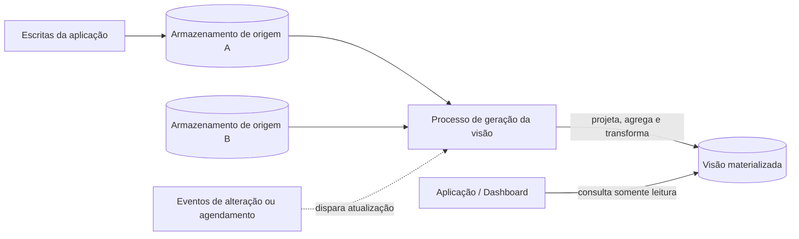

# Materialized View

## Descrição

O padrão Materialized View gera, com antecedência, visões pré-populadas sobre os dados de um ou mais armazenamentos quando esses dados não estão no formato ideal para as consultas necessárias. Em vez de montar o resultado a cada requisição (com junções, agregações e transformações caras), um componente dedicado calcula e persiste uma projeção já moldada para a leitura, contendo apenas os dados que a consulta precisa, incluindo valores calculados ou transformados.

A visão materializada é um modelo de leitura somente leitura para os consumidores e totalmente descartável: pode ser reconstruída a qualquer momento a partir das fontes. Ela pode residir em um armazenamento, partição ou tecnologia diferente da origem, o que permite combinar dados de várias fontes e escolher um repositório otimizado para leitura. O conceito é mais amplo que o objeto "materialized view" nativo de alguns bancos de dados: a projeção pode ser mantida por um processo da aplicação ou por um pipeline de dados.

Quando os dados de origem mudam, a visão precisa ser atualizada, seja em resposta a eventos de alteração, por agendamento, por gatilho externo ou manualmente. Na prática, ela funciona como um cache especializado, com uma janela de defasagem (staleness) que deve ser definida e monitorada.

## Problemas que resolve

- Consultas que precisam de apenas um subconjunto dos dados mas são obrigadas a ler entidades ou agregados inteiros (por exemplo, um resumo de pedidos sem os detalhes de cada item).
- Agregações e junções entre entidades, partições ou armazenamentos que são caras de calcular a cada requisição.
- Armazenamentos com capacidade de consulta limitada ou que não podem ganhar novos índices sem prejudicar a escrita.
- Dados em Event Sourcing, cujo estado atual só pode ser obtido reprocessando eventos.
- Necessidade de expor apenas um subconjunto restrito dos dados a certos consumidores, por motivos de segurança ou privacidade.

## Quando usar

- Os dados são difíceis de consultar diretamente ou exigem consultas muito complexas por estarem normalizados, semiestruturados ou não estruturados.
- Você quer projeções reconstruíveis ou transitórias que melhorem o desempenho de consulta ou moldem dados para uma UI, relatório ou dashboard.
- Há cenários ocasionalmente conectados ou desconectados, em que a visão pode ser mantida localmente.
- Você quer simplificar consultas e expor dados para análise sem exigir conhecimento do formato de origem.
- É preciso dar acesso a subconjuntos específicos dos dados que não devem ser expostos integralmente nem modificados.
- Você quer combinar armazenamentos diferentes, usando um otimizado para escrita como fonte e outro otimizado para leitura para as visões.
- Em microsserviços, para consolidar dados de vários serviços sem acoplar seus armazenamentos.

### Quando evitar

- Os dados de origem são simples e fáceis de consultar.
- Os dados de origem mudam muito rapidamente ou podem ser acessados sem uma visão; o custo de processamento não compensa.
- Consistência forte é prioridade, já que a visão pode não refletir imediatamente os dados de origem.
- Há muitas consultas distintas, cada uma exigindo sua própria visão, o que eleva demais armazenamento e custo.

## Trade-offs

| Ganho | Custo / Risco |
| --- | --- |
| Leituras rápidas e simples, sem recomputar junções e agregações a cada requisição | Dados potencialmente defasados (consistência eventual) |
| Menor consumo de recursos no caminho de leitura | Custo de computação para atualizar a visão, proporcional ao volume e à complexidade |
| Liberdade para usar um armazenamento otimizado para leitura | Armazenamento adicional e mais um componente para operar |
| Visão descartável, reconstruível a partir das fontes | Falhas silenciosas no sinal de atualização podem servir dados antigos sem aviso |
| Possibilidade de restringir dados expostos a consumidores | Risco de vazar dados se o pipeline incluir colunas ou linhas indevidas |

- **Estratégia de atualização:** escolha entre atualização orientada a eventos, agendada, por gatilho externo ou manual, a partir da janela de defasagem aceitável. Eventos muito frequentes podem gerar sobrecarga.
- **Reconstrução completa vs. incremental:** decida também se a atualização bloqueia leituras ou se a versão anterior continua servindo até a nova estar pronta.
- **Publicação atômica:** construa e valide uma nova versão da visão e só então troque, para nunca servir uma visão parcial após falha no meio do processo.
- **Observabilidade:** monitore a idade da visão e gere alertas quando ultrapassar a defasagem aceitável.
- **Índices e colunas calculadas:** agregam valor à leitura, mas aumentam o tempo e o custo de cada atualização.
- **Segurança e ciclo de vida dos dados:** aplique às visões os mesmos controles de acesso, retenção e exclusão da origem; trate as definições de visão como artefatos versionados e implantados via CI/CD.

## Diagrama

As escritas continuam indo para os armazenamentos de origem; um processo dedicado, acionado por eventos ou agendamento, gera a visão materializada já no formato da consulta, e as aplicações leem diretamente dela.

## Padrões relacionados

- [CQRS](/cloud/cloud-design-patterns/data-management/cqrs) — as visões materializadas são o modelo de leitura típico ao separar comandos e consultas.
- [Event Sourcing](/cloud/cloud-design-patterns/data-management/event-sourcing) — visões materializadas costumam ser necessárias para obter o estado atual a partir do fluxo de eventos.
- [Index Table](/cloud/cloud-design-patterns/data-management/index-table) — alternativa ou complemento para consultar por campos não indexados quando o armazenamento não suporta índices secundários.
- [Cache-Aside](/cloud/cloud-design-patterns/data-management/cache-aside) — a visão é um cache especializado e pode ser armazenada em uma camada de cache.
- [Sharding](/cloud/cloud-design-patterns/data-management/sharding) — visões podem consolidar dados distribuídos em várias partições para evitar consultas entre shards.

## Referência

- [Documentação no Azure Architecture Center](https://learn.microsoft.com/en-us/azure/architecture/patterns/materialized-view)
