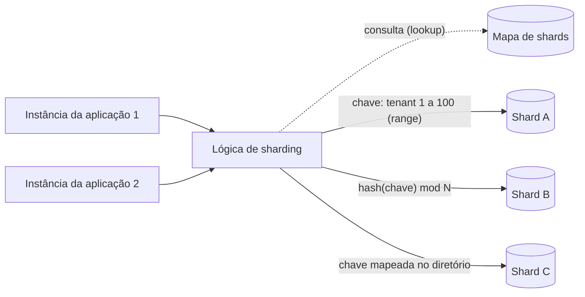

# Sharding

## Descrição

O padrão Sharding divide um armazenamento de dados em partições horizontais, chamadas *shards*. Todos os shards têm o mesmo esquema, mas cada um guarda um subconjunto distinto dos dados e roda em seu próprio nó de armazenamento. Assim o sistema cresce adicionando shards (escala horizontal), sem depender de um único servidor cada vez maior.

A distribuição dos dados é definida por uma **chave de shard** (ou *partition key*), formada por um ou mais atributos dos dados. Uma camada de lógica de sharding, que pode ficar no código de acesso a dados da aplicação ou no próprio armazenamento quando ele oferece sharding transparente, usa essa chave para encaminhar cada leitura e escrita ao shard correto. Como essa camada esconde a localização física dos dados, é possível mover dados entre shards sem alterar a lógica de negócio.

As estratégias mais comuns para mapear a chave ao shard são:

- **Lookup (diretório):** um mapa, consultado a cada acesso, associa cada valor de chave (por exemplo, o ID do tenant) a um shard. Com *shards virtuais*, muitas partições lógicas são mapeadas para menos partições físicas, e esse mapeamento pode mudar sem alterar o código da aplicação. Dá mais controle e facilita o rebalanceamento, mas a consulta ao mapa adiciona overhead. Por isso o mapa precisa ser fácil de cachear e replicar.
- **Range (intervalo):** itens com chaves sequenciais ficam juntos e ordenados no mesmo shard (por exemplo, pedidos de um mesmo mês). É simples de implementar e eficiente para consultas por intervalo, mas tende a gerar desbalanceamento e *hotspots*. Além disso, o rebalanceamento exige dividir e mesclar intervalos.
- **Hash:** o shard é calculado a partir de um hash de um ou mais atributos, o que espalha chaves sequenciais e equilibra volume e carga. Dispensa manter um mapa, mas com `hash(chave) mod N` adicionar ou remover shards realoca a maioria das chaves. O *consistent hashing* reduz bastante essa movimentação.

Também existe a estratégia **geográfica**, que coloca os dados perto dos usuários ou dentro de uma jurisdição exigida por lei. Ela costuma ser combinada com hash ou lookup dentro de cada região.

## Problemas que resolve

- O volume de dados passa da capacidade de armazenamento de um único servidor.
- O número de consultas e transações simultâneas passa do que um único nó consegue processar, gerando lentidão e timeouts.
- A largura de banda de rede de um único servidor vira gargalo.
- Requisitos legais ou de latência exigem guardar dados na mesma região geográfica dos usuários.
- Tenants ou segmentos de clientes precisam de isolamento físico de dados, por segurança, desempenho ou contrato.
- A escala vertical tem um teto e custa cada vez mais com hardware especializado.

## Quando usar

- O volume total de dados passa da capacidade de uma instância de banco e não há mais como escalar verticalmente.
- A vazão de escrita ou a concorrência de consultas passa do que uma instância suporta, e réplicas de leitura não resolvem porque a carga de escrita também é alta.
- Regulamentações exigem que subconjuntos de dados fiquem em jurisdições geográficas específicas.
- Tenants diferentes precisam de isolamento físico ou de níveis de serviço diferentes (por exemplo, shards dedicados para clientes de alto valor).
- Você quer limitar o raio de impacto de falhas ou de manutenção a uma parte dos dados.

### Quando evitar

- Os dados e a vazão cabem em uma única instância, mesmo considerando o crescimento previsto. A escala vertical mantém as consultas simples e preserva as transações.
- O gargalo está nas leituras. Réplicas de leitura e cache resolvem sem a complexidade de consultas entre shards.
- O particionamento de tabelas nativo do banco, dentro de uma única instância, já atende às necessidades.
- As consultas mais frequentes exigem joins entre entidades, transações com várias entidades ou agregações sobre todos os dados.
- Você usa um serviço gerenciado que já cuida do sharding (por exemplo, Azure Cosmos DB). Nesse caso, a responsabilidade se resume a escolher bem a chave de partição.

## Trade-offs

| Ganho | Custo / Risco |
| --- | --- |
| Escala horizontal de armazenamento, computação e rede adicionando shards | Complexidade permanente em desenvolvimento, testes, operação e recuperação |
| Isolamento de falhas: um shard com problema não derruba os demais | Consultas entre shards (*fan-out*) são mais caras, e o shard mais lento define a latência |
| Uso de vários recursos mais baratos em vez de um único recurso caro | Transações distribuídas são difíceis. Na prática, costuma-se aceitar consistência eventual |
| Menos contenção, porque cada requisição disputa recursos só dentro do seu shard | Risco de *hotspots* e de desbalanceamento com o tempo, o que exige rebalanceamento periódico |
| Dados próximos aos usuários e conformidade com residência de dados | Trocar a chave de shard depois exige migrar todos os dados, uma operação cara e arriscada |
| Manutenção e restauração de um shard sem tornar todos os dados indisponíveis | Backup, monitoramento e mudanças de esquema precisam ser coordenados em todos os shards |

- **Chave de shard:** é a decisão mais crítica. Escolha uma chave imutável, com alta cardinalidade e distribuição uniforme, alinhada às consultas mais frequentes para que a maioria delas acesse um único shard. Evite valores monotonicamente crescentes (autoincremento, timestamps sequenciais), atributos com baixa cardinalidade e atributos que mudam com frequência. Se nenhum atributo sozinho servir, use uma chave composta.
- **Unicidade:** campos de autoincremento não são coordenados entre shards e podem gerar IDs duplicados. Prefira identificadores globalmente únicos.
- **Consultas secundárias:** para buscar por atributos que não fazem parte da chave, use índices secundários (veja Index Table). Desnormalizar os dados ajuda a manter entidades relacionadas no mesmo shard.
- **Dados de referência:** replicar dados estáticos ou que mudam pouco em todos os shards evita idas a outro armazenamento, mas traz inconsistência temporária enquanto as cópias são sincronizadas.
- **Rebalanceamento:** muitos shards pequenos (ou shards virtuais) migram mais rápido e distribuem melhor a carga do que poucos shards grandes.
- **Observabilidade:** métricas e logs precisam ser agregados de todos os shards para dar uma visão completa da saúde do sistema.

## Diagrama

As instâncias da aplicação enviam as requisições para a lógica de sharding, que usa a chave de shard para descobrir o destino. Ela pode consultar um mapa (lookup), comparar a chave com intervalos (range) ou calcular um hash. Cada shard guarda um subconjunto distinto dos dados, e todos usam o mesmo esquema.

## Padrões relacionados

- [Index Table](/cloud/cloud-design-patterns/data-management/index-table): cria índices secundários para consultar dados por atributos que não fazem parte da chave de shard.
- [Materialized View](/cloud/cloud-design-patterns/data-management/materialized-view): pré-calcula visões que agregam dados de vários shards, evitando consultas *fan-out* caras.
- [Cache-Aside](/cloud/cloud-design-patterns/data-management/cache-aside): mantém em cache o mapa de shards (lookup) e dados muito acessados, reduzindo o overhead de roteamento.
- [Deployment Stamp](/cloud/cloud-design-patterns/deployment-and-topology/deployment-stamp): replica unidades completas de infraestrutura por grupo de tenants, levando a ideia de sharding para toda a pilha.
- [Geodes](/cloud/cloud-design-patterns/deployment-and-topology/geodes): distribui serviços e dados geograficamente, assim como a estratégia de sharding geográfica.
- [Compensating Transaction](/cloud/cloud-design-patterns/distributed-coordination/compensating-transaction): desfaz operações que atravessam vários shards quando não há transação distribuída.
- [Saga](/cloud/cloud-design-patterns/distributed-coordination/saga): coordena operações de várias etapas entre shards mantendo consistência eventual.
- [Bulkhead](/cloud/cloud-design-patterns/resiliency/bulkhead): isola recursos para que a falha de uma partição não afete as outras, o mesmo princípio de isolamento dos shards.

## Referência

- [Documentação no Azure Architecture Center](https://learn.microsoft.com/en-us/azure/architecture/patterns/sharding)
