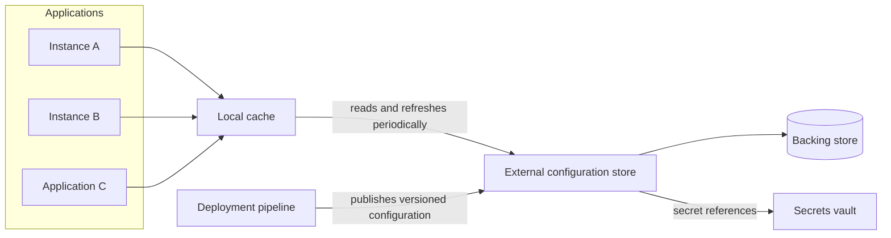

# External Configuration Store

## Descrição

O padrão External Configuration Store move as informações de configuração para fora do pacote de implantação da aplicação, levando-as para um repositório centralizado. Em vez de cada instância ler arquivos locais empacotados junto com o código, todas consultam uma mesma fonte externa por meio de uma interface que permite ler (e, quando autorizado, atualizar) as configurações de forma rápida, tipada e estruturada.

O repositório de apoio pode ser um serviço dedicado de configuração, um armazenamento em nuvem, um banco de dados ou um sistema próprio. A interface sobre ele costuma oferecer controle de acesso, versionamento (por ambiente, como desenvolvimento, homologação e produção, e por versão de release), escopos e herança de valores, além de um cache local para reduzir latência e tolerar falhas transitórias.

Como as configurações passam a alterar o comportamento das aplicações em tempo de execução, elas devem ser tratadas como artefatos de implantação: versionadas, revisadas, testadas e liberadas de forma progressiva, com possibilidade de reverter para um estado anterior. Segredos (senhas, chaves de API, certificados) ficam em um cofre de segredos dedicado e são apenas referenciados pelo repositório de configuração.

## Problemas que resolve

- Mudanças de configuração que exigem reimplantar a aplicação, com indisponibilidade e esforço administrativo.
- Configurações duplicadas entre várias aplicações que compartilham os mesmos valores (strings de conexão, URLs de filas e armazenamento, temas de interface).
- Instâncias de uma mesma aplicação rodando com configurações divergentes durante uma atualização.
- Sistemas de configuração locais que não suportam múltiplas versões de esquema ou tipos de dados mais complexos.
- Falta de auditoria e governança sobre quem altera configurações e quando.
- Em microsserviços, a necessidade de executar o mesmo serviço, sem modificação ou recompilação, em vários ambientes (desenvolvimento, teste, homologação, produção), cada um com instâncias distintas de bancos, brokers e serviços de terceiros (por exemplo, contas de pagamento de teste e de produção).

## Quando usar

- Quando é preciso compartilhar configurações entre várias aplicações ou instâncias, ou impor uma configuração padrão a todas elas.
- Quando o sistema de configuração nativo não suporta todos os tipos de valores necessários, como estruturas complexas ou dados binários.
- Quando se deseja um repositório complementar, permitindo que as aplicações sobrescrevam parte ou todos os valores centralizados.
- Quando se quer simplificar a administração de muitas aplicações e, opcionalmente, monitorar o uso das configurações registrando os acessos.
- Quando um serviço de microsserviços precisa ser promovido entre ambientes como o mesmo artefato (por exemplo, imagem de contêiner), recebendo localizações de rede e credenciais de fora.
- Quando se usa feature flags e liberações progressivas como parte de práticas de implantação segura.

### Quando evitar

- Quando a configuração é simples, local a uma única aplicação e só muda nos ciclos normais de release; o repositório externo adicionaria complexidade operacional sem benefício.
- Quando não é possível garantir a disponibilidade do repositório externo nem um mecanismo de fallback na inicialização da aplicação.

## Trade-offs

| Ganho | Custo / Risco |
| --- | --- |
| Alterar comportamento sem reimplantar a aplicação | Uma mudança errada propaga-se rapidamente para todas as aplicações que consomem o valor |
| Fonte única e consistente de configuração para várias aplicações e instâncias | O repositório vira dependência crítica; indisponibilidade na inicialização pode impedir o start |
| Versionamento, histórico e rollback de configurações | Necessidade de projetar esquema, escopos, herança e tratamento de valores ausentes ou inválidos |
| Auditoria e controle de acesso centralizados | Exige gestão rigorosa de permissões de leitura e escrita e separação de segredos |
| Suporte a feature flags e liberação progressiva | Caches locais introduzem janelas de inconsistência até a próxima atualização |

- **Disponibilidade:** escolha um repositório com alta disponibilidade e backup; considere replicação geográfica e leitura da réplica mais próxima.
- **Fallback na inicialização:** o cache resolve falhas transitórias em execução, mas não a indisponibilidade no start; inclua no pipeline uma cópia dos últimos valores conhecidos.
- **Atualização de cache:** defina política de expiração ou notificação de mudança para que as aplicações percebam novos valores.
- **Segurança:** separe permissões de leitura e escrita, criptografe valores sensíveis quando necessário e mantenha segredos em um cofre dedicado.
- **Governança:** trate mudanças de configuração com o mesmo processo de implantação do código (testes, staging, rollout progressivo), com auditoria de leituras e alterações.
- **Modelos pull e variações:** na forma mais simples, o serviço lê a configuração na inicialização (variáveis de ambiente, arquivos de propriedades, argumentos de linha de comando); em um repositório central ele consulta a fonte e pode atualizá-la em execução.
- **Validação no deploy:** é preciso verificar que a configuração fornecida corresponde ao que a aplicação espera (chaves, tipos e formatos) antes de liberar.
- **Robustez:** defina comportamento para chaves ausentes ou inválidas (valores padrão e registro de erros), sensibilidade a maiúsculas e valores nulos ou vazios.

## Diagrama

As aplicações leem as configurações por meio de um cache local, que é atualizado a partir do repositório externo centralizado; o pipeline publica versões de configuração no repositório, e os segredos permanecem em um cofre dedicado, apenas referenciados.

## Padrões relacionados

- [Cache-Aside](../data-management/cache-aside.md) — usado para armazenar em cache local as configurações lidas do repositório, melhorando desempenho e resiliência.
- [Retry](../resiliency/retry.md) — trata falhas transitórias ao acessar o repositório de configuração.
- [Circuit Breaker](../resiliency/circuit-breaker.md) — evita insistir em um repositório indisponível, recorrendo ao último valor conhecido.
- [Deployment Stamp](./deployment-stamp.md) — stamps costumam ler configurações específicas de cada unidade a partir de um repositório central.
- [Sidecar](../integration-and-modernization/sidecar.md) — um sidecar pode buscar e entregar configurações à aplicação sem alterar seu código.
- [Microservice Chassis](../../../architecture/microservices/cross-cutting-concerns/microservice-chassis.md) — o chassis costuma fornecer o mecanismo de leitura de configuração externa a todos os serviços.
- [Service Template](../../../architecture/microservices/cross-cutting-concerns/service-template.md) — o template já nasce preparado para receber configuração externalizada.
- [Client-side Discovery](../../../architecture/microservices/service-discovery/client-side-discovery.md) — a configuração pode usar nomes lógicos de serviço, resolvidos pela descoberta.
- [Valet Key](../security-and-access/valet-key.md) — complementa o controle de acesso restrito a recursos de armazenamento usados como repositório de apoio.

## Referência

- [Documentação no Azure Architecture Center](https://learn.microsoft.com/en-us/azure/architecture/patterns/external-configuration-store)
- [Externalized Configuration no microservices.io](https://microservices.io/patterns/externalized-configuration.html)
