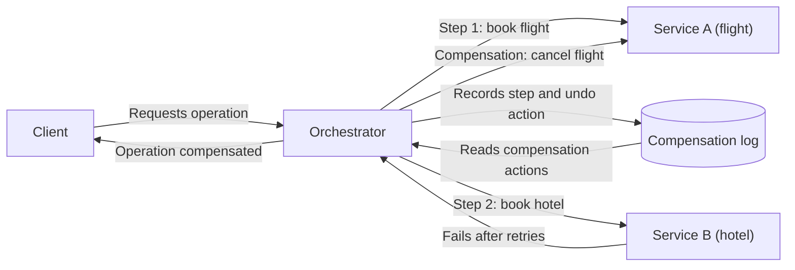

# Compensating Transaction

## Descrição

O padrão Compensating Transaction desfaz o trabalho já realizado quando uma ou mais etapas de uma operação com consistência eventual falham. Em sistemas distribuídos, uma operação de negócio costuma ser dividida em etapas independentes que alteram dados em vários serviços ou repositórios. Durante a execução, o sistema pode ficar temporariamente inconsistente, e não há uma transação atômica global capaz de fazer rollback de tudo.

A transação compensatória executa ações que neutralizam os efeitos das etapas já concluídas. Ela não restaura um snapshot do estado original, porque isso poderia sobrescrever alterações feitas por outras instâncias concorrentes. Cada compensação é uma ação de negócio, como cancelar uma reserva ou emitir um estorno parcial, e por isso depende da aplicação.

Na prática, um fluxo de trabalho (workflow) ou orquestrador registra, a cada etapa concluída, o que foi feito e como desfazê-lo. Se a operação falhar de forma irrecuperável, ou se o cliente pedir o cancelamento, o orquestrador percorre esse registro e executa as ações compensatórias, normalmente em ordem inversa, mas não obrigatoriamente: algumas podem rodar em paralelo ou ser priorizadas conforme a sensibilidade de cada repositório.

## Problemas que resolve

- Falhas parciais em operações que abrangem vários serviços ou repositórios de dados, sem suporte a transações distribuídas atômicas.
- Estados inconsistentes que permanecem no sistema quando uma etapa intermediária falha depois que outras já foram confirmadas.
- Necessidade de desfazer efeitos em serviços externos, como reservas, cobranças e alocações, que não podem ser revertidos por um simples rollback de banco de dados.
- Reversões que exigem regras de negócio, como multas de cancelamento ou reembolsos parciais.
- Cancelamento explícito, pelo cliente, de uma operação de longa duração que já foi concluída.

## Quando usar

- Uma operação de negócio envolve várias etapas, serviços ou repositórios e precisa ser desfeita se uma etapa posterior falhar.
- Fluxos de longa duração que seguem o modelo de consistência eventual e não podem depender de transações atômicas.
- A recuperação de falhas exige lógica de domínio, e não apenas um rollback de dados (por exemplo, cancelar reservas de voo e hotel de um itinerário).

### Quando evitar

- As operações podem ser repetidas com segurança e a maioria das falhas é transitória: a lógica de retry costuma bastar, e a compensação só acrescentaria complexidade.
- O sistema não tolera inconsistência temporária. Nesse caso, prefira mecanismos de consistência forte ou transações atômicas.
- A compensação não consegue levar o sistema de volta a um estado válido de forma confiável, por exemplo quando há efeitos externos irreversíveis.

## Trade-offs

| Ganho | Custo / Risco |
| --- | --- |
| Recuperação de falhas parciais sem transações distribuídas | A lógica de compensação é específica da aplicação e difícil de generalizar |
| Permite consistência eventual, menos contenção e mais desempenho | Janelas de inconsistência visíveis enquanto as etapas e as compensações rodam |
| Reversão orientada a regras de negócio (estornos, multas, alternativas) | A própria compensação pode falhar e precisa ser idempotente e retomável |
| Possibilidade de cancelar operações já concluídas | Exige persistência confiável do estado e das ações de desfazer de cada etapa |
| Rastreabilidade de ponta a ponta da operação e da compensação | Mais complexidade operacional: correlação, auditoria, alertas e intervenção manual |

Considerações adicionais:

- **Detecção de falha:** uma etapa pode ficar bloqueada em vez de falhar. Use timeouts para decidir quando ela falhou.
- **Retry primeiro:** trate erros como transitórios e tente de novo. Acione a compensação somente quando os retries se esgotarem ou a falha não for recuperável.
- **Idempotência:** cada etapa e cada ação compensatória podem rodar mais de uma vez, então devem ser idempotentes.
- **Estado não idêntico:** a compensação neutraliza o trabalho feito. Ela não garante voltar exatamente ao estado inicial, porque outras transações podem ter alterado os dados no meio do caminho.
- **Ordem flexível:** desfaça primeiro as alterações nos repositórios mais sensíveis a inconsistência e paralelize o que for possível.
- **Pontos sem retorno:** identifique as etapas irreversíveis (efeitos externos, ações com valor legal) e coloque-as depois de todas as validações críticas.
- **Bloqueios de curta duração:** reservar recursos com locks temporários antes de executar o trabalho reduz a chance de precisar compensar.
- **Intervenção humana:** em decisões ambíguas ou de alto impacto, pause o fluxo para revisão manual. Quando a compensação falhar repetidamente, gere alertas com detalhes e IDs de correlação.
- **Infraestrutura resiliente:** o armazenamento e o transporte das etapas não podem perder as informações necessárias para compensar. Uma fila com dead-letter queue, como o Azure Service Bus, é um exemplo.

## Diagrama

O orquestrador executa as etapas e registra, para cada etapa concluída, a ação que a desfaz. Quando a etapa 2 falha de forma irrecuperável, ele lê esse registro e aciona as compensações em ordem inversa, deixando o sistema em um estado consistente.

## Padrões relacionados

- [Saga](./saga.md): gerencia a consistência de dados entre microsserviços e usa transações compensatórias para se recuperar de falhas.
- [Retry](../resiliency/retry.md): trata falhas transitórias e reduz a necessidade de acionar compensações.
- [Idempotent Consumer](../messaging/idempotent-consumer.md): garante que etapas e compensações reexecutadas não produzam efeitos duplicados.
- [Scheduler Agent Supervisor](./scheduler-agent-supervisor.md): coordena operações distribuídas e pode acionar transações compensatórias para desfazer trabalho.
- [Pipes and Filters](../messaging/pipes-and-filters.md): decompõe tarefas complexas em etapas reutilizáveis, como alternativa a transações distribuídas.
- [Choreography](./choreography.md): forma descentralizada de coordenar etapas e suas compensações por meio de eventos.

## Referência

- [Documentação no Azure Architecture Center](https://learn.microsoft.com/en-us/azure/architecture/patterns/compensating-transaction)
