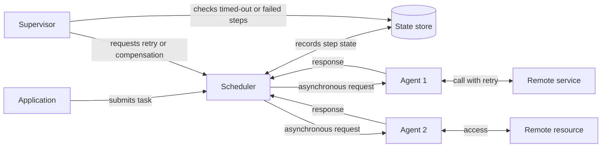

# Scheduler Agent Supervisor

## Descrição

O padrão Scheduler Agent Supervisor coordena um conjunto de ações distribuídas como uma única operação lógica: ou a operação inteira é concluída com sucesso, ou o trabalho já feito é desfeito. Ele trata falhas de forma transparente, recuperando-se de erros transitórios, falhas mais duradouras e quedas de processo que interrompem fluxos de várias etapas envolvendo serviços e recursos remotos.

A solução é dividida em três papéis lógicos. O **Scheduler** organiza as etapas da tarefa em um fluxo, executa-as na ordem correta e registra o estado de cada uma (não iniciada, em execução, concluída) em um **state store** durável, junto com um prazo limite (*complete-by*). Cada **Agent** encapsula a chamada a um serviço ou recurso remoto, aplicando tratamento de erros e retentativas dentro do prazo imposto, geralmente comunicando-se com o Scheduler por mensagens assíncronas de requisição e resposta. O **Supervisor** roda periodicamente, examina o state store em busca de etapas que falharam ou expiraram e solicita a recuperação: repetir a etapa ou desfazer a tarefa inteira por meio de uma transação de compensação.

Os papéis são lógicos e podem ser implementados de várias formas (por exemplo, um motor de orquestração durável como Scheduler, filas como canal com os Agents e um job agendado como Supervisor). Como todo o progresso fica no state store, qualquer instância do Scheduler, Agent ou Supervisor pode falhar e ser substituída sem perder o andamento da tarefa, o que torna o sistema autorrecuperável.

## Problemas que resolve

- Tarefas de várias etapas que dependem de serviços remotos ficam expostas a falhas de rede, indisponibilidade e lentidão, podendo terminar em estado inconsistente.
- Falhas não transitórias ou a queda do próprio orquestrador não são cobertas por retentativas simples (como o padrão Retry).
- Etapas travadas ou que excedem o tempo esperado passam despercebidas e bloqueiam trabalho indefinidamente.
- Falta de um registro durável do progresso impede retomar ou desfazer uma operação após uma falha.
- Necessidade de distribuir etapas entre workers com capacidade disponível, separando orquestração de execução.

## Quando usar

- Processos em ambientes distribuídos que precisam ser resilientes a falhas de comunicação e operacionais nos serviços e recursos que coordenam.
- Jobs em segundo plano que orquestram fluxos de várias etapas envolvendo recursos remotos e que devem ser concluídos ou desfeitos de forma limpa (por exemplo, processamento de pedidos ou provisionamento de recursos).
- Fluxos de longa duração em que é preciso detectar etapas expiradas e decidir entre repetir, compensar ou escalar para um operador.

### Quando evitar

- A tarefa não invoca serviços remotos nem acessa recursos remotos: não há superfície de falha distribuída a mitigar, e a coordenação só adiciona custo.
- Operações simples e de uma única etapa, em que retentativas locais (padrão Retry) bastam.
- Cenários em que a equipe não consegue arcar com a complexidade de testar todos os modos de falha, versionar estado e manter compensações.

## Trade-offs

| Ganho | Custo / Risco |
| --- | --- |
| Resiliência a falhas transitórias e permanentes, com autorrecuperação | Implementação complexa; exige testes de injeção de falhas para cada modo de falha |
| Estado durável permite retomar tarefas após quedas do Scheduler ou dos Agents | O state store e o log de compensação viram ativos críticos que precisam de alta disponibilidade e backup |
| Detecção automática de etapas travadas ou expiradas pelo Supervisor | A frequência do Supervisor equilibra atraso de detecção contra carga e custo no state store |
| Escalabilidade: etapas despachadas para Agents com capacidade, prioridades possíveis | Etapas podem rodar mais de uma vez; toda etapa precisa ser idempotente |
| Opção de desfazer a tarefa via compensação | Compensações podem falhar ou travar, e o modelo de estado precisa representar isso |

- **Amplificação de retentativas:** retentativas independentes no Agent, no runtime, nas bibliotecas, no sistema de mensagens e no Supervisor se multiplicam. Defina um orçamento de retentativas de ponta a ponta sob responsabilidade do Scheduler.
- **Controle de admissão:** o padrão não limita o trabalho em andamento; use filas limitadas, teto de tarefas simultâneas ou rejeição de novas submissões para gerar backpressure.
- **Escrita dupla:** gravar o registro de negócio e o registro no state store não é atômico; use chaves estáveis para tornar cada escrita repetível ou o padrão Transactional Outbox.
- **Versionamento:** tarefas longas atravessam deploys; versione a lógica do fluxo e o formato do estado persistido.
- **Estados de compensação:** diferencie "compensação em andamento", "concluída" e "falhou" em vez de um único estado de erro.
- **Concorrência:** com múltiplos Supervisors ou Schedulers, use atualizações condicionais ou eleição de líder para evitar que dois recuperem a mesma etapa.
- **Observabilidade:** o comportamento está nas transições do state store; defina métricas, eventos e alertas para etapas expiradas e falhas recorrentes.

## Diagrama

O Scheduler executa as etapas, delega chamadas remotas aos Agents e grava o progresso no state store. O Supervisor varre periodicamente esse estado e, ao encontrar etapas que falharam ou excederam o prazo, solicita ao Scheduler uma nova tentativa ou a compensação da tarefa.

## Padrões relacionados

- [Retry](../resiliency/retry.md) — usado pelos Agents para lidar com falhas transitórias dentro do prazo da etapa.
- [Compensating Transaction](./compensating-transaction.md) — permite desfazer as etapas já concluídas quando a tarefa não pode ser finalizada.
- [Idempotent Consumer](../messaging/idempotent-consumer.md) — necessário porque uma etapa pode ser executada mais de uma vez após recuperação.
- [Leader Election](./leader-election.md) — coordena múltiplas instâncias do Supervisor para que não disputem a mesma recuperação.
- [Asynchronous Request-Reply](../messaging/asynchronous-request-reply.md) — modelo de comunicação entre Scheduler e Agents.
- [Saga](./saga.md) — abordagem relacionada para manter consistência em transações distribuídas de várias etapas.
- [Circuit Breaker](../resiliency/circuit-breaker.md) — evita que Agents sobrecarreguem um serviço remoto com falhas persistentes.
- [Queue-Based Load Leveling](../messaging/queue-based-load-leveling.md) — filas entre Scheduler e Agents absorvem picos e ajudam no controle de admissão.

## Referência

- [Documentação no Azure Architecture Center](https://learn.microsoft.com/en-us/azure/architecture/patterns/scheduler-agent-supervisor)
