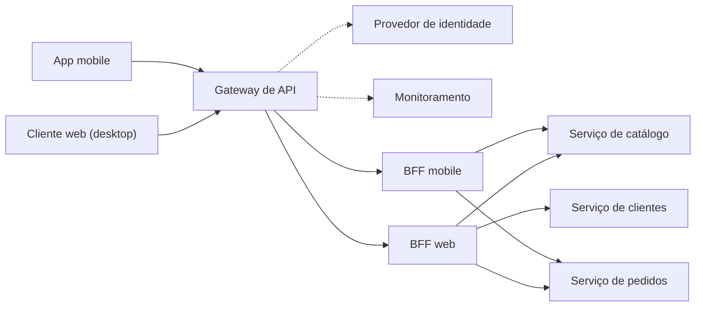

# Backends for Frontends

## Descrição

O padrão Backends for Frontends (BFF) propõe criar um serviço de backend separado para cada interface de frontend (por exemplo, aplicação web, app mobile, dispositivos embarcados), em vez de usar um único backend de propósito geral para todas elas. Cada BFF fica entre o cliente e os serviços de backend, concentrando apenas a lógica específica daquela experiência de usuário: formato e tamanho das respostas, agregação de chamadas, paginação e adaptação às limitações do dispositivo.

Como cada BFF é menor e mais simples que um backend compartilhado, ele pode ser ajustado às necessidades do seu frontend sem afetar as demais interfaces. Em geral, o próprio time do frontend é dono do seu BFF, o que lhe dá autonomia sobre linguagem, cadência de releases, prioridades e integração de funcionalidades, sem depender de um time central de backend.

Preocupações transversais, como autenticação, autorização, monitoramento, limitação de taxa e roteamento, não devem ficar no BFF; elas costumam ser tratadas em uma camada comum, como um gateway de API, que encaminha cada requisição ao BFF adequado. O padrão foi popularizado por Sam Newman.

No contexto de microsserviços (microservices.io), o BFF é uma variação do API Gateway em que cada tipo de cliente recebe seu próprio gateway dedicado, por exemplo um para a aplicação web, outro para o app mobile e outro para aplicações de terceiros que consomem uma API pública. Cada gateway oferece uma API desenhada para o seu cliente, escondendo do cliente a partição em serviços e reduzindo os round trips, o que é especialmente importante em redes móveis.

## Problemas que resolve

- Um backend único recebe demandas concorrentes e às vezes conflitantes de vários frontends, gerando atualizações frequentes e gargalos de desenvolvimento.
- Necessidade de manter compatibilidade entre clientes faz com que um único artefato implantável concentre mudanças em excesso.
- Desconexão entre times de frontend e um time separado de backend, com atrasos para obter consenso; mudanças pedidas por um frontend precisam ser validadas pelos outros.
- Clientes com capacidades muito diferentes (tamanho de tela, banda, processamento) recebendo as mesmas respostas genéricas, com excesso ou falta de dados e muitas chamadas de rede.
- Serviços de granularidade fina não casam com as necessidades de dados dos clientes, e redes móveis (alta latência) só toleram poucas chamadas, ao contrário de uma aplicação web no servidor.
- Falhas ou picos de uso de um tipo de cliente afetando a disponibilidade dos demais.

## Quando usar

- Um backend compartilhado ou de propósito geral exige esforço significativo de desenvolvimento e manutenção.
- Você quer otimizar o backend para os requisitos de interfaces de cliente específicas (por exemplo, economia de banda no mobile, respostas mais ricas no desktop).
- O backend de propósito geral já está acumulando customizações para acomodar múltiplas interfaces.
- Uma linguagem ou stack é mais adequada ao backend de uma interface específica, mas não de todas.
- Uma arquitetura de microsserviços exige APIs distintas para clientes web, mobile e de terceiros, e um único API Gateway compartilhado viraria gargalo de desenvolvimento.
- Times de frontend precisam de autonomia e ciclos de entrega independentes.

### Quando evitar

- As interfaces fazem requisições iguais ou muito parecidas ao backend.
- Apenas uma interface consome o backend.
- Um mecanismo de consulta flexível (como GraphQL com resolvers específicos por frontend) já permite que cada cliente peça exatamente os dados de que precisa.
- Um gateway de API combinado com microsserviços já atende às necessidades de adaptação por cliente.
- O time não tem capacidade de operar e manter vários serviços adicionais.

## Trade-offs

| Ganho | Custo / Risco |
| --- | --- |
| Experiência e desempenho ajustados a cada tipo de cliente | Mais serviços para implantar, monitorar, proteger e manter |
| Isolamento de falhas: problemas em um BFF não derrubam os outros clientes | Salto de rede adicional, com possível aumento de latência |
| Superfície de API reduzida e autorização ajustada por cliente | Duplicação de código entre BFFs |
| Autonomia dos times de frontend e releases independentes | Risco de lógica de negócio vazar para os BFFs |
| Backends centrais mais simples e estáveis | Curva de aprendizado e possível dívida técnica no início |

- **Custo e operação:** avalie o número ideal de BFFs; cada um tem ciclo de vida, pipeline, requisitos de segurança e custos próprios.
- **Latência e SLOs:** revise os objetivos de nível de serviço, considerando o salto extra entre cliente e backend.
- **Consolidação:** se diferentes interfaces fazem as mesmas requisições, considere um BFF compartilhado, ponderando o risco de requisitos divergentes complicarem sua evolução.
- **Responsabilidade:** mantenha no BFF apenas lógica específica da experiência do usuário; regras de negócio ficam nos serviços de backend e preocupações transversais em uma camada comum.
- **Implementação:** gateways sob carga alta se beneficiam de I/O não bloqueante e orientado a eventos; proteja as chamadas aos serviços com Circuit Breaker.
- **Observabilidade:** use rastreamento distribuído e correlação de requisições para acompanhar o fluxo cliente, gateway, BFF e microsserviços.

## Diagrama

Os clientes passam por um gateway que trata autenticação, autorização e monitoramento e roteia cada requisição ao BFF da sua interface. Cada BFF agrega e adapta as chamadas aos serviços de backend para a necessidade do cliente: o BFF mobile devolve respostas leves e paginadas, e o BFF web pode agregar várias páginas e mais dados em uma única resposta. Em uma implementação no Azure, por exemplo, o gateway poderia ser o API Management e os BFFs poderiam ser Azure Functions.

## Padrões relacionados

- [API Gateway](/architecture/microservices/external-api/api-gateway) — o BFF é a variação do API Gateway com um gateway por tipo de cliente.
- [API Composition](/architecture/microservices/service-collaboration/api-composition) — um BFF costuma implementá-lo para combinar dados de vários serviços.
- [Microservice Architecture](/architecture/microservices/architectural-style/microservice-architecture) — o estilo arquitetural que motiva a necessidade de BFFs.
- [Gateway Aggregation](/cloud/cloud-design-patterns/gateways-and-edge/gateway-aggregation) — um BFF frequentemente agrega chamadas a vários serviços para reduzir as requisições do cliente.
- [Gateway Offloading](/cloud/cloud-design-patterns/gateways-and-edge/gateway-offloading) — transfere preocupações transversais (TLS, autenticação, monitoramento) para o gateway, mantendo os BFFs focados na experiência do cliente.
- [Gateway Routing](/cloud/cloud-design-patterns/gateways-and-edge/gateway-routing) — encaminha cada requisição ao BFF correto a partir de um único ponto de entrada.
- [Gatekeeper](/cloud/cloud-design-patterns/security-and-access/gatekeeper) — protege os BFFs e os serviços de backend validando e higienizando requisições antes de chegarem a eles.
- [Rate Limiting](/cloud/cloud-design-patterns/resiliency/rate-limiting-pattern) — controla o volume de chamadas que os BFFs fazem aos serviços de backend.
- [Bulkhead](/cloud/cloud-design-patterns/resiliency/bulkhead) — o isolamento por cliente proporcionado pelos BFFs segue o mesmo princípio de conter falhas em compartimentos.
- [Cache-Aside](/cloud/cloud-design-patterns/data-management/cache-aside) — BFFs e gateways podem usar cache para otimizar respostas repetidas, especialmente para clientes mobile.

## Referência

- [Documentação no Azure Architecture Center](https://learn.microsoft.com/en-us/azure/architecture/patterns/backends-for-frontends)
- [Backend for Front-end no microservices.io](https://microservices.io/patterns/apigateway.html)
