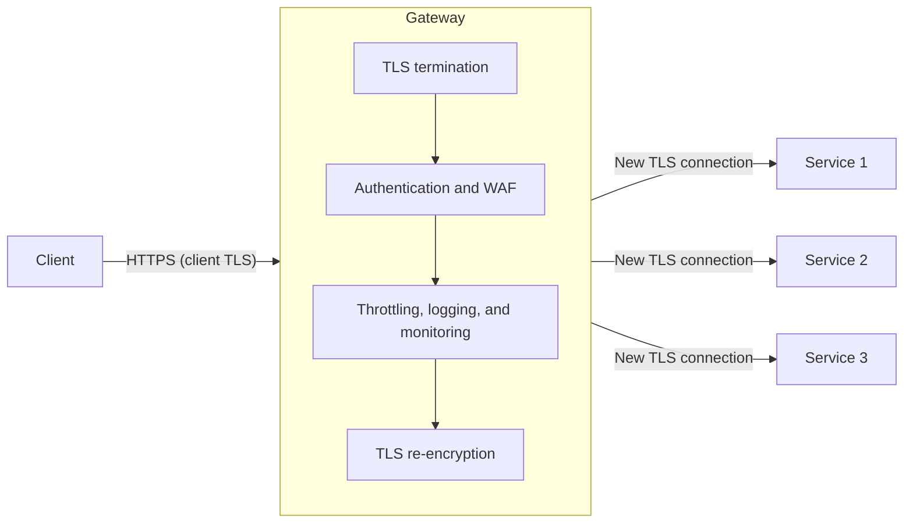

# Gateway Offloading

## Descrição

O padrão Gateway Offloading transfere para um gateway (proxy reverso) funcionalidades compartilhadas ou especializadas que, de outra forma, precisariam ser implementadas e mantidas em cada serviço de backend. São as chamadas preocupações transversais (*cross-cutting concerns*): terminação TLS e gestão de certificados voltados ao cliente, autenticação, limitação de taxa (*throttling*), registro de requisições, monitoramento, tradução de protocolos e até redirecionamentos estáticos de URLs legadas.

O gateway fica na borda do sistema, recebe as conexões dos clientes, aplica essas capacidades de forma centralizada e encaminha a requisição ao backend — idealmente por uma nova conexão criptografada. Assim, os serviços de backend ficam mais simples e focados na lógica de negócio, enquanto equipes especializadas (por exemplo, de segurança ou de rede) cuidam das funcionalidades centralizadas.

A lógica de negócio nunca deve ser transferida para o gateway: ele concentra apenas funções genéricas, compartilhadas por vários serviços ou rotas.

## Problemas que resolve

- Duplicação da configuração, gestão e manutenção de funcionalidades comuns em todas as implantações de cada serviço.
- Risco de erro de implantação ao propagar atualizações de um recurso compartilhado (por exemplo, renovar um certificado) por muitas instâncias.
- Necessidade de conhecimento altamente especializado (validação de tokens, criptografia, gestão de certificados TLS) espalhada entre todas as equipes de produto.
- Dificuldade de implementar de forma consistente autenticação, autorização, logging, monitoramento e throttling em um grande número de serviços.
- Falta de uma linha de base de observabilidade quando algum serviço não está corretamente instrumentado.
- Tratamento de URLs legadas espalhado pelo pipeline de cada aplicação.

## Quando usar

- Quando várias implantações compartilham uma preocupação comum, como certificados TLS ou criptografia.
- Quando uma funcionalidade comum entre aplicações tem requisitos de recursos distintos (memória, armazenamento, conexões de rede) e se beneficia de ser escalada separadamente.
- Quando se deseja transferir para uma equipe especializada a responsabilidade por segurança de rede, throttling ou outras preocupações de borda.
- Quando se quer padronizar políticas (por exemplo, WAF, política de TLS, limites de taxa) em um único ponto de controle.

### Quando evitar

- Quando o gateway precisaria conter lógica ou regras de roteamento específicas de cada serviço, acoplando mudanças do backend a mudanças na configuração do gateway e reduzindo a independência de implantação.
- Quando a funcionalidade transferida é leve e a carga de trabalho é muito sensível à latência, de modo que o salto adicional de rede não compensa.
- Quando a centralização cria um gargalo de gestão de mudanças, por exemplo se o ciclo de release da equipe do gateway é mais lento que o das equipes de serviço.

## Trade-offs

| Ganho | Custo / Risco |
| --- | --- |
| Serviços de backend mais simples, sem código de infraestrutura duplicado | O gateway torna-se ponto único de falha se não houver múltiplas instâncias e alta disponibilidade |
| Gestão de certificados, políticas e configuração em um único lugar | Concentração da responsabilidade operacional em uma equipe e um componente compartilhado |
| Segurança consistente (WAF, autenticação, política de TLS) | O gateway é um alvo de alto valor: um comprometimento expõe todos os serviços a jusante |
| Observabilidade de base mesmo para serviços pouco instrumentados | Salto de rede extra e tempo de processamento adicional em cada requisição |
| Menor consumo de recursos por nó e custo consolidado | Precisa ser dimensionado para picos, senão vira gargalo para todos os serviços |

Considerações adicionais:

- **Alta disponibilidade:** execute várias instâncias e use *connection draining* ou desligamento gracioso para não derrubar requisições em andamento.
- **Prevenção de bypass:** configure os backends para aceitarem tráfego somente pelo gateway, caso contrário autenticação, throttling e inspeção podem ser contornados.
- **TLS ponta a ponta:** ao terminar o TLS no gateway, restabeleça TLS até o backend; trate todas as redes como não confiáveis e mantenha um processo de emissão, rotação e revogação dos certificados de backend.
- **Propagação de identidade:** defina se o backend autoriza o chamador original, a identidade do gateway ou ambos; autentique o gateway no backend e não confie em cabeçalhos encaminhados sem verificação.
- **Contexto do cliente:** IP de origem, protocolo e nome de host originais se perdem a menos que o gateway os encaminhe explicitamente (por exemplo, cabeçalhos `X-Forwarded-*`).
- **Rastreabilidade:** gere IDs de correlação para acompanhar transações entre gateway e serviços.
- **Latência:** *connection pooling* e conexões *keep-alive* com os backends reduzem parcialmente o custo do salto extra.
- **Redirecionamentos:** corresponda apenas às URLs legadas pretendidas; redirecionamentos que dependem de estado de negócio ou autorização ficam na aplicação.

## Diagrama

O cliente se conecta ao gateway, que termina o TLS, aplica as capacidades compartilhadas (autenticação, inspeção, limitação de taxa, logging) e abre novas conexões criptografadas com os serviços de backend, que ficam livres dessas responsabilidades. Como exemplo pontual, um serviço como o Azure Application Gateway com WAF pode desempenhar esse papel.

## Padrões relacionados

- [Gateway Routing](./gateway-routing.md) — usa o mesmo gateway para rotear requisições a múltiplos serviços por um único endpoint.
- [Gateway Aggregation](./gateway-aggregation.md) — o gateway combina várias chamadas de backend em uma única resposta ao cliente.
- [Backends for Frontends](./backends-for-frontends.md) — gateways dedicados por tipo de cliente, que também podem concentrar funções transferidas.
- [Gatekeeper](../security-and-access/gatekeeper.md) — um host dedicado que valida e sanitiza requisições antes de repassá-las, reforçando a segurança na borda.
- [Throttling](../resiliency/throttling.md) — uma das funcionalidades mais comuns de ser transferida para o gateway.
- [Rate Limiting](../resiliency/rate-limiting-pattern.md) — controle de taxa de chamadas que pode ser aplicado de forma centralizada.
- [Federated Identity](../security-and-access/federated-identity.md) — a autenticação delegada a um provedor de identidade costuma ser validada no gateway.
- [Sidecar](../integration-and-modernization/sidecar.md) — alternativa que transfere preocupações transversais para um processo ao lado de cada serviço, em vez de um ponto central.
- [Ambassador](../integration-and-modernization/ambassador.md) — proxy que transfere tarefas de conectividade do lado do cliente, complementar ao gateway na borda.

## Referência

- [Documentação no Azure Architecture Center](https://learn.microsoft.com/en-us/azure/architecture/patterns/gateway-offloading)
