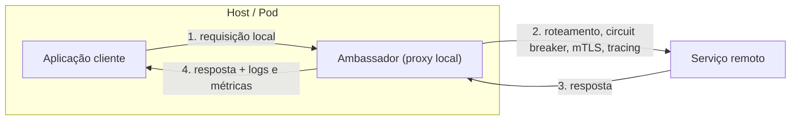

# Ambassador

## Descrição

O padrão Ambassador cria serviços auxiliares que enviam requisições de rede em nome de uma aplicação ou serviço consumidor. O ambassador funciona como um proxy fora do processo da aplicação, implantado junto dela (no mesmo host, VM ou pod), de modo que a aplicação passa a falar apenas com esse proxy local em vez de chamar diretamente os serviços remotos.

Com isso, tarefas transversais de conectividade do cliente, como monitoramento, logging, roteamento, criptografia (TLS/mTLS), autenticação e padrões de resiliência (retry, circuit breaker), saem do código da aplicação e passam para um componente independente de linguagem. O ambassador pode ser atualizado, configurado e operado separadamente, muitas vezes por equipes especializadas em rede, segurança ou plataforma.

O ambassador pode ser implantado como um sidecar que acompanha o ciclo de vida da aplicação, como um daemon ou serviço do sistema compartilhado por vários processos do mesmo host, ou, em ambientes conteinerizados, como um contêiner separado ao lado do contêiner da aplicação.

## Problemas que resolve

- Aplicações legadas ou difíceis de modificar que precisam de recursos modernos de conectividade (circuit breaking, roteamento, métricas, atualização de configuração de rede).
- Configuração repetida de conexão, autenticação e autorização em várias aplicações escritas em linguagens e frameworks diferentes.
- Risco de uma equipe central de rede ou segurança ter de alterar código de aplicações que não conhece.
- Falta de instrumentação padronizada (latência, uso de recursos, tracing) nas chamadas de saída.
- Necessidade de aplicar controles de segurança (criptografia, autenticação mútua) que o cliente não consegue implementar diretamente.

## Quando usar

- Quando for preciso construir um conjunto comum de recursos de conectividade de cliente para várias linguagens ou frameworks.
- Quando preocupações transversais de conectividade devem ser delegadas a equipes de infraestrutura ou outras equipes especializadas.
- Quando uma aplicação legada ou difícil de alterar precisa atender a requisitos de conectividade de nuvem ou cluster.
- Quando é necessário suportar protocolos ou padrões de conectividade que API gateways, service meshes ou controles padrão de entrada e saída não tratam com facilidade.

### Quando evitar

- Quando a latência das requisições de rede é crítica e mesmo o pequeno overhead do proxy é inaceitável.
- Quando os recursos de conectividade são consumidos por uma única linguagem; uma biblioteca cliente distribuída como pacote tende a ser mais simples.
- Quando os recursos de conectividade não podem ser generalizados e exigem integração profunda com a lógica da aplicação.
- Quando a plataforma já oferece soluções prontas, como um service mesh, para mTLS, gerenciamento de tráfego e políticas; prefira-as a um ambassador customizado.

## Trade-offs

| Ganho | Custo / Risco |
| --- | --- |
| Resiliência (retry, circuit breaker, buffering) aplicada sem alterar a aplicação | Latência adicional a cada chamada por causa do salto extra no proxy |
| Segurança de rede (TLS/mTLS, autenticação) centralizada e independente de linguagem | Mais um componente para empacotar, implantar, versionar e monitorar |
| Equipes especializadas evoluem rede e segurança sem tocar no código da aplicação | Retries genéricos podem ser perigosos se as operações não forem idempotentes |
| Instrumentação e telemetria padronizadas nas chamadas de saída | Instância compartilhada vira ponto único de falha e de contenção; instância por cliente consome mais recursos |

- **Contexto entre cliente e proxy:** defina um mecanismo para a aplicação passar instruções ao ambassador, por exemplo cabeçalhos que desativam o retry ou limitam o número de tentativas.
- **Modelo de implantação:** escolha entre uma instância por cliente (sidecar) ou uma instância compartilhada por host, pesando isolamento contra consumo de recursos.
- **Idempotência:** só habilite retries automáticos para operações que possam ser repetidas com segurança.
- **Observabilidade:** o ambassador é um ponto natural para medir latência, registrar chamadas e propagar informações de tracing.
- **Complexidade operacional:** o ciclo de vida do proxy (atualizações, configuração, saúde) precisa ser gerenciado junto com o da aplicação.

## Diagrama

A aplicação envia suas requisições ao ambassador colocalizado no mesmo host, que resolve o destino, aplica resiliência e segurança, encaminha a chamada ao serviço remoto e devolve a resposta, registrando métricas como a latência. Como exemplo pontual, no Azure Kubernetes Service o ambassador costuma rodar como um contêiner sidecar no mesmo pod da aplicação.

## Padrões relacionados

- [Sidecar](/cloud/cloud-design-patterns/integration-and-modernization/sidecar) — o ambassador é uma especialização do sidecar voltada a conectividade de saída e é frequentemente implantado dessa forma.
- [Circuit Breaker](/cloud/cloud-design-patterns/resiliency/circuit-breaker) — uma das funcionalidades de resiliência mais comuns de implementar dentro do ambassador.
- [Retry](/cloud/cloud-design-patterns/resiliency/retry) — o ambassador pode aplicar novas tentativas de forma transparente, desde que as operações sejam idempotentes.
- [Gateway Offloading](/cloud/cloud-design-patterns/gateways-and-edge/gateway-offloading) — também descarrega preocupações transversais, mas de forma centralizada no lado do servidor, e não junto ao cliente.
- [Anti-Corruption Layer](/cloud/cloud-design-patterns/integration-and-modernization/anti-corruption-layer) — também se interpõe entre a aplicação e sistemas externos, porém para traduzir semântica, e não para tratar conectividade.

## Referência

- [Documentação no Azure Architecture Center](https://learn.microsoft.com/en-us/azure/architecture/patterns/ambassador)
