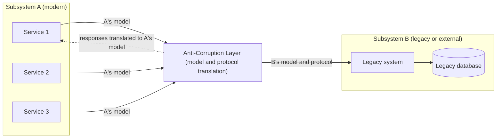

# Anti-Corruption Layer

## Descrição

O Anti-Corruption Layer (camada anticorrupção) é uma fachada ou camada de adaptação colocada entre subsistemas que não compartilham a mesma semântica. Ela traduz as requisições que um subsistema faz ao outro, de modo que as dependências de sistemas externos ou legados não limitem o design da aplicação. O padrão foi descrito originalmente por Eric Evans no livro *Domain-Driven Design*.

O subsistema A sempre se comunica com a camada usando o próprio modelo de dados e a própria arquitetura. A camada, por sua vez, chama o subsistema B respeitando o modelo, os protocolos e as APIs dele. Toda a lógica de tradução (de esquemas, protocolos, formatos e conceitos de domínio) fica concentrada nessa camada, que pode ser implementada como um componente dentro da aplicação ou como um serviço independente.

Assim, um dos lados pode continuar inalterado sem comprometer o design e as escolhas tecnológicas do outro. O padrão é especialmente útil em migrações graduais, nas quais funcionalidades são movidas aos poucos de um sistema legado para um sistema moderno.

Na visão do Domain-Driven Design, a camada é um padrão de Context Mapping: ela protege o modelo de um Bounded Context downstream da influência do modelo de outro contexto, que pode ser legado, de terceiros ou simplesmente mal alinhado ao domínio. Evans a descreve como uma combinação de Facade, Adapter e tradutores: a fachada oferece ao contexto uma interface simples na linguagem dele, o adaptador conversa com o sistema externo e os tradutores convertem conceitos e estruturas entre os dois modelos. É uma alternativa ao Conformist, quando adotar o modelo do upstream comprometeria o domínio.

No contexto de microsserviços (microservices.io), o padrão responde à pergunta de como impedir que o modelo de domínio de um monólito legado contamine o modelo de domínio de um novo serviço. Ao extrair um serviço do monólito, a camada traduz entre os dois modelos, permitindo que o serviço nasça com o próprio vocabulário e as próprias invariantes.

## Problemas que resolve

- Sistemas legados com esquemas de dados confusos, APIs obsoletas ou protocolos antigos "contaminando" o modelo de domínio de uma aplicação nova.
- Necessidade de a aplicação moderna suportar infraestrutura, formatos ou semânticas ultrapassadas apenas para interoperar com o legado.
- Acoplamento a sistemas externos que a equipe não controla (fornecedores, parceiros, outros times), cujas mudanças vazariam para dentro do domínio.
- Migrações em etapas em que o sistema novo e o legado precisam coexistir e conversar durante um longo período.
- Novos microsserviços extraídos de um monólito herdando, sem querer, conceitos e entidades do modelo legado.
- Acúmulo de dívida técnica nos componentes novos por causa de regras e modelos herdados.

## Quando usar

- Uma migração vai acontecer em várias etapas e é preciso manter a integração entre o sistema novo e o legado.
- Dois ou mais subsistemas têm semânticas diferentes, mas precisam se comunicar.
- É necessário integrar com um sistema externo cujo modelo de dados ou contrato não deve influenciar o domínio interno.
- Há código legado dentro de um monólito que precisa ser isolado de módulos novos.

### Quando evitar

- Não há diferenças semânticas significativas entre o sistema novo e o legado; a camada só adicionaria latência e manutenção.
- A intenção é colocar regras de negócio ou orquestração na camada: ela deve se limitar à lógica de tradução.
- O sistema integrado já expõe um contrato limpo e estável, compatível com o modelo de domínio da aplicação.

## Trade-offs

| Ganho | Custo / Risco |
| --- | --- |
| Modelo de domínio novo protegido de conceitos e limitações do legado | Latência adicional em cada chamada entre os sistemas |
| Redução de dívida técnica nos componentes novos | Mais um componente para implantar, operar, monitorar e versionar |
| Migração gradual possível, sem reescrita "big bang" | A camada pode virar gargalo ou ponto único de falha se não escalar |
| Mudanças no sistema externo ficam contidas em um único ponto | Risco de a camada acumular regras de negócio e virar um novo monólito |
| Fronteira clara para validar e sanitizar dados entre níveis de confiança distintos | Manter consistência transacional e de dados entre os dois lados é mais difícil |

- **Escalabilidade:** planeje como a camada vai escalar junto com o tráfego entre os subsistemas.
- **Granularidade:** avalie se é preciso mais de uma camada (por exemplo, por funcionalidade ou tecnologia) e se ela deve mediar toda a comunicação ou apenas um subconjunto de recursos.
- **Ciclo de vida:** em migrações de monólito para microsserviços, a camada tende a ser transitória e pode ser retirada quando a funcionalidade legada correspondente for desativada; defina se a camada é permanente ou se será desativada quando todo o legado for migrado.
- **Operação:** integre a camada aos processos de monitoramento, release e configuração das demais aplicações.
- **Observabilidade:** use IDs de correlação e logs estruturados para diagnosticar falhas de tradução e medir latência.
- **Segurança:** como a camada media sistemas com níveis de confiança diferentes, aplique validação e sanitização de entrada nessa fronteira.
- **Modelos de comunicação:** além de requisição e resposta síncronas, a camada pode traduzir mensagens de forma assíncrona e orientada a eventos, desacoplando o domínio moderno das restrições de vazão do legado. Como exemplo no Azure, um API gateway (API Management) pode expor a fachada enquanto funções serverless (Azure Functions) fazem o mapeamento de domínio.

## Diagrama



Os serviços do subsistema A falam apenas em seu próprio modelo com a Anti-Corruption Layer, que traduz as chamadas para o modelo e o protocolo do subsistema B e converte as respostas de volta. Nenhum dos lados precisa conhecer a estrutura interna do outro.

## Exemplo

Um novo contexto de Pedidos precisa consultar clientes em um ERP legado, que expõe registros com campos crípticos e status numéricos. Em vez de espalhar esse formato pelo domínio, o contexto define a interface `CustomerDirectory` na própria linguagem e a implementa com um tradutor que converte o registro legado em um objeto do seu modelo.

```java
public interface CustomerDirectory {
    Customer findById(CustomerId id);
}

public class LegacyErpCustomerDirectory implements CustomerDirectory {
    private final LegacyErpClient erp;

    public LegacyErpCustomerDirectory(LegacyErpClient erp) { this.erp = erp; }

    public Customer findById(CustomerId id) {
        LegacyCustomerRecord r = erp.fetchCli(id.value());
        return new Customer(
            id,
            new PersonName(r.nmCli().trim()),
            translateStatus(r.stCli()));
    }

    private CustomerStatus translateStatus(int code) {
        return switch (code) {
            case 1 -> CustomerStatus.ACTIVE;
            case 2 -> CustomerStatus.BLOCKED;
            default -> CustomerStatus.INACTIVE;
        };
    }
}
```

O domínio de Pedidos só conhece `CustomerDirectory` e `Customer`; mudanças no ERP ficam restritas ao tradutor.

## Padrões relacionados

- [Database per Service](../../../architecture/microservices/service-collaboration/database-per-service.md) — o novo serviço mantém seu próprio banco, e a camada traduz o acesso aos dados ainda mantidos pelo monólito.
- [Strangler Fig](./strangler-fig.md) — a camada anticorrupção costuma ser usada durante a substituição incremental de um sistema legado.
- [Gateway Routing](../gateways-and-edge/gateway-routing.md) — pode direcionar requisições para o sistema novo ou para o legado (via camada) durante a migração.
- [Ambassador](./ambassador.md) — também é um intermediário entre a aplicação e serviços externos, mas focado em preocupações de conectividade, não em tradução semântica.
- [Messaging Bridge](../messaging/messaging-bridge.md) — faz a ponte entre sistemas de mensageria incompatíveis, útil quando a camada atua de forma assíncrona.
- [Backends for Frontends](../gateways-and-edge/backends-for-frontends.md) — outra forma de camada de adaptação, voltada a adequar contratos às necessidades de cada cliente.
- [Context Map](../../../application/ddd/context-mapping/context-map.md) — onde a camada é registrada como política de relacionamento entre contextos.
- [Conformist](../../../application/ddd/context-mapping/conformist.md) — alternativa em que o downstream adota o modelo do upstream sem traduzir.
- [Big Ball of Mud](../../../application/ddd/context-mapping/big-ball-of-mud.md) — região confusa que a camada contém.
- [Bounded Context](../../../application/ddd/model-in-practice/bounded-context.md) — a fronteira cujo modelo a camada protege.

## Referência

- [Documentação no Azure Architecture Center](https://learn.microsoft.com/en-us/azure/architecture/patterns/anti-corruption-layer)
- [DDD Reference, Eric Evans (2015)](https://www.domainlanguage.com/ddd/reference/)
- [Anti-corruption layer no microservices.io](https://microservices.io/patterns/refactoring/anti-corruption-layer.html)
