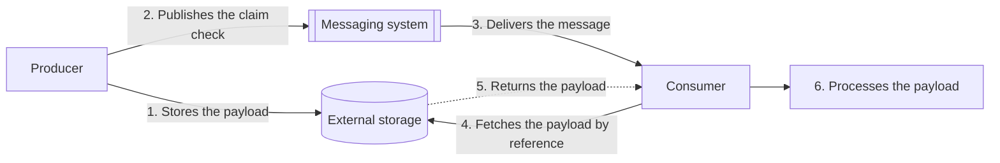

# Claim Check

## Descrição

O padrão Claim Check separa o armazenamento do conteúdo (payload) da entrega da mensagem. Em vez de enviar um payload grande pelo sistema de mensageria, o produtor grava o conteúdo completo em um armazenamento de dados externo e publica apenas uma referência a ele, o *claim check* (como um tíquete de guarda-volumes). O sistema de mensageria nunca vê nem armazena o payload.

O fluxo é simples: o produtor gera o payload, salva no armazenamento externo e, só depois que a gravação tiver sucesso, publica a mensagem com a referência. O consumidor recebe a mensagem, lê a referência, busca o payload diretamente no armazenamento e então o processa.

Na formulação do Enterprise Integration Patterns (Hohpe e Woolf), o foco é reduzir o volume de dados que atravessa uma cadeia de etapas sem perder informação: um dado só necessário mais adiante é guardado em um repositório persistente (arquivo ou banco) sob uma chave única, removido da mensagem e substituído por essa chave. Qualquer componente posterior que precise do dado usa a chave para recuperá-lo, tipicamente com um Content Enricher. A analogia é a bagagem despachada no aeroporto: você entrega a mala, recebe um comprovante e a retira no destino. Diferente do Content Filter, que descarta os campos de vez, o Claim Check apenas os guarda temporariamente. Além do desempenho, isso simplifica o diagnóstico, pois as etapas intermediárias lidam com mensagens menores e mais legíveis.

Com isso, o broker trafega apenas mensagens pequenas, enquanto o armazenamento externo cuida de controle de acesso, durabilidade e políticas de ciclo de vida do conteúdo, de forma independente da mensageria.

## Problemas que resolve

- Mensagens rejeitadas por ultrapassarem o tamanho máximo permitido pelo sistema de mensageria.
- Pressão de recursos no broker: payloads grandes consomem memória e disco desproporcionais, competindo com as demais mensagens.
- Queda de throughput causada pelo tempo maior de serialização, transferência e desserialização de mensagens grandes.
- Aumento de custo quando o tamanho das mensagens empurra a carga para camadas ou unidades de capacidade mais caras.
- Dados necessários apenas em etapas posteriores de um fluxo, que poluem e encarecem o processamento das etapas intermediárias e dificultam a depuração.
- Exposição de dados sensíveis a componentes intermediários (ferramentas de monitoramento de filas, roteadores, logs).

## Quando usar

- Os payloads frequentemente excedem o tamanho máximo de mensagem suportado pelo transporte.
- Mensagens grandes degradam o desempenho do broker para todos os produtores e consumidores que o compartilham.
- O payload (ou parte dele) contém informações sensíveis que não devem ficar visíveis na mensageria; o conteúdo vai para um armazenamento com controles de acesso dedicados.
- As mensagens passam por várias etapas de roteamento que serializam, desserializam, criptografam ou descriptografam; trafegar só o token reduz o processamento repetido e a latência acumulada.

### Quando evitar

- A latência ponta a ponta é mais crítica que o tamanho do payload e os saltos extras de rede para gravar e buscar o conteúdo não são aceitáveis.
- Existe um transporte ou camada que suporta o tamanho do payload sem prejuízo relevante de throughput ou latência (por exemplo, o tier Premium do Azure Service Bus aceita mensagens grandes); enviar inline é mais simples.
- Não é viável coordenar dois sistemas independentes (mensageria e armazenamento) nem manter um formato de referência compreendido por produtores e consumidores ao longo do tempo.
- Alternativas mais simples resolvem: compressão ou serialização mais compacta, ou dividir o payload em mensagens menores (Splitter/Aggregator) quando os consumidores conseguem processar ou remontar as partes.

## Trade-offs

| Ganho | Custo / Risco |
| --- | --- |
| Mensagens pequenas, sem rejeição por limite de tamanho | Dependência adicional de um armazenamento externo que precisa estar disponível e durável |
| Maior throughput e menor pressão sobre o broker | Latência extra pelo salto de rede para buscar o payload |
| Possibilidade de usar uma camada de mensageria mais barata | Custos de armazenamento, transferência de rede e limpeza dos payloads |
| Dados sensíveis fora do caminho da mensageria, com controle de acesso dedicado | Gestão de autorização entre produtores/consumidores e o armazenamento |
| Proteção do payload com recursos do armazenamento (versionamento, backup, replicação) | Gravação do payload e publicação do token não são atômicas: risco de payloads órfãos ou tokens sem conteúdo |

- **Ciclo de vida do payload:** defina qual componente é dono da exclusão e alinhe a expiração da mensagem com a retenção do payload, para que um claim check válido não aponte para dados apagados.
- **Consistência:** publique o token apenas após a gravação bem-sucedida; como retentativas podem entregar o mesmo claim check mais de uma vez, os consumidores devem ser idempotentes.
- **Aplicação condicional:** decida se todas as mensagens usam claim check ou se a decisão é por mensagem; nesse caso, o schema deve indicar se o payload está inline ou externo.
- **Segurança do token:** não embuta credenciais no claim check; a autorização deve ser uma interação independente com o armazenamento. Se for preciso conceder acesso temporário, use o Valet Key.
- **Integridade:** inclua hash ou assinatura do conteúdo na mensagem quando for necessário verificá-lo, e defina o que fazer em caso de divergência.
- **Suporte de frameworks:** aproveite recursos nativos do SDK de mensageria quando existirem (por exemplo, o DataBus do NServiceBus).

## Diagrama

O produtor grava o payload no armazenamento externo e publica apenas a referência na mensageria; o consumidor usa essa referência para buscar o conteúdo diretamente no armazenamento antes de processá-lo.

## Padrões relacionados

- [Content Enricher](../../../architecture/eip/message-transformation/content-enricher.md) — recupera o payload guardado a partir da chave e o devolve à mensagem.
- [Content Filter](../../../architecture/eip/message-transformation/content-filter.md) — também reduz a mensagem, mas descarta os dados em definitivo.
- [Process Manager](../../../architecture/eip/message-routing/process-manager.md) — coordena o fluxo em que o claim check atravessa várias etapas.
- [Valet Key](../security-and-access/valet-key.md) — concede acesso temporário e restrito ao armazenamento quando o consumidor precisa de permissão explícita para buscar o payload.
- [Idempotent Consumer](./idempotent-consumer.md) — garante processamento seguro de claim checks entregues mais de uma vez por retentativas.
- [Competing Consumers](./competing-consumers.md) — vários consumidores podem processar claim checks em paralelo, buscando os payloads sob demanda.
- [Publisher-Subscriber](./publisher-subscriber.md) — o claim check pode ser distribuído a vários assinantes sem replicar o payload grande.
- [Queue-Based Load Leveling](./queue-based-load-leveling.md) — filas com mensagens pequenas suavizam picos de carga com menor custo de recursos no broker.
- [Retry](../resiliency/retry.md) — trata falhas transitórias ao gravar ou buscar o payload no armazenamento externo.

## Referência

- [Documentação no Azure Architecture Center](https://learn.microsoft.com/en-us/azure/architecture/patterns/claim-check)
- [Página do padrão no Enterprise Integration Patterns](https://www.enterpriseintegrationpatterns.com/StoreInLibrary.html)
