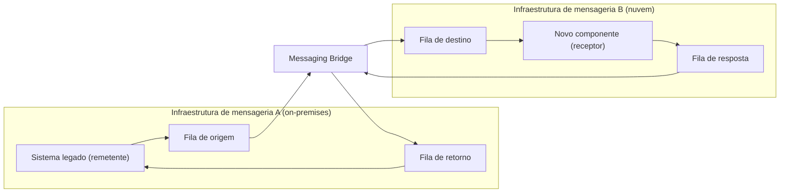

# Messaging Bridge

## Descrição

O Messaging Bridge conecta sistemas que usam infraestruturas de mensageria diferentes (por exemplo, um broker legado on-premises e um serviço de filas na nuvem) e repassa mensagens entre elas. Assim, sistemas distintos podem ser integrados sem que precisem ser modificados.

Cada sistema continua conectado apenas à sua própria infraestrutura de mensageria. Um componente intermediário, a *ponte*, conecta-se simultaneamente a duas ou mais infraestruturas: consome mensagens de uma fila de origem e as publica em uma fila de destino na outra infraestrutura, sem alterar o payload.

Os sistemas integrados não precisam conhecer uns aos outros nem a ponte. O remetente envia mensagens para uma fila designada em sua infraestrutura nativa; a ponte as recolhe e encaminha para a fila correspondente na outra infraestrutura, onde o receptor as consome. A topologia pode usar uma única *fila de ponte* por infraestrutura ou pares de *filas sombra* (shadow queues), uma para cada fila de destino, deixando o remetente totalmente alheio à ponte.

Na formulação do Enterprise Integration Patterns (Hohpe e Woolf), a ponte não liga sistemas inteiros, e sim canais correspondentes: ela é composta por pares de Channel Adapters, em que o outro lado de cada adaptador é um sistema de mensageria diferente, e cada par mapeia um canal de um sistema a um canal do outro. Também faz parte da responsabilidade da ponte converter o formato das mensagens entre os dois sistemas e distinguir canais usados por clientes comuns de canais que existem só para o tráfego entre os sistemas.

## Problemas que resolve

- Aplicações ficam sem saber a qual sistema de mensageria se conectar, e mensagens publicadas em um sistema não chegam aos demais.
- Juntar dois sistemas de mensageria por inteiro costuma ser impraticável; a ligação precisa ser feita canal a canal.
- Organizações com múltiplas infraestruturas de mensageria coexistindo, geralmente por fusões, aquisições ou extensão de sistemas on-premises para a nuvem.
- Necessidade de integrar sistemas sem reescrevê-los para usar HTTP, o que exigiria adicionar clientes e handlers, retestar e reimplantar.
- Complexidade de hospedar, proteger e manter altamente disponíveis endpoints HTTP criados apenas para integração.
- Falhas de conectividade frequentes que, com chamadas síncronas, exigiriam mecanismos de retry construídos sob medida.
- Migração de um sistema distribuído de uma tecnologia de mensageria para outra sem ter que mover tudo de uma só vez.

## Quando usar

- Integrar sistemas existentes com o mínimo de modificação.
- Integrar aplicações legadas que não conseguem usar outras tecnologias de mensageria.
- Estender aplicações on-premises com componentes hospedados na nuvem.
- Conectar sistemas geograficamente distribuídos quando a conexão de rede é instável.
- Migrar incrementalmente um sistema distribuído de uma infraestrutura de mensageria para outra, movendo endpoints conforme o cronograma permitir.

### Quando evitar

- Algum dos sistemas depende de um recurso de uma infraestrutura que não existe na outra.
- A integração é síncrona por natureza e o sistema iniciador precisa de resposta imediata.
- Há requisitos funcionais ou não funcionais específicos (segurança, privacidade) que a ponte não consegue atender.
- O volume de dados excede a capacidade das infraestruturas de mensageria ou torna a mensageria uma solução cara demais.

## Trade-offs

| Ganho | Custo / Risco |
| --- | --- |
| Sistemas integrados sem modificação; os endpoints idealmente nem sabem que as mensagens são encaminhadas | Recursos avançados de uma das tecnologias podem não estar disponíveis na rota com ponte |
| Integração mais confiável que HTTP, graças à entrega at-least-once | A rota precisa respeitar as limitações de ambas as tecnologias (ex.: tamanho máximo de mensagem bem menor em uma delas) |
| Migração gradual entre infraestruturas, endpoint por endpoint | Mais um componente para implantar, escalar, monitorar e manter |
| Prolonga a vida útil de sistemas existentes sem reescritas | Possibilidade de duplicatas exige deduplicação, sobretudo se um lado dependia de transações distribuídas |

- **Consistência:** se um dos sistemas depende de transações distribuídas para garantir correção, a ponte precisa implementar deduplicação.
- **Disponibilidade e escala:** para atingir os SLOs, a ponte pode precisar ser escalada horizontalmente com consumidores concorrentes.
- **Tratamento de falhas:** a ponte deve ter política de retry própria para não marcar mensagens como *poison* durante falhas de infraestrutura; um circuit breaker pode pausar o encaminhamento.
- **Migração:** mensagens em trânsito (incluindo as em filas de erro aguardando reprocessamento) precisam chegar ao endpoint migrado; mantenha a ponte até que todas sejam entregues.
- **Sistemas sem mensageria:** se um sistema não usa mensageria e não pode ser alterado, é possível emular uma fila em uma tabela de banco de dados (por exemplo, via change data capture) e fazer a ponte a partir dela.
- **Observabilidade:** monitore profundidade das filas, latência de encaminhamento e mensagens rejeitadas em ambos os lados.

## Diagrama

O sistema legado publica mensagens em sua infraestrutura nativa; a ponte as consome e repassa, sem alterar o payload, para a fila correspondente na outra infraestrutura, e faz o mesmo no sentido inverso. Nenhum dos lados precisa saber que existe uma ponte entre eles (no exemplo da Microsoft, MSMQ on-premises é conectado ao Azure Service Bus).

## Padrões relacionados

- [Channel Adapter](/architecture/eip/messaging-channels/channel-adapter) — o bloco de construção da ponte: um par de adaptadores liga um canal de cada sistema.
- [Message Channel](/architecture/eip/messaging-channels/message-channel) — os canais que a ponte conecta.
- [Message Translator](/architecture/eip/message-transformation/message-translator) — converte o formato das mensagens entre os dois sistemas.
- [Competing Consumers](/cloud/cloud-design-patterns/messaging/competing-consumers) — usado para escalar horizontalmente a ponte e atender aos SLOs de disponibilidade.
- [Retry](/cloud/cloud-design-patterns/resiliency/retry) — a ponte precisa de política de retry própria para lidar com falhas transitórias sem descartar mensagens válidas como poison.
- [Circuit Breaker](/cloud/cloud-design-patterns/resiliency/circuit-breaker) — permite pausar o encaminhamento quando uma das infraestruturas está indisponível.
- [Idempotent Consumer](/cloud/cloud-design-patterns/messaging/idempotent-consumer) — a entrega at-least-once pela ponte pode gerar duplicatas que os consumidores devem tolerar.
- [Strangler Fig](/cloud/cloud-design-patterns/integration-and-modernization/strangler-fig) — ambos suportam migração incremental de sistemas legados para novas tecnologias.
- [Anti-Corruption Layer](/cloud/cloud-design-patterns/integration-and-modernization/anti-corruption-layer) — também isola sistemas legados de novos, mas traduzindo semântica, enquanto a ponte repassa mensagens sem alterá-las.

## Referência

- [Documentação no Azure Architecture Center](https://learn.microsoft.com/en-us/azure/architecture/patterns/messaging-bridge)
- [Página do padrão no Enterprise Integration Patterns](https://www.enterpriseintegrationpatterns.com/MessagingBridge.html)
