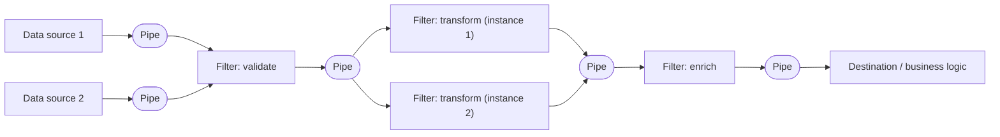

# Pipes and Filters

## Descrição

O padrão Pipes and Filters decompõe uma tarefa de processamento complexa em uma sequência de etapas independentes e reutilizáveis. Cada etapa é um **filtro** (filter): um componente autocontido, normalmente sem estado, que executa uma única responsabilidade, como validar, transformar, enriquecer ou descartar dados. Os filtros são conectados por **pipes**, canais que apenas transportam a saída de um filtro para a entrada do próximo, sem lógica de roteamento ou de negócio.

Cada filtro conhece apenas os esquemas de entrada e de saída, e não os outros filtros. Por isso, os filtros podem ser reordenados, substituídos, adicionados ou removidos, desde que a saída de um seja compatível com a entrada do seguinte. Um esquema de mensagem padronizado entre os filtros aumenta essa flexibilidade e favorece a reutilização por composição: novos pipelines são montados a partir de filtros existentes.

Como os filtros são implantados de forma independente, cada um pode escalar separadamente, rodar em hardware adequado à sua carga (por exemplo, máquinas mais potentes para etapas de uso intensivo de CPU) e ter múltiplas instâncias em paralelo para eliminar gargalos. Quando entrada e saída são estruturadas como stream, filtros subsequentes podem começar a trabalhar antes que o anterior termine todo o lote. Na formulação do Enterprise Integration Patterns (Hohpe e Woolf), a motivação é um evento que exige várias etapas, como decriptar um pedido, validar o certificado do remetente e eliminar duplicatas, sem acoplar as etapas entre si. Como todo filtro tem a mesma interface (uma porta de entrada e uma de saída), eles podem ser combinados em ordens diferentes e a topologia muda apenas alterando as conexões dos pipes. Um filtro com várias saídas é um Message Router.

Uma implementação comum usa uma sequência de filas de mensagens como pipes, com cada filtro consumindo de uma fila e publicando na seguinte.

## Problemas que resolve

- Módulos monolíticos de processamento que duplicam etapas semelhantes em vários fluxos, dificultando reutilização e exigindo alterar o mesmo código em vários lugares
- Impossibilidade de escalar separadamente etapas com requisitos de recursos muito diferentes
- Dificuldade de reordenar, inserir ou remover etapas sem reescrever e retestar todo o processamento
- Gargalos causados por uma etapa lenta que limita a vazão de todo o fluxo
- Falhas em uma etapa que derrubam todo o processamento, sem isolamento nem possibilidade de retomada a partir do ponto de falha

## Quando usar

- O processamento pode ser naturalmente dividido em um conjunto de etapas independentes
- As etapas têm requisitos de escalabilidade ou de hardware diferentes (filtros que escalam juntos podem ser agrupados no mesmo processo)
- É preciso flexibilidade para reordenar, adicionar ou remover etapas ao longo do tempo
- O sistema se beneficia de distribuir as etapas entre diferentes servidores ou regiões, próximos dos recursos que usam
- Deseja-se uma solução confiável que minimize o impacto da falha de uma etapa enquanto os dados são processados
- Pipelines de dados, ETL, processamento de mídia (moderação, redimensionamento, marca d'água, remoção de metadados, publicação em CDN) e ingestão de eventos

### Quando evitar

- A aplicação segue um modelo síncrono de requisição-resposta e o processamento precisa terminar dentro da requisição inicial
- As etapas não são independentes ou precisam ser executadas juntas em uma única transação
- Cada etapa exige tanto contexto ou estado que carregá-lo e persisti-lo a cada filtro torna a abordagem ineficiente ou gera contenção excessiva no armazenamento compartilhado
- O processamento é simples o bastante para que a sobrecarga de distribuir e operar vários componentes não se justifique

## Trade-offs

| Ganho | Custo / Risco |
| --- | --- |
| Modularidade e reutilização de filtros em vários pipelines | Mais componentes para implantar, versionar e operar |
| Escalabilidade independente e paralelismo por etapa | Latência total maior devido a saltos entre pipes e serialização |
| Flexibilidade para reordenar, inserir ou substituir etapas | Exige contratos de mensagem compatíveis e governança de esquemas |
| Isolamento de falhas e possibilidade de retomar a partir de uma etapa | Necessidade de pipes duráveis, idempotência e deduplicação de mensagens |
| Cada filtro pode rodar no hardware ou local mais adequado | Observabilidade e rastreamento ponta a ponta mais difíceis em ambiente distribuído |

- **Confiabilidade dos pipes:** use uma infraestrutura que garanta que as mensagens entre filtros não sejam perdidas (filas duráveis, confirmação após processamento).
- **Idempotência:** se um filtro falhar após receber ou publicar uma mensagem e o trabalho for reprocessado por outra instância, o mesmo efeito pode ocorrer duas vezes; projete filtros idempotentes.
- **Mensagens repetidas:** o pipeline deve detectar e eliminar duplicatas; algumas infraestruturas de mensageria oferecem deduplicação automática.
- **Contexto e estado:** cada filtro roda isolado e deve receber contexto suficiente para trabalhar; estado externo adiciona custo de carregar e persistir a cada etapa.
- **Tolerância de mensagem:** filtros devem ignorar e repassar inalterados os dados que não lhes dizem respeito.
- **Tratamento de erros:** cada filtro deve decidir se uma falha interrompe o pipeline ou é propagada (por exemplo, para uma fila de mensagens mortas).
- **Testes:** mudanças em um filtro podem afetar a cadeia toda; mantenha testes ponta a ponta do pipeline.
- **Gargalos:** a vazão é limitada pelo filtro mais lento; monitore filas e escale as etapas lentas.

## Diagrama

Dados de diferentes fontes entram no pipeline e passam por filtros independentes conectados por pipes (por exemplo, filas). O filtro mais lento ("transformar") roda com várias instâncias em paralelo para aumentar a vazão, sem afetar as demais etapas.

## Padrões relacionados

- [Competing Consumers](./competing-consumers.md) — várias instâncias de um filtro consomem do mesmo pipe para distribuir a carga e aumentar a vazão
- [Compute Resource Consolidation](../deployment-and-topology/compute-resource-consolidation.md) — filtros que escalam juntos podem ser agrupados no mesmo processo para reduzir custo e sobrecarga
- [Compensating Transaction](../distributed-coordination/compensating-transaction.md) — filtros podem implementar operações compensáveis, oferecendo alternativa a transações distribuídas
- [Claim Check](./claim-check.md) — evita trafegar cargas grandes pelos pipes, passando apenas uma referência ao dado armazenado
- [Idempotent Consumer](./idempotent-consumer.md) — garante que reprocessamentos e mensagens duplicadas não causem efeitos repetidos nos filtros
- [Queue-Based Load Leveling](./queue-based-load-leveling.md) — filas usadas como pipes absorvem picos de carga entre etapas
- [Retry](../resiliency/retry.md) — filtros podem repetir operações que falham de forma transitória antes de propagar o erro
- [Message Router](../../../architecture/eip/message-routing/message-router.md) — filtro com várias saídas que escolhe o canal de destino (visão do EIP)
- [Routing Slip](../../../architecture/eip/message-routing/routing-slip.md) — torna a sequência de filtros variável por mensagem
- [Message Filter](../../../architecture/eip/message-routing/message-filter.md) — filtro que descarta mensagens que não atendem a um critério
- [Choreography](../distributed-coordination/choreography.md) — alternativa descentralizada em que serviços reagem a eventos em vez de seguir uma cadeia fixa

## Referência

- [Documentação no Azure Architecture Center](https://learn.microsoft.com/en-us/azure/architecture/patterns/pipes-and-filters)
- [Página do padrão no Enterprise Integration Patterns](https://www.enterpriseintegrationpatterns.com/PipesAndFilters.html)
