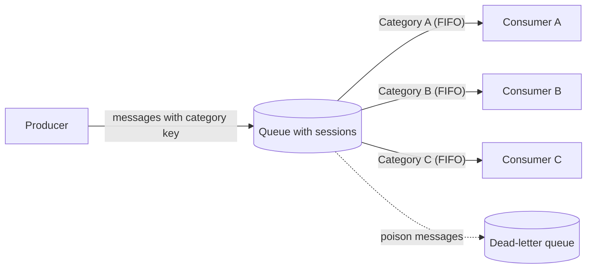

# Sequential Convoy

## Descrição

O Sequential Convoy agrupa mensagens relacionadas por uma chave de categoria (por exemplo, o ID de um pedido) e processa cada grupo de forma sequencial, uma mensagem por vez, enquanto grupos diferentes são processados em paralelo. Assim, a ordem FIFO é garantida dentro de cada grupo sem que a exigência de ordenação vire um gargalo para o sistema inteiro.

O produtor marca cada mensagem com a chave de categoria e o broker de mensageria usa essa chave para particionar as mensagens em grupos lógicos. Um consumidor obtém um bloqueio exclusivo sobre um grupo e recebe suas mensagens estritamente na ordem em que foram enfileiradas; outros consumidores atendem, ao mesmo tempo, outros grupos. A unidade de paralelismo deixa de ser a mensagem e passa a ser a categoria.

Muitos brokers oferecem esse comportamento nativamente, por meio de sessões, grupos de mensagens ou partições ordenadas. No Azure, por exemplo, as sessões de mensagens do Service Bus implementam o padrão.

## Problemas que resolve

- Um consumidor único preserva a ordem, mas não escala com o aumento de carga.
- Vários consumidores competindo por uma fila compartilhada aumentam a vazão, mas podem processar mensagens do mesmo grupo fora de ordem ou simultaneamente, corrompendo o estado.
- Operações sobre uma mesma entidade (criar, alterar, excluir) chegam intercaladas com operações de outras entidades e precisam ser aplicadas na sequência correta.
- Evita condições de corrida e lógicas de reordenação ou travamento improvisadas no código dos consumidores.

## Quando usar

- As mensagens chegam em ordem e precisam ser processadas nessa mesma ordem.
- As mensagens podem ser categorizadas de modo que cada categoria seja uma unidade independente de escala.
- Há muitas categorias ativas ao mesmo tempo, o que permite paralelismo real entre grupos.

### Quando evitar

- Cenários de vazão extremamente alta (milhões de mensagens por minuto), nos quais a exigência de FIFO limita a escala alcançável.
- A ordem das mensagens não importa; nesse caso o Competing Consumers oferece escala horizontal mais simples, sem o custo de coordenação por sessão.
- Há poucas categorias com volume muito concentrado, o que deixa o processamento praticamente serial.

## Trade-offs

| Ganho | Custo / Risco |
| --- | --- |
| Ordem FIFO garantida dentro de cada categoria | Vazão por categoria limitada ao tempo de processamento de uma mensagem |
| Escala horizontal entre categorias | Escolha da chave é crítica: muito grossa limita o paralelismo, muito fina não traz benefício de ordenação |
| Elimina condições de corrida e workarounds de reordenação | Mensagem envenenada bloqueia todas as mensagens seguintes da mesma categoria |
| Desacoplamento entre produtores e consumidores | Dependência de recursos do broker (sessões/bloqueios), o que pode exigir planos mais caros |
| Consumidores independentes e substituíveis | Contenção e latência no bloqueio de sessão; ajuste de tempo de lock e renovação |

- **Mensagens envenenadas:** conte tentativas de entrega e mova a mensagem para uma dead-letter queue após um limite, liberando o restante do grupo.
- **Ordem de chegada:** latência de rede entre produtor e broker pode desordenar mensagens antes do particionamento; use números de sequência e um marcador de fim de sequência.
- **Correção da chave:** uma chave errada no produtor envia a mensagem para o grupo errado e corrompe o estado; valide as chaves no produtor e, se necessário, no consumidor.
- **Disponibilidade do broker:** ele é dependência compartilhada de todas as categorias; avalie zonas de disponibilidade e recuperação de desastres.
- **Observabilidade:** monitore número de sessões ativas, backlog por sessão e mensagens em dead-letter, com fluxo de investigação e reprocessamento.
- **Custo:** cada sessão ativa tende a ocupar uma execução ou instância de consumidor; defina limites de concorrência.
- **Evolução:** o desenho deve absorver novas categorias sem mudanças estruturais nos consumidores.

## Diagrama

O produtor envia mensagens intercaladas de várias categorias para uma única fila; o broker entrega cada categoria com exclusividade a um consumidor, que a processa em ordem, enquanto categorias diferentes avançam em paralelo.

## Padrões relacionados

- [Competing Consumers](./competing-consumers.md) — escala o consumo em paralelo, mas perde a ordem; o Sequential Convoy fecha essa lacuna particionando por categoria.
- [Queue-Based Load Leveling](./queue-based-load-leveling.md) — a fila absorve picos de carga; o Sequential Convoy acrescenta particionamento com ordem por categoria.
- [Priority Queue](./priority-queue.md) — pode ser combinado para manter FIFO dentro de cada nível de prioridade.
- [Idempotent Consumer](./idempotent-consumer.md) — protege contra reprocessamento quando um bloqueio de sessão expira e a mensagem é entregue novamente.
- [Retry](../resiliency/retry.md) — define tentativas antes de mover mensagens com falha para a dead-letter queue sem travar o grupo indefinidamente.

## Referência

- [Documentação no Azure Architecture Center](https://learn.microsoft.com/en-us/azure/architecture/patterns/sequential-convoy)
