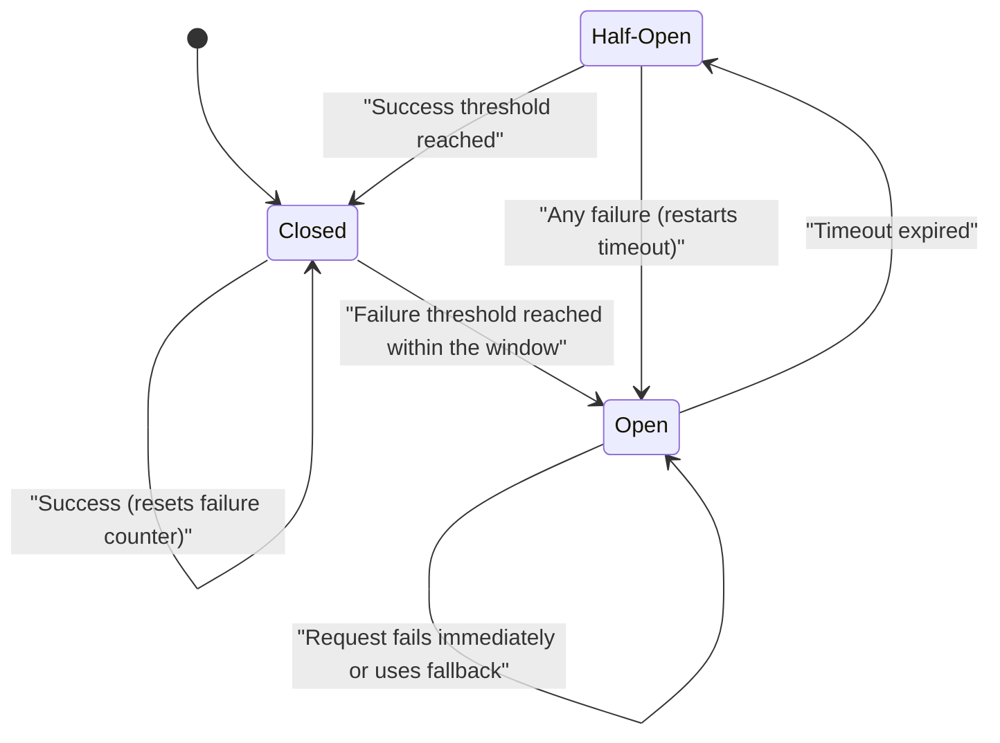

# Circuit Breaker

## Descrição

O Circuit Breaker bloqueia temporariamente o acesso a um serviço ou recurso remoto quando as falhas passam de um limite. Assim a aplicação para de repetir uma operação que provavelmente vai falhar. Ele funciona como um proxy entre quem chama e a dependência: monitora as falhas recentes e decide se a chamada segue adiante ou se falha na hora.

O proxy é uma máquina de estados inspirada no disjuntor elétrico. Em **Closed**, as requisições passam normalmente e um contador de falhas (zerado periodicamente) é incrementado a cada erro. Quando o limite é atingido dentro de uma janela de tempo, o circuito vai para **Open**: as chamadas falham imediatamente (ou recebem uma resposta padrão ou vinda de cache) e um temporizador começa a contar. Quando o temporizador expira, o circuito passa para **Half-Open** e deixa passar um número limitado de requisições de teste. Se elas derem certo, o circuito volta para Closed. Se qualquer uma falhar, ele volta para Open e o temporizador recomeça.

O padrão complementa o [Retry](./retry.md), mas tem outro objetivo. O Retry insiste esperando que a operação acabe dando certo. O Circuit Breaker impede chamadas que provavelmente vão falhar. Quando os dois são usados juntos, a lógica de retry precisa respeitar as exceções do circuito aberto e parar de tentar.

Em arquiteturas de microsserviços, esse contexto é ainda mais comum: um serviço costuma chamar outro de forma síncrona (RPC ou REST). Se o serviço chamado está fora do ar ou muito lento, o chamador fica com threads presas esperando, esgota seus próprios recursos e também deixa de responder, e a falha se espalha pelo sistema. A pergunta central é como impedir que uma falha de rede ou de um serviço se propague em cascata. O circuito, nesse caso, fica em um proxy ao redor do cliente remoto e abre depois de falhas consecutivas acima de um limite.

## Problemas que resolve

- Falhas em cascata: chamadas bloqueadas esperando timeout prendem threads, memória e conexões, e acabam derrubando partes do sistema que não têm relação com o problema.
- Desperdício de recursos e latência alta ao repetir chamadas para uma dependência que está fora do ar ou degradada por um período longo.
- Excesso de carga sobre um serviço que está tentando se recuperar, causado por retries agressivos dos clientes.
- Falta de um sinal claro de que uma dependência está indisponível. As mudanças de estado do circuito podem alimentar monitoramento e alertas.
- Necessidade de degradação graciosa: devolver valores padrão, dados em cache ou uma funcionalidade reduzida no lugar de um erro demorado.

## Quando usar

- Para evitar falhas em cascata ao chamar serviços remotos ou recursos compartilhados que podem ficar indisponíveis por períodos variáveis.
- Para proteger a aplicação de dependências lentas e manter os objetivos de nível de serviço (SLOs) mesmo quando um serviço tem alta latência.
- Para lidar com problemas intermitentes de conectividade em ambientes distribuídos.
- Para direcionar o tráfego a partir de sinais de falha em tempo real, por exemplo, para outra região em implantações multirregião.

### Quando evitar

- No acesso a recursos locais e privados da aplicação, como estruturas em memória. Nesses casos o circuito só adiciona overhead.
- Como substituto do tratamento de exceções da lógica de negócio.
- Quando algoritmos de retry conhecidos bastam e as dependências foram projetadas para suportá-los.
- Quando esperar o circuito se recompor causa atrasos inaceitáveis.
- Em arquiteturas orientadas a mensagens ou eventos que já isolam falhas com filas de mensagens mortas (dead-letter) e reprocessamento.
- Quando a plataforma ou a infraestrutura já cuida da recuperação, por exemplo, com health checks em balanceadores globais ou service mesh.

## Trade-offs

| Ganho | Custo / Risco |
| --- | --- |
| Falha rápida e tempo de resposta estável quando uma dependência cai | Requisições que poderiam dar certo são rejeitadas enquanto o circuito está aberto |
| Isola falhas e evita esgotar threads, conexões e memória | Ajustar limites, janelas e timeouts é difícil, e valores ruins causam aberturas indevidas ou oscilação |
| Dá tempo para a dependência se recuperar sem sobrecarga | A aplicação precisa de estratégias de fallback e degradação para cada operação protegida |
| Mudanças de estado viram sinais úteis para observabilidade e alertas | Mais complexidade: estado compartilhado entre instâncias, concorrência e testes do comportamento em falha |

- **Tipos de exceção:** nem toda falha pesa igual. Timeouts podem exigir mais ocorrências para abrir o circuito do que erros de serviço indisponível. Respostas como HTTP 429 ou 503, que trazem o tempo de espera sugerido, podem abrir o circuito na hora (accelerated circuit breaking).
- **Granularidade:** um único circuito para vários provedores independentes (por exemplo, shards diferentes) pode bloquear caminhos saudáveis. Use um circuito por recurso.
- **Recuperação:** o tempo em Open precisa combinar com o tempo provável de recuperação. Um temporizador crescente, sondagem com um endpoint de saúde ou um reset manual feito por um operador ajudam.
- **Concorrência e desempenho:** o circuito não deve bloquear requisições concorrentes nem adicionar overhead relevante a cada chamada.
- **Timeouts das dependências:** timeouts longos em serviços externos reduzem a proteção, porque as threads ficam presas antes de o circuito perceber a falha.
- **Observabilidade:** registre sucessos, falhas e transições de estado, e use rastreamento distribuído para ter visibilidade de ponta a ponta.
- **Onde implementar:** na própria aplicação, em uma biblioteca ou de forma transversal em um sidecar ou service mesh, sem mudar o código.
- **Escolha de timeouts:** é o ponto mais difícil na prática. Valores muito rígidos geram falsos positivos (o circuito abre sem necessidade), e valores muito frouxos aumentam a latência e deixam as threads presas por mais tempo.
- **Chamadas síncronas entre microsserviços:** o padrão protege quem chama, que passa a lidar com a falha das dependências, mas cada chamada protegida precisa de uma resposta alternativa definida (erro rápido, valor padrão ou cache).
- **Reprocessamento:** em Open, as requisições podem ser registradas em um journal e reenviadas quando a dependência voltar.

## Diagrama

O circuito começa em Closed e abre quando as falhas passam do limite. Em Open, as chamadas falham rápido até o timeout expirar. Em Half-Open, algumas chamadas de teste decidem se o circuito volta a fechar ou se abre de novo.

## Padrões relacionados

- [Retry](./retry.md): trata falhas transitórias repetindo a operação. Combinado com o Circuit Breaker, deve parar de tentar quando o circuito estiver aberto.
- [Health Endpoint Monitoring](./health-endpoint-monitoring.md): o circuito pode sondar um endpoint de saúde para decidir quando sair do estado Open.
- [Bulkhead](./bulkhead.md): isola recursos por consumidor ou dependência e, junto com o Circuit Breaker, limita o alcance das falhas.
- [Sidecar](../integration-and-modernization/sidecar.md): permite implementar o circuito fora do código da aplicação, como em service meshes.
- [Ambassador](../integration-and-modernization/ambassador.md): um proxy fora do processo pode centralizar circuit breaking, retries e monitoramento das chamadas remotas.
- [Throttling](./throttling.md): serviços que limitam clientes (HTTP 429) dão sinais que o circuito pode usar para abrir mais rápido.
- [Cache-Aside](../data-management/cache-aside.md): o cache pode fornecer respostas degradadas enquanto o circuito está aberto.

- [Microservice Chassis](../../../architecture/microservices/cross-cutting-concerns/microservice-chassis.md): o chassis pode embutir o circuit breaker (por exemplo, via biblioteca) em todos os serviços.
- [API Gateway](../../../architecture/microservices/external-api/api-gateway.md): usa circuit breakers ao invocar os serviços de back-end.
- [Server-side Discovery](../../../architecture/microservices/service-discovery/server-side-discovery.md): o roteador pode aplicar circuit breaking ao encaminhar requisições.
- [Remote Procedure Invocation](../../../architecture/microservices/communication-styles/remote-procedure-invocation.md): a comunicação síncrona entre serviços é o cenário em que o padrão é mais necessário.

## Referência

- [Documentação no Azure Architecture Center](https://learn.microsoft.com/en-us/azure/architecture/patterns/circuit-breaker)
- [Circuit Breaker no microservices.io](https://microservices.io/patterns/reliability/circuit-breaker.html)
