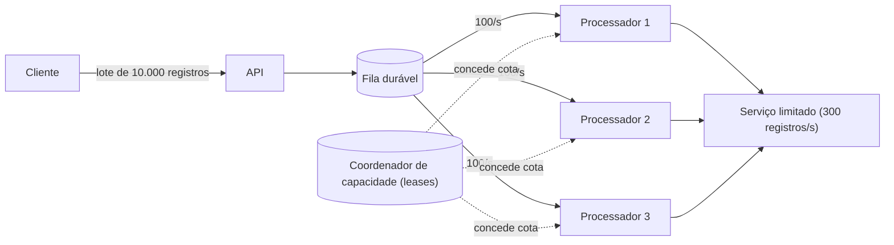

# Rate Limiting

## Descrição

O padrão Rate Limiting faz com que uma aplicação **controle a taxa com que ela mesma envia requisições** a um serviço que impõe limites de uso. Em vez de disparar tudo de uma vez e reenviar o que for rejeitado, o cliente regula o próprio consumo (número de operações, volume de dados ou custo relativo por intervalo de tempo) para ficar dentro da capacidade do serviço de destino. Assim, ele evita ou reduz erros de estrangulamento e consegue prever o throughput e o tempo total de processamento.

A diferença em relação ao [Throttling](/cloud/cloud-design-patterns/resiliency/throttling) está no lado de quem controla. No Throttling, o **serviço** se protege e limita ou rejeita os clientes que passam da conta (por exemplo, respondendo HTTP 429). No Rate Limiting, o **cliente** reconhece e respeita esses limites de antemão, consumindo só o que cabe, para não ser estrangulado. Os dois padrões se complementam: um define o teto, o outro se mantém abaixo dele.

Uma implementação típica coloca as requisições em um sistema de mensageria durável, capaz de absorver a taxa total de entrada, e usa um ou mais processadores que leem desse sistema em ritmo controlado. Liberar lotes pequenos com mais frequência (por exemplo, 20 operações a cada 200 ms em vez de 100 por segundo de uma vez) deixa o fluxo mais uniforme e evita picos. Quando vários processos independentes compartilham o mesmo serviço, a capacidade pode ser dividida em partições lógicas, e cada processo obtém concessões (leases) exclusivas e temporárias sobre elas por meio de um mecanismo de exclusão mútua distribuída (por exemplo, leases de blobs no Azure Storage, ZooKeeper, etcd ou Redis).

## Problemas que resolve

- Excesso de erros de estrangulamento ao executar grandes volumes de operações contra um serviço limitado
- Tráfego multiplicado por reenvios: no estilo "tentar e reenviar o que falhar", 10.000 registros podem virar 30.000 envios
- Custo extra de registrar e processar milhares de erros em log
- Impossibilidade de estimar quanto tempo um processamento em lote vai levar
- Consumo de memória alto por manter em buffer dados que o serviço ainda não consegue aceitar, com risco de perda se o processo cair
- Disputa descoordenada por capacidade entre vários processos ou aplicações que usam o mesmo serviço

## Quando usar

- Para reduzir erros de estrangulamento de um serviço com limites conhecidos (requisições/s, volume/min, unidades de custo/s)
- Em tarefas automatizadas, repetitivas e de grande escala, como processamento em lote e ingestão de dados
- Para diminuir o tráfego em comparação com abordagens ingênuas de reenvio após erro
- Para reduzir o uso de memória, retirando da fila apenas o que pode ser processado no intervalo atual
- Quando é preciso prever throughput e duração de um job

### Quando evitar

- Quando a operação exige conclusão imediata e síncrona com latência muito baixa e não tolera enfileiramento ou processamento adiado
- Quando o gargalo não é a taxa de requisições, e sim concorrência ou contenção de recursos (CPU saturada, trabalho de longa duração em andamento). Nesses casos, escala ou controle de concorrência resolvem melhor
- Quando o volume é baixo e esporádico e os limites do serviço praticamente nunca são atingidos

## Trade-offs

| Ganho | Custo / Risco |
| --- | --- |
| Menos erros de estrangulamento e menos reenvios | Mais componentes: fila durável, processadores, coordenação |
| Throughput estável e previsível | Latência maior por item, já que o trabalho fica enfileirado |
| Menor uso de memória, rede e CPU no cliente | Exige conhecer, configurar e manter atualizados os limites do serviço |
| Uso eficiente da capacidade contratada | Coordenação distribuída (leases, partições) traz complexidade e novos modos de falha |
| Isolamento entre fluxos de trabalho com cotas próprias | Capacidade reservada por fluxo pode ficar ociosa |

- **Erros residuais:** mesmo com Rate Limiting, a aplicação precisa tratar os erros de estrangulamento que ainda ocorrerem.
- **Retentativas coordenadas:** as retentativas devem respeitar o limitador e os sinais de contrapressão (por exemplo, HTTP 429 com `Retry-After`), com número limitado de tentativas e pequenos atrasos aleatórios, para evitar tempestades de retry.
- **Todos os fluxos de trabalho:** cargas em massa e consultas que usam o mesmo serviço precisam passar pelo mesmo mecanismo ou ter cotas separadas.
- **Contenção externa:** outras aplicações podem consumir a mesma capacidade. Um aumento inesperado de erros pode indicar disputa e pedir redução temporária da taxa.
- **Expiração de leases:** o processo precisa acompanhar o prazo das concessões e reduzir o ritmo quando elas expiram.
- **Observabilidade:** monitore taxa efetiva, tamanho das filas, erros 429 e tempo de espera para ajustar os parâmetros.

## Diagrama

A API aceita toda a carga e a grava em uma fila durável. Os processadores retiram itens em ritmo controlado, conforme a cota que obtiveram do coordenador, de modo que a soma das taxas nunca passe do limite do serviço de destino.

## Padrões relacionados

- [Throttling](/cloud/cloud-design-patterns/resiliency/throttling) — é o lado do serviço: impõe os limites que o Rate Limiting faz o cliente respeitar
- [Retry](/cloud/cloud-design-patterns/resiliency/retry) — trata as falhas transitórias que ainda ocorrerem; deve ser coordenado com o limitador para não gerar tempestades de retry
- [Circuit Breaker](/cloud/cloud-design-patterns/resiliency/circuit-breaker) — interrompe chamadas quando o serviço está degradado, complementando o controle de taxa
- [Queue-Based Load Leveling](/cloud/cloud-design-patterns/messaging/queue-based-load-leveling) — usa uma fila para absorver picos e entregar a carga em ritmo constante, base da implementação do Rate Limiting
- [Competing Consumers](/cloud/cloud-design-patterns/messaging/competing-consumers) — vários processadores consomem a mesma fila e dividem a capacidade disponível
- [Leader Election](/cloud/cloud-design-patterns/distributed-coordination/leader-election) — também usa exclusão mútua distribuída (leases) para coordenar processos independentes
- [Bulkhead](/cloud/cloud-design-patterns/resiliency/bulkhead) — isola capacidade por fluxo de trabalho, como reservar cotas separadas por tipo de carga
- [Asynchronous Request-Reply](/cloud/cloud-design-patterns/messaging/asynchronous-request-reply) — desacopla a aceitação da requisição do processamento adiado e controlado

## Referência

- [Documentação no Azure Architecture Center](https://learn.microsoft.com/en-us/azure/architecture/patterns/rate-limiting-pattern)
