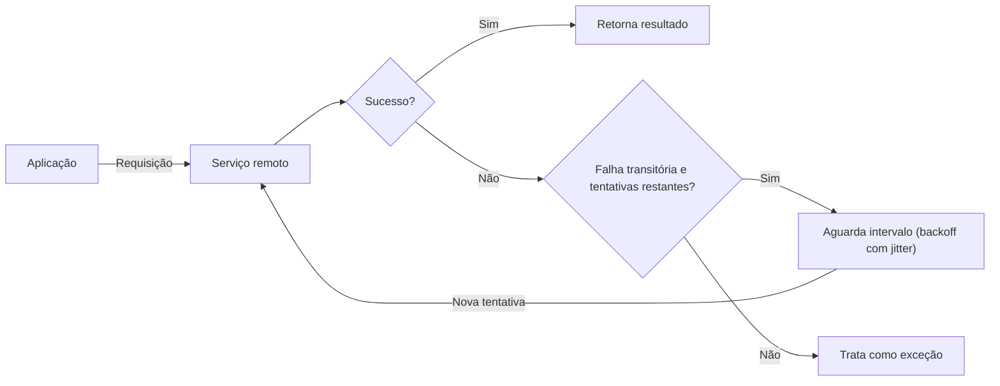

# Retry

## Descrição

O padrão Retry permite que uma aplicação lide com falhas transitórias ao se conectar a um serviço ou recurso remoto, repetindo de forma transparente uma operação que falhou. Em ambientes distribuídos, perdas momentâneas de conectividade, indisponibilidade temporária de um serviço ou timeouts causados por sobrecarga são esperados e, em geral, se corrigem sozinhos em pouco tempo.

Quando uma requisição falha, a aplicação classifica o erro e escolhe uma estratégia: **cancelar** (a falha não é transitória), **repetir imediatamente** (falha rara e pontual, como um pacote corrompido) ou **repetir após um intervalo**, que pode crescer de forma incremental ou exponencial, de preferência com variação aleatória (jitter) para espalhar as requisições de várias instâncias. Se a operação continuar falhando após o número máximo de tentativas, a falha é tratada como exceção.

A lógica de retry costuma ficar encapsulada em uma política reutilizável (número máximo de tentativas, intervalo, tipos de erro que disparam nova tentativa), e serviços diferentes podem ter políticas diferentes. Muitas bibliotecas cliente e SDKs de nuvem já oferecem esse mecanismo embutido e configurável.

## Problemas que resolve

- Falhas intermitentes de rede que derrubam operações que teriam sucesso segundos depois
- Serviços que rejeitam requisições temporariamente por estarem sobrecarregados ou aplicando throttling
- Timeouts esporádicos em dependências remotas (bancos de dados, APIs, filas, armazenamento)
- Erros transitórios propagados ao usuário ou ao processo de negócio sem necessidade, reduzindo a estabilidade percebida

## Quando usar

- Quando a aplicação interage com serviços ou recursos remotos sujeitos a falhas transitórias e de curta duração
- Quando repetir uma requisição que falhou tem chance real de sucesso em uma tentativa posterior
- Quando a operação é idempotente, ou pode ser tornada idempotente, de modo que repeti-la é seguro
- Em processamentos em lote ou em segundo plano, que toleram mais tentativas com intervalos maiores

### Quando evitar

- Quando a falha tende a ser duradoura: repetir só desperdiça tempo e recursos e piora a responsividade (prefira um Circuit Breaker)
- Para falhas que não são transitórias, como erros de lógica de negócio, validação ou autorização
- Como substituto para resolver problemas de escalabilidade: falhas frequentes por sobrecarga indicam que o serviço precisa escalar ou ser particionado
- Quando há várias camadas aninhadas com retry, o que multiplica as tentativas e gera atrasos longos

## Trade-offs

| Ganho | Custo / Risco |
| --- | --- |
| Maior resiliência a falhas transitórias sem intervenção manual | Aumento da latência percebida enquanto as tentativas ocorrem |
| Menos erros expostos ao usuário e aos processos de negócio | Políticas agressivas podem sobrecarregar ainda mais um serviço já degradado (retry storm) |
| Implementação simples e frequentemente disponível em bibliotecas | Operações não idempotentes podem ser executadas mais de uma vez, com efeitos colaterais |
| Políticas ajustáveis por tipo de operação e de erro | Retries aninhados em várias camadas multiplicam tentativas e atrasos |

- **Ajuste ao contexto:** operações interativas devem falhar rápido, com poucas tentativas e intervalos curtos; operações em lote podem usar mais tentativas com backoff exponencial.
- **Idempotência:** o serviço pode ter processado a requisição e falhado apenas ao responder; garanta que repetir seja seguro.
- **Tipo de erro:** ajuste o intervalo (ou desista) conforme o tipo de exceção; respeite indicações do serviço, como cabeçalhos de "tente novamente após".
- **Consistência transacional:** em operações que fazem parte de uma transação, calibre a política para maximizar o sucesso e evitar desfazer todos os passos.
- **Observabilidade:** registre falhas intermediárias como informativas e apenas a falha final como erro, evitando alertas desnecessários, mas mantendo dados para investigar causas recorrentes.
- **Testes:** valide a lógica de retry sob diferentes condições de falha para evitar gargalos, condições de corrida ou carga excessiva.

## Diagrama

A aplicação repete a requisição após intervalos crescentes enquanto as falhas forem transitórias; se o limite de tentativas for esgotado, a falha deixa de ser mascarada e é tratada como exceção.

## Padrões relacionados

- [Circuit Breaker](/cloud/cloud-design-patterns/resiliency/circuit-breaker) — interrompe as chamadas quando a falha é duradoura, complementando o Retry e evitando tentativas inúteis
- [Idempotent Consumer](/cloud/cloud-design-patterns/messaging/idempotent-consumer) — torna seguro reprocessar requisições ou mensagens repetidas por retries
- [Throttling](/cloud/cloud-design-patterns/resiliency/throttling) — serviços que aplicam throttling geram as falhas transitórias que o Retry precisa tratar com intervalos adequados
- [Rate Limiting](/cloud/cloud-design-patterns/resiliency/rate-limiting-pattern) — controla o ritmo de chamadas do cliente, reduzindo erros de limite que levariam a retries
- [Bulkhead](/cloud/cloud-design-patterns/resiliency/bulkhead) — isola recursos para que retries contra uma dependência com problemas não esgotem toda a aplicação
- [Compensating Transaction](/cloud/cloud-design-patterns/distributed-coordination/compensating-transaction) — desfaz passos já concluídos quando uma operação falha definitivamente após as tentativas
- [Ambassador](/cloud/cloud-design-patterns/integration-and-modernization/ambassador) — pode centralizar a lógica de retry fora da aplicação, em um proxy auxiliar

## Referência

- [Documentação no Azure Architecture Center](https://learn.microsoft.com/en-us/azure/architecture/patterns/retry)
