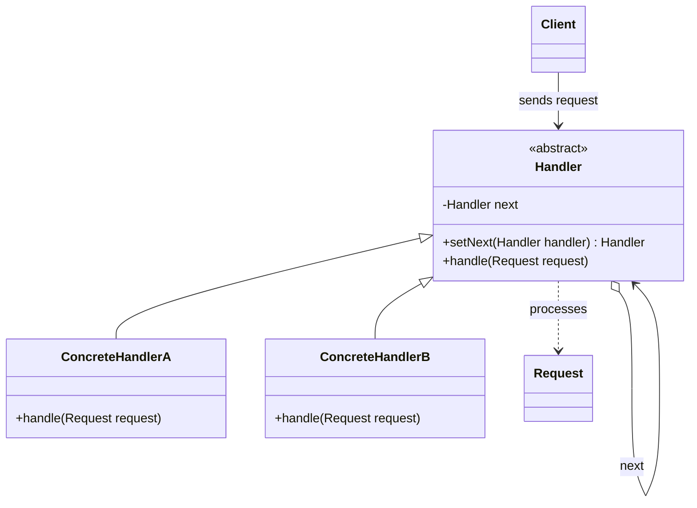

# Chain of Responsibility

## Descrição

O Chain of Responsibility evita acoplar o remetente de uma requisição ao seu receptor, dando a mais de um objeto a chance de tratá-la. Os objetos receptores (handlers) são encadeados, e a requisição é passada ao longo da cadeia até que algum deles a trate — ou até que a cadeia termine.

Cada handler implementa uma interface comum e guarda uma referência ao próximo elemento da cadeia. Ao receber a requisição, ele decide se a processa, se a repassa ao sucessor ou ambos (variação comum em pipelines de middleware). O cliente conhece apenas o primeiro elo e não precisa saber qual objeto efetivamente tratará o pedido.

Como a cadeia é montada em tempo de execução, é possível adicionar, remover ou reordenar handlers sem alterar o código do cliente nem dos demais handlers.

## Problemas que resolve

- Remetente fortemente acoplado a um receptor específico, com longas cadeias de `if/else` ou `switch` para decidir quem trata a requisição
- Necessidade de aplicar uma sequência configurável de verificações (autenticação, autorização, validação, rate limiting) antes de processar um pedido
- Escalonamento de solicitações por níveis (por exemplo, aprovação de despesas por alçada ou suporte de primeiro, segundo e terceiro nível)
- Conjunto de tratadores que precisa mudar dinamicamente sem recompilar ou modificar o cliente

## Quando usar

- Mais de um objeto pode tratar uma requisição e o tratador não é conhecido de antemão
- Você quer emitir uma requisição a um entre vários objetos sem especificar explicitamente o receptor
- O conjunto e a ordem dos tratadores devem ser definidos ou alterados dinamicamente
- Pipelines de processamento como middlewares HTTP, filtros de servlet, interceptors e tratamento de eventos em UI (event bubbling)

### Quando evitar

- Existe exatamente um tratador conhecido e estável — uma chamada direta é mais simples
- É obrigatório garantir que toda requisição seja tratada e não há um handler padrão ao fim da cadeia
- A cadeia é muito longa e o desempenho é crítico, pois cada requisição pode percorrer vários elos
- A ordem dos handlers gera dependências implícitas difíceis de entender e depurar

## Trade-offs

| Ganho | Custo / Risco |
| --- | --- |
| Desacopla remetente e receptor | Não há garantia de que a requisição será tratada |
| Flexibilidade para adicionar, remover e reordenar handlers em tempo de execução | Ordem da cadeia passa a ser uma dependência implícita e frágil |
| Cada handler tem responsabilidade única (SRP) e segue o Open/Closed Principle | Depuração mais difícil: o fluxo fica distribuído entre vários objetos |
| Handlers reutilizáveis em diferentes cadeias | Latência adicional quando a requisição atravessa muitos elos |

- **Acoplamento:** o cliente depende apenas da abstração `Handler`; cada handler conhece somente o próximo.
- **Testabilidade:** handlers podem ser testados isoladamente com um sucessor falso (mock).
- **Complexidade:** a montagem da cadeia deve ficar centralizada (por exemplo, em um builder ou na configuração) para evitar ciclos e elos esquecidos.
- **Desempenho:** em cadeias longas, considere ordenar os handlers mais prováveis primeiro.

## Diagrama



O `Client` envia a `Request` ao primeiro `Handler` da cadeia. Cada `ConcreteHandler` decide se trata a requisição ou a repassa ao sucessor referenciado por `next`, formando uma lista encadeada de tratadores.

## Exemplo

Um sistema de reembolso de despesas encaminha cada pedido por alçadas: o líder de equipe aprova até R$ 1.000, o gerente até R$ 10.000 e a diretoria acima disso.

```typescript
abstract class Approver {
  private next?: Approver;

  setNext(next: Approver): Approver {
    this.next = next;
    return next;
  }

  handle(amount: number): string {
    if (this.next) return this.next.handle(amount);
    return `Pedido de ${amount} rejeitado: sem aprovador`;
  }
}

class TeamLead extends Approver {
  handle(amount: number): string {
    return amount <= 1_000 ? `TeamLead aprovou ${amount}` : super.handle(amount);
  }
}

class Manager extends Approver {
  handle(amount: number): string {
    return amount <= 10_000 ? `Manager aprovou ${amount}` : super.handle(amount);
  }
}

class Director extends Approver {
  handle(amount: number): string {
    return `Director aprovou ${amount}`;
  }
}

const chain = new TeamLead();
chain.setNext(new Manager()).setNext(new Director());
console.log(chain.handle(500));    // TeamLead aprovou 500
console.log(chain.handle(25_000)); // Director aprovou 25000
```

## Padrões relacionados

- [Composite](../structural/composite.md) — a cadeia frequentemente segue a hierarquia de um Composite, repassando a requisição do filho para o pai (event bubbling)
- [Command](./command.md) — requisições podem ser encapsuladas como Commands e passadas ao longo da cadeia
- [Decorator](../structural/decorator.md) — estrutura semelhante de encadeamento recursivo, mas o Decorator sempre delega e adiciona comportamento, enquanto o handler pode interromper a cadeia
- [Mediator](./mediator.md) — outra forma de desacoplar remetentes e receptores, porém centralizando a comunicação em vez de distribuí-la em uma cadeia
- [Observer](./observer.md) — também desacopla emissores e receptores, mas notifica todos os interessados em vez de um único tratador
- [Null Object](./null-object.md) — pode servir como último elo da cadeia, eliminando verificações de sucessor nulo

## Referência

- [Design Patterns Cheat Sheet](https://iretha.github.io/design-patterns/cheat-sheet)
- [Chain of Responsibility no Refactoring.Guru](https://refactoring.guru/design-patterns/chain-of-responsibility)
