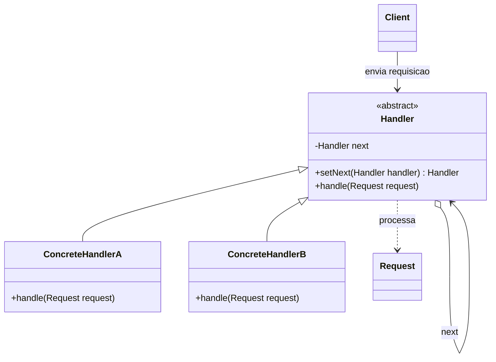

# Chain of Responsibility

## Descrição

O Chain of Responsibility evita acoplar o remetente de uma requisição ao seu receptor, dando a mais de um objeto a chance de tratá-la. Os objetos receptores (handlers) são encadeados, e a requisição é passada ao longo da cadeia até que algum deles a trate — ou até que a cadeia termine.

Cada handler implementa uma interface comum e guarda uma referência ao próximo elemento da cadeia. Ao receber a requisição, ele decide se a processa, se a repassa ao sucessor ou ambos (variação comum em pipelines de middleware). O cliente conhece apenas o primeiro elo e não precisa saber qual objeto efetivamente tratará o pedido.

Como a cadeia é montada em tempo de execução, é possível adicionar, remover ou reordenar handlers sem alterar o código do cliente nem dos demais handlers.

## Problemas que resolve

- Remetente fortemente acoplado a um receptor específico, com longas cadeias de `if/else` ou `switch` para decidir quem trata a requisição
- Necessidade de aplicar uma sequência configurável de verificações (autenticação, autorização, validação, rate limiting) antes de processar um pedido
- Escalonamento de solicitações por níveis (por exemplo, aprovação de despesas por alçada ou suporte de primeiro, segundo e terceiro nível)
- Conjunto de tratadores que precisa mudar dinamicamente sem recompilar ou modificar o cliente

## Quando usar

- Mais de um objeto pode tratar uma requisição e o tratador não é conhecido de antemão
- Você quer emitir uma requisição a um entre vários objetos sem especificar explicitamente o receptor
- O conjunto e a ordem dos tratadores devem ser definidos ou alterados dinamicamente
- Pipelines de processamento como middlewares HTTP, filtros de servlet, interceptors e tratamento de eventos em UI (event bubbling)

## Quando evitar

- Existe exatamente um tratador conhecido e estável — uma chamada direta é mais simples
- É obrigatório garantir que toda requisição seja tratada e não há um handler padrão ao fim da cadeia
- A cadeia é muito longa e o desempenho é crítico, pois cada requisição pode percorrer vários elos
- A ordem dos handlers gera dependências implícitas difíceis de entender e depurar

## Trade-offs

| Ganho | Custo / Risco |
| --- | --- |
| Desacopla remetente e receptor | Não há garantia de que a requisição será tratada |
| Flexibilidade para adicionar, remover e reordenar handlers em tempo de execução | Ordem da cadeia passa a ser uma dependência implícita e frágil |
| Cada handler tem responsabilidade única (SRP) e segue o Open/Closed Principle | Depuração mais difícil: o fluxo fica distribuído entre vários objetos |
| Handlers reutilizáveis em diferentes cadeias | Latência adicional quando a requisição atravessa muitos elos |

- **Acoplamento:** o cliente depende apenas da abstração `Handler`; cada handler conhece somente o próximo.
- **Testabilidade:** handlers podem ser testados isoladamente com um sucessor falso (mock).
- **Complexidade:** a montagem da cadeia deve ficar centralizada (por exemplo, em um builder ou na configuração) para evitar ciclos e elos esquecidos.
- **Desempenho:** em cadeias longas, considere ordenar os handlers mais prováveis primeiro.

## Diagrama



O `Client` envia a `Request` ao primeiro `Handler` da cadeia. Cada `ConcreteHandler` decide se trata a requisição ou a repassa ao sucessor referenciado por `next`, formando uma lista encadeada de tratadores.

## Exemplo

Um pedido de crédito pessoal sobe por alçadas: o analista aprova até R$ 5.000, o coordenador até R$ 50.000 e o comitê de crédito acima disso. Os valores das alçadas são ilustrativos.

<Tabs groupId="lang" queryString>
<TabItem value="java" label="Java">

```java
record CreditProposal(String id, long amountCents) {}

abstract class CreditApprover {
    private CreditApprover next;

    CreditApprover setNext(CreditApprover next) {
        this.next = next;
        return next;
    }

    String handle(CreditProposal proposal) {
        if (next != null) return next.handle(proposal);
        return "Proposta " + proposal.id() + " rejeitada: sem aprovador";
    }
}

class Analyst extends CreditApprover {
    @Override
    String handle(CreditProposal proposal) {
        return proposal.amountCents() <= 500_000 ? "Analyst aprovou " + proposal.id() : super.handle(proposal);
    }
}

class Coordinator extends CreditApprover {
    @Override
    String handle(CreditProposal proposal) {
        return proposal.amountCents() <= 5_000_000 ? "Coordinator aprovou " + proposal.id() : super.handle(proposal);
    }
}

class CreditCommittee extends CreditApprover {
    @Override
    String handle(CreditProposal proposal) {
        return "CreditCommittee aprovou " + proposal.id();
    }
}

CreditApprover chain = new Analyst();
chain.setNext(new Coordinator()).setNext(new CreditCommittee());
System.out.println(chain.handle(new CreditProposal("P-101", 300_000)));   // Analyst aprovou P-101
System.out.println(chain.handle(new CreditProposal("P-102", 8_000_000))); // CreditCommittee aprovou P-102
```

</TabItem>
<TabItem value="python" label="Python">

```python
from __future__ import annotations

from dataclasses import dataclass
from typing import Optional

@dataclass(frozen=True)
class CreditProposal:
    id: str
    amount_cents: int

class CreditApprover:
    def __init__(self) -> None:
        self._next: Optional[CreditApprover] = None

    def set_next(self, next_approver: CreditApprover) -> CreditApprover:
        self._next = next_approver
        return next_approver

    def handle(self, proposal: CreditProposal) -> str:
        if self._next:
            return self._next.handle(proposal)
        return f"Proposta {proposal.id} rejeitada: sem aprovador"

class Analyst(CreditApprover):
    def handle(self, proposal: CreditProposal) -> str:
        if proposal.amount_cents <= 500_000:
            return f"Analyst aprovou {proposal.id}"
        return super().handle(proposal)

class Coordinator(CreditApprover):
    def handle(self, proposal: CreditProposal) -> str:
        if proposal.amount_cents <= 5_000_000:
            return f"Coordinator aprovou {proposal.id}"
        return super().handle(proposal)

class CreditCommittee(CreditApprover):
    def handle(self, proposal: CreditProposal) -> str:
        return f"CreditCommittee aprovou {proposal.id}"

chain = Analyst()
chain.set_next(Coordinator()).set_next(CreditCommittee())
print(chain.handle(CreditProposal("P-101", 300_000)))    # Analyst aprovou P-101
print(chain.handle(CreditProposal("P-102", 8_000_000)))  # CreditCommittee aprovou P-102
```

</TabItem>
<TabItem value="go" label="Go">

```go
type CreditProposal struct {
	ID          string
	AmountCents int64
}

type CreditApprover interface {
	Handle(proposal CreditProposal) string
}

// Go não tem herança: cada elo guarda o próximo e delega a ele por composição.
type LimitApprover struct {
	Name       string
	LimitCents int64
	Next       CreditApprover
}

func (a LimitApprover) Handle(proposal CreditProposal) string {
	if proposal.AmountCents <= a.LimitCents {
		return fmt.Sprintf("%s aprovou %s", a.Name, proposal.ID)
	}
	if a.Next != nil {
		return a.Next.Handle(proposal)
	}
	return fmt.Sprintf("Proposta %s rejeitada: sem aprovador", proposal.ID)
}

type CreditCommittee struct{}

func (CreditCommittee) Handle(proposal CreditProposal) string {
	return "CreditCommittee aprovou " + proposal.ID
}

func main() {
	coordinator := LimitApprover{Name: "Coordinator", LimitCents: 5_000_000, Next: CreditCommittee{}}
	chain := LimitApprover{Name: "Analyst", LimitCents: 500_000, Next: coordinator}
	fmt.Println(chain.Handle(CreditProposal{"P-101", 300_000}))   // Analyst aprovou P-101
	fmt.Println(chain.Handle(CreditProposal{"P-102", 8_000_000})) // CreditCommittee aprovou P-102
}
```

</TabItem>
<TabItem value="typescript" label="TypeScript">

```typescript
abstract class CreditApprover {
  private next?: CreditApprover;

  setNext(next: CreditApprover): CreditApprover {
    this.next = next;
    return next;
  }

  handle(proposal: CreditProposal): string {
    if (this.next) return this.next.handle(proposal);
    return `Proposta ${proposal.id} rejeitada: sem aprovador`;
  }
}

class CreditProposal {
  constructor(readonly id: string, readonly amountCents: number) {}
}

class Analyst extends CreditApprover {
  handle(proposal: CreditProposal): string {
    return proposal.amountCents <= 500_000 ? `Analyst aprovou ${proposal.id}` : super.handle(proposal);
  }
}

class Coordinator extends CreditApprover {
  handle(proposal: CreditProposal): string {
    return proposal.amountCents <= 5_000_000 ? `Coordinator aprovou ${proposal.id}` : super.handle(proposal);
  }
}

class CreditCommittee extends CreditApprover {
  handle(proposal: CreditProposal): string {
    return `CreditCommittee aprovou ${proposal.id}`;
  }
}

const chain = new Analyst();
chain.setNext(new Coordinator()).setNext(new CreditCommittee());
console.log(chain.handle(new CreditProposal("P-101", 300_000)));   // Analyst aprovou P-101
console.log(chain.handle(new CreditProposal("P-102", 8_000_000))); // CreditCommittee aprovou P-102
```

</TabItem>
</Tabs>

## Padrões relacionados

- [Composite](/coding/gof/structural/composite) — a cadeia frequentemente segue a hierarquia de um Composite, repassando a requisição do filho para o pai (event bubbling)
- [Command](/coding/gof/behavioral/command) — requisições podem ser encapsuladas como Commands e passadas ao longo da cadeia
- [Decorator](/coding/gof/structural/decorator) — estrutura semelhante de encadeamento recursivo, mas o Decorator sempre delega e adiciona comportamento, enquanto o handler pode interromper a cadeia
- [Mediator](/coding/gof/behavioral/mediator) — outra forma de desacoplar remetentes e receptores, porém centralizando a comunicação em vez de distribuí-la em uma cadeia
- [Observer](/coding/gof/behavioral/observer) — também desacopla emissores e receptores, mas notifica todos os interessados em vez de um único tratador
- [Null Object](/coding/gof/behavioral/null-object) — pode servir como último elo da cadeia, eliminando verificações de sucessor nulo

## Referência

- [Design Patterns Cheat Sheet](https://iretha.github.io/design-patterns/cheat-sheet)
- [Chain of Responsibility no Refactoring.Guru](https://refactoring.guru/design-patterns/chain-of-responsibility)
