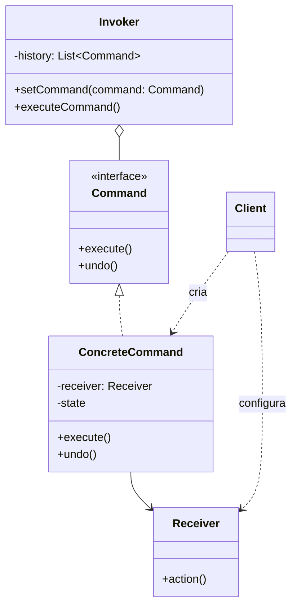

# Command

## Descrição

O Command encapsula uma solicitação como um objeto, contendo tudo o que é necessário para executá-la: a ação, o objeto que a realiza (o receptor) e os parâmetros. Com isso, é possível parametrizar clientes com diferentes solicitações, enfileirá-las, registrá-las em log e suportar operações que podem ser desfeitas.

O padrão separa quem dispara a operação (o Invoker, como um botão ou um agendador) de quem sabe realizá-la (o Receiver). O Invoker conhece apenas a interface `Command` com o método `execute()`; cada comando concreto delega o trabalho ao receptor apropriado. Opcionalmente, o comando guarda o estado necessário para implementar `undo()`.

Como os comandos são objetos de primeira classe, podem ser armazenados em histórico, compostos em macros, serializados para execução posterior ou em outro processo e reexecutados (por exemplo, para recuperação após falhas).

## Problemas que resolve

- Acoplamento direto entre o elemento de interface (botão, menu, atalho) e a lógica de negócio que ele dispara
- Necessidade de desfazer/refazer operações mantendo um histórico de ações
- Enfileirar, agendar ou executar operações de forma assíncrona ou remota
- Registrar operações em log para auditoria ou para reaplicá-las após uma falha
- Agrupar várias operações em uma única ação composta (macro ou transação)

## Quando usar

- Quando é preciso parametrizar objetos com ações a executar (callbacks orientados a objetos)
- Quando as solicitações devem ser especificadas, enfileiradas e executadas em momentos diferentes
- Quando o sistema precisa suportar undo/redo
- Quando operações devem ser registradas e reexecutáveis (journaling, event sourcing simplificado)
- Quando diferentes gatilhos (botão, atalho, menu, API) devem disparar a mesma operação

## Quando evitar

- Quando a operação é simples, síncrona e chamada de um único lugar: uma chamada direta de método ou uma função/lambda basta
- Quando não há necessidade de histórico, fila, log ou desacoplamento entre emissor e receptor
- Quando o número de classes de comando cresceria muito sem benefício real de reutilização

## Trade-offs

| Ganho | Custo / Risco |
| --- | --- |
| Desacopla quem invoca de quem executa | Aumenta o número de classes (uma por operação) |
| Permite undo/redo, filas, logs e macros | Implementar `undo()` corretamente exige guardar estado e pode ser complexo |
| Novos comandos são adicionados sem alterar código existente (Open/Closed) | Indireção extra dificulta seguir o fluxo de execução |
| Comandos podem ser serializados e executados depois ou remotamente | Comandos serializados exigem versionamento e cuidado com receptores ausentes |

- **Acoplamento:** o Invoker depende apenas da abstração `Command`; o acoplamento ao Receiver fica concentrado nos comandos concretos.
- **Testabilidade:** comandos são unidades pequenas e isoladas, fáceis de testar com receptores falsos.
- **Desempenho:** guardar histórico ilimitado para undo consome memória; costuma-se limitar o tamanho ou usar Memento para snapshots.
- **Linguagens modernas:** em linguagens com funções de primeira classe, closures podem substituir comandos simples, mas perdem undo e metadados.

## Diagrama



O `Client` cria o `ConcreteCommand` e o associa a um `Receiver`; o `Invoker` armazena comandos e chama `execute()` sem conhecer o receptor. O `ConcreteCommand` traduz a chamada em uma ou mais ações sobre o `Receiver` e pode guardar estado para `undo()`.

## Exemplo

Cada movimentação do ledger de uma conta é um comando com `execute()` e `undo()`, e o histórico permite estornar a última operação. Em contabilidade o estorno é um lançamento novo: o `undo()` posta o lançamento inverso e o original permanece no ledger.

```typescript
type EntryType = "DEBIT" | "CREDIT";

interface LedgerEntry {
  type: EntryType;
  amountCents: number;
  reversalOf?: number; // estorna o lançamento de índice indicado
}

class Account {                          // Receiver
  readonly entries: LedgerEntry[] = [];

  post(type: EntryType, amountCents: number, reversalOf?: number): number {
    this.entries.push({ type, amountCents, reversalOf });
    return this.entries.length - 1;      // o índice do lançamento serve de identificador
  }

  get balanceCents(): number {
    return this.entries.reduce(
      (sum, e) => sum + (e.type === "CREDIT" ? e.amountCents : -e.amountCents), 0);
  }
}

interface LedgerCommand { execute(): void; undo(): void; }

class CreditCommand implements LedgerCommand {
  private entryId?: number;
  constructor(private account: Account, private amountCents: number) {}
  execute() { this.entryId = this.account.post("CREDIT", this.amountCents); }
  undo() { this.account.post("DEBIT", this.amountCents, this.entryId); }
}

class DebitCommand implements LedgerCommand {
  private entryId?: number;
  constructor(private account: Account, private amountCents: number) {}
  execute() { this.entryId = this.account.post("DEBIT", this.amountCents); }
  undo() { this.account.post("CREDIT", this.amountCents, this.entryId); }
}

class LedgerHistory {                    // Invoker
  private history: LedgerCommand[] = [];
  run(cmd: LedgerCommand) { cmd.execute(); this.history.push(cmd); }
  undo() { this.history.pop()?.undo(); }
}

const account = new Account();
const history = new LedgerHistory();
history.run(new CreditCommand(account, 100_000));
history.run(new DebitCommand(account, 30_000));
console.log(account.balanceCents);       // 70000
history.undo();                          // posta um crédito de estorno; o débito original continua no ledger
console.log(account.balanceCents);       // 100000
console.log(account.entries.length);     // 3
```

## Padrões relacionados

- [Memento](/coding/gof/behavioral/memento) — pode guardar o estado do receptor antes da execução para viabilizar o `undo()`
- [Composite](/coding/gof/structural/composite) — permite montar macros, comandos compostos por outros comandos
- [Chain of Responsibility](/coding/gof/behavioral/chain-of-responsibility) — também desacopla emissor e receptor; os handlers podem ser representados como comandos
- [Strategy](/coding/gof/behavioral/strategy) — estrutura parecida, mas Strategy varia *como* algo é feito, enquanto Command representa *o que* fazer como objeto
- [Prototype](/coding/gof/creational/prototype) — útil para copiar comandos antes de colocá-los no histórico
- [Observer](/coding/gof/behavioral/observer) — comandos podem notificar observadores ou ser disparados por eventos

## Referência

- [Design Patterns Cheat Sheet](https://iretha.github.io/design-patterns/cheat-sheet)
- [Command no Refactoring.Guru](https://refactoring.guru/design-patterns/command)
