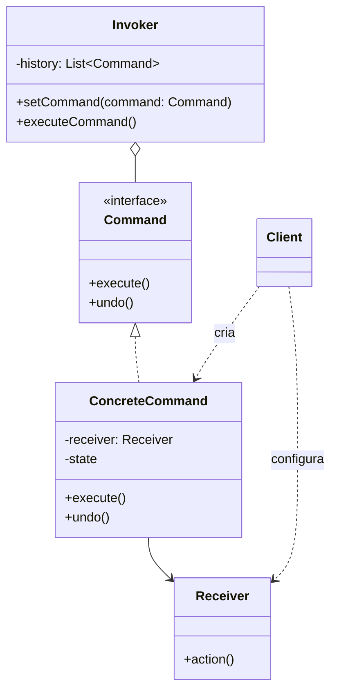

# Command

## Descrição

O Command encapsula uma solicitação como um objeto, contendo tudo o que é necessário para executá-la: a ação, o objeto que a realiza (o receptor) e os parâmetros. Com isso, é possível parametrizar clientes com diferentes solicitações, enfileirá-las, registrá-las em log e suportar operações que podem ser desfeitas.

O padrão separa quem dispara a operação (o Invoker, como um botão ou um agendador) de quem sabe realizá-la (o Receiver). O Invoker conhece apenas a interface `Command` com o método `execute()`; cada comando concreto delega o trabalho ao receptor apropriado. Opcionalmente, o comando guarda o estado necessário para implementar `undo()`.

Como os comandos são objetos de primeira classe, podem ser armazenados em histórico, compostos em macros, serializados para execução posterior ou em outro processo e reexecutados (por exemplo, para recuperação após falhas).

## Problemas que resolve

- Acoplamento direto entre o elemento de interface (botão, menu, atalho) e a lógica de negócio que ele dispara
- Necessidade de desfazer/refazer operações mantendo um histórico de ações
- Enfileirar, agendar ou executar operações de forma assíncrona ou remota
- Registrar operações em log para auditoria ou para reaplicá-las após uma falha
- Agrupar várias operações em uma única ação composta (macro ou transação)

## Quando usar

- Quando é preciso parametrizar objetos com ações a executar (callbacks orientados a objetos)
- Quando as solicitações devem ser especificadas, enfileiradas e executadas em momentos diferentes
- Quando o sistema precisa suportar undo/redo
- Quando operações devem ser registradas e reexecutáveis (journaling, event sourcing simplificado)
- Quando diferentes gatilhos (botão, atalho, menu, API) devem disparar a mesma operação

## Quando evitar

- Quando a operação é simples, síncrona e chamada de um único lugar: uma chamada direta de método ou uma função/lambda basta
- Quando não há necessidade de histórico, fila, log ou desacoplamento entre emissor e receptor
- Quando o número de classes de comando cresceria muito sem benefício real de reutilização

## Trade-offs

| Ganho | Custo / Risco |
| --- | --- |
| Desacopla quem invoca de quem executa | Aumenta o número de classes (uma por operação) |
| Permite undo/redo, filas, logs e macros | Implementar `undo()` corretamente exige guardar estado e pode ser complexo |
| Novos comandos são adicionados sem alterar código existente (Open/Closed) | Indireção extra dificulta seguir o fluxo de execução |
| Comandos podem ser serializados e executados depois ou remotamente | Comandos serializados exigem versionamento e cuidado com receptores ausentes |

- **Acoplamento:** o Invoker depende apenas da abstração `Command`; o acoplamento ao Receiver fica concentrado nos comandos concretos.
- **Testabilidade:** comandos são unidades pequenas e isoladas, fáceis de testar com receptores falsos.
- **Desempenho:** guardar histórico ilimitado para undo consome memória; costuma-se limitar o tamanho ou usar Memento para snapshots.
- **Linguagens modernas:** em linguagens com funções de primeira classe, closures podem substituir comandos simples, mas perdem undo e metadados.

## Diagrama



O `Client` cria o `ConcreteCommand` e o associa a um `Receiver`; o `Invoker` armazena comandos e chama `execute()` sem conhecer o receptor. O `ConcreteCommand` traduz a chamada em uma ou mais ações sobre o `Receiver` e pode guardar estado para `undo()`.

## Exemplo

Cada movimentação do ledger de uma conta é um comando com `execute()` e `undo()`, e o histórico permite estornar a última operação. Em contabilidade o estorno é um lançamento novo: o `undo()` posta o lançamento inverso e o original permanece no ledger.

<Tabs groupId="lang" queryString>
<TabItem value="java" label="Java">

```java
enum EntryType { DEBIT, CREDIT }

// reversalOf: estorna o lançamento de índice indicado (null nos demais)
record LedgerEntry(EntryType type, long amountCents, Integer reversalOf) {}

class Account {                              // Receiver
    final List<LedgerEntry> entries = new ArrayList<>();

    int post(EntryType type, long amountCents, Integer reversalOf) {
        entries.add(new LedgerEntry(type, amountCents, reversalOf));
        return entries.size() - 1;           // o índice do lançamento serve de identificador
    }

    long balanceCents() {
        return entries.stream()
                .mapToLong(e -> e.type() == EntryType.CREDIT ? e.amountCents() : -e.amountCents())
                .sum();
    }
}

interface LedgerCommand { void execute(); void undo(); }

class CreditCommand implements LedgerCommand {
    private final Account account;
    private final long amountCents;
    private Integer entryId;

    CreditCommand(Account account, long amountCents) { this.account = account; this.amountCents = amountCents; }
    public void execute() { entryId = account.post(EntryType.CREDIT, amountCents, null); }
    public void undo() { account.post(EntryType.DEBIT, amountCents, entryId); }
}

class DebitCommand implements LedgerCommand {
    private final Account account;
    private final long amountCents;
    private Integer entryId;

    DebitCommand(Account account, long amountCents) { this.account = account; this.amountCents = amountCents; }
    public void execute() { entryId = account.post(EntryType.DEBIT, amountCents, null); }
    public void undo() { account.post(EntryType.CREDIT, amountCents, entryId); }
}

class LedgerHistory {                        // Invoker
    private final Deque<LedgerCommand> history = new ArrayDeque<>();

    void run(LedgerCommand cmd) { cmd.execute(); history.push(cmd); }
    void undo() { if (!history.isEmpty()) history.pop().undo(); }
}

Account account = new Account();
LedgerHistory history = new LedgerHistory();
history.run(new CreditCommand(account, 100_000));
history.run(new DebitCommand(account, 30_000));
System.out.println(account.balanceCents());  // 70000
history.undo();                              // posta um crédito de estorno; o débito original continua no ledger
System.out.println(account.balanceCents());  // 100000
System.out.println(account.entries.size());  // 3
```

</TabItem>
<TabItem value="python" label="Python">

```python
from dataclasses import dataclass
from typing import Optional, Protocol

@dataclass(frozen=True)
class LedgerEntry:
    type: str  # "DEBIT" ou "CREDIT"
    amount_cents: int
    reversal_of: Optional[int] = None  # estorna o lançamento de índice indicado

class Account:  # Receiver
    def __init__(self) -> None:
        self.entries: list[LedgerEntry] = []

    def post(self, type: str, amount_cents: int, reversal_of: Optional[int] = None) -> int:
        self.entries.append(LedgerEntry(type, amount_cents, reversal_of))
        return len(self.entries) - 1  # o índice do lançamento serve de identificador

    @property
    def balance_cents(self) -> int:
        return sum(e.amount_cents if e.type == "CREDIT" else -e.amount_cents for e in self.entries)

class LedgerCommand(Protocol):
    def execute(self) -> None: ...
    def undo(self) -> None: ...

class CreditCommand:
    def __init__(self, account: Account, amount_cents: int) -> None:
        self._account, self._amount_cents = account, amount_cents
        self._entry_id: Optional[int] = None

    def execute(self) -> None:
        self._entry_id = self._account.post("CREDIT", self._amount_cents)

    def undo(self) -> None:
        self._account.post("DEBIT", self._amount_cents, self._entry_id)

class DebitCommand:
    def __init__(self, account: Account, amount_cents: int) -> None:
        self._account, self._amount_cents = account, amount_cents
        self._entry_id: Optional[int] = None

    def execute(self) -> None:
        self._entry_id = self._account.post("DEBIT", self._amount_cents)

    def undo(self) -> None:
        self._account.post("CREDIT", self._amount_cents, self._entry_id)

class LedgerHistory:  # Invoker
    def __init__(self) -> None:
        self._history: list[LedgerCommand] = []

    def run(self, cmd: LedgerCommand) -> None:
        cmd.execute()
        self._history.append(cmd)

    def undo(self) -> None:
        if self._history:
            self._history.pop().undo()

account = Account()
history = LedgerHistory()
history.run(CreditCommand(account, 100_000))
history.run(DebitCommand(account, 30_000))
print(account.balance_cents)  # 70000
history.undo()                # posta um crédito de estorno; o débito original continua no ledger
print(account.balance_cents)  # 100000
print(len(account.entries))   # 3
```

</TabItem>
<TabItem value="go" label="Go">

```go
type EntryType string

const (
	Debit  EntryType = "DEBIT"
	Credit EntryType = "CREDIT"
)

type LedgerEntry struct {
	Type        EntryType
	AmountCents int64
	ReversalOf  *int // estorna o lançamento de índice indicado
}

type Account struct { // Receiver
	Entries []LedgerEntry
}

func (a *Account) Post(entryType EntryType, amountCents int64, reversalOf *int) int {
	a.Entries = append(a.Entries, LedgerEntry{entryType, amountCents, reversalOf})
	return len(a.Entries) - 1 // o índice do lançamento serve de identificador
}

func (a *Account) BalanceCents() int64 {
	var sum int64
	for _, e := range a.Entries {
		if e.Type == Credit {
			sum += e.AmountCents
		} else {
			sum -= e.AmountCents
		}
	}
	return sum
}

type LedgerCommand interface {
	Execute()
	Undo()
}

type CreditCommand struct {
	account     *Account
	amountCents int64
	entryID     int
}

func (c *CreditCommand) Execute() { c.entryID = c.account.Post(Credit, c.amountCents, nil) }
func (c *CreditCommand) Undo()    { c.account.Post(Debit, c.amountCents, &c.entryID) }

type DebitCommand struct {
	account     *Account
	amountCents int64
	entryID     int
}

func (c *DebitCommand) Execute() { c.entryID = c.account.Post(Debit, c.amountCents, nil) }
func (c *DebitCommand) Undo()    { c.account.Post(Credit, c.amountCents, &c.entryID) }

type LedgerHistory struct { // Invoker
	history []LedgerCommand
}

func (h *LedgerHistory) Run(cmd LedgerCommand) {
	cmd.Execute()
	h.history = append(h.history, cmd)
}

func (h *LedgerHistory) Undo() {
	if len(h.history) == 0 {
		return
	}
	last := h.history[len(h.history)-1]
	h.history = h.history[:len(h.history)-1]
	last.Undo()
}

func main() {
	account := &Account{}
	history := &LedgerHistory{}
	history.Run(&CreditCommand{account: account, amountCents: 100_000})
	history.Run(&DebitCommand{account: account, amountCents: 30_000})
	fmt.Println(account.BalanceCents()) // 70000
	history.Undo()                      // posta um crédito de estorno; o débito original continua no ledger
	fmt.Println(account.BalanceCents()) // 100000
	fmt.Println(len(account.Entries))   // 3
}
```

</TabItem>
<TabItem value="typescript" label="TypeScript">

```typescript
type EntryType = "DEBIT" | "CREDIT";

interface LedgerEntry {
  type: EntryType;
  amountCents: number;
  reversalOf?: number; // estorna o lançamento de índice indicado
}

class Account {                          // Receiver
  readonly entries: LedgerEntry[] = [];

  post(type: EntryType, amountCents: number, reversalOf?: number): number {
    this.entries.push({ type, amountCents, reversalOf });
    return this.entries.length - 1;      // o índice do lançamento serve de identificador
  }

  get balanceCents(): number {
    return this.entries.reduce(
      (sum, e) => sum + (e.type === "CREDIT" ? e.amountCents : -e.amountCents), 0);
  }
}

interface LedgerCommand { execute(): void; undo(): void; }

class CreditCommand implements LedgerCommand {
  private entryId?: number;
  constructor(private account: Account, private amountCents: number) {}
  execute() { this.entryId = this.account.post("CREDIT", this.amountCents); }
  undo() { this.account.post("DEBIT", this.amountCents, this.entryId); }
}

class DebitCommand implements LedgerCommand {
  private entryId?: number;
  constructor(private account: Account, private amountCents: number) {}
  execute() { this.entryId = this.account.post("DEBIT", this.amountCents); }
  undo() { this.account.post("CREDIT", this.amountCents, this.entryId); }
}

class LedgerHistory {                    // Invoker
  private history: LedgerCommand[] = [];
  run(cmd: LedgerCommand) { cmd.execute(); this.history.push(cmd); }
  undo() { this.history.pop()?.undo(); }
}

const account = new Account();
const history = new LedgerHistory();
history.run(new CreditCommand(account, 100_000));
history.run(new DebitCommand(account, 30_000));
console.log(account.balanceCents);       // 70000
history.undo();                          // posta um crédito de estorno; o débito original continua no ledger
console.log(account.balanceCents);       // 100000
console.log(account.entries.length);     // 3
```

</TabItem>
</Tabs>

## Padrões relacionados

- [Memento](/coding/gof/behavioral/memento) — pode guardar o estado do receptor antes da execução para viabilizar o `undo()`
- [Composite](/coding/gof/structural/composite) — permite montar macros, comandos compostos por outros comandos
- [Chain of Responsibility](/coding/gof/behavioral/chain-of-responsibility) — também desacopla emissor e receptor; os handlers podem ser representados como comandos
- [Strategy](/coding/gof/behavioral/strategy) — estrutura parecida, mas Strategy varia *como* algo é feito, enquanto Command representa *o que* fazer como objeto
- [Prototype](/coding/gof/creational/prototype) — útil para copiar comandos antes de colocá-los no histórico
- [Observer](/coding/gof/behavioral/observer) — comandos podem notificar observadores ou ser disparados por eventos

## Referência

- [Design Patterns Cheat Sheet](https://iretha.github.io/design-patterns/cheat-sheet)
- [Command no Refactoring.Guru](https://refactoring.guru/design-patterns/command)
