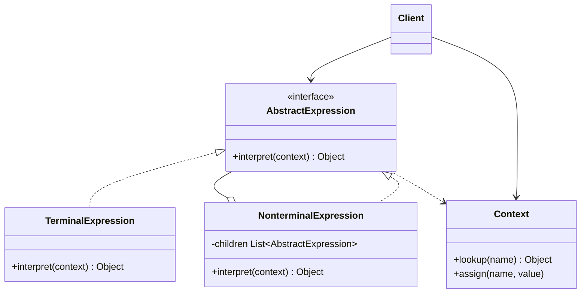

# Interpreter

## Descrição

O Interpreter define uma representação para a gramática de uma linguagem simples e um interpretador que usa essa representação para avaliar sentenças da linguagem. Cada regra da gramática vira uma classe, e uma sentença é representada como uma árvore sintática abstrata (AST) composta por instâncias dessas classes.

A interface comum `AbstractExpression` declara a operação `interpret(context)`. Expressões terminais (como literais e variáveis) resolvem seu valor diretamente; expressões não terminais (como soma, `and`, `or`) combinam recursivamente os resultados de suas subexpressões. Um `Context` carrega informações globais necessárias à interpretação, como valores de variáveis.

O padrão não trata da análise sintática (parsing): ele assume que a árvore já foi construída, seja manualmente pelo cliente, seja por um parser separado.

## Problemas que resolve

- Avaliar repetidamente expressões de uma linguagem pequena e bem definida (regras de negócio, filtros, consultas simples)
- Evitar condicionais gigantes ao interpretar comandos ou expressões configuráveis pelo usuário
- Permitir estender a linguagem adicionando novas regras como novas classes
- Representar expressões como objetos que podem ser combinados, reutilizados e avaliados com contextos diferentes

## Quando usar

- A gramática é simples e relativamente estável
- Eficiência não é a preocupação principal
- É útil expressar o problema como sentenças de uma DSL (por exemplo, regras de validação, expressões booleanas, especificações de busca)
- As mesmas expressões precisam ser avaliadas contra vários contextos

## Quando evitar

- A gramática é grande ou complexa: o número de classes explode e a manutenção fica difícil; prefira geradores de parser ou bibliotecas de expressão
- O desempenho é crítico: interpretar uma AST recursivamente é mais lento que código compilado ou tabelas de estado
- Já existe uma linguagem ou motor de regras pronto que atende à necessidade

## Trade-offs

| Ganho | Custo / Risco |
| --- | --- |
| Fácil mudar e estender a gramática (nova regra = nova classe) | Gramáticas grandes geram muitas classes difíceis de manter |
| Implementação direta de cada regra, isolada e testável | Avaliação recursiva pode ser lenta e consumir pilha em árvores profundas |
| Expressões combináveis e reutilizáveis | Não resolve o parsing; é preciso construir a AST de outra forma |
| Novas formas de interpretar podem ser adicionadas | Adicionar operações exige alterar todas as classes, a menos que se use Visitor |

- Acoplamento: cada classe conhece apenas sua regra e suas subexpressões.
- Testabilidade: expressões terminais e não terminais podem ser testadas isoladamente.
- Complexidade: cresce linearmente com o número de regras da gramática.
- Desempenho: considere cache de resultados ou compilação da AST quando houver avaliações frequentes.

## Diagrama



O `Client` monta (ou recebe) a árvore de `AbstractExpression` e chama `interpret` passando um `Context`. `TerminalExpression` representa as folhas da gramática e `NonterminalExpression` agrega subexpressões, formando uma estrutura recursiva semelhante ao Composite.

## Exemplo

Um sistema de promoções avalia regras booleanas como `cliente_vip AND (valor_alto OR primeira_compra)` contra os dados de cada pedido.

```typescript
interface Expression {
  interpret(ctx: Map<string, boolean>): boolean;
}

class Variable implements Expression {
  constructor(private name: string) {}
  interpret(ctx: Map<string, boolean>): boolean {
    return ctx.get(this.name) ?? false;
  }
}

class And implements Expression {
  constructor(private left: Expression, private right: Expression) {}
  interpret(ctx: Map<string, boolean>): boolean {
    return this.left.interpret(ctx) && this.right.interpret(ctx);
  }
}

class Or implements Expression {
  constructor(private left: Expression, private right: Expression) {}
  interpret(ctx: Map<string, boolean>): boolean {
    return this.left.interpret(ctx) || this.right.interpret(ctx);
  }
}

const rule = new And(
  new Variable("cliente_vip"),
  new Or(new Variable("valor_alto"), new Variable("primeira_compra")),
);
const ctx = new Map([["cliente_vip", true], ["primeira_compra", true]]);
console.log(rule.interpret(ctx)); // true
```

## Padrões relacionados

- [Composite](/coding/gof/structural/composite) — a árvore sintática abstrata é uma instância do Composite
- [Flyweight](/coding/gof/structural/flyweight) — permite compartilhar símbolos terminais repetidos na AST
- [Iterator](/coding/gof/behavioral/iterator) — pode ser usado para percorrer a estrutura da árvore
- [Visitor](/coding/gof/behavioral/visitor) — concentra operações sobre os nós da AST em uma única classe, evitando alterar cada expressão

## Referência

- [Design Patterns Cheat Sheet](https://iretha.github.io/design-patterns/cheat-sheet)
- [Interpreter no SourceMaking](https://sourcemaking.com/design_patterns/interpreter)
