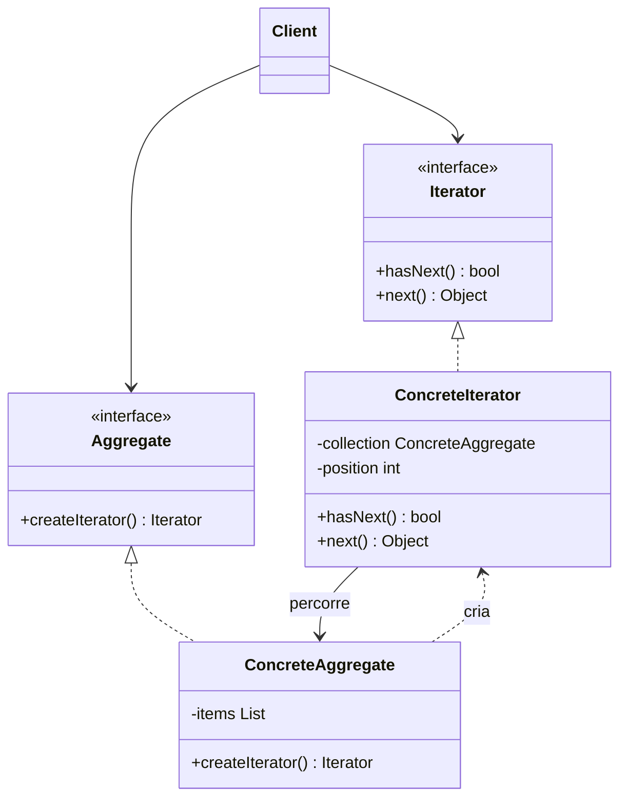

# Iterator

## Descrição

O Iterator fornece uma forma de acessar sequencialmente os elementos de uma coleção (agregado) sem expor sua representação interna. Em vez de o cliente conhecer se os dados estão em um array, uma lista ligada, uma árvore ou uma fonte paginada, ele conversa apenas com uma interface de iteração uniforme, com operações como `hasNext()` e `next()`.

A responsabilidade de percorrer a coleção sai do agregado e passa para um objeto iterador separado, que guarda o estado da travessia (posição atual, pilha de nós visitados, cursor de página etc.). Assim, a mesma coleção pode ter vários iteradores ativos ao mesmo tempo e oferecer diferentes estratégias de percurso (em ordem, reversa, filtrada, em largura, em profundidade).

O agregado atua como fábrica de iteradores por meio de um método como `createIterator()`. Muitas linguagens incorporam o padrão nativamente (`Iterable`/`Iterator` em Java, `IEnumerable` em C#, protocolo de iteração em Python e JavaScript, geradores com `yield`).

## Problemas que resolve

- O código cliente fica acoplado à estrutura interna da coleção (índices, ponteiros de nós, cursores) e quebra quando ela muda.
- Diferentes coleções exigem laços diferentes, impedindo algoritmos genéricos que funcionem sobre qualquer estrutura.
- É preciso suportar múltiplas formas de percorrer a mesma coleção sem inchar sua interface com métodos de travessia.
- Várias travessias simultâneas e independentes sobre a mesma coleção precisam manter seu próprio estado.
- Percorrer grandes volumes de dados (streams, resultados paginados) sem carregar tudo em memória.

## Quando usar

- A coleção tem estrutura complexa (árvore, grafo, composição) e você quer esconder essa complexidade dos clientes.
- Você precisa de uma interface uniforme para percorrer coleções heterogêneas (iteração polimórfica).
- Há necessidade de várias estratégias de percurso ou de iteração preguiçosa (lazy) sobre fontes externas.
- Você quer reduzir duplicação de código de travessia espalhado pela aplicação.

## Quando evitar

- A coleção é simples (um array ou lista nativa) e a linguagem já oferece iteração adequada; criar iteradores próprios só adiciona cerimônia.
- O acesso aleatório por índice é o caso de uso principal, e a iteração sequencial é mais lenta ou menos expressiva.
- A coleção é modificada com frequência durante a travessia e não há uma política clara para lidar com modificações concorrentes.

## Trade-offs

| Ganho | Custo / Risco |
| --- | --- |
| Encapsula a estrutura interna da coleção | Mais classes e interfaces para manter |
| Permite múltiplas travessias simultâneas e independentes | Iteradores podem ficar inválidos se a coleção mudar durante o percurso |
| Suporta várias estratégias de percurso sem alterar o agregado | Pode ser menos eficiente que acesso direto em coleções especializadas |
| Habilita iteração preguiçosa e sobre fontes infinitas | Estado da iteração precisa de cuidado em cenários concorrentes |
| Facilita algoritmos genéricos (Single Responsibility, Open/Closed) | Overkill para coleções triviais |

- **Acoplamento:** o cliente depende apenas das interfaces `Iterator` e `Aggregate`, não das classes concretas.
- **Testabilidade:** iteradores podem ser testados isoladamente e substituídos por dublês simples.
- **Robustez:** decida entre iteradores *fail-fast* (lançam erro em modificação concorrente) ou baseados em snapshot.
- **Iterador interno vs. externo:** iteradores externos dão controle ao cliente; internos (ex.: `forEach` com callback) são mais simples, porém menos flexíveis.

## Diagrama



O `Client` obtém um `Iterator` a partir do `Aggregate` e percorre os elementos sem conhecer a estrutura interna. O `ConcreteAggregate` cria o `ConcreteIterator`, que mantém a posição atual da travessia sobre a coleção.

## Exemplo

O extrato de uma conta tem milhares de lançamentos e a API os devolve em páginas com cursor. O consumidor só chama `hasNext()` e `next()`: o `PagedStatementIterator` busca a próxima página quando a atual acaba, e o `ReverseStatementIterator` percorre a mesma coleção do lançamento mais recente para o mais antigo.

<Tabs groupId="lang" queryString>
<TabItem value="java" label="Java">

```java
record StatementEntry(String date, String description, long amountCents) {}

record Page(List<StatementEntry> entries, Integer nextCursor) {}

class Statement implements Iterable<StatementEntry> {
    private final List<StatementEntry> entries;
    private final int pageSize;

    Statement(List<StatementEntry> entries, int pageSize) { this.entries = entries; this.pageSize = pageSize; }

    // simula a API paginada: devolve uma página e o cursor da próxima
    Page fetchPage(int cursor) {
        int end = Math.min(cursor + pageSize, entries.size());
        return new Page(entries.subList(cursor, end), end < entries.size() ? end : null);
    }

    public Iterator<StatementEntry> iterator() { return new PagedStatementIterator(this); }

    Iterator<StatementEntry> reverseIterator() {
        return new ReverseStatementIterator(entries); // simplificação: lê os lançamentos já carregados
    }
}

class PagedStatementIterator implements Iterator<StatementEntry> {
    private final Statement statement;
    private List<StatementEntry> buffer = List.of();
    private int position = 0;
    private Integer cursor = 0;

    PagedStatementIterator(Statement statement) { this.statement = statement; }

    public boolean hasNext() { fill(); return position < buffer.size(); }
    public StatementEntry next() { fill(); return buffer.get(position++); }

    private void fill() {
        if (position < buffer.size() || cursor == null) return;
        Page page = statement.fetchPage(cursor); // só busca quando a página atual acabou
        buffer = page.entries();
        position = 0;
        cursor = page.nextCursor();
    }
}

class ReverseStatementIterator implements Iterator<StatementEntry> {
    private final List<StatementEntry> entries;
    private int position;

    ReverseStatementIterator(List<StatementEntry> entries) { this.entries = entries; position = entries.size() - 1; }

    public boolean hasNext() { return position >= 0; }
    public StatementEntry next() { return entries.get(position--); }
}

Statement statement = new Statement(List.of(
    new StatementEntry("2026-03-01", "Pix recebido", 25_000),
    new StatementEntry("2026-03-02", "Boleto pago", -8_990),
    new StatementEntry("2026-03-03", "Compra no cartão", -4_550)), 2);

for (StatementEntry entry : statement) System.out.println(entry.description()); // Pix recebido, Boleto pago, Compra no cartão

Iterator<StatementEntry> recent = statement.reverseIterator();
System.out.println(recent.next().description());                                // Compra no cartão
```

</TabItem>
<TabItem value="python" label="Python">

```python
from dataclasses import dataclass
from typing import Iterator, Optional

@dataclass(frozen=True)
class StatementEntry:
    date: str
    description: str
    amount_cents: int

@dataclass(frozen=True)
class Page:
    entries: list[StatementEntry]
    next_cursor: Optional[int]

class Statement:
    def __init__(self, entries: list[StatementEntry], page_size: int = 2) -> None:
        self._entries = entries
        self._page_size = page_size

    def fetch_page(self, cursor: int = 0) -> Page:
        """Simula a API paginada: devolve uma página e o cursor da próxima."""
        end = cursor + self._page_size
        return Page(self._entries[cursor:end], end if end < len(self._entries) else None)

    def __iter__(self) -> Iterator[StatementEntry]:
        return PagedStatementIterator(self)

    def __reversed__(self) -> Iterator[StatementEntry]:
        return ReverseStatementIterator(self._entries)  # simplificação: lê os lançamentos já carregados

class PagedStatementIterator:
    def __init__(self, statement: Statement) -> None:
        self._statement = statement
        self._buffer: list[StatementEntry] = []
        self._position = 0
        self._cursor: Optional[int] = 0

    def __iter__(self) -> Iterator[StatementEntry]:
        return self

    def __next__(self) -> StatementEntry:
        if self._position >= len(self._buffer):
            if self._cursor is None:
                raise StopIteration
            page = self._statement.fetch_page(self._cursor)  # só busca quando a página atual acabou
            self._buffer, self._position, self._cursor = page.entries, 0, page.next_cursor
        entry = self._buffer[self._position]
        self._position += 1
        return entry

class ReverseStatementIterator:
    def __init__(self, entries: list[StatementEntry]) -> None:
        self._entries = entries
        self._position = len(entries) - 1

    def __iter__(self) -> Iterator[StatementEntry]:
        return self

    def __next__(self) -> StatementEntry:
        if self._position < 0:
            raise StopIteration
        entry = self._entries[self._position]
        self._position -= 1
        return entry

statement = Statement([
    StatementEntry("2026-03-01", "Pix recebido", 25_000),
    StatementEntry("2026-03-02", "Boleto pago", -8_990),
    StatementEntry("2026-03-03", "Compra no cartão", -4_550),
])

for entry in statement:
    print(entry.description)  # Pix recebido, Boleto pago, Compra no cartão

recent = reversed(statement)
print(next(recent).description)  # Compra no cartão
```

</TabItem>
<TabItem value="go" label="Go">

```go
type StatementEntry struct {
	Date        string
	Description string
	AmountCents int64
}

type Page struct {
	Entries    []StatementEntry
	NextCursor int // -1 quando não há próxima página
}

type Statement struct {
	entries  []StatementEntry
	pageSize int
}

// simula a API paginada: devolve uma página e o cursor da próxima
func (s *Statement) FetchPage(cursor int) Page {
	end := min(cursor+s.pageSize, len(s.entries))
	next := -1
	if end < len(s.entries) {
		next = end
	}
	return Page{s.entries[cursor:end], next}
}

// Em Go, o iterador é uma função iter.Seq, consumida com for range.
func (s *Statement) All() iter.Seq[StatementEntry] {
	return func(yield func(StatementEntry) bool) {
		for cursor := 0; cursor >= 0; {
			page := s.FetchPage(cursor) // só busca quando a página atual acabou
			for _, entry := range page.Entries {
				if !yield(entry) {
					return
				}
			}
			cursor = page.NextCursor
		}
	}
}

func (s *Statement) Backward() iter.Seq[StatementEntry] {
	return func(yield func(StatementEntry) bool) {
		// simplificação: lê os lançamentos já carregados
		for i := len(s.entries) - 1; i >= 0; i-- {
			if !yield(s.entries[i]) {
				return
			}
		}
	}
}

func main() {
	statement := &Statement{pageSize: 2, entries: []StatementEntry{
		{"2026-03-01", "Pix recebido", 25_000},
		{"2026-03-02", "Boleto pago", -8_990},
		{"2026-03-03", "Compra no cartão", -4_550},
	}}

	for entry := range statement.All() {
		fmt.Println(entry.Description) // Pix recebido, Boleto pago, Compra no cartão
	}

	for entry := range statement.Backward() {
		fmt.Println(entry.Description) // Compra no cartão
		break
	}
}
```

</TabItem>
<TabItem value="typescript" label="TypeScript">

```typescript
interface StatementEntry {
  date: string;
  description: string;
  amountCents: number;
}

interface Page {
  entries: StatementEntry[];
  nextCursor?: number;
}

interface StatementIterator {
  hasNext(): boolean;
  next(): StatementEntry;
}

class Statement {
  constructor(private entries: StatementEntry[], private pageSize = 2) {}

  // simula a API paginada: devolve uma página e o cursor da próxima
  fetchPage(cursor = 0): Page {
    const end = cursor + this.pageSize;
    return {
      entries: this.entries.slice(cursor, end),
      nextCursor: end < this.entries.length ? end : undefined,
    };
  }

  createIterator(): StatementIterator {
    return new PagedStatementIterator(this);
  }

  createReverseIterator(): StatementIterator {
    return new ReverseStatementIterator(this.entries); // simplificação: lê os lançamentos já carregados
  }
}

class PagedStatementIterator implements StatementIterator {
  private buffer: StatementEntry[] = [];
  private position = 0;
  private cursor: number | undefined = 0;
  constructor(private statement: Statement) {}

  hasNext(): boolean { this.fill(); return this.position < this.buffer.length; }
  next(): StatementEntry { this.fill(); return this.buffer[this.position++]; }

  private fill(): void {
    if (this.position < this.buffer.length || this.cursor === undefined) return;
    const page = this.statement.fetchPage(this.cursor); // só busca quando a página atual acabou
    this.buffer = page.entries;
    this.position = 0;
    this.cursor = page.nextCursor;
  }
}

class ReverseStatementIterator implements StatementIterator {
  private position: number;
  constructor(private entries: StatementEntry[]) {
    this.position = entries.length - 1;
  }

  hasNext(): boolean { return this.position >= 0; }
  next(): StatementEntry { return this.entries[this.position--]; }
}

const statement = new Statement([
  { date: "2026-03-01", description: "Pix recebido", amountCents: 25_000 },
  { date: "2026-03-02", description: "Boleto pago", amountCents: -8_990 },
  { date: "2026-03-03", description: "Compra no cartão", amountCents: -4_550 },
]);

const it = statement.createIterator();
while (it.hasNext()) console.log(it.next().description);  // Pix recebido, Boleto pago, Compra no cartão

const recent = statement.createReverseIterator();
console.log(recent.next().description);                   // Compra no cartão
```

</TabItem>
</Tabs>

## Padrões relacionados

- [Composite](/coding/gof/structural/composite) — iteradores são frequentemente usados para percorrer estruturas recursivas de Composite.
- [Factory Method](/coding/gof/creational/factory-method) — `createIterator()` é um Factory Method que permite a cada coleção instanciar o iterador adequado.
- [Memento](/coding/gof/behavioral/memento) — pode capturar o estado de uma iteração para retomá-la ou desfazê-la depois.
- [Visitor](/coding/gof/behavioral/visitor) — combina-se com Iterator: o iterador percorre a coleção e o Visitor aplica a operação a cada elemento.
- [Null Object](/coding/gof/behavioral/null-object) — um iterador vazio (Null Iterator) evita verificações de nulo em coleções sem elementos.

## Referência

- [Design Patterns Cheat Sheet](https://iretha.github.io/design-patterns/cheat-sheet)
- [Iterator no Refactoring.Guru](https://refactoring.guru/design-patterns/iterator)
