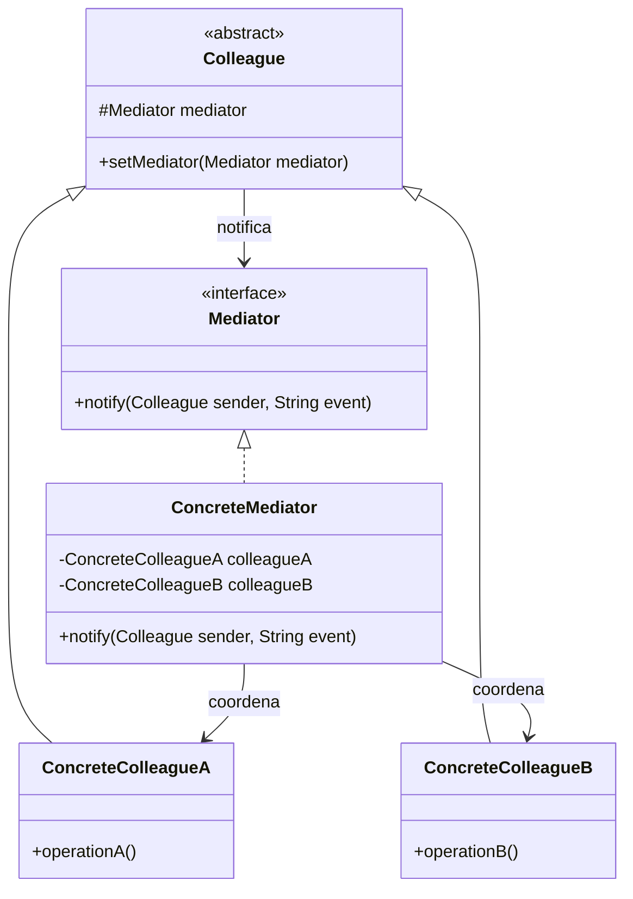

# Mediator

## Descrição

O Mediator define um objeto que encapsula a forma como um conjunto de objetos interage. Em vez de os objetos (chamados de colleagues) se referenciarem e se chamarem diretamente, eles se comunicam apenas por meio do mediador, o que promove baixo acoplamento entre eles.

Cada colleague conhece somente a abstração `Mediator` e o notifica quando algo relevante acontece. O mediador concreto concentra a lógica de coordenação: decide quais outros colleagues devem reagir e em que ordem. Assim, uma rede de dependências muitos-para-muitos é transformada em várias relações um-para-muitos centradas no mediador.

Como o comportamento colaborativo fica em um único lugar, é possível alterar a forma como os componentes interagem trocando ou estendendo o mediador, sem modificar as classes dos colleagues, que se tornam mais fáceis de reutilizar.

## Problemas que resolve

- Muitos objetos referenciando-se diretamente, formando uma teia de dependências difícil de entender e manter
- Componentes difíceis de reutilizar porque dependem de vários outros componentes específicos
- Lógica de interação espalhada entre várias classes, exigindo mudanças em muitas delas para alterar um fluxo
- Coordenação de elementos de UI em formulários (habilitar botões, validar campos, atualizar listas conforme seleções)
- Comunicação entre participantes de um sistema, como usuários em uma sala de chat ou aeronaves em uma torre de controle

## Quando usar

- Um conjunto de objetos se comunica de maneira bem definida, porém complexa, e as interdependências resultantes são desestruturadas
- Reutilizar um objeto é difícil porque ele referencia e se comunica com muitos outros
- Um comportamento distribuído entre várias classes deve ser customizável sem criar muitas subclasses
- Você quer centralizar regras de orquestração entre componentes (por exemplo, diálogos de UI, workflows, handlers de comandos em CQRS)

### Quando evitar

- Poucos objetos com interações simples — chamadas diretas são mais claras
- O mediador tende a acumular regras demais e virar um "god object" difícil de manter
- A comunicação é essencialmente de broadcast sem lógica de coordenação — o Observer costuma ser suficiente
- Desempenho é crítico e a indireção adicional em cada interação não se justifica

## Trade-offs

| Ganho | Custo / Risco |
| --- | --- |
| Reduz o acoplamento entre colleagues | O mediador pode se tornar monolítico e complexo (god object) |
| Centraliza a lógica de interação em um único ponto | Ponto único de falha e de contenção de mudanças |
| Colleagues ficam mais simples e reutilizáveis | Fluxo indireto torna o rastreamento das interações menos óbvio |
| Substitui relações muitos-para-muitos por um-para-muitos | Mediadores concretos costumam ser pouco reutilizáveis entre contextos |

- **Acoplamento:** colleagues dependem apenas da interface `Mediator`; o acoplamento se concentra no mediador concreto.
- **Testabilidade:** colleagues podem ser testados com um mediador falso; o mediador pode ser testado com colleagues simulados.
- **Complexidade:** divida mediadores grandes por contexto ou caso de uso para evitar que cresçam indefinidamente.
- **Desempenho:** a indireção tem custo baixo, mas pode se acumular em fluxos com muitas notificações encadeadas.

## Diagrama



O `Mediator` define a interface de comunicação usada pelos colleagues. O `ConcreteMediator` conhece os colleagues concretos e implementa a coordenação entre eles. Cada `Colleague` guarda uma referência ao mediador e o notifica em vez de falar diretamente com os demais.

## Exemplo

Em uma sala de chat, os usuários não enviam mensagens diretamente uns aos outros: a sala (mediador) recebe a mensagem e a repassa a todos os demais participantes.

```typescript
interface ChatMediator {
  register(user: User): void;
  send(message: string, sender: User): void;
}

class ChatRoom implements ChatMediator {
  private users: User[] = [];

  register(user: User): void {
    this.users.push(user);
  }

  send(message: string, sender: User): void {
    this.users
      .filter((u) => u !== sender)
      .forEach((u) => u.receive(message, sender.name));
  }
}

class User {
  constructor(public name: string, private room: ChatMediator) {
    room.register(this);
  }
  send(message: string): void {
    this.room.send(message, this);
  }
  receive(message: string, from: string): void {
    console.log(`[${this.name}] ${from}: ${message}`);
  }
}

const room = new ChatRoom();
const alice = new User("Alice", room);
new User("Bob", room);
alice.send("Olá, Bob!"); // [Bob] Alice: Olá, Bob!
```

## Padrões relacionados

- [Observer](/coding/gof/behavioral/observer) — frequentemente usado para implementar a comunicação entre colleagues e mediador; o Observer distribui a comunicação, enquanto o Mediator a centraliza
- [Facade](/coding/gof/structural/facade) — também simplifica interações, mas é unidirecional e abstrai um subsistema; o Mediator coordena colleagues que o conhecem e se comunicam por ele
- [Chain of Responsibility](/coding/gof/behavioral/chain-of-responsibility) — outra forma de desacoplar remetentes e receptores, passando a requisição por uma cadeia em vez de centralizá-la
- [Command](/coding/gof/behavioral/command) — comandos podem ser encaminhados por um mediador a seus handlers, como em bibliotecas de mediator para CQRS
- [Singleton](/coding/gof/creational/singleton) — o mediador costuma ter uma única instância por contexto

## Referência

- [Design Patterns Cheat Sheet](https://iretha.github.io/design-patterns/cheat-sheet)
- [Mediator no Refactoring.Guru](https://refactoring.guru/design-patterns/mediator)
