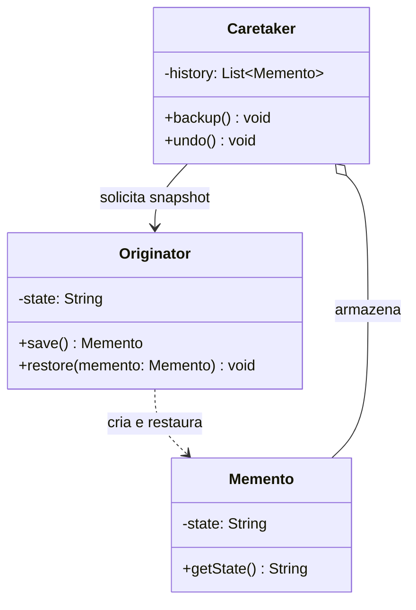

# Memento

## Descrição

O Memento captura e externaliza o estado interno de um objeto, sem violar seu encapsulamento, para que esse objeto possa ser restaurado a esse estado mais tarde. É o padrão clássico por trás de funcionalidades de desfazer (undo), checkpoints e rollback.

O padrão envolve três participantes. O Originator é o objeto cujo estado se quer salvar: ele sabe criar um memento com um snapshot do próprio estado e restaurar-se a partir de um memento. O Memento é o objeto que armazena esse snapshot, normalmente imutável. O Caretaker guarda os mementos (por exemplo, em uma pilha de histórico) e decide quando salvar e quando restaurar, mas nunca lê nem altera o conteúdo deles.

O ponto central é o encapsulamento: o Memento expõe uma interface "estreita" para o Caretaker (que só o armazena e o repassa) e uma interface "larga" apenas para o Originator (que acessa o estado). Em linguagens sem `friend` ou visibilidade de pacote, isso costuma ser obtido com classes aninhadas, interfaces opacas ou objetos imutáveis.

## Problemas que resolve

- Implementar desfazer/refazer sem expor os campos internos do objeto a outras classes
- Criar checkpoints para reverter um objeto após uma operação que falhou ou foi cancelada
- Evitar que código externo (histórico, gerenciador de transações) dependa da estrutura interna do objeto salvo
- Guardar versões anteriores de um estado para comparação ou navegação (histórico de edições)

## Quando usar

- É necessário salvar snapshots do estado de um objeto para restaurá-lo depois
- O acesso direto aos campos do objeto quebraria o encapsulamento ou exporia detalhes de implementação
- Editores, formulários, jogos (save/load) ou wizards precisam de undo, histórico ou rollback local
- Operações transacionais em memória que podem precisar ser revertidas

## Quando evitar

- O estado é grande e os snapshots são frequentes, gerando alto consumo de memória — prefira armazenar diferenças ou usar [Command](/coding/gof/behavioral/command) com operações inversas
- O objeto é simples e totalmente público; uma cópia direta ou um [Prototype](/coding/gof/creational/prototype) resolve
- A persistência de longo prazo é o objetivo — serialização, event sourcing ou versionamento em banco são mais adequados

## Trade-offs

| Ganho | Custo / Risco |
| --- | --- |
| Preserva o encapsulamento do Originator | Snapshots completos podem consumir muita memória |
| Simplifica o Originator, delegando o histórico ao Caretaker | O Caretaker precisa gerenciar o ciclo de vida dos mementos (limites, descarte) |
| Facilita undo/redo e rollback | Em linguagens dinâmicas é difícil garantir que só o Originator acesse o estado |
| Mementos imutáveis são seguros para compartilhar | Cópia rasa de estado mutável pode causar restaurações incorretas |

- **Acoplamento:** o Caretaker depende apenas do tipo opaco do memento, não do estado interno.
- **Desempenho:** considere snapshots incrementais, compressão ou limite de histórico para estados grandes.
- **Testabilidade:** salvar e restaurar é facilmente verificável comparando o estado antes e depois.
- **Consistência:** garanta cópias profundas de coleções e objetos mutáveis dentro do memento.

## Diagrama



O Originator cria mementos com seu estado e os usa para se restaurar; o Caretaker mantém o histórico de mementos e aciona salvar/restaurar no Originator sem acessar o conteúdo dos snapshots.

## Exemplo

Um editor de texto permite desfazer edições: antes de cada alteração, o histórico (Caretaker) pede ao editor (Originator) um snapshot do conteúdo e da posição do cursor.

```typescript
class EditorMemento {
  constructor(readonly content: string, readonly cursor: number) {}
}

class Editor {
  private content = "";
  private cursor = 0;

  type(text: string) {
    this.content += text;
    this.cursor = this.content.length;
  }
  save(): EditorMemento {
    return new EditorMemento(this.content, this.cursor);
  }
  restore(m: EditorMemento) {
    this.content = m.content;
    this.cursor = m.cursor;
  }
}

class History {
  private stack: EditorMemento[] = [];
  constructor(private editor: Editor) {}

  backup() { this.stack.push(this.editor.save()); }
  undo() {
    const m = this.stack.pop();
    if (m) this.editor.restore(m);
  }
}
```

## Padrões relacionados

- [Command](/coding/gof/behavioral/command) — comandos podem usar mementos para guardar o estado necessário ao `undo()`
- [Iterator](/coding/gof/behavioral/iterator) — um memento pode registrar o estado de uma iteração para retomá-la depois
- [Prototype](/coding/gof/creational/prototype) — clonar o objeto é uma alternativa mais simples ao memento quando o estado é público e direto
- [State](/coding/gof/behavioral/state) — mementos podem salvar e restaurar o estado corrente de uma máquina de estados

## Referência

- [Design Patterns Cheat Sheet](https://iretha.github.io/design-patterns/cheat-sheet)
- [Memento no Refactoring.Guru](https://refactoring.guru/design-patterns/memento)
