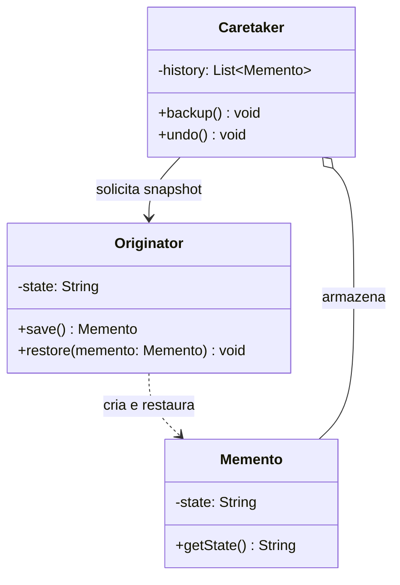

# Memento

## Descrição

O Memento captura e externaliza o estado interno de um objeto, sem violar seu encapsulamento, para que esse objeto possa ser restaurado a esse estado mais tarde. É o padrão clássico por trás de funcionalidades de desfazer (undo), checkpoints e rollback.

O padrão envolve três participantes. O Originator é o objeto cujo estado se quer salvar: ele sabe criar um memento com um snapshot do próprio estado e restaurar-se a partir de um memento. O Memento é o objeto que armazena esse snapshot, normalmente imutável. O Caretaker guarda os mementos (por exemplo, em uma pilha de histórico) e decide quando salvar e quando restaurar, mas nunca lê nem altera o conteúdo deles.

O ponto central é o encapsulamento: o Memento expõe uma interface "estreita" para o Caretaker (que só o armazena e o repassa) e uma interface "larga" apenas para o Originator (que acessa o estado). Em linguagens sem `friend` ou visibilidade de pacote, isso costuma ser obtido com classes aninhadas, interfaces opacas ou objetos imutáveis.

## Problemas que resolve

- Implementar desfazer/refazer sem expor os campos internos do objeto a outras classes
- Criar checkpoints para reverter um objeto após uma operação que falhou ou foi cancelada
- Evitar que código externo (histórico, gerenciador de transações) dependa da estrutura interna do objeto salvo
- Guardar versões anteriores de um estado para comparação ou navegação (histórico de edições)

## Quando usar

- É necessário salvar snapshots do estado de um objeto para restaurá-lo depois
- O acesso direto aos campos do objeto quebraria o encapsulamento ou exporia detalhes de implementação
- Editores, formulários, jogos (save/load) ou wizards precisam de undo, histórico ou rollback local
- Operações transacionais em memória que podem precisar ser revertidas

## Quando evitar

- O estado é grande e os snapshots são frequentes, gerando alto consumo de memória — prefira armazenar diferenças ou usar [Command](/coding/gof/behavioral/command) com operações inversas
- O objeto é simples e totalmente público; uma cópia direta ou um [Prototype](/coding/gof/creational/prototype) resolve
- A persistência de longo prazo é o objetivo — serialização, event sourcing ou versionamento em banco são mais adequados

## Trade-offs

| Ganho | Custo / Risco |
| --- | --- |
| Preserva o encapsulamento do Originator | Snapshots completos podem consumir muita memória |
| Simplifica o Originator, delegando o histórico ao Caretaker | O Caretaker precisa gerenciar o ciclo de vida dos mementos (limites, descarte) |
| Facilita undo/redo e rollback | Em linguagens dinâmicas é difícil garantir que só o Originator acesse o estado |
| Mementos imutáveis são seguros para compartilhar | Cópia rasa de estado mutável pode causar restaurações incorretas |

- **Acoplamento:** o Caretaker depende apenas do tipo opaco do memento, não do estado interno.
- **Desempenho:** considere snapshots incrementais, compressão ou limite de histórico para estados grandes.
- **Testabilidade:** salvar e restaurar é facilmente verificável comparando o estado antes e depois.
- **Consistência:** garanta cópias profundas de coleções e objetos mutáveis dentro do memento.

## Diagrama



O Originator cria mementos com seu estado e os usa para se restaurar; o Caretaker mantém o histórico de mementos e aciona salvar/restaurar no Originator sem acessar o conteúdo dos snapshots.

## Exemplo

Em uma simulação de empréstimo, o cliente altera valor, prazo e taxa e pode voltar às simulações anteriores: antes de cada alteração, o histórico (Caretaker) pede à simulação (Originator) um snapshot com esses três valores.

<Tabs groupId="lang" queryString>
<TabItem value="java" label="Java">

```java
record SimulationSnapshot(long principalCents, int months, double monthlyRate) {}

class LoanSimulation {                       // Originator
    long principalCents;
    int months;
    double monthlyRate;

    LoanSimulation(long principalCents, int months, double monthlyRate) {
        this.principalCents = principalCents;
        this.months = months;
        this.monthlyRate = monthlyRate;
    }

    SimulationSnapshot save() {
        return new SimulationSnapshot(principalCents, months, monthlyRate);
    }

    void restore(SimulationSnapshot s) {
        principalCents = s.principalCents();
        months = s.months();
        monthlyRate = s.monthlyRate();
    }
}

class SimulationHistory {                    // Caretaker
    private final Deque<SimulationSnapshot> stack = new ArrayDeque<>();
    private final LoanSimulation simulation;

    SimulationHistory(LoanSimulation simulation) { this.simulation = simulation; }

    void backup() { stack.push(simulation.save()); }
    void undo() { if (!stack.isEmpty()) simulation.restore(stack.pop()); }
}

LoanSimulation simulation = new LoanSimulation(1_000_000, 10, 0.02);
SimulationHistory history = new SimulationHistory(simulation);

history.backup();
simulation.months = 24;
history.backup();
simulation.principalCents = 2_000_000;

history.undo();
System.out.println(simulation.principalCents + " " + simulation.months); // 1000000 24
history.undo();
System.out.println(simulation.principalCents + " " + simulation.months); // 1000000 10
```

</TabItem>
<TabItem value="python" label="Python">

```python
from dataclasses import dataclass

@dataclass(frozen=True)
class SimulationSnapshot:
    principal_cents: int
    months: int
    monthly_rate: float

@dataclass
class LoanSimulation:  # Originator
    principal_cents: int
    months: int
    monthly_rate: float

    def save(self) -> SimulationSnapshot:
        return SimulationSnapshot(self.principal_cents, self.months, self.monthly_rate)

    def restore(self, s: SimulationSnapshot) -> None:
        self.principal_cents = s.principal_cents
        self.months = s.months
        self.monthly_rate = s.monthly_rate

class SimulationHistory:  # Caretaker
    def __init__(self, simulation: LoanSimulation) -> None:
        self._simulation = simulation
        self._stack: list[SimulationSnapshot] = []

    def backup(self) -> None:
        self._stack.append(self._simulation.save())

    def undo(self) -> None:
        if self._stack:
            self._simulation.restore(self._stack.pop())

simulation = LoanSimulation(1_000_000, 10, 0.02)
history = SimulationHistory(simulation)

history.backup()
simulation.months = 24
history.backup()
simulation.principal_cents = 2_000_000

history.undo()
print(simulation.principal_cents, simulation.months)  # 1000000 24
history.undo()
print(simulation.principal_cents, simulation.months)  # 1000000 10
```

</TabItem>
<TabItem value="go" label="Go">

```go
// Campos não exportados: fora do pacote, o snapshot é opaco para o Caretaker.
type SimulationSnapshot struct {
	principalCents int64
	months         int
	monthlyRate    float64
}

type LoanSimulation struct { // Originator
	PrincipalCents int64
	Months         int
	MonthlyRate    float64
}

func (l *LoanSimulation) Save() SimulationSnapshot {
	return SimulationSnapshot{l.PrincipalCents, l.Months, l.MonthlyRate}
}

func (l *LoanSimulation) Restore(s SimulationSnapshot) {
	l.PrincipalCents = s.principalCents
	l.Months = s.months
	l.MonthlyRate = s.monthlyRate
}

type SimulationHistory struct { // Caretaker
	simulation *LoanSimulation
	stack      []SimulationSnapshot
}

func (h *SimulationHistory) Backup() { h.stack = append(h.stack, h.simulation.Save()) }

func (h *SimulationHistory) Undo() {
	if len(h.stack) == 0 {
		return
	}
	last := h.stack[len(h.stack)-1]
	h.stack = h.stack[:len(h.stack)-1]
	h.simulation.Restore(last)
}

func main() {
	simulation := &LoanSimulation{PrincipalCents: 1_000_000, Months: 10, MonthlyRate: 0.02}
	history := &SimulationHistory{simulation: simulation}

	history.Backup()
	simulation.Months = 24
	history.Backup()
	simulation.PrincipalCents = 2_000_000

	history.Undo()
	fmt.Println(simulation.PrincipalCents, simulation.Months) // 1000000 24
	history.Undo()
	fmt.Println(simulation.PrincipalCents, simulation.Months) // 1000000 10
}
```

</TabItem>
<TabItem value="typescript" label="TypeScript">

```typescript
class SimulationSnapshot {
  constructor(
    readonly principalCents: number,
    readonly months: number,
    readonly monthlyRate: number,
  ) {}
}

class LoanSimulation {                   // Originator
  constructor(
    public principalCents: number,
    public months: number,
    public monthlyRate: number,
  ) {}

  save(): SimulationSnapshot {
    return new SimulationSnapshot(this.principalCents, this.months, this.monthlyRate);
  }
  restore(s: SimulationSnapshot) {
    this.principalCents = s.principalCents;
    this.months = s.months;
    this.monthlyRate = s.monthlyRate;
  }
}

class SimulationHistory {                // Caretaker
  private stack: SimulationSnapshot[] = [];
  constructor(private simulation: LoanSimulation) {}

  backup() { this.stack.push(this.simulation.save()); }
  undo() {
    const s = this.stack.pop();
    if (s) this.simulation.restore(s);
  }
}

const simulation = new LoanSimulation(1_000_000, 10, 0.02);
const history = new SimulationHistory(simulation);

history.backup();
simulation.months = 24;
history.backup();
simulation.principalCents = 2_000_000;

history.undo();
console.log(simulation.principalCents, simulation.months); // 1000000 24
history.undo();
console.log(simulation.principalCents, simulation.months); // 1000000 10
```

</TabItem>
</Tabs>

## Padrões relacionados

- [Command](/coding/gof/behavioral/command) — comandos podem usar mementos para guardar o estado necessário ao `undo()`
- [Iterator](/coding/gof/behavioral/iterator) — um memento pode registrar o estado de uma iteração para retomá-la depois
- [Prototype](/coding/gof/creational/prototype) — clonar o objeto é uma alternativa mais simples ao memento quando o estado é público e direto
- [State](/coding/gof/behavioral/state) — mementos podem salvar e restaurar o estado corrente de uma máquina de estados

## Referência

- [Design Patterns Cheat Sheet](https://iretha.github.io/design-patterns/cheat-sheet)
- [Memento no Refactoring.Guru](https://refactoring.guru/design-patterns/memento)
