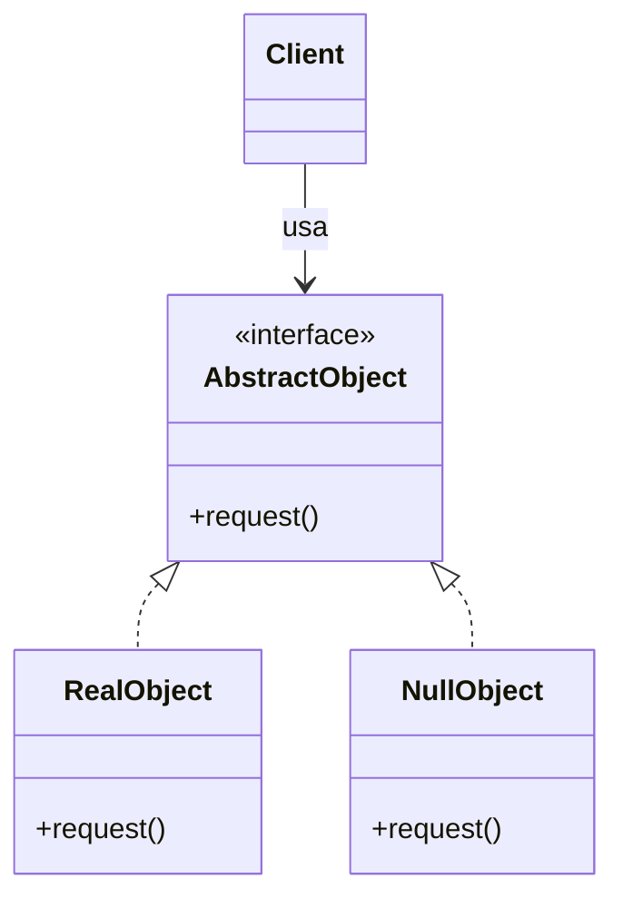

# Null Object

## Descrição

O Null Object substitui referências nulas por um objeto que implementa a mesma interface esperada pelo cliente, mas cujo comportamento é neutro, ou seja, "não fazer nada". Assim o cliente pode chamar métodos sem antes verificar se a referência existe.

O padrão define uma abstração (interface ou classe abstrata), uma ou mais implementações reais e uma implementação nula. A implementação nula devolve valores padrão seguros (lista vazia, zero, string vazia) ou simplesmente ignora a chamada. Como ela não guarda estado, costuma ser compartilhada como uma instância única.

Na prática, o padrão troca o tratamento condicional espalhado pelo código (`if (x != null)`) por polimorfismo: a decisão sobre o que fazer na ausência de um objeto fica concentrada em uma única classe.

## Problemas que resolve

- Verificações de nulo repetidas em vários pontos do código, que poluem a lógica e são fáceis de esquecer
- Falhas em tempo de execução (`NullPointerException`, `TypeError`) causadas por referências ausentes
- Dependências opcionais (logger, notificador, cache) que exigem lógica condicional sempre que são usadas
- Ausência de um comportamento padrão bem definido quando um colaborador não está disponível

## Quando usar

- O cliente precisa de um colaborador que pode estar ausente, e "não fazer nada" é uma reação aceitável
- Há muitos pontos de verificação de nulo para a mesma abstração
- Você quer fornecer um valor padrão seguro para dependências opcionais (por exemplo, um `NullLogger` em testes)
- O comportamento neutro pode ser expresso de forma clara e previsível

## Quando evitar

- A ausência do objeto é um erro que precisa ser detectado e reportado; o Null Object esconderia a falha
- O cliente precisa reagir de forma diferente quando o objeto não existe (nesse caso, prefira `Optional`/`Maybe` ou verificação explícita)
- Não existe um comportamento neutro razoável (por exemplo, um método que precisa devolver um identificador válido)
- A linguagem já oferece mecanismos adequados, como operadores de navegação segura, e a abstração extra não se paga

## Trade-offs

| Ganho | Custo / Risco |
| --- | --- |
| Elimina verificações de nulo espalhadas pelo código | Pode mascarar erros reais, adiando a descoberta de bugs |
| Código cliente mais simples e legível | Uma classe extra para cada abstração que precisa de versão nula |
| Comportamento padrão centralizado em um único lugar | Toda mudança na interface exige atualizar também a implementação nula |
| Facilita testes ao substituir dependências opcionais | O "não fazer nada" pode não ser óbvio para quem lê o código |

- **Acoplamento:** o cliente depende apenas da abstração, sem conhecer a implementação nula.
- **Testabilidade:** objetos nulos funcionam como dublês simples para dependências que não interessam ao teste.
- **Desempenho:** a implementação nula costuma ser um Singleton sem estado, com custo desprezível.
- **Semântica:** documente bem o comportamento neutro para não surpreender quem consome a interface.

## Diagrama



`Client` depende apenas de `AbstractObject`. `RealObject` executa o comportamento de fato, enquanto `NullObject` implementa a mesma interface com um comportamento neutro, permitindo que o cliente o use sem verificar nulos.

## Exemplo

O serviço de transferência aplica uma política de tarifa. Contas isentas recebem uma `NoFeePolicy`, que devolve zero, em vez de o serviço testar se existe política a cada transferência. O valor da tarifa é ilustrativo.

<Tabs groupId="lang" queryString>
<TabItem value="java" label="Java">

```java
interface FeePolicy {
    long feeCents(long amountCents);
}

record PerTransferFeePolicy(long flatCents) implements FeePolicy {
    public long feeCents(long amountCents) {
        return flatCents;
    }
}

enum NoFeePolicy implements FeePolicy {
    INSTANCE;

    public long feeCents(long amountCents) {
        return 0;                            // conta isenta: tarifa zero
    }
}

class TransferService {
    private final FeePolicy feePolicy;

    TransferService(FeePolicy feePolicy) { this.feePolicy = feePolicy; }

    // total debitado da conta
    long transfer(long amountCents) {
        long fee = feePolicy.feeCents(amountCents); // sem if (policy != null)
        return amountCents + fee;
    }
}

System.out.println(new TransferService(new PerTransferFeePolicy(350)).transfer(10_000)); // 10350
System.out.println(new TransferService(NoFeePolicy.INSTANCE).transfer(10_000));          // 10000
```

</TabItem>
<TabItem value="python" label="Python">

```python
from typing import Protocol

class FeePolicy(Protocol):
    def fee_cents(self, amount_cents: int) -> int: ...

class PerTransferFeePolicy:
    def __init__(self, flat_cents: int) -> None:
        self._flat_cents = flat_cents

    def fee_cents(self, amount_cents: int) -> int:
        return self._flat_cents

class NoFeePolicy:
    def fee_cents(self, amount_cents: int) -> int:
        return 0  # conta isenta: tarifa zero

NO_FEE = NoFeePolicy()

class TransferService:
    def __init__(self, fee_policy: FeePolicy) -> None:
        self._fee_policy = fee_policy

    def transfer(self, amount_cents: int) -> int:
        """Devolve o total debitado da conta."""
        fee = self._fee_policy.fee_cents(amount_cents)  # sem if policy is not None
        return amount_cents + fee

print(TransferService(PerTransferFeePolicy(350)).transfer(10_000))  # 10350
print(TransferService(NO_FEE).transfer(10_000))                     # 10000
```

</TabItem>
<TabItem value="go" label="Go">

```go
type FeePolicy interface {
	FeeCents(amountCents int64) int64
}

type PerTransferFeePolicy struct{ FlatCents int64 }

func (p PerTransferFeePolicy) FeeCents(amountCents int64) int64 { return p.FlatCents }

type NoFeePolicy struct{}

func (NoFeePolicy) FeeCents(amountCents int64) int64 {
	return 0 // conta isenta: tarifa zero
}

type TransferService struct {
	feePolicy FeePolicy
}

// total debitado da conta
func (s TransferService) Transfer(amountCents int64) int64 {
	fee := s.feePolicy.FeeCents(amountCents) // sem if policy != nil
	return amountCents + fee
}

func main() {
	fmt.Println(TransferService{PerTransferFeePolicy{350}}.Transfer(10_000)) // 10350
	fmt.Println(TransferService{NoFeePolicy{}}.Transfer(10_000))             // 10000
}
```

</TabItem>
<TabItem value="typescript" label="TypeScript">

```typescript
interface FeePolicy {
  feeCents(amountCents: number): number;
}

class PerTransferFeePolicy implements FeePolicy {
  constructor(private readonly flatCents: number) {}
  feeCents(_amountCents: number): number {
    return this.flatCents;
  }
}

class NoFeePolicy implements FeePolicy {
  static readonly instance = new NoFeePolicy();
  feeCents(_amountCents: number): number {
    return 0;                            // conta isenta: tarifa zero
  }
}

class TransferService {
  constructor(private readonly feePolicy: FeePolicy) {}

  // total debitado da conta
  transfer(amountCents: number): number {
    const fee = this.feePolicy.feeCents(amountCents); // sem if (policy != null)
    return amountCents + fee;
  }
}

console.log(new TransferService(new PerTransferFeePolicy(350)).transfer(10_000)); // 10350
console.log(new TransferService(NoFeePolicy.instance).transfer(10_000));          // 10000
```

</TabItem>
</Tabs>

## Padrões relacionados

- [Strategy](/coding/gof/behavioral/strategy) — o Null Object pode ser visto como uma estratégia que não faz nada
- [State](/coding/gof/behavioral/state) — um estado "nulo" ou inicial pode ser modelado como Null Object
- [Singleton](/coding/gof/creational/singleton) — como não tem estado, o objeto nulo costuma ser uma instância única compartilhada
- [Flyweight](/coding/gof/structural/flyweight) — a instância nula pode ser compartilhada como um flyweight sem estado intrínseco
- [Proxy](/coding/gof/structural/proxy) — ambos se colocam no lugar do objeto real, mas o Proxy controla acesso a ele e o Null Object o substitui
- [Iterator](/coding/gof/behavioral/iterator) — um iterador vazio é um caso clássico de Null Object
- [Command](/coding/gof/behavioral/command) — um comando "no-op" é usado como valor padrão em vez de comando nulo

## Referência

- [Design Patterns Cheat Sheet](https://iretha.github.io/design-patterns/cheat-sheet)
- [Null Object no SourceMaking](https://sourcemaking.com/design_patterns/null_object)
