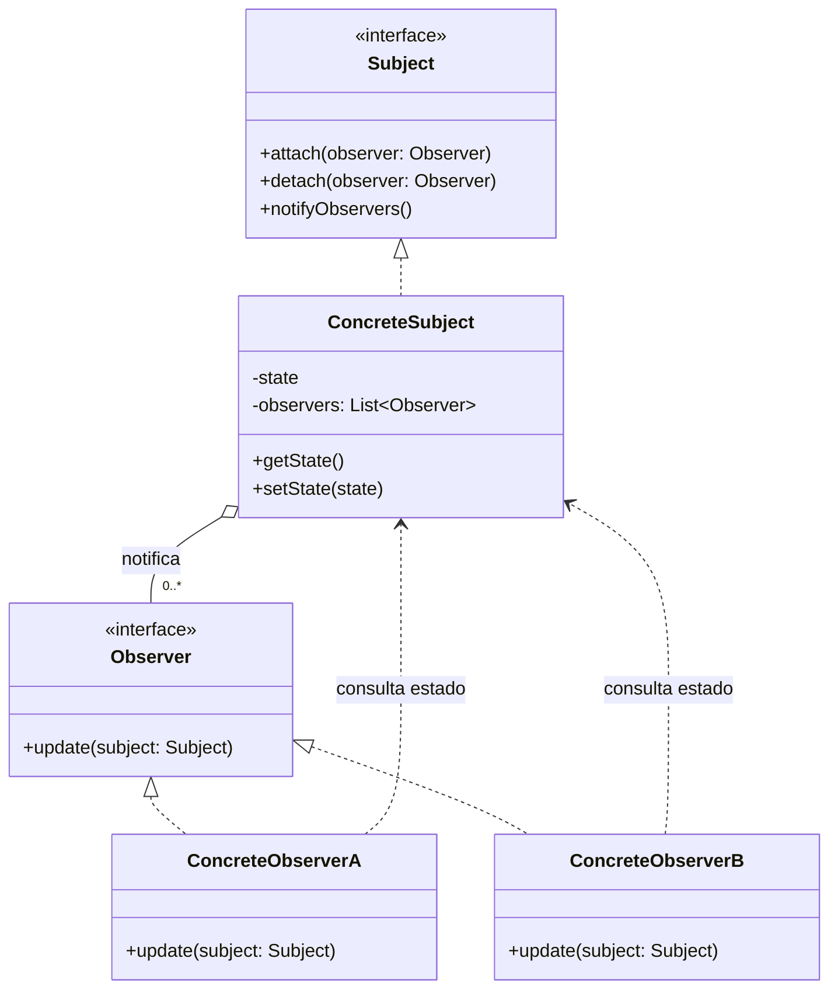

# Observer

## Descrição

O Observer define uma dependência um-para-muitos entre objetos, de modo que, quando um objeto (o *subject*) muda de estado, todos os seus dependentes (os *observers*) são notificados e atualizados automaticamente.

O subject mantém uma lista de observers registrados e expõe operações para inscrever (`attach`) e cancelar a inscrição (`detach`). Quando seu estado muda, ele percorre a lista e chama um método comum (`update`) em cada observer. O subject conhece apenas a interface `Observer`, não as classes concretas, o que mantém o acoplamento baixo.

A notificação pode seguir o modelo *push* (o subject envia os dados alterados junto com a notificação) ou *pull* (o observer recebe apenas o aviso e consulta o subject para obter o que precisa). O padrão é a base de mecanismos de eventos, data binding e programação reativa.

## Problemas que resolve

- Manter vários objetos sincronizados com o estado de outro sem acoplá-los às classes concretas uns dos outros
- Evitar polling: dependentes não precisam consultar repetidamente se algo mudou
- Permitir adicionar ou remover interessados em um evento em tempo de execução, sem alterar o emissor
- Separar a lógica de domínio (modelo) da lógica de apresentação (views) que reage a ela

## Quando usar

- Quando a mudança em um objeto exige alterar outros e você não sabe de antemão quantos ou quais são
- Quando um objeto deve notificar outros sem fazer suposições sobre quem eles são
- Em sistemas de eventos, interfaces gráficas (MVC), assinaturas de notícias, caches que precisam ser invalidados, etc.

### Quando evitar

- Quando há apenas um dependente fixo e conhecido; uma chamada direta é mais simples
- Quando a ordem de notificação é crítica e precisa ser garantida
- Quando cadeias de atualizações em cascata podem gerar ciclos ou tornar o fluxo difícil de rastrear
- Quando a comunicação precisa atravessar processos ou serviços com garantias de entrega; prefira um broker de mensagens (publish/subscribe)

## Trade-offs

| Ganho | Custo / Risco |
| --- | --- |
| Baixo acoplamento entre subject e observers | Fluxo de controle implícito, mais difícil de depurar |
| Observers podem ser adicionados/removidos em tempo de execução (Open/Closed) | Ordem de notificação geralmente não é garantida |
| Suporte natural a broadcast de eventos | Atualizações em cascata podem causar problemas de desempenho ou loops |
| Reuso independente de subjects e observers | Vazamento de memória se observers não forem removidos (*lapsed listener*) |

- **Acoplamento:** o subject depende apenas da interface `Observer`.
- **Testabilidade:** observers podem ser substituídos por mocks facilmente; porém, testar a interação completa exige verificar efeitos indiretos.
- **Desempenho:** notificações síncronas bloqueiam o subject até que todos os observers terminem; considere notificação assíncrona quando houver muitos observers ou processamento pesado.
- **Concorrência:** a lista de observers deve ser protegida contra modificação durante a iteração.

## Diagrama



O `ConcreteSubject` guarda seu estado e a lista de `Observer`s registrados, notificando-os a cada mudança. Os observers concretos implementam `update` e, no modelo *pull*, consultam o estado do subject para reagir.

## Exemplo

Uma loja online precisa avisar diferentes canais (e-mail e painel administrativo) quando o estoque de um produto muda, sem que a classe de estoque conheça esses canais.

```typescript
interface StockObserver {
  update(sku: string, quantity: number): void;
}

class Inventory {
  private observers: StockObserver[] = [];
  private stock = new Map<string, number>();

  attach(o: StockObserver) { this.observers.push(o); }
  detach(o: StockObserver) { this.observers = this.observers.filter(x => x !== o); }

  setQuantity(sku: string, quantity: number) {
    this.stock.set(sku, quantity);
    this.observers.forEach(o => o.update(sku, quantity)); // push
  }
}

class EmailAlert implements StockObserver {
  update(sku: string, quantity: number) {
    if (quantity === 0) console.log(`E-mail: ${sku} esgotado`);
  }
}

class AdminDashboard implements StockObserver {
  update(sku: string, quantity: number) {
    console.log(`Dashboard: ${sku} = ${quantity}`);
  }
}

const inventory = new Inventory();
inventory.attach(new EmailAlert());
inventory.attach(new AdminDashboard());
inventory.setQuantity("SKU-42", 0);
```

## Padrões relacionados

- [Mediator](./mediator.md) — ambos desacoplam emissores e receptores; o Mediator centraliza a comunicação, enquanto o Observer a distribui. Um Mediator pode ser implementado com Observer.
- [Singleton](../creational/singleton.md) — um gerenciador de eventos/subject global costuma ser implementado como Singleton.
- [Command](./command.md) — notificações podem ser encapsuladas como comandos, permitindo enfileirá-las ou desfazê-las.
- [Chain of Responsibility](./chain-of-responsibility.md) — também conecta emissores e receptores, mas passa a requisição sequencialmente até um tratador, em vez de difundi-la a todos.

## Referência

- [Design Patterns Cheat Sheet](https://iretha.github.io/design-patterns/cheat-sheet)
- [Observer no Refactoring.Guru](https://refactoring.guru/design-patterns/observer)
