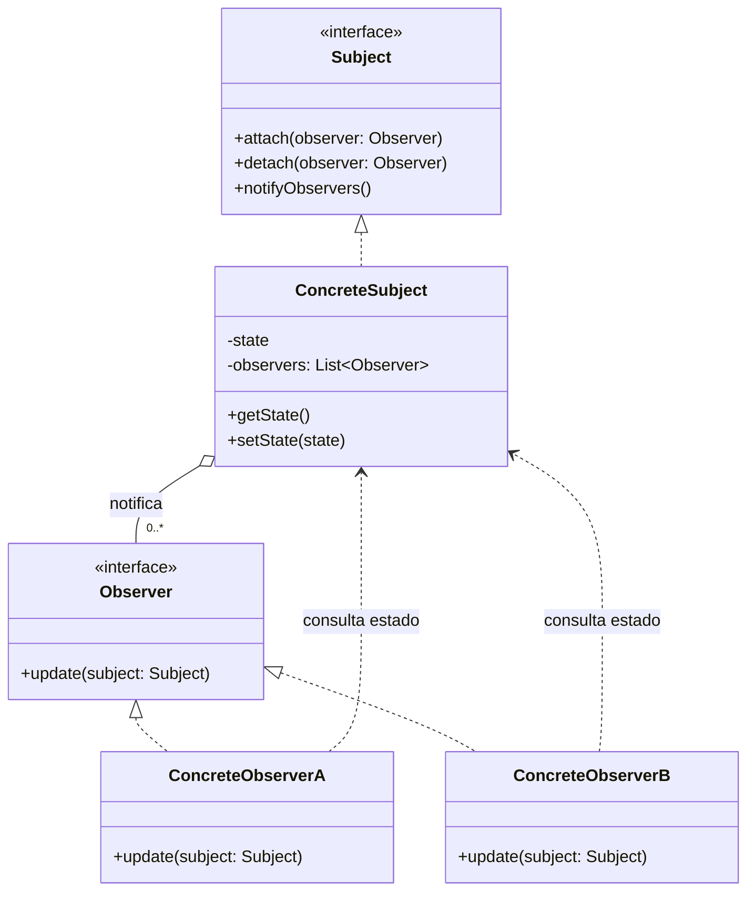

# Observer

## Descrição

O Observer define uma dependência um-para-muitos entre objetos, de modo que, quando um objeto (o *subject*) muda de estado, todos os seus dependentes (os *observers*) são notificados e atualizados automaticamente.

O subject mantém uma lista de observers registrados e expõe operações para inscrever (`attach`) e cancelar a inscrição (`detach`). Quando seu estado muda, ele percorre a lista e chama um método comum (`update`) em cada observer. O subject conhece apenas a interface `Observer`, não as classes concretas, o que mantém o acoplamento baixo.

A notificação pode seguir o modelo *push* (o subject envia os dados alterados junto com a notificação) ou *pull* (o observer recebe apenas o aviso e consulta o subject para obter o que precisa). O padrão é a base de mecanismos de eventos, data binding e programação reativa.

## Problemas que resolve

- Manter vários objetos sincronizados com o estado de outro sem acoplá-los às classes concretas uns dos outros
- Evitar polling: dependentes não precisam consultar repetidamente se algo mudou
- Permitir adicionar ou remover interessados em um evento em tempo de execução, sem alterar o emissor
- Separar a lógica de domínio (modelo) da lógica de apresentação (views) que reage a ela

## Quando usar

- Quando a mudança em um objeto exige alterar outros e você não sabe de antemão quantos ou quais são
- Quando um objeto deve notificar outros sem fazer suposições sobre quem eles são
- Em sistemas de eventos, interfaces gráficas (MVC), assinaturas de notícias, caches que precisam ser invalidados, etc.

## Quando evitar

- Quando há apenas um dependente fixo e conhecido; uma chamada direta é mais simples
- Quando a ordem de notificação é crítica e precisa ser garantida
- Quando cadeias de atualizações em cascata podem gerar ciclos ou tornar o fluxo difícil de rastrear
- Quando a comunicação precisa atravessar processos ou serviços com garantias de entrega; prefira um broker de mensagens (publish/subscribe)

## Trade-offs

| Ganho | Custo / Risco |
| --- | --- |
| Baixo acoplamento entre subject e observers | Fluxo de controle implícito, mais difícil de depurar |
| Observers podem ser adicionados/removidos em tempo de execução (Open/Closed) | Ordem de notificação geralmente não é garantida |
| Suporte natural a broadcast de eventos | Atualizações em cascata podem causar problemas de desempenho ou loops |
| Reuso independente de subjects e observers | Vazamento de memória se observers não forem removidos (*lapsed listener*) |

- **Acoplamento:** o subject depende apenas da interface `Observer`.
- **Testabilidade:** observers podem ser substituídos por mocks facilmente; porém, testar a interação completa exige verificar efeitos indiretos.
- **Desempenho:** notificações síncronas bloqueiam o subject até que todos os observers terminem; considere notificação assíncrona quando houver muitos observers ou processamento pesado.
- **Concorrência:** a lista de observers deve ser protegida contra modificação durante a iteração.

## Diagrama



O `ConcreteSubject` guarda seu estado e a lista de `Observer`s registrados, notificando-os a cada mudança. Os observers concretos implementam `update` e, no modelo *pull*, consultam o estado do subject para reagir.

## Exemplo

Quando um Pix é creditado, o app precisa enviar um push, o lojista precisa receber um webhook e a conciliação precisa registrar o recebimento, sem que o serviço de recebimento conheça esses canais.

<Tabs groupId="lang" queryString>
<TabItem value="java" label="Java">

```java
interface PixReceivedListener {
    void onPixReceived(String txid, long amountCents);
}

class PixReceiptService {
    private final List<PixReceivedListener> listeners = new ArrayList<>();

    void attach(PixReceivedListener l) { listeners.add(l); }
    void detach(PixReceivedListener l) { listeners.remove(l); }

    void receive(String txid, long amountCents) {
        // credita na conta e avisa os interessados
        listeners.forEach(l -> l.onPixReceived(txid, amountCents)); // modelo push: os dados vão no evento
    }
}

class PushNotifier implements PixReceivedListener {
    public void onPixReceived(String txid, long amountCents) {
        System.out.printf("Push: Pix recebido de R$ %d.%02d%n", amountCents / 100, amountCents % 100);
    }
}

class MerchantWebhook implements PixReceivedListener {
    public void onPixReceived(String txid, long amountCents) {
        System.out.println("Webhook: pix.received " + txid);
    }
}

class ReconciliationRecorder implements PixReceivedListener {
    public void onPixReceived(String txid, long amountCents) {
        System.out.println("Conciliação: " + txid + " = " + amountCents);
    }
}

PixReceiptService service = new PixReceiptService();
service.attach(new PushNotifier());
service.attach(new MerchantWebhook());
service.attach(new ReconciliationRecorder());
service.receive("txid-8f3a", 12_990);
```

</TabItem>
<TabItem value="python" label="Python">

```python
from typing import Protocol

class PixReceivedListener(Protocol):
    def on_pix_received(self, txid: str, amount_cents: int) -> None: ...

class PixReceiptService:
    def __init__(self) -> None:
        self._listeners: list[PixReceivedListener] = []

    def attach(self, listener: PixReceivedListener) -> None:
        self._listeners.append(listener)

    def detach(self, listener: PixReceivedListener) -> None:
        self._listeners.remove(listener)

    def receive(self, txid: str, amount_cents: int) -> None:
        # credita na conta e avisa os interessados
        for listener in self._listeners:
            listener.on_pix_received(txid, amount_cents)  # modelo push: os dados vão no evento

class PushNotifier:
    def on_pix_received(self, txid: str, amount_cents: int) -> None:
        print(f"Push: Pix recebido de R$ {amount_cents // 100}.{amount_cents % 100:02d}")

class MerchantWebhook:
    def on_pix_received(self, txid: str, amount_cents: int) -> None:
        print(f"Webhook: pix.received {txid}")

class ReconciliationRecorder:
    def on_pix_received(self, txid: str, amount_cents: int) -> None:
        print(f"Conciliação: {txid} = {amount_cents}")

service = PixReceiptService()
service.attach(PushNotifier())
service.attach(MerchantWebhook())
service.attach(ReconciliationRecorder())
service.receive("txid-8f3a", 12_990)
```

</TabItem>
<TabItem value="go" label="Go">

```go
type PixReceivedListener interface {
	OnPixReceived(txid string, amountCents int64)
}

type PixReceiptService struct {
	listeners []PixReceivedListener
}

func (s *PixReceiptService) Attach(l PixReceivedListener) { s.listeners = append(s.listeners, l) }

func (s *PixReceiptService) Detach(l PixReceivedListener) {
	s.listeners = slices.DeleteFunc(s.listeners, func(x PixReceivedListener) bool { return x == l })
}

func (s *PixReceiptService) Receive(txid string, amountCents int64) {
	// credita na conta e avisa os interessados
	for _, l := range s.listeners {
		l.OnPixReceived(txid, amountCents) // modelo push: os dados vão no evento
	}
}

type PushNotifier struct{}

func (PushNotifier) OnPixReceived(txid string, amountCents int64) {
	fmt.Printf("Push: Pix recebido de R$ %d.%02d\n", amountCents/100, amountCents%100)
}

type MerchantWebhook struct{}

func (MerchantWebhook) OnPixReceived(txid string, amountCents int64) {
	fmt.Println("Webhook: pix.received", txid)
}

type ReconciliationRecorder struct{}

func (ReconciliationRecorder) OnPixReceived(txid string, amountCents int64) {
	fmt.Printf("Conciliação: %s = %d\n", txid, amountCents)
}

func main() {
	service := &PixReceiptService{}
	service.Attach(PushNotifier{})
	service.Attach(MerchantWebhook{})
	service.Attach(ReconciliationRecorder{})
	service.Receive("txid-8f3a", 12_990)
}
```

</TabItem>
<TabItem value="typescript" label="TypeScript">

```typescript
interface PixReceivedListener {
  onPixReceived(txid: string, amountCents: number): void;
}

class PixReceiptService {
  private listeners: PixReceivedListener[] = [];

  attach(l: PixReceivedListener) { this.listeners.push(l); }
  detach(l: PixReceivedListener) { this.listeners = this.listeners.filter(x => x !== l); }

  receive(txid: string, amountCents: number) {
    // credita na conta e avisa os interessados
    this.listeners.forEach(l => l.onPixReceived(txid, amountCents)); // modelo push: os dados vão no evento
  }
}

class PushNotifier implements PixReceivedListener {
  onPixReceived(txid: string, amountCents: number) {
    console.log(`Push: Pix recebido de R$ ${(amountCents / 100).toFixed(2)}`);
  }
}

class MerchantWebhook implements PixReceivedListener {
  onPixReceived(txid: string, amountCents: number) {
    console.log(`Webhook: pix.received ${txid}`);
  }
}

class ReconciliationRecorder implements PixReceivedListener {
  onPixReceived(txid: string, amountCents: number) {
    console.log(`Conciliação: ${txid} = ${amountCents}`);
  }
}

const service = new PixReceiptService();
service.attach(new PushNotifier());
service.attach(new MerchantWebhook());
service.attach(new ReconciliationRecorder());
service.receive("txid-8f3a", 12_990);
```

</TabItem>
</Tabs>

## Padrões relacionados

- [Mediator](/coding/gof/behavioral/mediator) — ambos desacoplam emissores e receptores; o Mediator centraliza a comunicação, enquanto o Observer a distribui. Um Mediator pode ser implementado com Observer.
- [Singleton](/coding/gof/creational/singleton) — um gerenciador de eventos/subject global costuma ser implementado como Singleton.
- [Command](/coding/gof/behavioral/command) — notificações podem ser encapsuladas como comandos, permitindo enfileirá-las ou desfazê-las.
- [Chain of Responsibility](/coding/gof/behavioral/chain-of-responsibility) — também conecta emissores e receptores, mas passa a requisição sequencialmente até um tratador, em vez de difundi-la a todos.

## Referência

- [Design Patterns Cheat Sheet](https://iretha.github.io/design-patterns/cheat-sheet)
- [Observer no Refactoring.Guru](https://refactoring.guru/design-patterns/observer)
