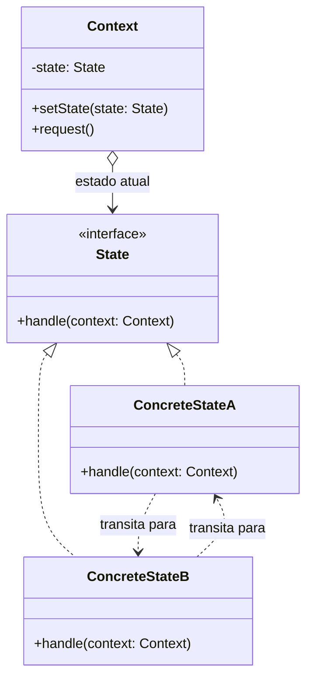

# State

## Descrição

O State permite que um objeto altere seu comportamento quando seu estado interno muda, dando a impressão de que o objeto mudou de classe. Em vez de concentrar condicionais (`if`/`switch`) sobre uma variável de estado em cada método, cada estado possível é encapsulado em uma classe própria que implementa uma interface comum.

O objeto principal, chamado de contexto (`Context`), mantém uma referência para o estado atual e delega a ele as operações dependentes de estado. As transições acontecem trocando essa referência por outra instância de estado, o que pode ser feito pelo próprio contexto ou pelos estados concretos, que conhecem quais transições são válidas a partir deles.

Na prática, o padrão é uma forma orientada a objetos de implementar uma máquina de estados finita: cada estado sabe como reagir aos eventos e para qual estado seguir.

## Problemas que resolve

- Métodos repletos de condicionais grandes que verificam o estado atual antes de decidir o que fazer
- Regras de transição espalhadas pelo código, dificultando entender quais mudanças de estado são permitidas
- Dificuldade de adicionar novos estados sem modificar diversos métodos existentes (violação do Open/Closed)
- Comportamento inconsistente quando uma operação é chamada em um estado em que não deveria ser permitida

## Quando usar

- O comportamento de um objeto depende fortemente do seu estado e precisa mudar em tempo de execução
- Existem muitos estados e transições bem definidas (pedidos, documentos em workflow, conexões de rede, máquinas de venda)
- As mesmas condicionais sobre o estado se repetem em vários métodos da classe
- Novos estados tendem a surgir com frequência e devem ser adicionados de forma isolada

## Quando evitar

- O objeto tem poucos estados ou o comportamento raramente muda; um `enum` com um `switch` simples é mais legível
- As transições são triviais e não há comportamento específico por estado
- O fluxo é melhor descrito de forma declarativa (tabela de transições ou biblioteca de máquina de estados)

## Trade-offs

| Ganho | Custo / Risco |
| --- | --- |
| Elimina condicionais extensas sobre o estado | Aumenta o número de classes |
| Cada estado fica isolado e coeso (Single Responsibility) | Visão geral do fluxo fica distribuída entre várias classes |
| Novos estados são adicionados sem alterar os existentes | Estados que conhecem seus sucessores ficam acoplados entre si |
| Transições ficam explícitas e controladas | Overkill para máquinas de estado pequenas |

- **Acoplamento:** se os estados concretos decidem as transições, eles se conhecem mutuamente; centralizar as transições no contexto reduz esse acoplamento, mas concentra lógica.
- **Testabilidade:** cada estado pode ser testado isoladamente, verificando a ação e o estado resultante.
- **Desempenho:** estados sem atributos próprios podem ser compartilhados (como Singletons ou Flyweights), evitando criar objetos a cada transição.

## Diagrama



O `Context` delega `request()` ao `State` atual. Cada `ConcreteState` implementa o comportamento daquele estado e pode chamar `setState()` no contexto para provocar a transição para outro estado.

## Exemplo

Uma cobrança Pix passa pelos estados "ativa", "paga", "expirada" e "devolvida"; as ações `pay()`, `expire()` e `refund()` só são válidas em determinados estados: `pay()` só vale para a cobrança ativa e `refund()` só para a paga.

<Tabs groupId="lang" queryString>
<TabItem value="java" label="Java">

```java
interface ChargeState {
    void pay(PixCharge charge);
    void expire(PixCharge charge);
    void refund(PixCharge charge);
}

class Active implements ChargeState {
    public void pay(PixCharge charge) { charge.setState(new Paid()); }
    public void expire(PixCharge charge) { charge.setState(new Expired()); }
    public void refund(PixCharge charge) { throw new IllegalStateException("Cobrança ativa não pode ser devolvida"); }
}

class Paid implements ChargeState {
    public void pay(PixCharge charge) { throw new IllegalStateException("Cobrança já foi paga"); }
    public void expire(PixCharge charge) { throw new IllegalStateException("Cobrança paga não expira"); }
    public void refund(PixCharge charge) { charge.setState(new Refunded()); }
}

class Expired implements ChargeState {
    public void pay(PixCharge charge) { throw new IllegalStateException("Cobrança expirada"); }
    public void expire(PixCharge charge) { throw new IllegalStateException("Cobrança expirada"); }
    public void refund(PixCharge charge) { throw new IllegalStateException("Cobrança expirada"); }
}

class Refunded implements ChargeState {
    public void pay(PixCharge charge) { throw new IllegalStateException("Cobrança já devolvida"); }
    public void expire(PixCharge charge) { throw new IllegalStateException("Cobrança já devolvida"); }
    public void refund(PixCharge charge) { throw new IllegalStateException("Cobrança já devolvida"); }
}

class PixCharge {
    private ChargeState state = new Active();

    void setState(ChargeState state) { this.state = state; }
    void pay() { state.pay(this); }
    void expire() { state.expire(this); }
    void refund() { state.refund(this); }
}
```

</TabItem>
<TabItem value="python" label="Python">

```python
from __future__ import annotations

from typing import Protocol

class InvalidTransition(Exception):
    pass

class ChargeState(Protocol):
    def pay(self, charge: PixCharge) -> None: ...
    def expire(self, charge: PixCharge) -> None: ...
    def refund(self, charge: PixCharge) -> None: ...

class Active:
    def pay(self, charge: PixCharge) -> None:
        charge.state = Paid()

    def expire(self, charge: PixCharge) -> None:
        charge.state = Expired()

    def refund(self, charge: PixCharge) -> None:
        raise InvalidTransition("Cobrança ativa não pode ser devolvida")

class Paid:
    def pay(self, charge: PixCharge) -> None:
        raise InvalidTransition("Cobrança já foi paga")

    def expire(self, charge: PixCharge) -> None:
        raise InvalidTransition("Cobrança paga não expira")

    def refund(self, charge: PixCharge) -> None:
        charge.state = Refunded()

class Expired:
    def pay(self, charge: PixCharge) -> None:
        raise InvalidTransition("Cobrança expirada")

    expire = refund = pay  # toda ação falha do mesmo jeito

class Refunded:
    def pay(self, charge: PixCharge) -> None:
        raise InvalidTransition("Cobrança já devolvida")

    expire = refund = pay  # toda ação falha do mesmo jeito

class PixCharge:
    def __init__(self) -> None:
        self.state: ChargeState = Active()

    def pay(self) -> None:
        self.state.pay(self)

    def expire(self) -> None:
        self.state.expire(self)

    def refund(self) -> None:
        self.state.refund(self)
```

</TabItem>
<TabItem value="go" label="Go">

```go
type ChargeState interface {
	Pay(charge *PixCharge) error
	Expire(charge *PixCharge) error
	Refund(charge *PixCharge) error
}

type Active struct{}

func (Active) Pay(charge *PixCharge) error    { charge.state = Paid{}; return nil }
func (Active) Expire(charge *PixCharge) error { charge.state = Expired{}; return nil }
func (Active) Refund(*PixCharge) error        { return errors.New("cobrança ativa não pode ser devolvida") }

type Paid struct{}

func (Paid) Pay(*PixCharge) error           { return errors.New("cobrança já foi paga") }
func (Paid) Expire(*PixCharge) error        { return errors.New("cobrança paga não expira") }
func (Paid) Refund(charge *PixCharge) error { charge.state = Refunded{}; return nil }

type Expired struct{}

func (Expired) Pay(*PixCharge) error    { return errors.New("cobrança expirada") }
func (Expired) Expire(*PixCharge) error { return errors.New("cobrança expirada") }
func (Expired) Refund(*PixCharge) error { return errors.New("cobrança expirada") }

type Refunded struct{}

func (Refunded) Pay(*PixCharge) error    { return errors.New("cobrança já devolvida") }
func (Refunded) Expire(*PixCharge) error { return errors.New("cobrança já devolvida") }
func (Refunded) Refund(*PixCharge) error { return errors.New("cobrança já devolvida") }

type PixCharge struct {
	state ChargeState
}

func NewPixCharge() *PixCharge { return &PixCharge{state: Active{}} }

func (c *PixCharge) Pay() error    { return c.state.Pay(c) }
func (c *PixCharge) Expire() error { return c.state.Expire(c) }
func (c *PixCharge) Refund() error { return c.state.Refund(c) }
```

</TabItem>
<TabItem value="typescript" label="TypeScript">

```typescript
interface ChargeState {
  pay(charge: PixCharge): void;
  expire(charge: PixCharge): void;
  refund(charge: PixCharge): void;
}

class Active implements ChargeState {
  pay(charge: PixCharge) { charge.setState(new Paid()); }
  expire(charge: PixCharge) { charge.setState(new Expired()); }
  refund(_: PixCharge) { throw new Error("Cobrança ativa não pode ser devolvida"); }
}

class Paid implements ChargeState {
  pay(_: PixCharge) { throw new Error("Cobrança já foi paga"); }
  expire(_: PixCharge) { throw new Error("Cobrança paga não expira"); }
  refund(charge: PixCharge) { charge.setState(new Refunded()); }
}

class Expired implements ChargeState {
  pay(_: PixCharge) { throw new Error("Cobrança expirada"); }
  expire(_: PixCharge) { throw new Error("Cobrança expirada"); }
  refund(_: PixCharge) { throw new Error("Cobrança expirada"); }
}

class Refunded implements ChargeState {
  pay(_: PixCharge) { throw new Error("Cobrança já devolvida"); }
  expire(_: PixCharge) { throw new Error("Cobrança já devolvida"); }
  refund(_: PixCharge) { throw new Error("Cobrança já devolvida"); }
}

class PixCharge {
  private state: ChargeState = new Active();
  setState(state: ChargeState) { this.state = state; }
  pay() { this.state.pay(this); }
  expire() { this.state.expire(this); }
  refund() { this.state.refund(this); }
}
```

</TabItem>
</Tabs>

## Padrões relacionados

- [Strategy](/coding/gof/behavioral/strategy) — tem estrutura quase idêntica (contexto delegando a um objeto intercambiável), mas a intenção difere: no Strategy o cliente escolhe o algoritmo e as estratégias são independentes e não se conhecem; no State a troca é dirigida pelo próprio objeto conforme seu estado interno, e os estados costumam conhecer e disparar as transições entre si.
- [Singleton](/coding/gof/creational/singleton) — estados sem dados próprios podem ser instâncias únicas compartilhadas.
- [Flyweight](/coding/gof/structural/flyweight) — permite compartilhar objetos de estado entre vários contextos, mantendo o dado específico no contexto.
- [Memento](/coding/gof/behavioral/memento) — pode capturar e restaurar o estado de um objeto, por exemplo para desfazer transições.
- [Bridge](/coding/gof/structural/bridge) — também se baseia em composição e delegação para uma hierarquia de implementações, porém com foco estrutural, não em transições.

## Referência

- [Design Patterns Cheat Sheet](https://iretha.github.io/design-patterns/cheat-sheet)
- [State no Refactoring.Guru](https://refactoring.guru/design-patterns/state)
