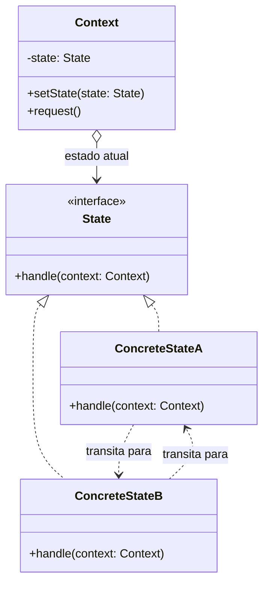

# State

## Descrição

O State permite que um objeto altere seu comportamento quando seu estado interno muda, dando a impressão de que o objeto mudou de classe. Em vez de concentrar condicionais (`if`/`switch`) sobre uma variável de estado em cada método, cada estado possível é encapsulado em uma classe própria que implementa uma interface comum.

O objeto principal, chamado de contexto (`Context`), mantém uma referência para o estado atual e delega a ele as operações dependentes de estado. As transições acontecem trocando essa referência por outra instância de estado, o que pode ser feito pelo próprio contexto ou pelos estados concretos, que conhecem quais transições são válidas a partir deles.

Na prática, o padrão é uma forma orientada a objetos de implementar uma máquina de estados finita: cada estado sabe como reagir aos eventos e para qual estado seguir.

## Problemas que resolve

- Métodos repletos de condicionais grandes que verificam o estado atual antes de decidir o que fazer
- Regras de transição espalhadas pelo código, dificultando entender quais mudanças de estado são permitidas
- Dificuldade de adicionar novos estados sem modificar diversos métodos existentes (violação do Open/Closed)
- Comportamento inconsistente quando uma operação é chamada em um estado em que não deveria ser permitida

## Quando usar

- O comportamento de um objeto depende fortemente do seu estado e precisa mudar em tempo de execução
- Existem muitos estados e transições bem definidas (pedidos, documentos em workflow, conexões de rede, máquinas de venda)
- As mesmas condicionais sobre o estado se repetem em vários métodos da classe
- Novos estados tendem a surgir com frequência e devem ser adicionados de forma isolada

### Quando evitar

- O objeto tem poucos estados ou o comportamento raramente muda; um `enum` com um `switch` simples é mais legível
- As transições são triviais e não há comportamento específico por estado
- O fluxo é melhor descrito de forma declarativa (tabela de transições ou biblioteca de máquina de estados)

## Trade-offs

| Ganho | Custo / Risco |
| --- | --- |
| Elimina condicionais extensas sobre o estado | Aumenta o número de classes |
| Cada estado fica isolado e coeso (Single Responsibility) | Visão geral do fluxo fica distribuída entre várias classes |
| Novos estados são adicionados sem alterar os existentes | Estados que conhecem seus sucessores ficam acoplados entre si |
| Transições ficam explícitas e controladas | Overkill para máquinas de estado pequenas |

- **Acoplamento:** se os estados concretos decidem as transições, eles se conhecem mutuamente; centralizar as transições no contexto reduz esse acoplamento, mas concentra lógica.
- **Testabilidade:** cada estado pode ser testado isoladamente, verificando a ação e o estado resultante.
- **Desempenho:** estados sem atributos próprios podem ser compartilhados (como Singletons ou Flyweights), evitando criar objetos a cada transição.

## Diagrama



O `Context` delega `request()` ao `State` atual. Cada `ConcreteState` implementa o comportamento daquele estado e pode chamar `setState()` no contexto para provocar a transição para outro estado.

## Exemplo

Um pedido de e-commerce passa pelos estados "aguardando pagamento", "pago" e "enviado"; as ações `pay()` e `ship()` só são válidas em determinados estados.

```typescript
interface OrderState {
  pay(order: Order): void;
  ship(order: Order): void;
}

class PendingPayment implements OrderState {
  pay(order: Order) { order.setState(new Paid()); }
  ship(_: Order) { throw new Error("Pedido ainda não foi pago"); }
}

class Paid implements OrderState {
  pay(_: Order) { throw new Error("Pedido já está pago"); }
  ship(order: Order) { order.setState(new Shipped()); }
}

class Shipped implements OrderState {
  pay(_: Order) { throw new Error("Pedido já enviado"); }
  ship(_: Order) { throw new Error("Pedido já enviado"); }
}

class Order {
  private state: OrderState = new PendingPayment();
  setState(state: OrderState) { this.state = state; }
  pay() { this.state.pay(this); }
  ship() { this.state.ship(this); }
}
```

## Padrões relacionados

- [Strategy](/coding/gof/behavioral/strategy) — tem estrutura quase idêntica (contexto delegando a um objeto intercambiável), mas a intenção difere: no Strategy o cliente escolhe o algoritmo e as estratégias são independentes e não se conhecem; no State a troca é dirigida pelo próprio objeto conforme seu estado interno, e os estados costumam conhecer e disparar as transições entre si.
- [Singleton](/coding/gof/creational/singleton) — estados sem dados próprios podem ser instâncias únicas compartilhadas.
- [Flyweight](/coding/gof/structural/flyweight) — permite compartilhar objetos de estado entre vários contextos, mantendo o dado específico no contexto.
- [Memento](/coding/gof/behavioral/memento) — pode capturar e restaurar o estado de um objeto, por exemplo para desfazer transições.
- [Bridge](/coding/gof/structural/bridge) — também se baseia em composição e delegação para uma hierarquia de implementações, porém com foco estrutural, não em transições.

## Referência

- [Design Patterns Cheat Sheet](https://iretha.github.io/design-patterns/cheat-sheet)
- [State no Refactoring.Guru](https://refactoring.guru/design-patterns/state)
