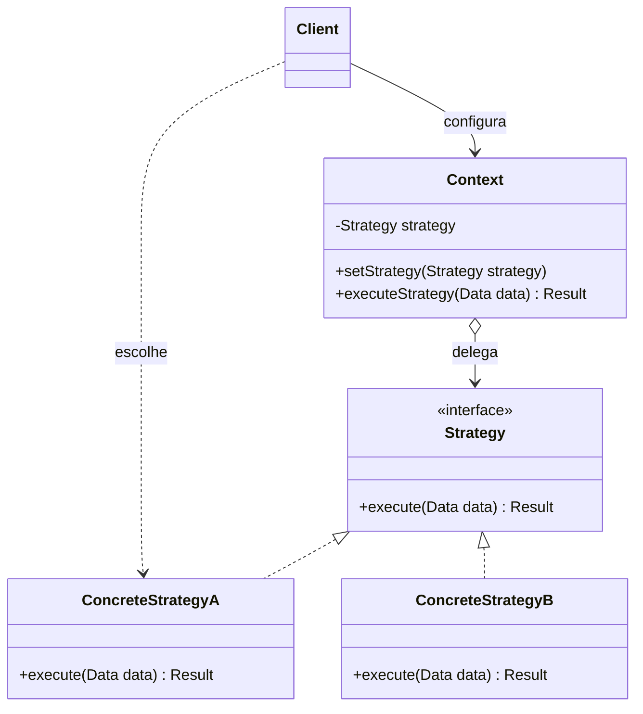

# Strategy

## Descrição

O Strategy (também conhecido como Policy) define uma família de algoritmos, encapsula cada um deles em um objeto próprio e os torna intercambiáveis. Assim, o algoritmo pode variar independentemente dos clientes que o utilizam.

O objeto que usa o algoritmo, chamado de contexto (`Context`), guarda uma referência a uma interface `Strategy` e delega a ela o trabalho, sem conhecer a implementação concreta. Cada `ConcreteStrategy` implementa a mesma interface com uma variação do comportamento (por exemplo, diferentes formas de amortizar um empréstimo, ordenar dados ou comprimir arquivos).

A estratégia normalmente é escolhida pelo cliente e injetada no contexto — via construtor ou setter — e pode ser trocada em tempo de execução. Isso substitui condicionais espalhadas por composição, mantendo cada algoritmo isolado, testável e extensível sem alterar o contexto.

## Problemas que resolve

- Classes com longos blocos `if/else` ou `switch` que selecionam entre variações de um mesmo algoritmo
- Necessidade de trocar o comportamento de um objeto em tempo de execução (por configuração, perfil do usuário ou contexto)
- Proliferação de subclasses que diferem apenas na forma como executam uma operação
- Algoritmos com detalhes de implementação (estruturas de dados, dependências) que não deveriam vazar para o cliente

## Quando usar

- Existem várias classes relacionadas que diferem apenas no comportamento
- Você precisa de diferentes variantes de um algoritmo (por exemplo, com trade-offs de memória e tempo distintos)
- O algoritmo deve ser selecionado ou substituído dinamicamente, inclusive por injeção de dependência
- Regras de negócio variáveis, como políticas de preço, descontos, cálculo de impostos, retry/backoff ou balanceamento de carga

## Quando evitar

- Há apenas um ou dois algoritmos estáveis que raramente mudam — uma condicional simples é mais legível
- Os clientes não deveriam precisar conhecer as diferenças entre as estratégias para escolher uma
- A linguagem oferece funções de primeira classe e uma lambda resolve o problema sem a cerimônia de classes e interfaces
- As estratégias precisariam de interfaces muito diferentes, forçando parâmetros que algumas implementações ignoram

## Trade-offs

| Ganho | Custo / Risco |
| --- | --- |
| Elimina condicionais e segue o Open/Closed Principle | Aumenta o número de classes/objetos no sistema |
| Algoritmos intercambiáveis em tempo de execução | Cliente precisa conhecer as estratégias disponíveis para escolher a adequada |
| Cada algoritmo isolado e testável individualmente | Overhead de comunicação: a interface comum pode passar dados que algumas estratégias não usam |
| Composição no lugar de herança | Indireção extra pode dificultar a leitura do fluxo em casos simples |

- **Acoplamento:** o contexto depende apenas da abstração `Strategy`; as implementações concretas ficam isoladas.
- **Testabilidade:** o contexto pode ser testado com uma estratégia falsa, e cada estratégia pode ser testada sem o contexto.
- **Complexidade:** a seleção da estratégia costuma ficar em uma factory, em um mapa de registro ou na configuração do contêiner de DI.
- **Desempenho:** estratégias sem estado podem ser compartilhadas (inclusive como Flyweight) para evitar alocações repetidas.

## Diagrama



O `Client` escolhe uma `ConcreteStrategy` e a entrega ao `Context`, que mantém uma referência à interface `Strategy` e delega a ela a execução do algoritmo. Novas estratégias podem ser adicionadas implementando a interface, sem alterar o `Context`.

## Exemplo

O simulador de crédito de uma fintech calcula as parcelas de um empréstimo pelo sistema de amortização escolhido pelo cliente: SAC, com parcelas decrescentes, ou Price, com parcelas fixas. A taxa é ilustrativa.

<Tabs groupId="lang" queryString>
<TabItem value="java" label="Java">

```java
interface AmortizationStrategy {
    // Devolve o valor de cada parcela, em centavos.
    long[] schedule(long principalCents, double monthlyRate, int months);
}

class SacAmortization implements AmortizationStrategy {
    public long[] schedule(long principalCents, double monthlyRate, int months) {
        double amortization = (double) principalCents / months;
        long[] installments = new long[months];
        for (int i = 0; i < months; i++) {
            double balance = principalCents - amortization * i;
            installments[i] = Math.round(amortization + balance * monthlyRate);
        }
        return installments;
    }
}

class PriceAmortization implements AmortizationStrategy {
    public long[] schedule(long principalCents, double monthlyRate, int months) {
        double factor = monthlyRate / (1 - Math.pow(1 + monthlyRate, -months));
        long[] installments = new long[months];
        Arrays.fill(installments, Math.round(principalCents * factor));
        return installments;
    }
}

class LoanSimulator {
    private AmortizationStrategy amortization;

    LoanSimulator(AmortizationStrategy amortization) { this.amortization = amortization; }

    void setAmortization(AmortizationStrategy amortization) { this.amortization = amortization; }

    long[] simulate(long principalCents, double monthlyRate, int months) {
        return amortization.schedule(principalCents, monthlyRate, months);
    }
}

// R$ 10.000,00 a 2% ao mês, em 10 parcelas
LoanSimulator simulator = new LoanSimulator(new SacAmortization());
long[] sac = simulator.simulate(1_000_000, 0.02, 10);
System.out.println(sac[0] + " " + sac[9]); // 120000 102000

simulator.setAmortization(new PriceAmortization());
long[] price = simulator.simulate(1_000_000, 0.02, 10);
System.out.println(price[0] + " " + price[9]); // 111327 111327
```

</TabItem>
<TabItem value="python" label="Python">

```python
from typing import Protocol

class AmortizationStrategy(Protocol):
    def schedule(self, principal_cents: int, monthly_rate: float, months: int) -> list[int]:
        """Devolve o valor de cada parcela, em centavos."""
        ...

class SacAmortization:
    def schedule(self, principal_cents: int, monthly_rate: float, months: int) -> list[int]:
        amortization = principal_cents / months
        return [
            round(amortization + (principal_cents - amortization * i) * monthly_rate)
            for i in range(months)
        ]

class PriceAmortization:
    def schedule(self, principal_cents: int, monthly_rate: float, months: int) -> list[int]:
        factor = monthly_rate / (1 - (1 + monthly_rate) ** -months)
        return [round(principal_cents * factor)] * months

class LoanSimulator:
    def __init__(self, amortization: AmortizationStrategy) -> None:
        self.amortization = amortization

    def simulate(self, principal_cents: int, monthly_rate: float, months: int) -> list[int]:
        return self.amortization.schedule(principal_cents, monthly_rate, months)

# R$ 10.000,00 a 2% ao mês, em 10 parcelas
simulator = LoanSimulator(SacAmortization())
sac = simulator.simulate(1_000_000, 0.02, 10)
print(sac[0], sac[9])  # 120000 102000

simulator.amortization = PriceAmortization()
price = simulator.simulate(1_000_000, 0.02, 10)
print(price[0], price[9])  # 111327 111327
```

</TabItem>
<TabItem value="go" label="Go">

```go
type AmortizationStrategy interface {
	// Devolve o valor de cada parcela, em centavos.
	Schedule(principalCents int64, monthlyRate float64, months int) []int64
}

type SacAmortization struct{}

func (SacAmortization) Schedule(principalCents int64, monthlyRate float64, months int) []int64 {
	amortization := float64(principalCents) / float64(months)
	installments := make([]int64, months)
	for i := range installments {
		balance := float64(principalCents) - amortization*float64(i)
		installments[i] = int64(math.Round(amortization + balance*monthlyRate))
	}
	return installments
}

type PriceAmortization struct{}

func (PriceAmortization) Schedule(principalCents int64, monthlyRate float64, months int) []int64 {
	factor := monthlyRate / (1 - math.Pow(1+monthlyRate, float64(-months)))
	installments := make([]int64, months)
	for i := range installments {
		installments[i] = int64(math.Round(float64(principalCents) * factor))
	}
	return installments
}

type LoanSimulator struct {
	Amortization AmortizationStrategy
}

func (s *LoanSimulator) Simulate(principalCents int64, monthlyRate float64, months int) []int64 {
	return s.Amortization.Schedule(principalCents, monthlyRate, months)
}

func main() {
	// R$ 10.000,00 a 2% ao mês, em 10 parcelas
	simulator := &LoanSimulator{Amortization: SacAmortization{}}
	sac := simulator.Simulate(1_000_000, 0.02, 10)
	fmt.Println(sac[0], sac[9]) // 120000 102000

	simulator.Amortization = PriceAmortization{}
	price := simulator.Simulate(1_000_000, 0.02, 10)
	fmt.Println(price[0], price[9]) // 111327 111327
}
```

</TabItem>
<TabItem value="typescript" label="TypeScript">

```typescript
interface AmortizationStrategy {
  // Devolve o valor de cada parcela, em centavos.
  schedule(principalCents: number, monthlyRate: number, months: number): number[];
}

class SacAmortization implements AmortizationStrategy {
  schedule(principalCents: number, monthlyRate: number, months: number): number[] {
    const amortization = principalCents / months;
    return Array.from({ length: months }, (_, i) => {
      const balance = principalCents - amortization * i;
      return Math.round(amortization + balance * monthlyRate);
    });
  }
}

class PriceAmortization implements AmortizationStrategy {
  schedule(principalCents: number, monthlyRate: number, months: number): number[] {
    const factor = monthlyRate / (1 - Math.pow(1 + monthlyRate, -months));
    const installment = Math.round(principalCents * factor);
    return Array.from({ length: months }, () => installment);
  }
}

class LoanSimulator {
  constructor(private amortization: AmortizationStrategy) {}

  setAmortization(amortization: AmortizationStrategy): void {
    this.amortization = amortization;
  }

  simulate(principalCents: number, monthlyRate: number, months: number): number[] {
    return this.amortization.schedule(principalCents, monthlyRate, months);
  }
}

// R$ 10.000,00 a 2% ao mês, em 10 parcelas
const simulator = new LoanSimulator(new SacAmortization());
const sac = simulator.simulate(1_000_000, 0.02, 10);
console.log(sac[0], sac[9]); // 120000 102000

simulator.setAmortization(new PriceAmortization());
const price = simulator.simulate(1_000_000, 0.02, 10);
console.log(price[0], price[9]); // 111327 111327
```

</TabItem>
</Tabs>

## Padrões relacionados

- [State](/coding/gof/behavioral/state) — estrutura quase idêntica, mas no State os estados trocam a si mesmos conforme o ciclo de vida, enquanto no Strategy a escolha costuma vir do cliente
- [Template Method](/coding/gof/behavioral/template-method) — varia partes de um algoritmo por herança, enquanto o Strategy varia o algoritmo inteiro por composição
- [Decorator](/coding/gof/structural/decorator) — o Decorator muda a "pele" de um objeto; o Strategy muda suas "entranhas"
- [Bridge](/coding/gof/structural/bridge) — estrutura semelhante de delegação a uma implementação, mas voltada a separar abstração e implementação em hierarquias independentes
- [Command](/coding/gof/behavioral/command) — ambos encapsulam comportamento em objetos; o Command representa uma ação a executar, o Strategy uma forma de executar algo
- [Flyweight](/coding/gof/structural/flyweight) — estratégias sem estado podem ser compartilhadas como flyweights
- [Factory Method](/coding/gof/creational/factory-method) — frequentemente usado para criar a estratégia adequada a partir de configuração ou entrada do usuário
- [Null Object](/coding/gof/behavioral/null-object) — pode atuar como estratégia padrão que não faz nada, evitando verificações de nulo no contexto

## Referência

- [Design Patterns Cheat Sheet](https://iretha.github.io/design-patterns/cheat-sheet)
- [Strategy no Refactoring.Guru](https://refactoring.guru/design-patterns/strategy)
