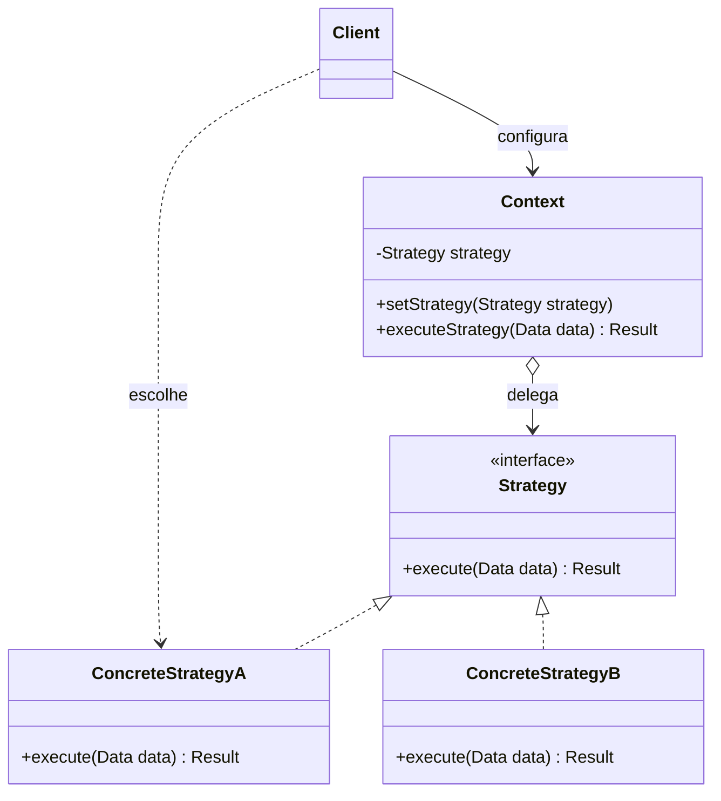

# Strategy

## Descrição

O Strategy (também conhecido como Policy) define uma família de algoritmos, encapsula cada um deles em um objeto próprio e os torna intercambiáveis. Assim, o algoritmo pode variar independentemente dos clientes que o utilizam.

O objeto que usa o algoritmo, chamado de contexto (`Context`), guarda uma referência a uma interface `Strategy` e delega a ela o trabalho, sem conhecer a implementação concreta. Cada `ConcreteStrategy` implementa a mesma interface com uma variação do comportamento (por exemplo, diferentes formas de calcular frete, ordenar dados ou comprimir arquivos).

A estratégia normalmente é escolhida pelo cliente e injetada no contexto — via construtor ou setter — e pode ser trocada em tempo de execução. Isso substitui condicionais espalhadas por composição, mantendo cada algoritmo isolado, testável e extensível sem alterar o contexto.

## Problemas que resolve

- Classes com longos blocos `if/else` ou `switch` que selecionam entre variações de um mesmo algoritmo
- Necessidade de trocar o comportamento de um objeto em tempo de execução (por configuração, perfil do usuário ou contexto)
- Proliferação de subclasses que diferem apenas na forma como executam uma operação
- Algoritmos com detalhes de implementação (estruturas de dados, dependências) que não deveriam vazar para o cliente

## Quando usar

- Existem várias classes relacionadas que diferem apenas no comportamento
- Você precisa de diferentes variantes de um algoritmo (por exemplo, com trade-offs de memória e tempo distintos)
- O algoritmo deve ser selecionado ou substituído dinamicamente, inclusive por injeção de dependência
- Regras de negócio variáveis, como políticas de preço, descontos, cálculo de impostos, retry/backoff ou balanceamento de carga

### Quando evitar

- Há apenas um ou dois algoritmos estáveis que raramente mudam — uma condicional simples é mais legível
- Os clientes não deveriam precisar conhecer as diferenças entre as estratégias para escolher uma
- A linguagem oferece funções de primeira classe e uma lambda resolve o problema sem a cerimônia de classes e interfaces
- As estratégias precisariam de interfaces muito diferentes, forçando parâmetros que algumas implementações ignoram

## Trade-offs

| Ganho | Custo / Risco |
| --- | --- |
| Elimina condicionais e segue o Open/Closed Principle | Aumenta o número de classes/objetos no sistema |
| Algoritmos intercambiáveis em tempo de execução | Cliente precisa conhecer as estratégias disponíveis para escolher a adequada |
| Cada algoritmo isolado e testável individualmente | Overhead de comunicação: a interface comum pode passar dados que algumas estratégias não usam |
| Composição no lugar de herança | Indireção extra pode dificultar a leitura do fluxo em casos simples |

- **Acoplamento:** o contexto depende apenas da abstração `Strategy`; as implementações concretas ficam isoladas.
- **Testabilidade:** o contexto pode ser testado com uma estratégia falsa, e cada estratégia pode ser testada sem o contexto.
- **Complexidade:** a seleção da estratégia costuma ficar em uma factory, em um mapa de registro ou na configuração do contêiner de DI.
- **Desempenho:** estratégias sem estado podem ser compartilhadas (inclusive como Flyweight) para evitar alocações repetidas.

## Diagrama



O `Client` escolhe uma `ConcreteStrategy` e a entrega ao `Context`, que mantém uma referência à interface `Strategy` e delega a ela a execução do algoritmo. Novas estratégias podem ser adicionadas implementando a interface, sem alterar o `Context`.

## Exemplo

Um e-commerce calcula o frete de acordo com a modalidade escolhida pelo cliente no checkout: padrão, expressa ou retirada na loja.

```typescript
interface ShippingStrategy {
  calculate(weightKg: number): number;
}

class StandardShipping implements ShippingStrategy {
  calculate(weightKg: number): number {
    return 10 + weightKg * 2;
  }
}

class ExpressShipping implements ShippingStrategy {
  calculate(weightKg: number): number {
    return 25 + weightKg * 4;
  }
}

class StorePickup implements ShippingStrategy {
  calculate(): number {
    return 0;
  }
}

class Checkout {
  constructor(private shipping: ShippingStrategy) {}

  setShipping(shipping: ShippingStrategy): void {
    this.shipping = shipping;
  }

  total(subtotal: number, weightKg: number): number {
    return subtotal + this.shipping.calculate(weightKg);
  }
}

const checkout = new Checkout(new StandardShipping());
console.log(checkout.total(100, 3)); // 116
checkout.setShipping(new ExpressShipping());
console.log(checkout.total(100, 3)); // 137
```

## Padrões relacionados

- [State](/coding/gof/behavioral/state) — estrutura quase idêntica, mas no State os estados trocam a si mesmos conforme o ciclo de vida, enquanto no Strategy a escolha costuma vir do cliente
- [Template Method](/coding/gof/behavioral/template-method) — varia partes de um algoritmo por herança, enquanto o Strategy varia o algoritmo inteiro por composição
- [Decorator](/coding/gof/structural/decorator) — o Decorator muda a "pele" de um objeto; o Strategy muda suas "entranhas"
- [Bridge](/coding/gof/structural/bridge) — estrutura semelhante de delegação a uma implementação, mas voltada a separar abstração e implementação em hierarquias independentes
- [Command](/coding/gof/behavioral/command) — ambos encapsulam comportamento em objetos; o Command representa uma ação a executar, o Strategy uma forma de executar algo
- [Flyweight](/coding/gof/structural/flyweight) — estratégias sem estado podem ser compartilhadas como flyweights
- [Factory Method](/coding/gof/creational/factory-method) — frequentemente usado para criar a estratégia adequada a partir de configuração ou entrada do usuário
- [Null Object](/coding/gof/behavioral/null-object) — pode atuar como estratégia padrão que não faz nada, evitando verificações de nulo no contexto

## Referência

- [Design Patterns Cheat Sheet](https://iretha.github.io/design-patterns/cheat-sheet)
- [Strategy no Refactoring.Guru](https://refactoring.guru/design-patterns/strategy)
