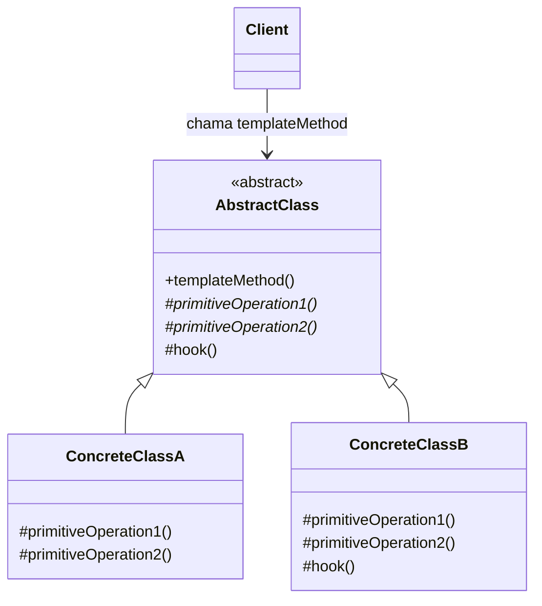

# Template Method

## Descrição

O Template Method define o esqueleto de um algoritmo em uma operação de uma classe base, delegando alguns passos para as subclasses. As subclasses podem redefinir certos passos do algoritmo sem alterar sua estrutura geral.

A classe abstrata expõe um método "template" (geralmente não sobrescrevível) que chama, em ordem fixa, uma sequência de operações. Algumas dessas operações são abstratas (passos obrigatórios que cada subclasse deve implementar), outras têm implementação padrão e outras são *hooks*: pontos de extensão opcionais, normalmente vazios, que a subclasse pode sobrescrever se quiser.

O controle do fluxo permanece na classe base, aplicando o chamado "Princípio de Hollywood" (*don't call us, we'll call you*): é a superclasse que chama os métodos das subclasses, e não o contrário.

## Problemas que resolve

- Duplicação de código em classes que executam algoritmos quase idênticos, diferindo apenas em alguns passos
- Falta de um ponto único para controlar a ordem e as invariantes de um processo (validação, logging, transações)
- Necessidade de permitir extensão controlada de um framework sem expor ou permitir alterar todo o fluxo

## Quando usar

- Quando várias classes compartilham a mesma estrutura de algoritmo e só variam em detalhes de alguns passos
- Quando se quer fixar as partes invariantes de um algoritmo uma única vez e deixar as partes variáveis para as subclasses
- Em frameworks e bibliotecas que oferecem pontos de extensão (hooks) bem definidos ao código cliente
- Ao refatorar código duplicado em subclasses, promovendo o comportamento comum para a superclasse

### Quando evitar

- Quando os passos variáveis precisam ser trocados em tempo de execução — prefira Strategy (composição)
- Quando o algoritmo tem muitos passos customizáveis, gerando hierarquias grandes e difíceis de entender
- Em linguagens ou contextos onde herança é desencorajada ou a hierarquia já é profunda
- Quando as subclasses precisariam violar o contrato da base (quebra do Princípio de Substituição de Liskov)

## Trade-offs

| Ganho | Custo / Risco |
| --- | --- |
| Elimina duplicação, centralizando o fluxo comum na classe base | Acoplamento forte por herança entre base e subclasses |
| Garante ordem e invariantes do algoritmo | Fluxo fica fragmentado entre classes, dificultando a leitura |
| Extensão controlada por meio de passos abstratos e hooks | Variação fixada em tempo de compilação; não troca em runtime |
| Facilita a criação de frameworks reutilizáveis | Mudanças na classe base podem afetar todas as subclasses (fragile base class) |

- **Acoplamento:** subclasses dependem de detalhes da superclasse; documente bem quais métodos podem ser sobrescritos.
- **Testabilidade:** o template pode ser testado com subclasses de teste simples, mas os passos isolados nem sempre são fáceis de testar.
- **Complexidade:** mantenha o número de passos abstratos pequeno; prefira hooks com implementação padrão.
- **Segurança do contrato:** marque o método template como `final` (ou equivalente) para impedir que subclasses alterem a estrutura.

## Diagrama



`AbstractClass` define o `templateMethod`, que invoca as operações primitivas (abstratas) e o `hook` (opcional) em ordem fixa. `ConcreteClassA` e `ConcreteClassB` implementam os passos variáveis, e o `Client` interage apenas com o método template.

## Exemplo

Um sistema importa dados de diferentes formatos (CSV e JSON). O fluxo é sempre: abrir, ler, converter, validar e salvar; apenas a leitura e a conversão variam conforme o formato.

```java
public abstract class DataImporter {
    // Método template: estrutura fixa do algoritmo
    public final void importFile(String path) {
        String raw = read(path);
        List<Record> records = parse(raw);
        validate(records);
        beforeSave(records); // hook opcional
        save(records);
    }

    protected abstract String read(String path);
    protected abstract List<Record> parse(String raw);

    protected void validate(List<Record> records) {
        records.removeIf(r -> !r.isValid());
    }

    protected void beforeSave(List<Record> records) { } // hook

    private void save(List<Record> records) { /* persiste no banco */ }
}

public class CsvImporter extends DataImporter {
    protected String read(String path) { return Files.readString(Path.of(path)); }
    protected List<Record> parse(String raw) { return CsvParser.parse(raw); }
}

public class JsonImporter extends DataImporter {
    protected String read(String path) { return Files.readString(Path.of(path)); }
    protected List<Record> parse(String raw) { return JsonParser.parse(raw); }
    @Override
    protected void beforeSave(List<Record> records) { records.forEach(Record::normalize); }
}
```

## Padrões relacionados

- [Strategy](./strategy.md) — alternativa baseada em composição: varia o algoritmo inteiro em runtime, enquanto o Template Method varia partes via herança
- [Factory Method](../creational/factory-method.md) — é frequentemente um passo especializado chamado de dentro de um método template
- [State](./state.md) — também delega comportamento, mas por composição e com troca dinâmica de estado
- [Command](./command.md) — comandos podem usar um método template para padronizar etapas como validação, execução e auditoria
- [Null Object](./null-object.md) — hooks vazios com implementação padrão seguem a mesma ideia de comportamento neutro

## Referência

- [Design Patterns Cheat Sheet](https://iretha.github.io/design-patterns/cheat-sheet)
- [Template Method no Refactoring.Guru](https://refactoring.guru/design-patterns/template-method)
