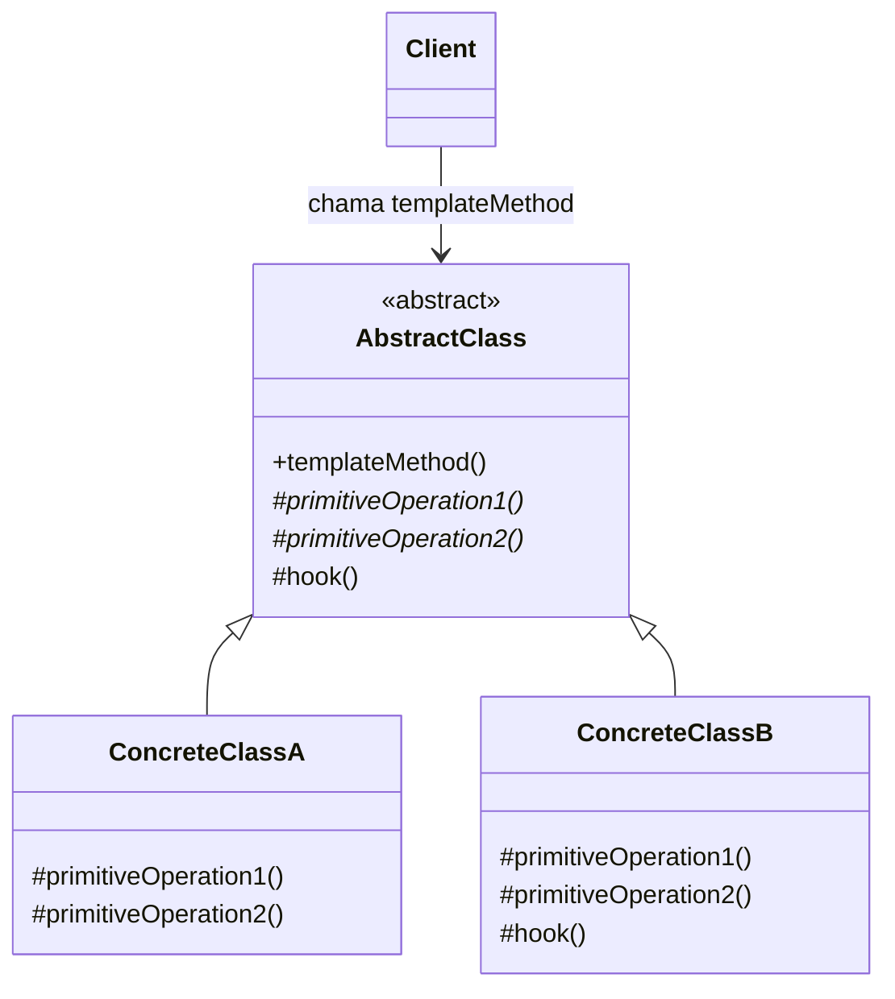

# Template Method

## Descrição

O Template Method define o esqueleto de um algoritmo em uma operação de uma classe base, delegando alguns passos para as subclasses. As subclasses podem redefinir certos passos do algoritmo sem alterar sua estrutura geral.

A classe abstrata expõe um método "template" (geralmente não sobrescrevível) que chama, em ordem fixa, uma sequência de operações. Algumas dessas operações são abstratas (passos obrigatórios que cada subclasse deve implementar), outras têm implementação padrão e outras são *hooks*: pontos de extensão opcionais, normalmente vazios, que a subclasse pode sobrescrever se quiser.

O controle do fluxo permanece na classe base, aplicando o chamado "Princípio de Hollywood" (*don't call us, we'll call you*): é a superclasse que chama os métodos das subclasses, e não o contrário.

## Problemas que resolve

- Duplicação de código em classes que executam algoritmos quase idênticos, diferindo apenas em alguns passos
- Falta de um ponto único para controlar a ordem e as invariantes de um processo (validação, logging, transações)
- Necessidade de permitir extensão controlada de um framework sem expor ou permitir alterar todo o fluxo

## Quando usar

- Quando várias classes compartilham a mesma estrutura de algoritmo e só variam em detalhes de alguns passos
- Quando se quer fixar as partes invariantes de um algoritmo uma única vez e deixar as partes variáveis para as subclasses
- Em frameworks e bibliotecas que oferecem pontos de extensão (hooks) bem definidos ao código cliente
- Ao refatorar código duplicado em subclasses, promovendo o comportamento comum para a superclasse

## Quando evitar

- Quando os passos variáveis precisam ser trocados em tempo de execução — prefira Strategy (composição)
- Quando o algoritmo tem muitos passos customizáveis, gerando hierarquias grandes e difíceis de entender
- Em linguagens ou contextos onde herança é desencorajada ou a hierarquia já é profunda
- Quando as subclasses precisariam violar o contrato da base (quebra do Princípio de Substituição de Liskov)

## Trade-offs

| Ganho | Custo / Risco |
| --- | --- |
| Elimina duplicação, centralizando o fluxo comum na classe base | Acoplamento forte por herança entre base e subclasses |
| Garante ordem e invariantes do algoritmo | Fluxo fica fragmentado entre classes, dificultando a leitura |
| Extensão controlada por meio de passos abstratos e hooks | Variação fixada em tempo de compilação; não troca em runtime |
| Facilita a criação de frameworks reutilizáveis | Mudanças na classe base podem afetar todas as subclasses (fragile base class) |

- **Acoplamento:** subclasses dependem de detalhes da superclasse; documente bem quais métodos podem ser sobrescritos.
- **Testabilidade:** o template pode ser testado com subclasses de teste simples, mas os passos isolados nem sempre são fáceis de testar.
- **Complexidade:** mantenha o número de passos abstratos pequeno; prefira hooks com implementação padrão.
- **Segurança do contrato:** marque o método template como `final` (ou equivalente) para impedir que subclasses alterem a estrutura.

## Diagrama



`AbstractClass` define o `templateMethod`, que invoca as operações primitivas (abstratas) e o `hook` (opcional) em ordem fixa. `ConcreteClassA` e `ConcreteClassB` implementam os passos variáveis, e o `Client` interage apenas com o método template.

## Exemplo

O processamento de um arquivo de retorno bancário é sempre: ler, converter em registros, validar e baixar os boletos pagos. Só a leitura e a conversão mudam entre CNAB 240 e CNAB 400 (o Abstract Factory usa os mesmos arquivos CNAB, mas varia o layout por banco parceiro; aqui o foco é o fluxo de processamento do retorno).

<Tabs groupId="lang" queryString>
<TabItem value="java" label="Java">

```java
public abstract class RetornoProcessor {
    // Método template: estrutura fixa do fluxo
    public final void process(String path) throws IOException {
        String raw = read(path);
        List<PaymentRecord> records = parse(raw);
        validate(records);
        beforeSettle(records); // hook opcional
        settle(records);
    }

    protected abstract String read(String path) throws IOException;
    protected abstract List<PaymentRecord> parse(String raw);

    protected void validate(List<PaymentRecord> records) {
        records.removeIf(r -> !r.isValid());
    }

    protected void beforeSettle(List<PaymentRecord> records) { } // hook

    private void settle(List<PaymentRecord> records) { /* baixa os boletos pagos */ }
}

public class Cnab240Processor extends RetornoProcessor {
    protected String read(String path) throws IOException { return Files.readString(Path.of(path)); }
    protected List<PaymentRecord> parse(String raw) { return Cnab240Parser.parse(raw); }
}

public class Cnab400Processor extends RetornoProcessor {
    protected String read(String path) throws IOException {
        return Files.readString(Path.of(path), StandardCharsets.ISO_8859_1);
    }
    protected List<PaymentRecord> parse(String raw) { return Cnab400Parser.parse(raw); }
    @Override
    protected void beforeSettle(List<PaymentRecord> records) { records.forEach(PaymentRecord::normalize); }
}
```

</TabItem>
<TabItem value="python" label="Python">

```python
from abc import ABC, abstractmethod
from pathlib import Path

class RetornoProcessor(ABC):
    def process(self, path: str) -> None:
        """Método template: estrutura fixa do fluxo."""
        raw = self._read(path)
        records = self._parse(raw)
        records = self._validate(records)
        self._before_settle(records)  # hook opcional
        self._settle(records)

    @abstractmethod
    def _read(self, path: str) -> str: ...

    @abstractmethod
    def _parse(self, raw: str) -> list[PaymentRecord]: ...

    def _validate(self, records: list[PaymentRecord]) -> list[PaymentRecord]:
        return [r for r in records if r.is_valid()]

    def _before_settle(self, records: list[PaymentRecord]) -> None:  # hook
        pass

    def _settle(self, records: list[PaymentRecord]) -> None:
        ...  # baixa os boletos pagos

class Cnab240Processor(RetornoProcessor):
    def _read(self, path: str) -> str:
        return Path(path).read_text(encoding="utf-8")

    def _parse(self, raw: str) -> list[PaymentRecord]:
        return Cnab240Parser.parse(raw)

class Cnab400Processor(RetornoProcessor):
    def _read(self, path: str) -> str:
        return Path(path).read_text(encoding="iso-8859-1")

    def _parse(self, raw: str) -> list[PaymentRecord]:
        return Cnab400Parser.parse(raw)

    def _before_settle(self, records: list[PaymentRecord]) -> None:
        for record in records:
            record.normalize()
```

</TabItem>
<TabItem value="go" label="Go">

```go
// Go não tem herança: o fluxo fixo é uma função, e os passos que variam vêm de uma interface.
type RetornoFormat interface {
	Read(path string) (string, error)
	Parse(raw string) []PaymentRecord
}

// Hook opcional: só os formatos que precisam dele implementam esta interface.
type BeforeSettler interface {
	BeforeSettle(records []PaymentRecord)
}

// Método template: estrutura fixa do fluxo
func ProcessRetorno(format RetornoFormat, path string) error {
	raw, err := format.Read(path)
	if err != nil {
		return err
	}
	records := validate(format.Parse(raw))
	if hook, ok := format.(BeforeSettler); ok {
		hook.BeforeSettle(records) // hook opcional
	}
	settle(records)
	return nil
}

func validate(records []PaymentRecord) []PaymentRecord {
	return slices.DeleteFunc(records, func(r PaymentRecord) bool { return !r.IsValid() })
}

func settle(records []PaymentRecord) { /* baixa os boletos pagos */ }

type Cnab240 struct{}

func (Cnab240) Read(path string) (string, error) {
	data, err := os.ReadFile(path)
	return string(data), err
}

func (Cnab240) Parse(raw string) []PaymentRecord { return parseCnab240(raw) }

type Cnab400 struct{}

func (Cnab400) Read(path string) (string, error) {
	data, err := os.ReadFile(path)
	runes := make([]rune, len(data)) // ISO-8859-1: cada byte é um code point
	for i, b := range data {
		runes[i] = rune(b)
	}
	return string(runes), err
}

func (Cnab400) Parse(raw string) []PaymentRecord { return parseCnab400(raw) }

func (Cnab400) BeforeSettle(records []PaymentRecord) {
	for i := range records {
		records[i].Normalize()
	}
}
```

</TabItem>
</Tabs>

## Padrões relacionados

- [Strategy](/coding/gof/behavioral/strategy) — alternativa baseada em composição: varia o algoritmo inteiro em runtime, enquanto o Template Method varia partes via herança
- [Factory Method](/coding/gof/creational/factory-method) — é frequentemente um passo especializado chamado de dentro de um método template
- [State](/coding/gof/behavioral/state) — também delega comportamento, mas por composição e com troca dinâmica de estado
- [Command](/coding/gof/behavioral/command) — comandos podem usar um método template para padronizar etapas como validação, execução e auditoria
- [Null Object](/coding/gof/behavioral/null-object) — hooks vazios com implementação padrão seguem a mesma ideia de comportamento neutro

## Referência

- [Design Patterns Cheat Sheet](https://iretha.github.io/design-patterns/cheat-sheet)
- [Template Method no Refactoring.Guru](https://refactoring.guru/design-patterns/template-method)
