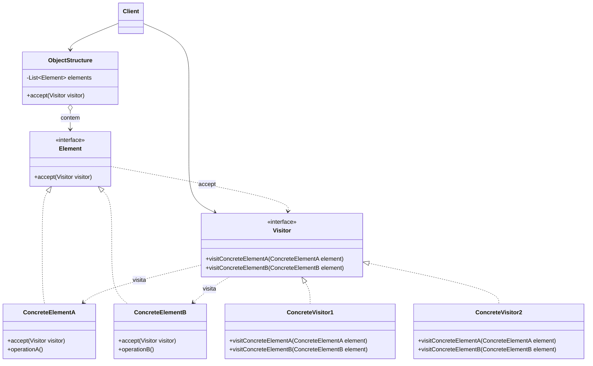

# Visitor

## Descrição

O Visitor representa uma operação a ser executada sobre os elementos de uma estrutura de objetos. Ele permite definir novas operações sem alterar as classes dos elementos sobre os quais opera, movendo cada operação para um objeto separado, o visitante.

Cada elemento da estrutura expõe um método `accept(visitor)`, que apenas chama de volta o método do visitante correspondente ao seu tipo concreto (por exemplo, `visitor.visitCdb(this)`). Essa técnica, chamada de *double dispatch*, faz com que o código executado dependa tanto do tipo do visitante quanto do tipo do elemento, sem `instanceof` nem `switch` sobre tipos.

Assim, cada nova operação vira uma nova classe `ConcreteVisitor` que reúne, em um só lugar, o comportamento para todos os tipos de elemento. O padrão é especialmente útil em hierarquias estáveis, como árvores sintáticas (AST), documentos e modelos de domínio, sobre as quais muitas operações diferentes são aplicadas.

## Problemas que resolve

- Necessidade de adicionar novas operações (exportação, validação, cálculo, renderização) a uma hierarquia de classes sem modificá-la a cada nova funcionalidade
- Lógica de uma mesma operação espalhada por várias classes de elementos, dificultando entendimento e manutenção
- Cadeias de `if/else` ou `switch` com verificações de tipo (`instanceof`) para decidir o que fazer com cada elemento
- Classes de domínio poluídas com responsabilidades não relacionadas ao seu propósito principal
- Acúmulo de estado ao percorrer uma estrutura heterogênea (por exemplo, somar totais ou coletar métricas de uma árvore)

## Quando usar

- A estrutura de objetos contém classes com interfaces diferentes e você precisa executar operações que dependem do tipo concreto de cada uma
- Muitas operações distintas e não relacionadas precisam ser aplicadas à estrutura e você não quer poluir as classes com elas
- A hierarquia de elementos raramente muda, mas novas operações são adicionadas com frequência
- Compiladores, interpretadores e ferramentas de análise que percorrem árvores sintáticas (type checking, otimização, geração de código, pretty printing)

## Quando evitar

- A hierarquia de elementos muda com frequência: cada novo tipo exige um novo método em todos os visitantes
- Há poucas operações e elas pertencem naturalmente aos próprios elementos
- A operação precisa de acesso a estado interno privado dos elementos, o que obrigaria a quebrar o encapsulamento
- A linguagem oferece pattern matching exaustivo sobre tipos selados (sealed classes, union types), que resolve o mesmo problema com menos cerimônia

## Trade-offs

| Ganho | Custo / Risco |
| --- | --- |
| Novas operações sem alterar as classes dos elementos (Open/Closed para operações) | Adicionar um novo tipo de elemento exige alterar a interface `Visitor` e todos os visitantes concretos |
| Comportamento relacionado concentrado em um único visitante (SRP) | Pode forçar os elementos a expor estado interno via métodos públicos |
| Visitante pode acumular estado durante o percorrimento da estrutura | Double dispatch e callbacks tornam o fluxo menos intuitivo |
| Elimina verificações de tipo e `switch` sobre classes | Acoplamento cíclico entre `Visitor` e a hierarquia de elementos |

- **Acoplamento:** os visitantes conhecem todos os tipos concretos de elemento; os elementos conhecem apenas a interface `Visitor`.
- **Testabilidade:** cada operação pode ser testada isoladamente aplicando o visitante a estruturas pequenas e controladas.
- **Complexidade:** a responsabilidade de percorrer a estrutura (no elemento, no visitante ou em um Iterator) deve ser decidida e mantida de forma consistente.
- **Extensibilidade:** o padrão inverte o eixo de extensão: facilita novas operações e dificulta novos tipos (o chamado *expression problem*).

## Diagrama



O `Client` aplica um `ConcreteVisitor` à `ObjectStructure`, que repassa o visitante a cada `Element`. Cada `ConcreteElement` implementa `accept` chamando o método `visit` correspondente ao seu tipo, de modo que a operação executada depende do par visitante/elemento (double dispatch).

## Exemplo

A carteira de investimentos tem tipos de ativo estáveis (`Cdb`, `Stock` e `FundShare`; a mesma carteira que o Composite organiza em subcarteiras), e novas operações aparecem com frequência: calcular o imposto devido, gerar o informe de rendimentos. Cada operação é um visitante, sem alterar as classes dos ativos. As alíquotas do exemplo são ilustrativas.

<Tabs groupId="lang" queryString>
<TabItem value="java" label="Java">

```java
interface AssetVisitor<R> {
    R visitCdb(Cdb cdb);
    R visitStock(Stock stock);
    R visitFundShare(FundShare share);
}

interface Asset { <R> R accept(AssetVisitor<R> v); }

record Cdb(String issuer, long gainCents) implements Asset {
    public <R> R accept(AssetVisitor<R> v) { return v.visitCdb(this); }
}

record Stock(String symbol, long gainCents) implements Asset {
    public <R> R accept(AssetVisitor<R> v) { return v.visitStock(this); }
}

record FundShare(String fund, long gainCents) implements Asset {
    public <R> R accept(AssetVisitor<R> v) { return v.visitFundShare(this); }
}

// alíquotas ilustrativas, não representam regra fiscal
class TaxCalculator implements AssetVisitor<Long> {
    public Long visitCdb(Cdb cdb) { return Math.round(cdb.gainCents() * 0.15); }
    public Long visitStock(Stock stock) { return Math.round(stock.gainCents() * 0.15); }
    public Long visitFundShare(FundShare share) { return Math.round(share.gainCents() * 0.20); }
}

class IncomeReportExporter implements AssetVisitor<String> {
    public String visitCdb(Cdb cdb) {
        return "{\"type\":\"cdb\",\"issuer\":\"%s\",\"gainCents\":%d}".formatted(cdb.issuer(), cdb.gainCents());
    }
    public String visitStock(Stock stock) {
        return "{\"type\":\"stock\",\"symbol\":\"%s\",\"gainCents\":%d}".formatted(stock.symbol(), stock.gainCents());
    }
    public String visitFundShare(FundShare share) {
        return "{\"type\":\"fund\",\"fund\":\"%s\",\"gainCents\":%d}".formatted(share.fund(), share.gainCents());
    }
}

List<Asset> assets = List.of(
    new Cdb("Banco Alfa", 100_000),
    new Stock("ACME3", 50_000),
    new FundShare("Fundo Beta", 200_000));
long totalTaxCents = assets.stream().mapToLong(a -> a.accept(new TaxCalculator())).sum();
System.out.println(totalTaxCents); // 62500
List<String> report = assets.stream().map(a -> a.accept(new IncomeReportExporter())).toList();
```

</TabItem>
<TabItem value="python" label="Python">

```python
import json
from dataclasses import dataclass

@dataclass(frozen=True)
class Cdb:
    issuer: str
    gain_cents: int

    def accept(self, visitor):
        return visitor.visit_cdb(self)

@dataclass(frozen=True)
class Stock:
    symbol: str
    gain_cents: int

    def accept(self, visitor):
        return visitor.visit_stock(self)

@dataclass(frozen=True)
class FundShare:
    fund: str
    gain_cents: int

    def accept(self, visitor):
        return visitor.visit_fund_share(self)

class TaxCalculator:
    """Alíquotas ilustrativas, não representam regra fiscal."""

    def visit_cdb(self, cdb: Cdb) -> int:
        return round(cdb.gain_cents * 0.15)

    def visit_stock(self, stock: Stock) -> int:
        return round(stock.gain_cents * 0.15)

    def visit_fund_share(self, share: FundShare) -> int:
        return round(share.gain_cents * 0.20)

class IncomeReportExporter:
    def visit_cdb(self, cdb: Cdb) -> str:
        return json.dumps({"type": "cdb", "issuer": cdb.issuer, "gainCents": cdb.gain_cents})

    def visit_stock(self, stock: Stock) -> str:
        return json.dumps({"type": "stock", "symbol": stock.symbol, "gainCents": stock.gain_cents})

    def visit_fund_share(self, share: FundShare) -> str:
        return json.dumps({"type": "fund", "fund": share.fund, "gainCents": share.gain_cents})

assets = [Cdb("Banco Alfa", 100_000), Stock("ACME3", 50_000), FundShare("Fundo Beta", 200_000)]
total_tax_cents = sum(a.accept(TaxCalculator()) for a in assets)
print(total_tax_cents)  # 62500
report = [a.accept(IncomeReportExporter()) for a in assets]
```

</TabItem>
<TabItem value="go" label="Go">

```go
// Go não tem métodos genéricos: o visitante acumula o resultado em vez de devolvê-lo.
type AssetVisitor interface {
	VisitCdb(cdb Cdb)
	VisitStock(stock Stock)
	VisitFundShare(share FundShare)
}

type Asset interface{ Accept(v AssetVisitor) }

type Cdb struct {
	Issuer    string
	GainCents int64
}

func (c Cdb) Accept(v AssetVisitor) { v.VisitCdb(c) }

type Stock struct {
	Symbol    string
	GainCents int64
}

func (s Stock) Accept(v AssetVisitor) { v.VisitStock(s) }

type FundShare struct {
	Fund      string
	GainCents int64
}

func (f FundShare) Accept(v AssetVisitor) { v.VisitFundShare(f) }

// alíquotas ilustrativas, não representam regra fiscal
type TaxCalculator struct{ TotalCents int64 }

func (t *TaxCalculator) add(gainCents int64, rate float64) {
	t.TotalCents += int64(math.Round(float64(gainCents) * rate))
}

func (t *TaxCalculator) VisitCdb(cdb Cdb)               { t.add(cdb.GainCents, 0.15) }
func (t *TaxCalculator) VisitStock(stock Stock)         { t.add(stock.GainCents, 0.15) }
func (t *TaxCalculator) VisitFundShare(share FundShare) { t.add(share.GainCents, 0.20) }

type IncomeReportExporter struct{ Lines []string }

func (e *IncomeReportExporter) add(kind, field, value string, gainCents int64) {
	e.Lines = append(e.Lines, fmt.Sprintf(`{"type":%q,%q:%q,"gainCents":%d}`, kind, field, value, gainCents))
}

func (e *IncomeReportExporter) VisitCdb(cdb Cdb) { e.add("cdb", "issuer", cdb.Issuer, cdb.GainCents) }
func (e *IncomeReportExporter) VisitStock(stock Stock) {
	e.add("stock", "symbol", stock.Symbol, stock.GainCents)
}
func (e *IncomeReportExporter) VisitFundShare(share FundShare) {
	e.add("fund", "fund", share.Fund, share.GainCents)
}

func main() {
	assets := []Asset{Cdb{"Banco Alfa", 100_000}, Stock{"ACME3", 50_000}, FundShare{"Fundo Beta", 200_000}}
	tax, report := &TaxCalculator{}, &IncomeReportExporter{}
	for _, asset := range assets {
		asset.Accept(tax)
		asset.Accept(report)
	}
	fmt.Println(tax.TotalCents) // 62500
}
```

</TabItem>
<TabItem value="typescript" label="TypeScript">

```typescript
interface AssetVisitor<R> {
  visitCdb(cdb: Cdb): R;
  visitStock(stock: Stock): R;
  visitFundShare(share: FundShare): R;
}

interface Asset { accept<R>(v: AssetVisitor<R>): R; }

class Cdb implements Asset {
  constructor(public issuer: string, public gainCents: number) {}
  accept<R>(v: AssetVisitor<R>): R { return v.visitCdb(this); }
}

class Stock implements Asset {
  constructor(public symbol: string, public gainCents: number) {}
  accept<R>(v: AssetVisitor<R>): R { return v.visitStock(this); }
}

class FundShare implements Asset {
  constructor(public fund: string, public gainCents: number) {}
  accept<R>(v: AssetVisitor<R>): R { return v.visitFundShare(this); }
}

// alíquotas ilustrativas, não representam regra fiscal
class TaxCalculator implements AssetVisitor<number> {
  visitCdb(cdb: Cdb) { return Math.round(cdb.gainCents * 0.15); }
  visitStock(stock: Stock) { return Math.round(stock.gainCents * 0.15); }
  visitFundShare(share: FundShare) { return Math.round(share.gainCents * 0.20); }
}

class IncomeReportExporter implements AssetVisitor<string> {
  visitCdb(cdb: Cdb) { return JSON.stringify({ type: "cdb", issuer: cdb.issuer, gainCents: cdb.gainCents }); }
  visitStock(stock: Stock) { return JSON.stringify({ type: "stock", symbol: stock.symbol, gainCents: stock.gainCents }); }
  visitFundShare(share: FundShare) { return JSON.stringify({ type: "fund", fund: share.fund, gainCents: share.gainCents }); }
}

const assets: Asset[] = [
  new Cdb("Banco Alfa", 100_000),
  new Stock("ACME3", 50_000),
  new FundShare("Fundo Beta", 200_000),
];
const totalTaxCents = assets.reduce((sum, a) => sum + a.accept(new TaxCalculator()), 0);
console.log(totalTaxCents); // 62500
const report = assets.map((a) => a.accept(new IncomeReportExporter()));
```

</TabItem>
</Tabs>

## Padrões relacionados

- [Composite](/coding/gof/structural/composite) — o Visitor é frequentemente aplicado para executar operações sobre todos os nós de uma árvore Composite, como a carteira de investimentos do exemplo
- [Iterator](/coding/gof/behavioral/iterator) — pode ser usado para percorrer a estrutura de objetos enquanto o Visitor executa a operação em cada elemento
- [Interpreter](/coding/gof/behavioral/interpreter) — operações sobre a árvore sintática abstrata do Interpreter (avaliação, impressão, otimização) costumam ser implementadas como visitantes
- [Command](/coding/gof/behavioral/command) — ambos encapsulam operações em objetos; o Visitor pode ser visto como um Command poderoso que atua sobre vários tipos de elemento
- [Strategy](/coding/gof/behavioral/strategy) — também extrai comportamento para objetos separados, mas varia um algoritmo para um único contexto, sem double dispatch

## Referência

- [Design Patterns Cheat Sheet](https://iretha.github.io/design-patterns/cheat-sheet)
- [Visitor no Refactoring.Guru](https://refactoring.guru/design-patterns/visitor)
