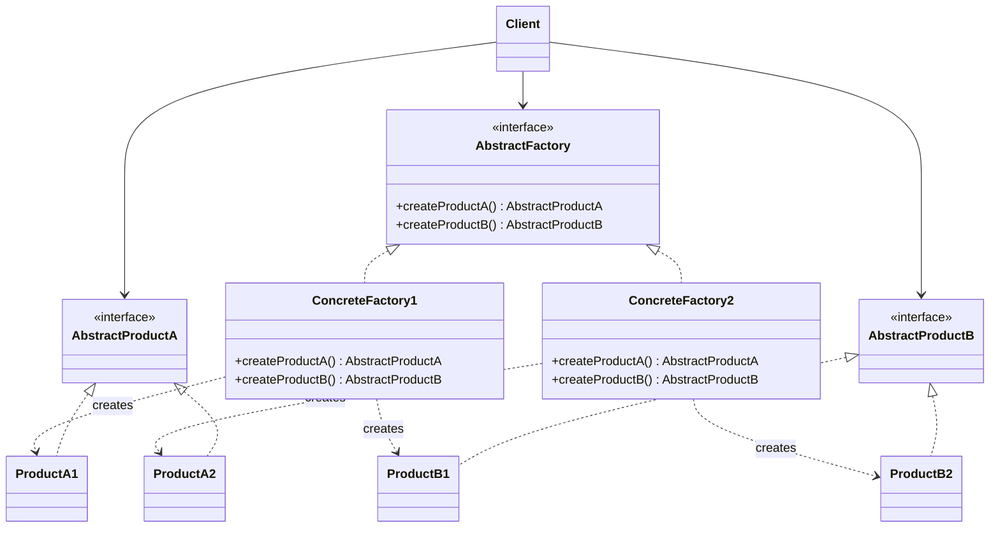

# Abstract Factory

## Descrição

O Abstract Factory fornece uma interface para criar famílias de objetos relacionados ou dependentes sem especificar suas classes concretas. O cliente conversa apenas com a fábrica abstrata e com as interfaces abstratas dos produtos, sem saber qual implementação está por trás.

Cada fábrica concreta implementa a interface da fábrica abstrata e produz uma variante coerente de todos os produtos da família (por exemplo, todos os componentes de UI no estilo "Windows" ou todos no estilo "Mac"). Trocar a fábrica concreta, normalmente em um único ponto de configuração, troca a família inteira de uma vez.

Na prática, o padrão funciona como uma "fábrica de fábricas": agrupa vários Factory Methods relacionados em um único objeto e garante a consistência entre os produtos criados.

## Problemas que resolve

- O código cliente fica acoplado a classes concretas ao instanciar objetos com `new`, dificultando a troca de implementações.
- Produtos de famílias diferentes acabam sendo misturados por engano (por exemplo, um botão de um tema com uma caixa de diálogo de outro).
- Suportar uma nova plataforma, tema ou fornecedor exige alterar vários pontos espalhados pelo código.

## Quando usar

- O sistema deve ser independente de como seus produtos são criados, compostos e representados.
- O sistema precisa ser configurado com uma entre várias famílias de produtos (temas de UI, drivers de banco de dados, provedores de nuvem).
- Produtos relacionados foram projetados para serem usados juntos e essa restrição precisa ser garantida.
- Você quer expor uma biblioteca de produtos revelando apenas as interfaces, não as implementações.

### Quando evitar

- Existe apenas uma família de produtos ou um único produto; um Factory Method ou construção direta é suficiente.
- Novos tipos de produto são adicionados com frequência: cada novo produto exige alterar a interface da fábrica abstrata e todas as fábricas concretas.
- O ganho de flexibilidade não justifica o número extra de interfaces e classes.

## Trade-offs

| Ganho | Custo / Risco |
| --- | --- |
| Isola o cliente das classes concretas | Aumenta o número de interfaces e classes |
| Garante consistência entre produtos da mesma família | Adicionar um novo tipo de produto exige mudar todas as fábricas |
| Facilita trocar a família inteira em um único ponto | Indireção extra pode dificultar a leitura do fluxo de criação |
| Favorece o Open/Closed Principle para novas famílias | Pode virar over-engineering em domínios simples |

- **Acoplamento:** o cliente depende apenas de abstrações, o que reduz o acoplamento com implementações.
- **Testabilidade:** é simples injetar uma fábrica falsa que produz mocks ou stubs.
- **Complexidade:** a hierarquia paralela de fábricas e produtos cresce rapidamente com o número de variantes.
- **Desempenho:** impacto desprezível; a criação passa por uma chamada polimórfica adicional.

## Diagrama



O `Client` usa apenas `AbstractFactory` e as interfaces de produto. Cada fábrica concreta (`ConcreteFactory1`, `ConcreteFactory2`) cria uma família coerente de produtos (`ProductA1`/`ProductB1` ou `ProductA2`/`ProductB2`).

## Exemplo

Uma aplicação desktop precisa renderizar botões e checkboxes com a aparência nativa do sistema operacional. A fábrica é escolhida uma vez na inicialização e o restante do código não conhece as classes concretas.

```typescript
interface Button { render(): string; }
interface Checkbox { render(): string; }

interface GUIFactory {
  createButton(): Button;
  createCheckbox(): Checkbox;
}

class WinButton implements Button { render() { return "[Win Button]"; } }
class WinCheckbox implements Checkbox { render() { return "[Win Checkbox]"; } }
class MacButton implements Button { render() { return "(Mac Button)"; } }
class MacCheckbox implements Checkbox { render() { return "(Mac Checkbox)"; } }

class WinFactory implements GUIFactory {
  createButton() { return new WinButton(); }
  createCheckbox() { return new WinCheckbox(); }
}

class MacFactory implements GUIFactory {
  createButton() { return new MacButton(); }
  createCheckbox() { return new MacCheckbox(); }
}

function renderForm(factory: GUIFactory): string {
  return [factory.createButton(), factory.createCheckbox()]
    .map((w) => w.render())
    .join(" ");
}

const factory: GUIFactory = process.platform === "darwin" ? new MacFactory() : new WinFactory();
console.log(renderForm(factory));
```

## Padrões relacionados

- [Factory Method](./factory-method.md) — as fábricas concretas costumam ser implementadas com Factory Methods.
- [Prototype](./prototype.md) — alternativa para implementar as fábricas concretas clonando protótipos em vez de instanciar subclasses.
- [Singleton](./singleton.md) — normalmente basta uma instância de cada fábrica concreta na aplicação.
- [Builder](./builder.md) — foca em construir um objeto complexo passo a passo, enquanto o Abstract Factory cria famílias de objetos de imediato.
- [Facade](../structural/facade.md) — um Abstract Factory pode ser usado como alternativa ao Facade para esconder a criação de objetos específicos de um subsistema.
- [Bridge](../structural/bridge.md) — um Abstract Factory pode criar e configurar uma implementação específica de um Bridge.

## Referência

- [Design Patterns Cheat Sheet](https://iretha.github.io/design-patterns/cheat-sheet)
- [Abstract Factory no Refactoring.Guru](https://refactoring.guru/design-patterns/abstract-factory)
