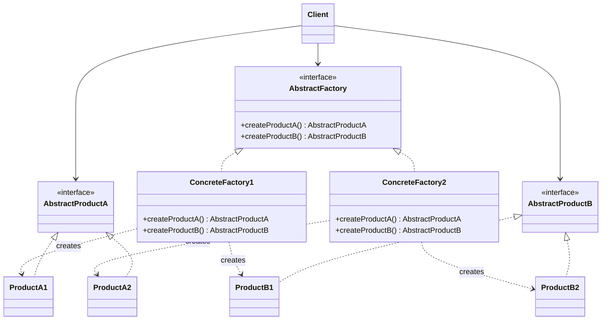

# Abstract Factory

## Descrição

O Abstract Factory fornece uma interface para criar famílias de objetos relacionados ou dependentes sem especificar suas classes concretas. O cliente conversa apenas com a fábrica abstrata e com as interfaces abstratas dos produtos, sem saber qual implementação está por trás.

Cada fábrica concreta implementa a interface da fábrica abstrata e produz uma variante coerente de todos os produtos da família (por exemplo, o gerador de remessa e o leitor de retorno no layout CNAB de um mesmo banco parceiro). Trocar a fábrica concreta, normalmente em um único ponto de configuração, troca a família inteira de uma vez.

Na prática, o padrão funciona como uma "fábrica de fábricas": agrupa vários Factory Methods relacionados em um único objeto e garante a consistência entre os produtos criados.

## Problemas que resolve

- O código cliente fica acoplado a classes concretas ao instanciar objetos com `new`, dificultando a troca de implementações.
- Produtos de famílias diferentes acabam sendo misturados por engano (por exemplo, gerar a remessa no layout de um banco e ler o retorno no layout de outro).
- Suportar uma nova plataforma, tema ou fornecedor exige alterar vários pontos espalhados pelo código.

## Quando usar

- O sistema deve ser independente de como seus produtos são criados, compostos e representados.
- O sistema precisa ser configurado com uma entre várias famílias de produtos (temas de UI, drivers de banco de dados, provedores de nuvem).
- Produtos relacionados foram projetados para serem usados juntos e essa restrição precisa ser garantida.
- Você quer expor uma biblioteca de produtos revelando apenas as interfaces, não as implementações.

## Quando evitar

- Existe apenas uma família de produtos ou um único produto; um Factory Method ou construção direta é suficiente.
- Novos tipos de produto são adicionados com frequência: cada novo produto exige alterar a interface da fábrica abstrata e todas as fábricas concretas.
- O ganho de flexibilidade não justifica o número extra de interfaces e classes.

## Trade-offs

| Ganho | Custo / Risco |
| --- | --- |
| Isola o cliente das classes concretas | Aumenta o número de interfaces e classes |
| Garante consistência entre produtos da mesma família | Adicionar um novo tipo de produto exige mudar todas as fábricas |
| Facilita trocar a família inteira em um único ponto | Indireção extra pode dificultar a leitura do fluxo de criação |
| Favorece o Open/Closed Principle para novas famílias | Pode virar over-engineering em domínios simples |

- **Acoplamento:** o cliente depende apenas de abstrações, o que reduz o acoplamento com implementações.
- **Testabilidade:** é simples injetar uma fábrica falsa que produz mocks ou stubs.
- **Complexidade:** a hierarquia paralela de fábricas e produtos cresce rapidamente com o número de variantes.
- **Desempenho:** impacto desprezível; a criação passa por uma chamada polimórfica adicional.

## Diagrama



O `Client` usa apenas `AbstractFactory` e as interfaces de produto. Cada fábrica concreta (`ConcreteFactory1`, `ConcreteFactory2`) cria uma família coerente de produtos (`ProductA1`/`ProductB1` ou `ProductA2`/`ProductB2`).

## Exemplo

A fintech troca arquivos de cobrança com vários bancos parceiros, e cada banco tem seu próprio layout CNAB. A fábrica do banco é escolhida uma vez e entrega um gerador de remessa e um leitor de retorno que combinam entre si; o restante do código não conhece as classes concretas.

<Tabs groupId="lang" queryString>
<TabItem value="java" label="Java">

```java
record Boleto(String ourNumber, long amountCents) {}
record Settlement(String ourNumber, long paidCents) {}

interface RemessaWriter { String write(List<Boleto> boletos); }
interface RetornoParser { List<Settlement> parse(String file); }

interface CnabFactory {
    RemessaWriter createWriter();
    RetornoParser createParser();
}

// Banco A: campos separados por ";" (layout simplificado)
class BankARemessaWriter implements RemessaWriter {
    public String write(List<Boleto> boletos) {
        return boletos.stream()
                .map(b -> "A;" + b.ourNumber() + ";" + b.amountCents())
                .collect(Collectors.joining("\n"));
    }
}

class BankARetornoParser implements RetornoParser {
    public List<Settlement> parse(String file) {
        return file.lines().map(line -> {
            String[] fields = line.split(";");
            return new Settlement(fields[1], Long.parseLong(fields[2]));
        }).toList();
    }
}

// Banco B: colunas de largura fixa (layout simplificado)
class BankBRemessaWriter implements RemessaWriter {
    public String write(List<Boleto> boletos) {
        return boletos.stream()
                .map(b -> String.format("B%10s%013d", b.ourNumber(), b.amountCents()).replace(' ', '0'))
                .collect(Collectors.joining("\n"));
    }
}

class BankBRetornoParser implements RetornoParser {
    public List<Settlement> parse(String file) {
        return file.lines()
                .map(line -> new Settlement(line.substring(1, 11), Long.parseLong(line.substring(11, 24))))
                .toList();
    }
}

class BankACnabFactory implements CnabFactory {
    public RemessaWriter createWriter() { return new BankARemessaWriter(); }
    public RetornoParser createParser() { return new BankARetornoParser(); }
}

class BankBCnabFactory implements CnabFactory {
    public RemessaWriter createWriter() { return new BankBRemessaWriter(); }
    public RetornoParser createParser() { return new BankBRetornoParser(); }
}

class BillingBatchService {
    private final RemessaWriter writer;
    private final RetornoParser parser;

    BillingBatchService(CnabFactory factory) {
        writer = factory.createWriter();
        parser = factory.createParser();
    }

    String generateRemessa(List<Boleto> boletos) { return writer.write(boletos); }
    List<Settlement> readRetorno(String file) { return parser.parse(file); }
}

// O banco parceiro é escolhido uma vez; remessa e retorno sempre usam o mesmo layout
BillingBatchService service = new BillingBatchService(new BankBCnabFactory());
String remessa = service.generateRemessa(List.of(new Boleto("42", 15000)));
System.out.println(remessa); // B00000000420000000015000
System.out.println(service.readRetorno(remessa)); // [Settlement[ourNumber=0000000042, paidCents=15000]]
```

</TabItem>
<TabItem value="python" label="Python">

```python
from dataclasses import dataclass
from typing import Protocol

@dataclass(frozen=True)
class Boleto:
    our_number: str
    amount_cents: int

@dataclass(frozen=True)
class Settlement:
    our_number: str
    paid_cents: int

class RemessaWriter(Protocol):
    def write(self, boletos: list[Boleto]) -> str: ...

class RetornoParser(Protocol):
    def parse(self, file: str) -> list[Settlement]: ...

class CnabFactory(Protocol):
    def create_writer(self) -> RemessaWriter: ...
    def create_parser(self) -> RetornoParser: ...

# Banco A: campos separados por ";" (layout simplificado)
class BankARemessaWriter:
    def write(self, boletos: list[Boleto]) -> str:
        return "\n".join(f"A;{b.our_number};{b.amount_cents}" for b in boletos)

class BankARetornoParser:
    def parse(self, file: str) -> list[Settlement]:
        rows = (line.split(";") for line in file.splitlines())
        return [Settlement(our_number, int(paid)) for _, our_number, paid in rows]

# Banco B: colunas de largura fixa (layout simplificado)
class BankBRemessaWriter:
    def write(self, boletos: list[Boleto]) -> str:
        return "\n".join(f"B{b.our_number:0>10}{b.amount_cents:013d}" for b in boletos)

class BankBRetornoParser:
    def parse(self, file: str) -> list[Settlement]:
        return [Settlement(line[1:11], int(line[11:24])) for line in file.splitlines()]

class BankACnabFactory:
    def create_writer(self) -> RemessaWriter:
        return BankARemessaWriter()

    def create_parser(self) -> RetornoParser:
        return BankARetornoParser()

class BankBCnabFactory:
    def create_writer(self) -> RemessaWriter:
        return BankBRemessaWriter()

    def create_parser(self) -> RetornoParser:
        return BankBRetornoParser()

class BillingBatchService:
    def __init__(self, factory: CnabFactory) -> None:
        self._writer = factory.create_writer()
        self._parser = factory.create_parser()

    def generate_remessa(self, boletos: list[Boleto]) -> str:
        return self._writer.write(boletos)

    def read_retorno(self, file: str) -> list[Settlement]:
        return self._parser.parse(file)

# O banco parceiro é escolhido uma vez; remessa e retorno sempre usam o mesmo layout
service = BillingBatchService(BankBCnabFactory())
remessa = service.generate_remessa([Boleto("42", 15000)])
print(remessa)  # B00000000420000000015000
print(service.read_retorno(remessa))  # [Settlement(our_number='0000000042', paid_cents=15000)]
```

</TabItem>
<TabItem value="go" label="Go">

```go
type Boleto struct {
	OurNumber   string
	AmountCents int64
}

type Settlement struct {
	OurNumber string
	PaidCents int64
}

type RemessaWriter interface {
	Write(boletos []Boleto) string
}

type RetornoParser interface {
	Parse(file string) []Settlement
}

type CnabFactory interface {
	CreateWriter() RemessaWriter
	CreateParser() RetornoParser
}

// Banco A: campos separados por ";" (layout simplificado)
type BankARemessaWriter struct{}

func (BankARemessaWriter) Write(boletos []Boleto) string {
	lines := make([]string, len(boletos))
	for i, b := range boletos {
		lines[i] = fmt.Sprintf("A;%s;%d", b.OurNumber, b.AmountCents)
	}
	return strings.Join(lines, "\n")
}

type BankARetornoParser struct{}

func (BankARetornoParser) Parse(file string) []Settlement {
	var settlements []Settlement
	for _, line := range strings.Split(file, "\n") {
		fields := strings.Split(line, ";")
		paid, _ := strconv.ParseInt(fields[2], 10, 64)
		settlements = append(settlements, Settlement{fields[1], paid})
	}
	return settlements
}

// Banco B: colunas de largura fixa (layout simplificado)
type BankBRemessaWriter struct{}

func (BankBRemessaWriter) Write(boletos []Boleto) string {
	lines := make([]string, len(boletos))
	for i, b := range boletos {
		lines[i] = fmt.Sprintf("B%010s%013d", b.OurNumber, b.AmountCents)
	}
	return strings.Join(lines, "\n")
}

type BankBRetornoParser struct{}

func (BankBRetornoParser) Parse(file string) []Settlement {
	var settlements []Settlement
	for _, line := range strings.Split(file, "\n") {
		paid, _ := strconv.ParseInt(line[11:24], 10, 64)
		settlements = append(settlements, Settlement{line[1:11], paid})
	}
	return settlements
}

type BankACnabFactory struct{}

func (BankACnabFactory) CreateWriter() RemessaWriter { return BankARemessaWriter{} }
func (BankACnabFactory) CreateParser() RetornoParser { return BankARetornoParser{} }

type BankBCnabFactory struct{}

func (BankBCnabFactory) CreateWriter() RemessaWriter { return BankBRemessaWriter{} }
func (BankBCnabFactory) CreateParser() RetornoParser { return BankBRetornoParser{} }

type BillingBatchService struct {
	writer RemessaWriter
	parser RetornoParser
}

func NewBillingBatchService(factory CnabFactory) *BillingBatchService {
	return &BillingBatchService{factory.CreateWriter(), factory.CreateParser()}
}

func (s *BillingBatchService) GenerateRemessa(boletos []Boleto) string {
	return s.writer.Write(boletos)
}
func (s *BillingBatchService) ReadRetorno(file string) []Settlement { return s.parser.Parse(file) }

func main() {
	// O banco parceiro é escolhido uma vez; remessa e retorno sempre usam o mesmo layout
	service := NewBillingBatchService(BankBCnabFactory{})
	remessa := service.GenerateRemessa([]Boleto{{"42", 15000}})
	fmt.Println(remessa)                      // B00000000420000000015000
	fmt.Println(service.ReadRetorno(remessa)) // [{0000000042 15000}]
}
```

</TabItem>
<TabItem value="typescript" label="TypeScript">

```typescript
interface Boleto { ourNumber: string; amountCents: number; }
interface Settlement { ourNumber: string; paidCents: number; }

interface RemessaWriter { write(boletos: Boleto[]): string; }
interface RetornoParser { parse(file: string): Settlement[]; }

interface CnabFactory {
  createWriter(): RemessaWriter;
  createParser(): RetornoParser;
}

// Banco A: campos separados por ";" (layout simplificado)
class BankARemessaWriter implements RemessaWriter {
  write(boletos: Boleto[]) {
    return boletos.map((b) => `A;${b.ourNumber};${b.amountCents}`).join("\n");
  }
}
class BankARetornoParser implements RetornoParser {
  parse(file: string) {
    return file.split("\n").map((line) => {
      const [, ourNumber, paid] = line.split(";");
      return { ourNumber, paidCents: Number(paid) };
    });
  }
}

// Banco B: colunas de largura fixa (layout simplificado)
class BankBRemessaWriter implements RemessaWriter {
  write(boletos: Boleto[]) {
    return boletos
      .map((b) => `B${b.ourNumber.padStart(10, "0")}${String(b.amountCents).padStart(13, "0")}`)
      .join("\n");
  }
}
class BankBRetornoParser implements RetornoParser {
  parse(file: string) {
    return file.split("\n").map((line) => ({
      ourNumber: line.slice(1, 11),
      paidCents: Number(line.slice(11, 24)),
    }));
  }
}

class BankACnabFactory implements CnabFactory {
  createWriter() { return new BankARemessaWriter(); }
  createParser() { return new BankARetornoParser(); }
}

class BankBCnabFactory implements CnabFactory {
  createWriter() { return new BankBRemessaWriter(); }
  createParser() { return new BankBRetornoParser(); }
}

class BillingBatchService {
  private writer: RemessaWriter;
  private parser: RetornoParser;

  constructor(factory: CnabFactory) {
    this.writer = factory.createWriter();
    this.parser = factory.createParser();
  }

  generateRemessa(boletos: Boleto[]): string { return this.writer.write(boletos); }
  readRetorno(file: string): Settlement[] { return this.parser.parse(file); }
}

// O banco parceiro é escolhido uma vez; remessa e retorno sempre usam o mesmo layout
const service = new BillingBatchService(new BankBCnabFactory());
const remessa = service.generateRemessa([{ ourNumber: "42", amountCents: 15000 }]);
console.log(remessa); // B00000000420000000015000
console.log(service.readRetorno(remessa)); // [ { ourNumber: '0000000042', paidCents: 15000 } ]
```

</TabItem>
</Tabs>

## Padrões relacionados

- [Factory Method](/coding/gof/creational/factory-method) — as fábricas concretas costumam ser implementadas com Factory Methods.
- [Prototype](/coding/gof/creational/prototype) — alternativa para implementar as fábricas concretas clonando protótipos em vez de instanciar subclasses.
- [Singleton](/coding/gof/creational/singleton) — normalmente basta uma instância de cada fábrica concreta na aplicação.
- [Builder](/coding/gof/creational/builder) — foca em construir um objeto complexo passo a passo, enquanto o Abstract Factory cria famílias de objetos de imediato.
- [Facade](/coding/gof/structural/facade) — um Abstract Factory pode ser usado como alternativa ao Facade para esconder a criação de objetos específicos de um subsistema.
- [Bridge](/coding/gof/structural/bridge) — um Abstract Factory pode criar e configurar uma implementação específica de um Bridge.

## Referência

- [Design Patterns Cheat Sheet](https://iretha.github.io/design-patterns/cheat-sheet)
- [Abstract Factory no Refactoring.Guru](https://refactoring.guru/design-patterns/abstract-factory)
