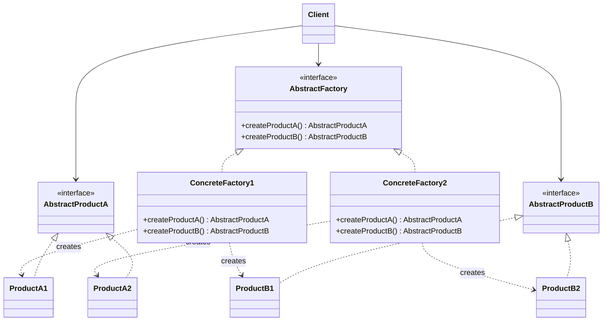

# Abstract Factory

## Descrição

O Abstract Factory fornece uma interface para criar famílias de objetos relacionados ou dependentes sem especificar suas classes concretas. O cliente conversa apenas com a fábrica abstrata e com as interfaces abstratas dos produtos, sem saber qual implementação está por trás.

Cada fábrica concreta implementa a interface da fábrica abstrata e produz uma variante coerente de todos os produtos da família (por exemplo, o gerador de remessa e o leitor de retorno no layout CNAB de um mesmo banco parceiro). Trocar a fábrica concreta, normalmente em um único ponto de configuração, troca a família inteira de uma vez.

Na prática, o padrão funciona como uma "fábrica de fábricas": agrupa vários Factory Methods relacionados em um único objeto e garante a consistência entre os produtos criados.

## Problemas que resolve

- O código cliente fica acoplado a classes concretas ao instanciar objetos com `new`, dificultando a troca de implementações.
- Produtos de famílias diferentes acabam sendo misturados por engano (por exemplo, gerar a remessa no layout de um banco e ler o retorno no layout de outro).
- Suportar uma nova plataforma, tema ou fornecedor exige alterar vários pontos espalhados pelo código.

## Quando usar

- O sistema deve ser independente de como seus produtos são criados, compostos e representados.
- O sistema precisa ser configurado com uma entre várias famílias de produtos (temas de UI, drivers de banco de dados, provedores de nuvem).
- Produtos relacionados foram projetados para serem usados juntos e essa restrição precisa ser garantida.
- Você quer expor uma biblioteca de produtos revelando apenas as interfaces, não as implementações.

## Quando evitar

- Existe apenas uma família de produtos ou um único produto; um Factory Method ou construção direta é suficiente.
- Novos tipos de produto são adicionados com frequência: cada novo produto exige alterar a interface da fábrica abstrata e todas as fábricas concretas.
- O ganho de flexibilidade não justifica o número extra de interfaces e classes.

## Trade-offs

| Ganho | Custo / Risco |
| --- | --- |
| Isola o cliente das classes concretas | Aumenta o número de interfaces e classes |
| Garante consistência entre produtos da mesma família | Adicionar um novo tipo de produto exige mudar todas as fábricas |
| Facilita trocar a família inteira em um único ponto | Indireção extra pode dificultar a leitura do fluxo de criação |
| Favorece o Open/Closed Principle para novas famílias | Pode virar over-engineering em domínios simples |

- **Acoplamento:** o cliente depende apenas de abstrações, o que reduz o acoplamento com implementações.
- **Testabilidade:** é simples injetar uma fábrica falsa que produz mocks ou stubs.
- **Complexidade:** a hierarquia paralela de fábricas e produtos cresce rapidamente com o número de variantes.
- **Desempenho:** impacto desprezível; a criação passa por uma chamada polimórfica adicional.

## Diagrama



O `Client` usa apenas `AbstractFactory` e as interfaces de produto. Cada fábrica concreta (`ConcreteFactory1`, `ConcreteFactory2`) cria uma família coerente de produtos (`ProductA1`/`ProductB1` ou `ProductA2`/`ProductB2`).

## Exemplo

A fintech troca arquivos de cobrança com vários bancos parceiros, e cada banco tem seu próprio layout CNAB. A fábrica do banco é escolhida uma vez e entrega um gerador de remessa e um leitor de retorno que combinam entre si; o restante do código não conhece as classes concretas.

```typescript
interface Boleto { ourNumber: string; amountCents: number; }
interface Settlement { ourNumber: string; paidCents: number; }

interface RemessaWriter { write(boletos: Boleto[]): string; }
interface RetornoParser { parse(file: string): Settlement[]; }

interface CnabFactory {
  createWriter(): RemessaWriter;
  createParser(): RetornoParser;
}

// Banco A: campos separados por ";" (layout simplificado)
class BankARemessaWriter implements RemessaWriter {
  write(boletos: Boleto[]) {
    return boletos.map((b) => `A;${b.ourNumber};${b.amountCents}`).join("\n");
  }
}
class BankARetornoParser implements RetornoParser {
  parse(file: string) {
    return file.split("\n").map((line) => {
      const [, ourNumber, paid] = line.split(";");
      return { ourNumber, paidCents: Number(paid) };
    });
  }
}

// Banco B: colunas de largura fixa (layout simplificado)
class BankBRemessaWriter implements RemessaWriter {
  write(boletos: Boleto[]) {
    return boletos
      .map((b) => `B${b.ourNumber.padStart(10, "0")}${String(b.amountCents).padStart(13, "0")}`)
      .join("\n");
  }
}
class BankBRetornoParser implements RetornoParser {
  parse(file: string) {
    return file.split("\n").map((line) => ({
      ourNumber: line.slice(1, 11),
      paidCents: Number(line.slice(11, 24)),
    }));
  }
}

class BankACnabFactory implements CnabFactory {
  createWriter() { return new BankARemessaWriter(); }
  createParser() { return new BankARetornoParser(); }
}

class BankBCnabFactory implements CnabFactory {
  createWriter() { return new BankBRemessaWriter(); }
  createParser() { return new BankBRetornoParser(); }
}

class BillingBatchService {
  private writer: RemessaWriter;
  private parser: RetornoParser;

  constructor(factory: CnabFactory) {
    this.writer = factory.createWriter();
    this.parser = factory.createParser();
  }

  generateRemessa(boletos: Boleto[]): string { return this.writer.write(boletos); }
  readRetorno(file: string): Settlement[] { return this.parser.parse(file); }
}

// O banco parceiro é escolhido uma vez; remessa e retorno sempre usam o mesmo layout
const service = new BillingBatchService(new BankBCnabFactory());
const remessa = service.generateRemessa([{ ourNumber: "42", amountCents: 15000 }]);
console.log(remessa); // B00000000420000000015000
console.log(service.readRetorno(remessa)); // [ { ourNumber: '0000000042', paidCents: 15000 } ]
```

## Padrões relacionados

- [Factory Method](/coding/gof/creational/factory-method) — as fábricas concretas costumam ser implementadas com Factory Methods.
- [Prototype](/coding/gof/creational/prototype) — alternativa para implementar as fábricas concretas clonando protótipos em vez de instanciar subclasses.
- [Singleton](/coding/gof/creational/singleton) — normalmente basta uma instância de cada fábrica concreta na aplicação.
- [Builder](/coding/gof/creational/builder) — foca em construir um objeto complexo passo a passo, enquanto o Abstract Factory cria famílias de objetos de imediato.
- [Facade](/coding/gof/structural/facade) — um Abstract Factory pode ser usado como alternativa ao Facade para esconder a criação de objetos específicos de um subsistema.
- [Bridge](/coding/gof/structural/bridge) — um Abstract Factory pode criar e configurar uma implementação específica de um Bridge.

## Referência

- [Design Patterns Cheat Sheet](https://iretha.github.io/design-patterns/cheat-sheet)
- [Abstract Factory no Refactoring.Guru](https://refactoring.guru/design-patterns/abstract-factory)
