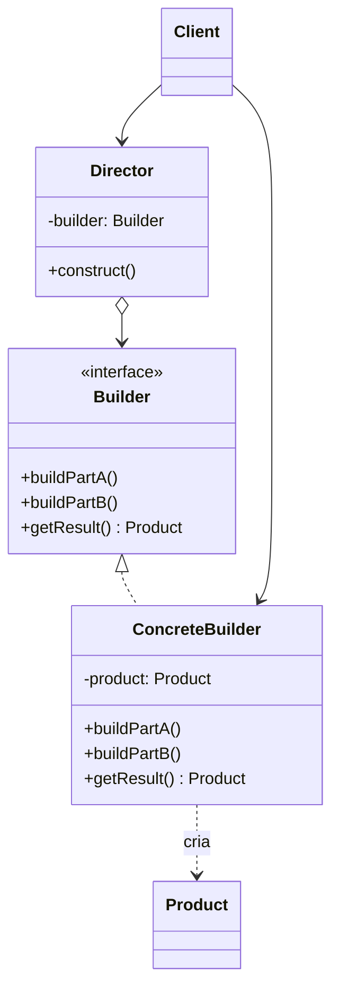

# Builder

## Descrição

O Builder separa a construção de um objeto complexo da sua representação, permitindo que o mesmo processo de construção produza representações diferentes. Em vez de montar o objeto de uma só vez por um construtor com muitos parâmetros, a criação é dividida em etapas nomeadas e explícitas.

Um `Builder` define as operações para criar cada parte do produto; implementações concretas (`ConcreteBuilder`) sabem como montar e guardar essas partes e expõem um método para obter o resultado final. Opcionalmente, um `Director` encapsula a ordem dos passos para receitas de construção recorrentes, de modo que o cliente só escolhe qual builder usar.

Na prática moderna, a variante mais comum é o builder fluente (métodos encadeados que retornam o próprio builder), usado para criar objetos imutáveis com muitos atributos opcionais e validar a consistência do objeto antes de entregá-lo.

## Problemas que resolve

- Construtores com longas listas de parâmetros, muitos deles opcionais, difíceis de ler e propensos a erros de ordem (o "telescoping constructor")
- Necessidade de montar um objeto passo a passo, às vezes com etapas condicionais ou repetidas
- Mesmo processo de construção precisando gerar representações diferentes (ex.: documento em HTML, Markdown ou PDF)
- Criação de objetos imutáveis cujo estado deve estar completo e válido no momento em que são entregues

## Quando usar

- O objeto tem muitos atributos, principalmente opcionais ou com valores padrão
- A construção envolve várias etapas, ordem relevante ou regras de validação entre campos
- Você quer reutilizar o mesmo algoritmo de montagem para produzir produtos diferentes
- Você precisa de objetos imutáveis, mas sem construtores gigantes
- Montagem de estruturas compostas (árvores, consultas SQL, requisições HTTP, mensagens)

## Quando evitar

- O objeto é simples, com poucos campos obrigatórios; um construtor ou factory resolve
- A linguagem já oferece parâmetros nomeados e valores padrão que eliminam o problema
- Os produtos não compartilham um processo de construção comum, tornando a abstração artificial
- O custo de manter um builder sincronizado com cada mudança na classe de produto não compensa

## Trade-offs

| Ganho | Custo / Risco |
| --- | --- |
| Código cliente legível e autodocumentado (passos nomeados) | Mais classes e código a manter (um builder por produto) |
| Permite produtos imutáveis e validação centralizada em `build()` | Duplicação de campos entre builder e produto |
| Isola o código de construção da lógica de negócio do produto | Builder pode ficar desatualizado em relação ao produto |
| Mesmo processo gera representações diferentes | Erros de campos obrigatórios esquecidos só aparecem em tempo de execução (salvo builders tipados por etapa) |

- **Acoplamento:** o cliente depende do builder, não da representação interna do produto.
- **Testabilidade:** builders facilitam criar dados de teste ("test data builders") com valores padrão sensatos.
- **Complexidade:** o `Director` é opcional; muitas vezes adiciona camadas sem benefício real.
- **Concorrência:** builders são mutáveis e normalmente não devem ser compartilhados entre threads.

## Diagrama



O `Client` cria um `ConcreteBuilder` e o entrega ao `Director`, que chama os passos de construção na ordem correta; ao final, o cliente obtém o `Product` montado a partir do próprio builder via `getResult()`.

## Exemplo

Uma cobrança Pix tem valor e chave do recebedor obrigatórios, e vencimento, multa, juros, desconto e mensagem ao pagador opcionais. Um builder fluente deixa a criação legível, valida as combinações (multa, juros e desconto só fazem sentido com vencimento) e entrega um `PixCharge` imutável, com o `txid` já gerado. Taxas e valores são ilustrativos.

<Tabs groupId="lang" queryString>
<TabItem value="java" label="Java">

```java
public final class PixCharge {
    private final long amountCents;
    private final String receiverKey, txid, payerMessage;
    private final LocalDate dueDate;
    private final double fineRate, dailyInterestRate, discountRate;

    private PixCharge(Builder b) {
        amountCents = b.amountCents; receiverKey = b.receiverKey;
        payerMessage = b.payerMessage; dueDate = b.dueDate;
        fineRate = b.fineRate; dailyInterestRate = b.dailyInterestRate;
        discountRate = b.discountRate;
        txid = UUID.randomUUID().toString().replace("-", "");
    }

    public static Builder builder(long amountCents, String receiverKey) {
        return new Builder(amountCents, receiverKey);
    }

    public static final class Builder {
        private final long amountCents;
        private final String receiverKey;
        private String payerMessage;
        private LocalDate dueDate;
        private double fineRate, dailyInterestRate, discountRate;

        private Builder(long amountCents, String receiverKey) {
            this.amountCents = amountCents; this.receiverKey = receiverKey;
        }
        public Builder dueDate(LocalDate d) { this.dueDate = d; return this; }
        public Builder fineRate(double r) { this.fineRate = r; return this; }
        public Builder dailyInterestRate(double r) { this.dailyInterestRate = r; return this; }
        public Builder discountRate(double r) { this.discountRate = r; return this; }
        public Builder payerMessage(String m) { this.payerMessage = m; return this; }

        public PixCharge build() {
            if (amountCents <= 0)
                throw new IllegalStateException("valor deve ser positivo");
            boolean hasCharges = fineRate > 0 || dailyInterestRate > 0 || discountRate > 0;
            if (hasCharges && dueDate == null)
                throw new IllegalStateException("multa, juros e desconto exigem vencimento");
            return new PixCharge(this); // o construtor gera o txid
        }
    }
}

// Uso: R$ 250,00 com vencimento, multa de 2% e juros de 0,033% ao dia
PixCharge charge = PixCharge.builder(25_000, "pagamentos@fintech.example")
    .dueDate(LocalDate.of(2026, 12, 10)).fineRate(0.02).dailyInterestRate(0.00033)
    .payerMessage("Mensalidade de dezembro").build();
```

</TabItem>
<TabItem value="python" label="Python">

```python
from __future__ import annotations

import uuid
from dataclasses import dataclass, field
from datetime import date
from typing import Optional

@dataclass(frozen=True)
class PixCharge:
    amount_cents: int
    receiver_key: str
    due_date: Optional[date] = None
    fine_rate: float = 0.0
    daily_interest_rate: float = 0.0
    discount_rate: float = 0.0
    payer_message: Optional[str] = None
    txid: str = field(default_factory=lambda: uuid.uuid4().hex)  # gerado na criação

class PixChargeBuilder:
    def __init__(self, amount_cents: int, receiver_key: str) -> None:
        self._fields: dict = {"amount_cents": amount_cents, "receiver_key": receiver_key}

    def due_date(self, d: date) -> PixChargeBuilder:
        self._fields["due_date"] = d
        return self

    def fine_rate(self, r: float) -> PixChargeBuilder:
        self._fields["fine_rate"] = r
        return self

    def daily_interest_rate(self, r: float) -> PixChargeBuilder:
        self._fields["daily_interest_rate"] = r
        return self

    def discount_rate(self, r: float) -> PixChargeBuilder:
        self._fields["discount_rate"] = r
        return self

    def payer_message(self, m: str) -> PixChargeBuilder:
        self._fields["payer_message"] = m
        return self

    def build(self) -> PixCharge:
        f = self._fields
        if f["amount_cents"] <= 0:
            raise ValueError("valor deve ser positivo")
        has_charges = any(f.get(k, 0) > 0 for k in ("fine_rate", "daily_interest_rate", "discount_rate"))
        if has_charges and "due_date" not in f:
            raise ValueError("multa, juros e desconto exigem vencimento")
        return PixCharge(**f)

# Uso: R$ 250,00 com vencimento, multa de 2% e juros de 0,033% ao dia
charge = (
    PixChargeBuilder(25_000, "pagamentos@fintech.example")
    .due_date(date(2026, 12, 10))
    .fine_rate(0.02)
    .daily_interest_rate(0.00033)
    .payer_message("Mensalidade de dezembro")
    .build()
)
```

</TabItem>
<TabItem value="go" label="Go">

```go
// Campos não exportados: fora do pacote, um PixCharge só nasce pelo builder.
type PixCharge struct {
	amountCents                           int64
	receiverKey, txid, payerMessage       string
	dueDate                               time.Time
	fineRate, dailyInterestRate, discount float64
}

type PixChargeBuilder struct {
	charge PixCharge
}

func NewPixChargeBuilder(amountCents int64, receiverKey string) *PixChargeBuilder {
	return &PixChargeBuilder{PixCharge{amountCents: amountCents, receiverKey: receiverKey}}
}

func (b *PixChargeBuilder) DueDate(d time.Time) *PixChargeBuilder { b.charge.dueDate = d; return b }
func (b *PixChargeBuilder) FineRate(r float64) *PixChargeBuilder  { b.charge.fineRate = r; return b }
func (b *PixChargeBuilder) DailyInterestRate(r float64) *PixChargeBuilder {
	b.charge.dailyInterestRate = r
	return b
}
func (b *PixChargeBuilder) DiscountRate(r float64) *PixChargeBuilder { b.charge.discount = r; return b }
func (b *PixChargeBuilder) PayerMessage(m string) *PixChargeBuilder {
	b.charge.payerMessage = m
	return b
}

func (b *PixChargeBuilder) Build() (PixCharge, error) {
	c := b.charge
	if c.amountCents <= 0 {
		return PixCharge{}, errors.New("valor deve ser positivo")
	}
	hasCharges := c.fineRate > 0 || c.dailyInterestRate > 0 || c.discount > 0
	if hasCharges && c.dueDate.IsZero() {
		return PixCharge{}, errors.New("multa, juros e desconto exigem vencimento")
	}
	id := make([]byte, 16)
	rand.Read(id)
	c.txid = hex.EncodeToString(id) // o txid é gerado na criação
	return c, nil
}

func main() {
	// Uso: R$ 250,00 com vencimento, multa de 2% e juros de 0,033% ao dia
	charge, err := NewPixChargeBuilder(25_000, "pagamentos@fintech.example").
		DueDate(time.Date(2026, 12, 10, 0, 0, 0, 0, time.UTC)).
		FineRate(0.02).
		DailyInterestRate(0.00033).
		PayerMessage("Mensalidade de dezembro").
		Build()
}
```

</TabItem>
</Tabs>

## Padrões relacionados

- [Abstract Factory](/coding/gof/creational/abstract-factory) — também cria objetos complexos, mas retorna famílias de produtos de uma vez; o Builder foca em montar um produto passo a passo
- [Telescoping Constructor](/coding/gof/creational/telescoping-constructor) — antipadrão que o Builder normalmente substitui
- [Factory Method](/coding/gof/creational/factory-method) — alternativa mais simples quando a criação cabe em uma única chamada
- [Prototype](/coding/gof/creational/prototype) — outra forma de evitar construção complexa, clonando um objeto já configurado
- [Composite](/coding/gof/structural/composite) — o Builder é frequentemente usado para montar árvores Composite
- [Singleton](/coding/gof/creational/singleton) — um Director ou builder compartilhado às vezes é exposto como instância única

## Referência

- [Design Patterns Cheat Sheet](https://iretha.github.io/design-patterns/cheat-sheet)
- [Builder no Refactoring.Guru](https://refactoring.guru/design-patterns/builder)
