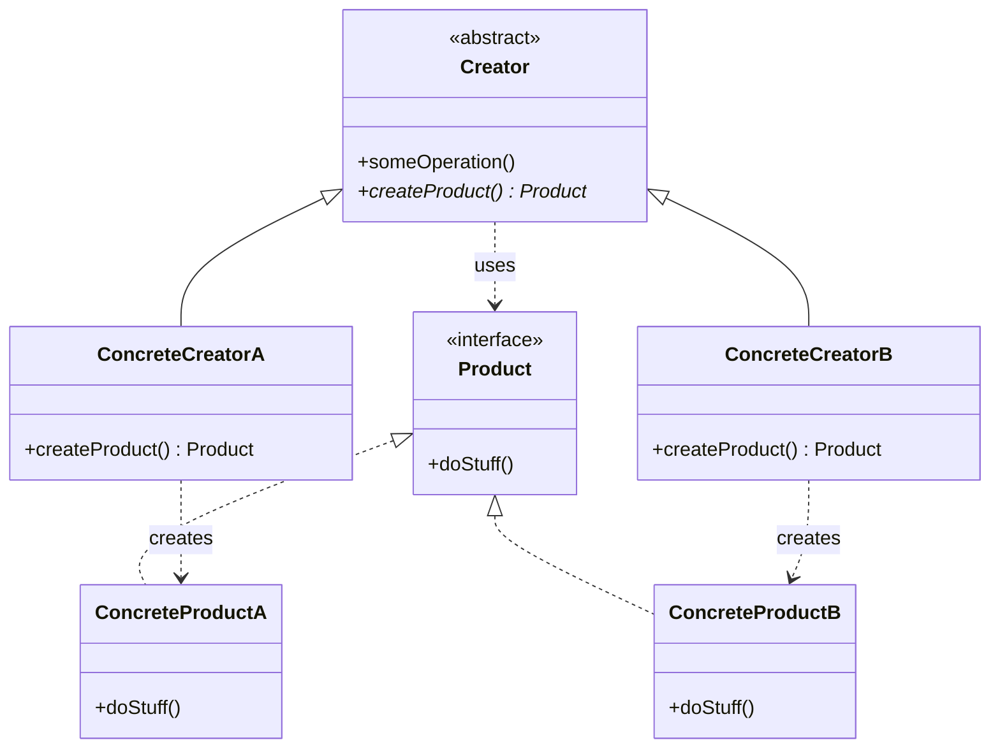

# Factory Method

## Descrição

O Factory Method define uma interface para criar um objeto, mas deixa que as subclasses decidam qual classe concreta instanciar. Em vez de chamar o construtor diretamente, a classe base (o *Creator*) declara um método de fábrica — geralmente abstrato ou com uma implementação padrão — que retorna um *Product* abstrato.

O ponto central é que o Creator normalmente contém lógica de negócio que **usa** o produto, sem saber qual implementação concreta está sendo usada. Cada subclasse (*ConcreteCreator*) sobrescreve o método de fábrica para devolver o *ConcreteProduct* adequado. Assim, a criação é adiada para as subclasses e o código cliente depende apenas de abstrações.

Diferente da **Factory (Simple Factory)**, que é um único método/classe com condicionais (`if`/`switch`) decidindo o que criar, o Factory Method usa **herança e polimorfismo**: cada variante de criação vive em uma subclasse. Já o **Abstract Factory** cria **famílias** de produtos relacionados por meio de vários métodos de criação em um objeto de fábrica (composição), enquanto o Factory Method trata de **um** produto por método.

## Problemas que resolve

- Código que instancia classes concretas diretamente (`new`) fica acoplado a implementações e precisa ser alterado a cada novo tipo.
- Um framework ou biblioteca precisa permitir que os usuários estendam os objetos que ele cria internamente.
- Lógica comum (fluxo, validação, ciclo de vida) se repete entre variantes que diferem apenas no objeto criado.
- Condicionais de criação espalhados pelo código violam o princípio Open/Closed.

## Quando usar

- Quando a classe não sabe de antemão quais tipos exatos de objetos precisa criar.
- Quando se deseja que subclasses especifiquem os objetos criados, como em frameworks e pontos de extensão.
- Quando há um algoritmo comum na classe base e apenas o produto varia (combina bem com Template Method).
- Quando se quer reaproveitar objetos existentes (cache, pool) por trás de um método de criação, em vez de sempre construir novos.

## Quando evitar

- Quando há apenas um tipo de produto e não há perspectiva real de variação — um construtor simples basta.
- Quando a criação de subclasses só para trocar o produto gera uma explosão de classes; uma Simple Factory, injeção de dependência ou uma função/lambda de criação pode ser mais simples.
- Quando é preciso criar famílias de objetos que devem ser compatíveis entre si — prefira Abstract Factory.

## Trade-offs

| Ganho | Custo / Risco |
| --- | --- |
| Desacopla o Creator dos produtos concretos | Exige uma hierarquia paralela de Creators e Products |
| Novos produtos sem alterar código existente (Open/Closed) | Mais classes e indireção para entender o fluxo |
| Centraliza a criação em um único ponto (Single Responsibility) | Baseado em herança: menos flexível que composição em tempo de execução |
| Facilita testes substituindo o produto por um *fake* via subclasse | Pode ser *overengineering* em cenários simples |

- **Acoplamento:** o cliente depende apenas de `Creator` e `Product` abstratos.
- **Testabilidade:** basta uma subclasse de teste que sobrescreva o método de fábrica.
- **Complexidade:** cresce com o número de variantes; avalie se uma Simple Factory resolve.
- **Evolução:** é comum começar com Factory Method e evoluir para Abstract Factory, Prototype ou Builder conforme a necessidade de flexibilidade aumenta.

## Diagrama



O `Creator` declara o método abstrato `createProduct()` e usa o `Product` em `someOperation()`. Cada `ConcreteCreator` sobrescreve o método de fábrica para instanciar seu `ConcreteProduct` correspondente, sem que o Creator conheça a classe concreta.

## Exemplo

Toda transferência segue o mesmo fluxo (validar saldo, criar a instrução, registrar no ledger), mas a instrução varia conforme o trilho: Pix ou TED. Cada subclasse decide qual `PaymentInstruction` criar.

<Tabs groupId="lang" queryString>
<TabItem value="java" label="Java">

```java
record TransferRequest(String fromAccountId, String destination, long amountCents) {}

interface PaymentInstruction {
    String send();
}

record PixInstruction(TransferRequest request) implements PaymentInstruction {
    public String send() {
        return "Pix de " + request.amountCents() + " centavos para a chave " + request.destination() + " (SPI)";
    }
}

record TedInstruction(TransferRequest request) implements PaymentInstruction {
    public String send() {
        return "TED de " + request.amountCents() + " centavos para " + request.destination() + " (próxima janela)";
    }
}

abstract class TransferProcessor {
    protected abstract PaymentInstruction createInstruction(TransferRequest request); // Factory Method

    void process(TransferRequest request, long balanceCents) {
        if (balanceCents < request.amountCents()) throw new IllegalStateException("saldo insuficiente");
        PaymentInstruction instruction = createInstruction(request);
        System.out.println(instruction.send());
        System.out.println("ledger: débito de " + request.amountCents() + " centavos em " + request.fromAccountId());
    }
}

class PixTransferProcessor extends TransferProcessor {
    protected PaymentInstruction createInstruction(TransferRequest request) { return new PixInstruction(request); }
}

class TedTransferProcessor extends TransferProcessor {
    protected PaymentInstruction createInstruction(TransferRequest request) { return new TedInstruction(request); }
}

TransferProcessor processor = new PixTransferProcessor();
processor.process(new TransferRequest("0001-1", "maria@example.com", 12_500), 50_000);
```

</TabItem>
<TabItem value="python" label="Python">

```python
from abc import ABC, abstractmethod
from dataclasses import dataclass
from typing import Protocol

@dataclass(frozen=True)
class TransferRequest:
    from_account_id: str
    destination: str
    amount_cents: int

class PaymentInstruction(Protocol):
    def send(self) -> str: ...

@dataclass(frozen=True)
class PixInstruction:
    request: TransferRequest

    def send(self) -> str:
        return f"Pix de {self.request.amount_cents} centavos para a chave {self.request.destination} (SPI)"

@dataclass(frozen=True)
class TedInstruction:
    request: TransferRequest

    def send(self) -> str:
        return f"TED de {self.request.amount_cents} centavos para {self.request.destination} (próxima janela)"

class TransferProcessor(ABC):
    @abstractmethod
    def _create_instruction(self, request: TransferRequest) -> PaymentInstruction:  # Factory Method
        ...

    def process(self, request: TransferRequest, balance_cents: int) -> None:
        if balance_cents < request.amount_cents:
            raise ValueError("saldo insuficiente")
        instruction = self._create_instruction(request)
        print(instruction.send())
        print(f"ledger: débito de {request.amount_cents} centavos em {request.from_account_id}")

class PixTransferProcessor(TransferProcessor):
    def _create_instruction(self, request: TransferRequest) -> PaymentInstruction:
        return PixInstruction(request)

class TedTransferProcessor(TransferProcessor):
    def _create_instruction(self, request: TransferRequest) -> PaymentInstruction:
        return TedInstruction(request)

processor: TransferProcessor = PixTransferProcessor()
processor.process(TransferRequest("0001-1", "maria@example.com", 12_500), 50_000)
```

</TabItem>
<TabItem value="go" label="Go">

```go
type TransferRequest struct {
	FromAccountID string
	Destination   string
	AmountCents   int64
}

type PaymentInstruction interface {
	Send() string
}

type PixInstruction struct{ request TransferRequest }

func (i PixInstruction) Send() string {
	return fmt.Sprintf("Pix de %d centavos para a chave %s (SPI)", i.request.AmountCents, i.request.Destination)
}

type TedInstruction struct{ request TransferRequest }

func (i TedInstruction) Send() string {
	return fmt.Sprintf("TED de %d centavos para %s (próxima janela)", i.request.AmountCents, i.request.Destination)
}

// Go não tem classes abstratas: o factory method é uma função guardada no processador.
type TransferProcessor struct {
	createInstruction func(TransferRequest) PaymentInstruction // Factory Method
}

func (p TransferProcessor) Process(request TransferRequest, balanceCents int64) error {
	if balanceCents < request.AmountCents {
		return errors.New("saldo insuficiente")
	}
	instruction := p.createInstruction(request)
	fmt.Println(instruction.Send())
	fmt.Printf("ledger: débito de %d centavos em %s\n", request.AmountCents, request.FromAccountID)
	return nil
}

func NewPixTransferProcessor() TransferProcessor {
	return TransferProcessor{func(r TransferRequest) PaymentInstruction { return PixInstruction{r} }}
}

func NewTedTransferProcessor() TransferProcessor {
	return TransferProcessor{func(r TransferRequest) PaymentInstruction { return TedInstruction{r} }}
}

func main() {
	processor := NewPixTransferProcessor()
	err := processor.Process(TransferRequest{"0001-1", "maria@example.com", 12_500}, 50_000)
	if err != nil {
		fmt.Println(err)
	}
}
```

</TabItem>
<TabItem value="typescript" label="TypeScript">

```typescript
interface TransferRequest {
  fromAccountId: string;
  destination: string;
  amountCents: number;
}

interface PaymentInstruction {
  send(): string;
}

class PixInstruction implements PaymentInstruction {
  constructor(private request: TransferRequest) {}
  send() { return `Pix de ${this.request.amountCents} centavos para a chave ${this.request.destination} (SPI)`; }
}

class TedInstruction implements PaymentInstruction {
  constructor(private request: TransferRequest) {}
  send() { return `TED de ${this.request.amountCents} centavos para ${this.request.destination} (próxima janela)`; }
}

abstract class TransferProcessor {
  protected abstract createInstruction(request: TransferRequest): PaymentInstruction; // Factory Method

  process(request: TransferRequest, balanceCents: number): void {
    if (balanceCents < request.amountCents) throw new Error("saldo insuficiente");
    const instruction = this.createInstruction(request);
    console.log(instruction.send());
    console.log(`ledger: débito de ${request.amountCents} centavos em ${request.fromAccountId}`);
  }
}

class PixTransferProcessor extends TransferProcessor {
  protected createInstruction(request: TransferRequest): PaymentInstruction { return new PixInstruction(request); }
}

class TedTransferProcessor extends TransferProcessor {
  protected createInstruction(request: TransferRequest): PaymentInstruction { return new TedInstruction(request); }
}

const processor: TransferProcessor = new PixTransferProcessor();
processor.process({ fromAccountId: "0001-1", destination: "maria@example.com", amountCents: 12_500 }, 50_000);
```

</TabItem>
</Tabs>

## Padrões relacionados

- [Factory](/coding/gof/creational/factory) — a Simple Factory concentra a decisão em um único método com condicionais; o Factory Method distribui essa decisão entre subclasses via polimorfismo, evitando modificar a fábrica a cada novo tipo.
- [Abstract Factory](/coding/gof/creational/abstract-factory) — cria famílias de produtos relacionados por composição; suas fábricas concretas costumam ser implementadas com um Factory Method por produto.
- [Template Method](/coding/gof/behavioral/template-method) — o Factory Method é frequentemente um passo de um Template Method, em que a classe base define o algoritmo e a subclasse fornece o objeto.
- [Prototype](/coding/gof/creational/prototype) — alternativa que cria objetos clonando instâncias, sem exigir uma hierarquia de Creators.
- [Builder](/coding/gof/creational/builder) — foca na construção passo a passo de objetos complexos, enquanto o Factory Method decide qual classe instanciar.
- [Iterator](/coding/gof/behavioral/iterator) — coleções usam um Factory Method (`createIterator()`) para devolver o iterador compatível com sua estrutura.

## Referência

- [Design Patterns Cheat Sheet](https://iretha.github.io/design-patterns/cheat-sheet)
- [Factory Method no Refactoring.Guru](https://refactoring.guru/design-patterns/factory-method)
