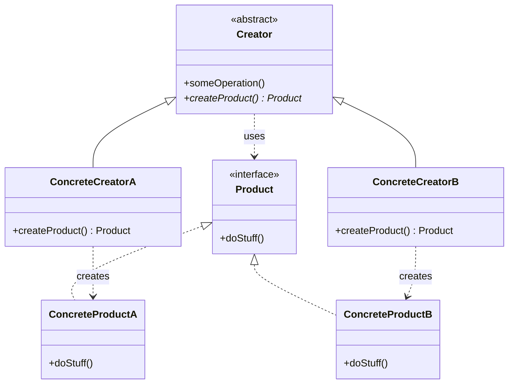

# Factory Method

## Descrição

O Factory Method define uma interface para criar um objeto, mas deixa que as subclasses decidam qual classe concreta instanciar. Em vez de chamar o construtor diretamente, a classe base (o *Creator*) declara um método de fábrica — geralmente abstrato ou com uma implementação padrão — que retorna um *Product* abstrato.

O ponto central é que o Creator normalmente contém lógica de negócio que **usa** o produto, sem saber qual implementação concreta está sendo usada. Cada subclasse (*ConcreteCreator*) sobrescreve o método de fábrica para devolver o *ConcreteProduct* adequado. Assim, a criação é adiada para as subclasses e o código cliente depende apenas de abstrações.

Diferente da **Factory (Simple Factory)**, que é um único método/classe com condicionais (`if`/`switch`) decidindo o que criar, o Factory Method usa **herança e polimorfismo**: cada variante de criação vive em uma subclasse. Já o **Abstract Factory** cria **famílias** de produtos relacionados por meio de vários métodos de criação em um objeto de fábrica (composição), enquanto o Factory Method trata de **um** produto por método.

## Problemas que resolve

- Código que instancia classes concretas diretamente (`new`) fica acoplado a implementações e precisa ser alterado a cada novo tipo.
- Um framework ou biblioteca precisa permitir que os usuários estendam os objetos que ele cria internamente.
- Lógica comum (fluxo, validação, ciclo de vida) se repete entre variantes que diferem apenas no objeto criado.
- Condicionais de criação espalhados pelo código violam o princípio Open/Closed.

## Quando usar

- Quando a classe não sabe de antemão quais tipos exatos de objetos precisa criar.
- Quando se deseja que subclasses especifiquem os objetos criados, como em frameworks e pontos de extensão.
- Quando há um algoritmo comum na classe base e apenas o produto varia (combina bem com Template Method).
- Quando se quer reaproveitar objetos existentes (cache, pool) por trás de um método de criação, em vez de sempre construir novos.

### Quando evitar

- Quando há apenas um tipo de produto e não há perspectiva real de variação — um construtor simples basta.
- Quando a criação de subclasses só para trocar o produto gera uma explosão de classes; uma Simple Factory, injeção de dependência ou uma função/lambda de criação pode ser mais simples.
- Quando é preciso criar famílias de objetos que devem ser compatíveis entre si — prefira Abstract Factory.

## Trade-offs

| Ganho | Custo / Risco |
| --- | --- |
| Desacopla o Creator dos produtos concretos | Exige uma hierarquia paralela de Creators e Products |
| Novos produtos sem alterar código existente (Open/Closed) | Mais classes e indireção para entender o fluxo |
| Centraliza a criação em um único ponto (Single Responsibility) | Baseado em herança: menos flexível que composição em tempo de execução |
| Facilita testes substituindo o produto por um *fake* via subclasse | Pode ser *overengineering* em cenários simples |

- **Acoplamento:** o cliente depende apenas de `Creator` e `Product` abstratos.
- **Testabilidade:** basta uma subclasse de teste que sobrescreva o método de fábrica.
- **Complexidade:** cresce com o número de variantes; avalie se uma Simple Factory resolve.
- **Evolução:** é comum começar com Factory Method e evoluir para Abstract Factory, Prototype ou Builder conforme a necessidade de flexibilidade aumenta.

## Diagrama



O `Creator` declara o método abstrato `createProduct()` e usa o `Product` em `someOperation()`. Cada `ConcreteCreator` sobrescreve o método de fábrica para instanciar seu `ConcreteProduct` correspondente, sem que o Creator conheça a classe concreta.

## Exemplo

Um serviço de notificações tem um fluxo comum (montar a mensagem, enviar, registrar log), mas o canal varia: e-mail ou SMS. Cada subclasse decide qual `Notifier` criar.

```typescript
interface Notifier {
  send(to: string, message: string): void;
}

class EmailNotifier implements Notifier {
  send(to: string, message: string) { console.log(`Email para ${to}: ${message}`); }
}

class SmsNotifier implements Notifier {
  send(to: string, message: string) { console.log(`SMS para ${to}: ${message}`); }
}

abstract class NotificationService {
  protected abstract createNotifier(): Notifier; // Factory Method

  notify(to: string, message: string): void {
    const notifier = this.createNotifier();
    notifier.send(to, message);
    console.log(`log: notificação enviada para ${to}`);
  }
}

class EmailNotificationService extends NotificationService {
  protected createNotifier(): Notifier { return new EmailNotifier(); }
}

class SmsNotificationService extends NotificationService {
  protected createNotifier(): Notifier { return new SmsNotifier(); }
}

const service: NotificationService = new SmsNotificationService();
service.notify("+5511999999999", "Seu pedido foi enviado");
```

## Padrões relacionados

- [Factory](./factory.md) — a Simple Factory concentra a decisão em um único método com condicionais; o Factory Method distribui essa decisão entre subclasses via polimorfismo, evitando modificar a fábrica a cada novo tipo.
- [Abstract Factory](./abstract-factory.md) — cria famílias de produtos relacionados por composição; suas fábricas concretas costumam ser implementadas com um Factory Method por produto.
- [Template Method](../behavioral/template-method.md) — o Factory Method é frequentemente um passo de um Template Method, em que a classe base define o algoritmo e a subclasse fornece o objeto.
- [Prototype](./prototype.md) — alternativa que cria objetos clonando instâncias, sem exigir uma hierarquia de Creators.
- [Builder](./builder.md) — foca na construção passo a passo de objetos complexos, enquanto o Factory Method decide qual classe instanciar.
- [Iterator](../behavioral/iterator.md) — coleções usam um Factory Method (`createIterator()`) para devolver o iterador compatível com sua estrutura.

## Referência

- [Design Patterns Cheat Sheet](https://iretha.github.io/design-patterns/cheat-sheet)
- [Factory Method no Refactoring.Guru](https://refactoring.guru/design-patterns/factory-method)
