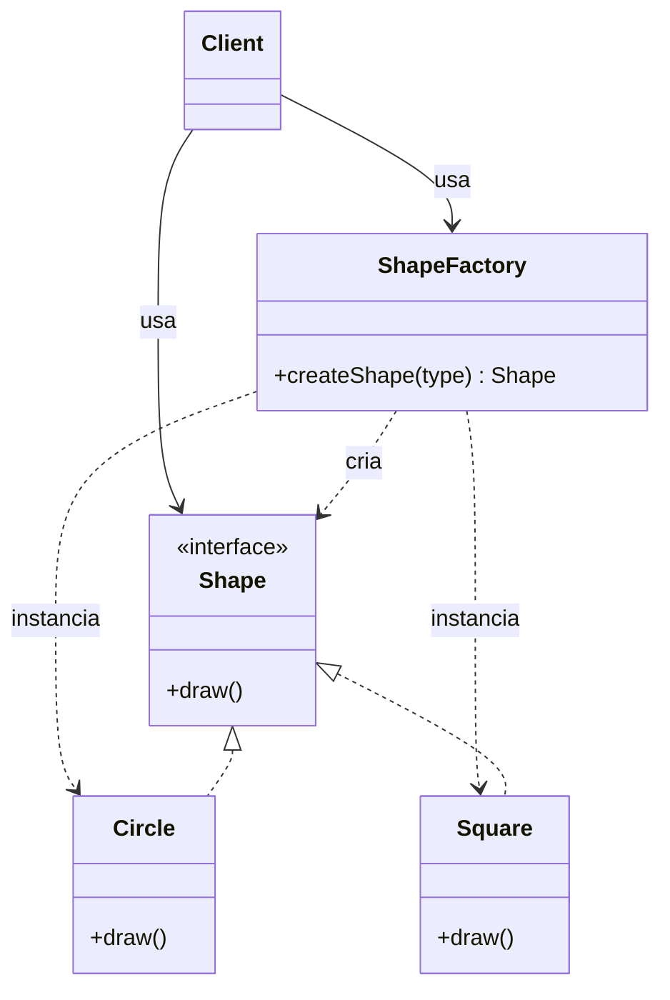

# Factory

## Descrição

O Factory (também chamado de Simple Factory) centraliza a criação de objetos em um único ponto: uma classe ou método que recebe um parâmetro (um tipo, uma configuração, uma string) e decide qual implementação concreta instanciar, devolvendo-a por meio de uma interface ou classe base comum. O cliente pede "um produto do tipo X" sem conhecer o construtor nem a classe concreta.

Diferentemente dos padrões do livro "Design Patterns" (Gang of Four), o Simple Factory não está entre os 23 padrões catalogados, e seu status como padrão formal é debatido: muitos autores o consideram apenas um idioma de programação ou uma boa prática de encapsulamento. Ainda assim, é provavelmente a forma mais comum de "fábrica" encontrada em código real e costuma ser o primeiro passo antes de evoluir para Factory Method ou Abstract Factory.

A lógica de decisão normalmente é um `switch`/`if` ou um mapa de registro (tipo → construtor). Não há hierarquia de fábricas nem subclasses decidindo a criação: existe uma única fábrica concreta, muitas vezes com um método estático.

## Problemas que resolve

- Lógica de seleção de classes concretas (`if tipo == ...`) espalhada e duplicada em vários pontos do código cliente
- Cliente acoplado a classes concretas e a detalhes de construção (parâmetros, dependências, configuração)
- Dificuldade de adicionar ou trocar implementações sem alterar todos os pontos que as instanciam
- Necessidade de criar objetos a partir de dados em tempo de execução (configuração, entrada do usuário, mensagens)

## Quando usar

- Há uma família de classes com interface comum e a escolha da implementação depende de um parâmetro simples
- A criação dos objetos envolve lógica que não deveria ficar no cliente
- Você quer um único ponto para mudar como os objetos são criados (por exemplo, para cache, logging ou injeção de dependências)
- O número de variantes é pequeno e relativamente estável

## Quando evitar

- Existe apenas uma implementação e nenhuma perspectiva de variação — um construtor direto é mais simples
- Novas variantes surgem com frequência e alterar o `switch` central fere o princípio aberto/fechado; considere Factory Method ou um registro extensível
- É preciso criar famílias de objetos relacionados que devem ser consistentes entre si — use Abstract Factory
- A construção é complexa e feita em etapas — use Builder

## Trade-offs

| Ganho | Custo / Risco |
| --- | --- |
| Cliente desacoplado das classes concretas | A fábrica passa a conhecer todas as classes concretas |
| Lógica de criação centralizada e sem duplicação | Adicionar um tipo exige modificar a fábrica (viola aberto/fechado) |
| Fácil de entender e implementar | Pode crescer até virar um `switch` gigante e difícil de manter |
| Ponto único para trocar implementações | Métodos estáticos dificultam substituição em testes |

- **Acoplamento:** reduz o acoplamento do cliente, mas concentra dependências na fábrica.
- **Testabilidade:** prefira uma fábrica injetável (instância com interface) a um método estático para facilitar mocks.
- **Extensibilidade:** um mapa de registro (tipo → construtor) mitiga o problema do `switch` crescente.
- **Complexidade:** baixa; é a forma mais leve de encapsular criação de objetos.

## Diagrama



O `Client` solicita um objeto à `ShapeFactory` informando o tipo desejado; a fábrica decide qual classe concreta (`Circle` ou `Square`) instanciar e a devolve como `Shape`. O cliente trabalha apenas com a interface.

## Exemplo

Um serviço de notificações precisa enviar mensagens por e-mail, SMS ou push, conforme a preferência salva de cada usuário. A fábrica traduz essa preferência na implementação correta.

```typescript
interface Notifier {
  send(to: string, message: string): void;
}

class EmailNotifier implements Notifier {
  send(to: string, message: string) { /* envia e-mail */ }
}

class SmsNotifier implements Notifier {
  send(to: string, message: string) { /* envia SMS */ }
}

class PushNotifier implements Notifier {
  send(to: string, message: string) { /* envia push */ }
}

class NotifierFactory {
  static create(channel: "email" | "sms" | "push"): Notifier {
    switch (channel) {
      case "email": return new EmailNotifier();
      case "sms":   return new SmsNotifier();
      case "push":  return new PushNotifier();
      default: throw new Error(`Canal desconhecido: ${channel}`);
    }
  }
}

// Cliente
const notifier = NotifierFactory.create(user.preferredChannel);
notifier.send(user.contact, "Seu pedido foi enviado!");
```

## Padrões relacionados

- [Factory Method](/coding/gof/creational/factory-method) — em vez de uma única fábrica com condicional, define um método de criação que subclasses sobrescrevem; a decisão sobre a classe concreta é feita por herança/polimorfismo, não por parâmetro. É a evolução natural quando o Simple Factory precisa ser estendido sem modificação.
- [Abstract Factory](/coding/gof/creational/abstract-factory) — fornece uma interface para criar *famílias* de objetos relacionados, com várias fábricas concretas intercambiáveis; o Simple Factory cria um único tipo de produto e tem apenas uma fábrica concreta.
- [Builder](/coding/gof/creational/builder) — foca na construção passo a passo de um objeto complexo, enquanto o Factory devolve o objeto pronto em uma única chamada.
- [Singleton](/coding/gof/creational/singleton) — a fábrica frequentemente é exposta como instância única ou por métodos estáticos.
- [Prototype](/coding/gof/creational/prototype) — uma fábrica pode criar objetos clonando protótipos registrados em vez de chamar construtores.
- [Object Pool](/coding/gof/creational/object-pool) — a fábrica pode reutilizar instâncias de um pool em vez de criar novas a cada chamada.
- [Strategy](/coding/gof/behavioral/strategy) — fábricas são usadas com frequência para selecionar a estratégia concreta com base em configuração.

## Referência

- [Design Patterns Cheat Sheet](https://iretha.github.io/design-patterns/cheat-sheet)
