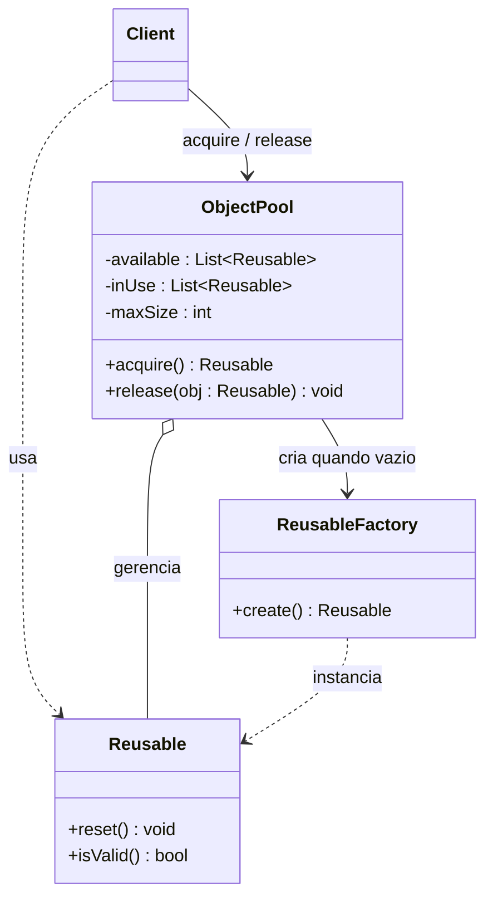

# Object Pool

## Descrição

O Object Pool mantém um conjunto de objetos já inicializados e prontos para uso, em vez de criá-los e destruí-los sob demanda. Quando um cliente precisa de um objeto, ele o "pega emprestado" do pool (*acquire*); ao terminar, devolve-o (*release*) para que possa ser reutilizado por outro cliente.

O pool controla o ciclo de vida das instâncias: cria novas quando não há nenhuma disponível (respeitando um limite máximo), reinicia o estado dos objetos devolvidos e pode bloquear, falhar ou aguardar quando o limite é atingido. O padrão é especialmente útil quando a criação de um objeto é cara (conexões de rede, threads, buffers grandes) e a taxa de uso é alta, mas o número de objetos em uso simultâneo é limitado.

Não faz parte dos 23 padrões do livro do Gang of Four, mas é amplamente usado em infraestrutura: pools de conexões de banco de dados, pools de threads e pools de buffers.

## Problemas que resolve

- Custo alto e repetitivo de criação/destruição de objetos (handshake de conexão, alocação de memória, inicialização pesada)
- Pressão sobre o garbage collector causada por muitos objetos de vida curta
- Necessidade de limitar o número de recursos escassos usados ao mesmo tempo (conexões, licenças, sockets)
- Latência imprevisível ao obter um recurso no momento do uso

## Quando usar

- Objetos caros de criar e frequentemente necessários por curtos períodos
- Recursos externos com limite de concorrência (conexões de banco, threads de trabalho)
- Sistemas sensíveis a latência que se beneficiam de pré-aquecimento (*warm-up*) dos objetos
- Quando é possível reiniciar o estado de um objeto de forma confiável antes de reutilizá-lo

## Quando evitar

- Objetos leves e baratos de criar; em runtimes modernos, o alocador e o GC costumam ser mais eficientes que um pool
- Objetos com estado difícil de limpar, o que traz risco de vazamento de dados entre usos
- Quando a disciplina de devolução não pode ser garantida (objetos "perdidos" esgotam o pool)
- Quando uma biblioteca madura já oferece o pooling (ex.: HikariCP, pools de threads da plataforma)

## Trade-offs

| Ganho | Custo / Risco |
| --- | --- |
| Reduz o custo de criação e destruição de objetos | Mais complexidade: gerenciamento de ciclo de vida, limites e tempos de espera |
| Limita e controla o uso de recursos escassos | Objetos não devolvidos causam esgotamento do pool (*pool exhaustion*) |
| Latência mais previsível após o *warm-up* | Estado residual de um uso pode vazar para o próximo se o *reset* falhar |
| Menos pressão sobre o garbage collector | Memória ocupada por objetos ociosos, mesmo sem demanda |

- **Concorrência:** o pool costuma ser compartilhado entre threads e precisa de sincronização, o que pode virar ponto de contenção.
- **Validação:** objetos podem ficar inválidos enquanto ociosos (ex.: conexão fechada pelo servidor); o pool deve validá-los antes de entregá-los.
- **Testabilidade:** expor o pool por uma interface facilita substituí-lo por uma implementação simples em testes.
- **Dimensionamento:** tamanhos mínimo/máximo e *timeouts* exigem ajuste conforme a carga real.

## Diagrama



O `Client` obtém um `Reusable` do `ObjectPool` e o devolve ao terminar. O pool mantém as listas de objetos disponíveis e em uso, recorre à `ReusableFactory` quando precisa criar novas instâncias (até `maxSize`) e chama `reset()` ao receber um objeto de volta.

## Exemplo

Toda mensagem enviada ao SPI precisa ser assinada em um HSM. Abrir uma sessão no HSM é caro e o equipamento aceita poucas sessões simultâneas, então as sessões são mantidas em um pool limitado.

```python
import threading

class HsmSessionPool:
    def __init__(self, factory, max_size=4):
        self._factory = factory
        self._available = []
        self._in_use = set()
        self._max_size = max_size
        self._cond = threading.Condition()

    def acquire(self, timeout=5.0):
        with self._cond:
            while not self._available and len(self._in_use) >= self._max_size:
                if not self._cond.wait(timeout):
                    raise TimeoutError("pool esgotado")
            session = self._available.pop() if self._available else self._factory()
            if not session.is_valid():
                session = self._factory()
            self._in_use.add(session)
            return session

    def release(self, session):
        with self._cond:
            self._in_use.discard(session)
            session.reset()
            self._available.append(session)
            self._cond.notify()

class MessageSigner:
    def __init__(self, pool):
        self._pool = pool

    def sign(self, message):
        session = self._pool.acquire()
        try:
            return session.sign(message)
        finally:
            self._pool.release(session)

# uso: cada mensagem enviada ao SPI é assinada com uma sessão emprestada do pool
signer = MessageSigner(HsmSessionPool(open_hsm_session, max_size=4))
signature = signer.sign(pacs008_xml)
```

## Padrões relacionados

- [Singleton](/coding/gof/creational/singleton) — o pool costuma ser uma instância única e global da aplicação
- [Factory Method](/coding/gof/creational/factory-method) — usado pelo pool para criar novas instâncias quando não há objetos disponíveis
- [Prototype](/coding/gof/creational/prototype) — o pool pode clonar um protótipo pré-configurado para gerar novos objetos
- [Flyweight](/coding/gof/structural/flyweight) — ambos reutilizam objetos, mas o Flyweight compartilha estado imutável simultaneamente, enquanto o pool empresta objetos com uso exclusivo
- [Proxy](/coding/gof/structural/proxy) — um proxy pode envolver o objeto emprestado e devolvê-lo ao pool automaticamente ao ser fechado

## Referência

- [Design Patterns Cheat Sheet](https://iretha.github.io/design-patterns/cheat-sheet)
- [Object Pool no SourceMaking](https://sourcemaking.com/design_patterns/object_pool)
