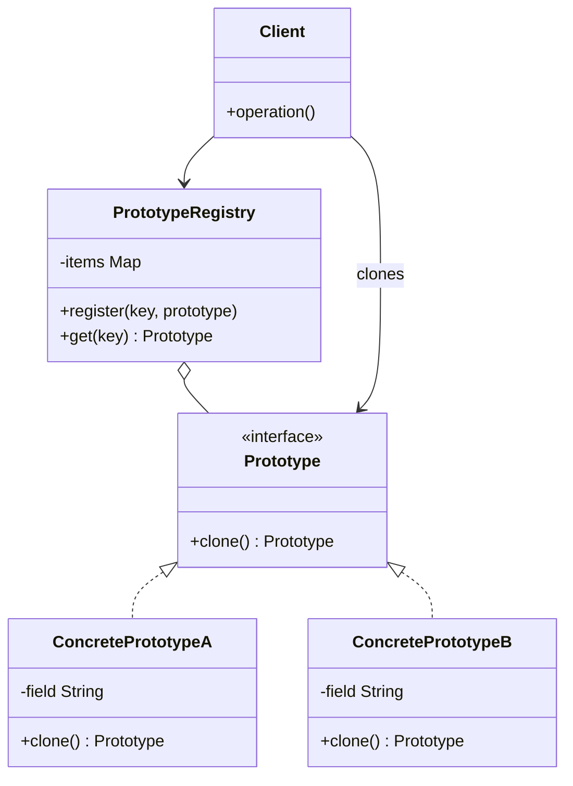

# Prototype

## Descrição

O Prototype especifica os tipos de objetos a serem criados por meio de uma instância-protótipo e cria novos objetos copiando (clonando) esse protótipo. Em vez de instanciar uma classe concreta com `new` e configurar o objeto do zero, o cliente pede a um objeto existente que produza uma cópia de si mesmo.

Cada protótipo implementa uma operação `clone()` declarada em uma interface comum. Assim, o cliente consegue criar objetos sem conhecer suas classes concretas, apenas trabalhando com a abstração. É comum manter um registro (Prototype Registry) com protótipos pré-configurados, identificados por uma chave, a partir dos quais novas instâncias são clonadas.

A decisão central da implementação é entre cópia rasa (shallow copy), que compartilha referências internas com o original, e cópia profunda (deep copy), que duplica também os objetos referenciados.

## Problemas que resolve

- Criar objetos cuja inicialização é cara (consultas a banco, leitura de arquivos, cálculos pesados) repetidas vezes
- Instanciar objetos quando o código cliente só conhece uma interface, e não a classe concreta
- Evitar uma hierarquia paralela de fábricas para cada variação de produto
- Gerar muitas variações de um objeto que diferem apenas em alguns atributos de configuração
- Copiar objetos cujo estado interno é privado e não pode ser replicado externamente

## Quando usar

- Quando as classes a instanciar são definidas em tempo de execução (por exemplo, carregadas dinamicamente)
- Quando criar um objeto do zero é mais custoso do que copiar um já pronto
- Quando instâncias de uma classe podem assumir apenas algumas poucas combinações de estado, que podem ser mantidas como protótipos
- Quando se quer reduzir o número de subclasses criadas apenas para variar a configuração inicial

## Quando evitar

- Quando os objetos têm muitas referências circulares ou recursos não clonáveis (conexões, handles de arquivo, threads)
- Quando a criação direta é barata e simples, tornando a clonagem uma indireção desnecessária
- Quando a semântica de cópia (rasa vs. profunda) é ambígua e pode gerar bugs de estado compartilhado

## Trade-offs

| Ganho | Custo / Risco |
| --- | --- |
| Cria objetos sem acoplar o cliente às classes concretas | Cada classe precisa implementar `clone()` corretamente |
| Evita inicialização repetida e custosa | Cópia profunda de grafos complexos ou circulares é difícil |
| Permite adicionar e remover "tipos" em tempo de execução via registro | Cópia rasa pode compartilhar estado mutável de forma inesperada |
| Reduz subclasses criadas só para variar configuração | Mecanismos nativos de clonagem (ex.: `Cloneable` em Java) têm armadilhas |

- **Acoplamento:** baixo entre cliente e produtos concretos; o cliente depende apenas da interface `Prototype`.
- **Testabilidade:** boa; protótipos de teste podem ser registrados no lugar dos reais.
- **Complexidade:** a lógica de cópia precisa evoluir junto com os campos da classe, o que é fonte frequente de bugs.
- **Desempenho:** vantajoso quando a clonagem é mais barata que a construção; caso contrário, neutro ou negativo.

## Diagrama



`Prototype` declara a operação `clone()`, implementada por `ConcretePrototypeA` e `ConcretePrototypeB`, que copiam o próprio estado. O `Client` cria novos objetos pedindo cópias aos protótipos, opcionalmente obtidos de um `PrototypeRegistry` que os mantém indexados por chave.

## Exemplo

O cliente salva pagamentos favoritos, como o aluguel e a mesada. Para agendar um novo, o app clona o favorito e muda só a data e o valor, sem reconstruir os dados do recebedor nem a descrição e sem saber se o favorito é um Pix ou uma TED.

<Tabs groupId="lang" queryString>
<TabItem value="java" label="Java">

```java
interface PaymentOrder {
    PaymentOrder copy();
    void reschedule(String scheduledFor, long amountCents);
}

class PixPaymentOrder implements PaymentOrder {
    String receiverKey, description, scheduledFor;
    long amountCents;

    PixPaymentOrder(String receiverKey, String description, long amountCents, String scheduledFor) {
        this.receiverKey = receiverKey; this.description = description;
        this.amountCents = amountCents; this.scheduledFor = scheduledFor;
    }

    public PaymentOrder copy() {
        return new PixPaymentOrder(receiverKey, description, amountCents, scheduledFor);
    }

    public void reschedule(String scheduledFor, long amountCents) {
        this.scheduledFor = scheduledFor; this.amountCents = amountCents;
    }
}

class TedPaymentOrder implements PaymentOrder {
    String bankCode, branch, accountNumber, description, scheduledFor;
    long amountCents;

    TedPaymentOrder(String bankCode, String branch, String accountNumber,
                    String description, long amountCents, String scheduledFor) {
        this.bankCode = bankCode; this.branch = branch; this.accountNumber = accountNumber;
        this.description = description; this.amountCents = amountCents; this.scheduledFor = scheduledFor;
    }

    public PaymentOrder copy() {
        return new TedPaymentOrder(bankCode, branch, accountNumber, description, amountCents, scheduledFor);
    }

    public void reschedule(String scheduledFor, long amountCents) {
        this.scheduledFor = scheduledFor; this.amountCents = amountCents;
    }
}

class FavoritePayments {
    private final Map<String, PaymentOrder> items = new HashMap<>();

    void register(String key, PaymentOrder order) {
        items.put(key, order);
    }

    PaymentOrder create(String key) {
        PaymentOrder proto = items.get(key);
        if (proto == null) throw new IllegalArgumentException("Unknown favorite: " + key);
        return proto.copy();
    }
}

FavoritePayments favorites = new FavoritePayments();
favorites.register("rent", new PixPaymentOrder("locador@example.com", "Aluguel", 250_000, "2026-12-05"));
favorites.register("allowance", new TedPaymentOrder("001", "1234", "56789-0", "Mesada", 30_000, "2026-12-10"));

// O cliente clona sem saber se o favorito é Pix ou TED
PaymentOrder order = favorites.create("rent");
order.reschedule("2027-01-05", 262_500); // o favorito original permanece intacto
```

</TabItem>
<TabItem value="python" label="Python">

```python
from __future__ import annotations

import copy
from dataclasses import dataclass
from typing import Protocol

class PaymentOrder(Protocol):
    def clone(self) -> PaymentOrder: ...
    def reschedule(self, scheduled_for: str, amount_cents: int) -> None: ...

@dataclass
class PixPaymentOrder:
    receiver_key: str
    description: str
    amount_cents: int
    scheduled_for: str

    def clone(self) -> PaymentOrder:
        return copy.copy(self)

    def reschedule(self, scheduled_for: str, amount_cents: int) -> None:
        self.scheduled_for, self.amount_cents = scheduled_for, amount_cents

@dataclass
class TedPaymentOrder:
    bank_code: str
    branch: str
    account_number: str
    description: str
    amount_cents: int
    scheduled_for: str

    def clone(self) -> PaymentOrder:
        return copy.copy(self)

    def reschedule(self, scheduled_for: str, amount_cents: int) -> None:
        self.scheduled_for, self.amount_cents = scheduled_for, amount_cents

class FavoritePayments:
    def __init__(self) -> None:
        self._items: dict[str, PaymentOrder] = {}

    def register(self, key: str, order: PaymentOrder) -> None:
        self._items[key] = order

    def create(self, key: str) -> PaymentOrder:
        if key not in self._items:
            raise KeyError(f"Unknown favorite: {key}")
        return self._items[key].clone()

favorites = FavoritePayments()
favorites.register("rent", PixPaymentOrder("locador@example.com", "Aluguel", 250_000, "2026-12-05"))
favorites.register("allowance", TedPaymentOrder("001", "1234", "56789-0", "Mesada", 30_000, "2026-12-10"))

# O cliente clona sem saber se o favorito é Pix ou TED
order = favorites.create("rent")
order.reschedule("2027-01-05", 262_500)  # o favorito original permanece intacto
```

</TabItem>
<TabItem value="go" label="Go">

```go
type PaymentOrder interface {
	Clone() PaymentOrder
	Reschedule(scheduledFor string, amountCents int64)
}

type PixPaymentOrder struct {
	ReceiverKey, Description string
	AmountCents              int64
	ScheduledFor             string
}

func (o *PixPaymentOrder) Clone() PaymentOrder {
	clone := *o // a atribuição copia todos os campos
	return &clone
}

func (o *PixPaymentOrder) Reschedule(scheduledFor string, amountCents int64) {
	o.ScheduledFor, o.AmountCents = scheduledFor, amountCents
}

type TedPaymentOrder struct {
	BankCode, Branch, AccountNumber, Description string
	AmountCents                                  int64
	ScheduledFor                                 string
}

func (o *TedPaymentOrder) Clone() PaymentOrder {
	clone := *o
	return &clone
}

func (o *TedPaymentOrder) Reschedule(scheduledFor string, amountCents int64) {
	o.ScheduledFor, o.AmountCents = scheduledFor, amountCents
}

type FavoritePayments struct {
	items map[string]PaymentOrder
}

func (f *FavoritePayments) Register(key string, order PaymentOrder) {
	f.items[key] = order
}

func (f *FavoritePayments) Create(key string) (PaymentOrder, error) {
	proto, ok := f.items[key]
	if !ok {
		return nil, fmt.Errorf("unknown favorite: %s", key)
	}
	return proto.Clone(), nil
}

func main() {
	favorites := &FavoritePayments{items: map[string]PaymentOrder{}}
	favorites.Register("rent", &PixPaymentOrder{"locador@example.com", "Aluguel", 250_000, "2026-12-05"})
	favorites.Register("allowance", &TedPaymentOrder{"001", "1234", "56789-0", "Mesada", 30_000, "2026-12-10"})

	// O cliente clona sem saber se o favorito é Pix ou TED
	order, err := favorites.Create("rent")
	if err != nil {
		return
	}
	order.Reschedule("2027-01-05", 262_500) // o favorito original permanece intacto
}
```

</TabItem>
<TabItem value="typescript" label="TypeScript">

```typescript
interface PaymentOrder {
  clone(): PaymentOrder;
  reschedule(scheduledFor: string, amountCents: number): void;
}

class PixPaymentOrder implements PaymentOrder {
  constructor(public receiverKey: string, public description: string,
              public amountCents: number, public scheduledFor: string) {}

  clone(): PaymentOrder {
    return new PixPaymentOrder(this.receiverKey, this.description,
                               this.amountCents, this.scheduledFor);
  }

  reschedule(scheduledFor: string, amountCents: number): void {
    this.scheduledFor = scheduledFor; this.amountCents = amountCents;
  }
}

class TedPaymentOrder implements PaymentOrder {
  constructor(public bankCode: string, public branch: string, public accountNumber: string,
              public description: string, public amountCents: number, public scheduledFor: string) {}

  clone(): PaymentOrder {
    return new TedPaymentOrder(this.bankCode, this.branch, this.accountNumber,
                               this.description, this.amountCents, this.scheduledFor);
  }

  reschedule(scheduledFor: string, amountCents: number): void {
    this.scheduledFor = scheduledFor; this.amountCents = amountCents;
  }
}

class FavoritePayments {
  private items = new Map<string, PaymentOrder>();

  register(key: string, order: PaymentOrder): void {
    this.items.set(key, order);
  }

  create(key: string): PaymentOrder {
    const proto = this.items.get(key);
    if (!proto) throw new Error(`Unknown favorite: ${key}`);
    return proto.clone();
  }
}

const favorites = new FavoritePayments();
favorites.register("rent", new PixPaymentOrder("locador@example.com", "Aluguel", 250_000, "2026-12-05"));
favorites.register("allowance", new TedPaymentOrder("001", "1234", "56789-0", "Mesada", 30_000, "2026-12-10"));

// O cliente clona sem saber se o favorito é Pix ou TED
const order = favorites.create("rent");
order.reschedule("2027-01-05", 262_500); // o favorito original permanece intacto
```

</TabItem>
</Tabs>

## Padrões relacionados

- [Abstract Factory](/coding/gof/creational/abstract-factory) — pode armazenar um conjunto de protótipos e clonar a partir deles em vez de instanciar subclasses
- [Factory Method](/coding/gof/creational/factory-method) — alternativa baseada em herança; o Prototype dispensa subclasses de criador
- [Composite](/coding/gof/structural/composite) — estruturas compostas costumam se beneficiar de clonagem para duplicar árvores inteiras
- [Decorator](/coding/gof/structural/decorator) — designs com muitos objetos decorados podem usar clonagem para replicar configurações complexas
- [Memento](/coding/gof/behavioral/memento) — em casos simples, um clone do objeto pode servir como snapshot de estado
- [Singleton](/coding/gof/creational/singleton) — o registro de protótipos frequentemente é implementado como Singleton

## Referência

- [Design Patterns Cheat Sheet](https://iretha.github.io/design-patterns/cheat-sheet)
- [Prototype no Refactoring.Guru](https://refactoring.guru/design-patterns/prototype)
