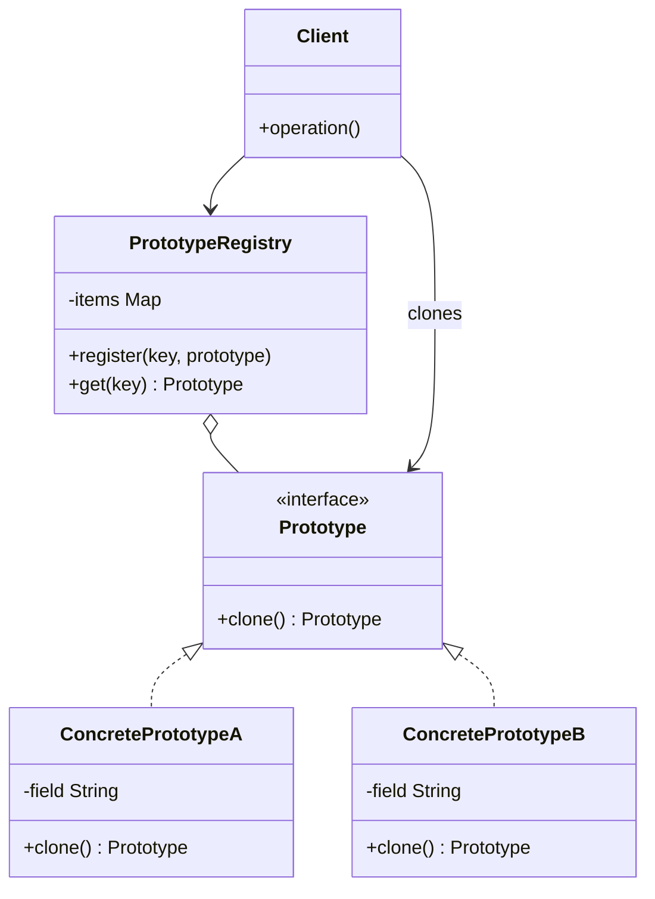

# Prototype

## Descrição

O Prototype especifica os tipos de objetos a serem criados por meio de uma instância-protótipo e cria novos objetos copiando (clonando) esse protótipo. Em vez de instanciar uma classe concreta com `new` e configurar o objeto do zero, o cliente pede a um objeto existente que produza uma cópia de si mesmo.

Cada protótipo implementa uma operação `clone()` declarada em uma interface comum. Assim, o cliente consegue criar objetos sem conhecer suas classes concretas, apenas trabalhando com a abstração. É comum manter um registro (Prototype Registry) com protótipos pré-configurados, identificados por uma chave, a partir dos quais novas instâncias são clonadas.

A decisão central da implementação é entre cópia rasa (shallow copy), que compartilha referências internas com o original, e cópia profunda (deep copy), que duplica também os objetos referenciados.

## Problemas que resolve

- Criar objetos cuja inicialização é cara (consultas a banco, leitura de arquivos, cálculos pesados) repetidas vezes
- Instanciar objetos quando o código cliente só conhece uma interface, e não a classe concreta
- Evitar uma hierarquia paralela de fábricas para cada variação de produto
- Gerar muitas variações de um objeto que diferem apenas em alguns atributos de configuração
- Copiar objetos cujo estado interno é privado e não pode ser replicado externamente

## Quando usar

- Quando as classes a instanciar são definidas em tempo de execução (por exemplo, carregadas dinamicamente)
- Quando criar um objeto do zero é mais custoso do que copiar um já pronto
- Quando instâncias de uma classe podem assumir apenas algumas poucas combinações de estado, que podem ser mantidas como protótipos
- Quando se quer reduzir o número de subclasses criadas apenas para variar a configuração inicial

## Quando evitar

- Quando os objetos têm muitas referências circulares ou recursos não clonáveis (conexões, handles de arquivo, threads)
- Quando a criação direta é barata e simples, tornando a clonagem uma indireção desnecessária
- Quando a semântica de cópia (rasa vs. profunda) é ambígua e pode gerar bugs de estado compartilhado

## Trade-offs

| Ganho | Custo / Risco |
| --- | --- |
| Cria objetos sem acoplar o cliente às classes concretas | Cada classe precisa implementar `clone()` corretamente |
| Evita inicialização repetida e custosa | Cópia profunda de grafos complexos ou circulares é difícil |
| Permite adicionar e remover "tipos" em tempo de execução via registro | Cópia rasa pode compartilhar estado mutável de forma inesperada |
| Reduz subclasses criadas só para variar configuração | Mecanismos nativos de clonagem (ex.: `Cloneable` em Java) têm armadilhas |

- **Acoplamento:** baixo entre cliente e produtos concretos; o cliente depende apenas da interface `Prototype`.
- **Testabilidade:** boa; protótipos de teste podem ser registrados no lugar dos reais.
- **Complexidade:** a lógica de cópia precisa evoluir junto com os campos da classe, o que é fonte frequente de bugs.
- **Desempenho:** vantajoso quando a clonagem é mais barata que a construção; caso contrário, neutro ou negativo.

## Diagrama



`Prototype` declara a operação `clone()`, implementada por `ConcretePrototypeA` e `ConcretePrototypeB`, que copiam o próprio estado. O `Client` cria novos objetos pedindo cópias aos protótipos, opcionalmente obtidos de um `PrototypeRegistry` que os mantém indexados por chave.

## Exemplo

O cliente salva pagamentos favoritos, como o aluguel e a mesada. Para agendar um novo, o app clona o favorito e muda só a data e o valor, sem reconstruir os dados do recebedor nem a descrição.

```typescript
interface PaymentOrder {
  clone(): PaymentOrder;
}

class PixPaymentOrder implements PaymentOrder {
  constructor(public receiverKey: string, public description: string,
              public amountCents: number, public scheduledFor: string) {}

  clone(): PaymentOrder {
    return new PixPaymentOrder(this.receiverKey, this.description,
                               this.amountCents, this.scheduledFor);
  }
}

class FavoritePayments {
  private items = new Map<string, PaymentOrder>();

  register(key: string, order: PaymentOrder): void {
    this.items.set(key, order);
  }

  create(key: string): PaymentOrder {
    const proto = this.items.get(key);
    if (!proto) throw new Error(`Unknown favorite: ${key}`);
    return proto.clone();
  }
}

const favorites = new FavoritePayments();
favorites.register("rent", new PixPaymentOrder("locador@example.com", "Aluguel", 250_000, "2026-12-05"));

const order = favorites.create("rent") as PixPaymentOrder;
order.scheduledFor = "2027-01-05"; order.amountCents = 262_500; // o favorito original permanece intacto
```

## Padrões relacionados

- [Abstract Factory](/coding/gof/creational/abstract-factory) — pode armazenar um conjunto de protótipos e clonar a partir deles em vez de instanciar subclasses
- [Factory Method](/coding/gof/creational/factory-method) — alternativa baseada em herança; o Prototype dispensa subclasses de criador
- [Composite](/coding/gof/structural/composite) — estruturas compostas costumam se beneficiar de clonagem para duplicar árvores inteiras
- [Decorator](/coding/gof/structural/decorator) — designs com muitos objetos decorados podem usar clonagem para replicar configurações complexas
- [Memento](/coding/gof/behavioral/memento) — em casos simples, um clone do objeto pode servir como snapshot de estado
- [Singleton](/coding/gof/creational/singleton) — o registro de protótipos frequentemente é implementado como Singleton

## Referência

- [Design Patterns Cheat Sheet](https://iretha.github.io/design-patterns/cheat-sheet)
- [Prototype no Refactoring.Guru](https://refactoring.guru/design-patterns/prototype)
