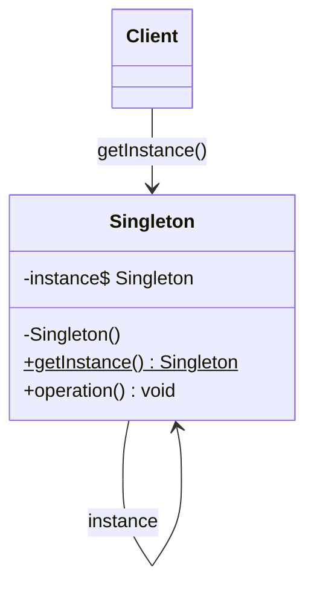

# Singleton

## Descrição

O Singleton garante que uma classe tenha **uma única instância** durante a vida da aplicação e fornece um **ponto de acesso global** a ela. A própria classe passa a ser responsável por controlar sua criação, em vez de deixar essa decisão para os clientes.

Para isso, o construtor é tornado privado (ou protegido), impedindo instanciações externas, e a classe expõe um método estático (por exemplo, `getInstance()`) que cria a instância na primeira chamada (inicialização preguiçosa) ou a cria antecipadamente (inicialização ansiosa) e devolve sempre o mesmo objeto nas chamadas seguintes.

Em ambientes concorrentes, a criação da instância precisa ser protegida (sincronização, double-checked locking, holder estático ou recursos da linguagem como `enum` em Java ou `Lazy<T>` em C#) para evitar que duas threads criem instâncias distintas.

## Problemas que resolve

- Recursos que devem existir uma única vez no processo, como um pool de conexões, um cache em memória, um gerenciador de configuração ou um logger centralizado.
- Necessidade de acesso controlado e consistente a um estado compartilhado, sem espalhar a criação do objeto por todo o código.
- Evitar o custo de criar repetidamente objetos caros de inicializar.
- Substituir variáveis globais por um ponto de acesso encapsulado, que pode adiar a criação até o primeiro uso.

## Quando usar

- Quando deve haver exatamente uma instância de uma classe e ela precisa ser acessível a vários clientes a partir de um ponto conhecido.
- Quando a instância única deve poder ser estendida por subclasses e os clientes devem usar a versão estendida sem alterar seu código.
- Quando a inicialização é cara e deve ocorrer apenas sob demanda.

### Quando evitar

- Quando o "único" é apenas uma conveniência: prefira injeção de dependência com escopo singleton gerenciado por um container.
- Quando a classe guarda estado mutável compartilhado, pois isso cria acoplamento oculto e dificulta o raciocínio sobre o sistema.
- Em código que precisa ser facilmente testável com mocks ou executado em paralelo nos testes.
- Em sistemas distribuídos ou com múltiplos processos, em que "única instância" por processo não significa única instância no sistema.

## Trade-offs

| Ganho | Custo / Risco |
| --- | --- |
| Garante uma única instância | Esconde dependências e cria acoplamento global |
| Ponto de acesso centralizado | Dificulta testes unitários (estado persiste entre testes, difícil de mockar) |
| Inicialização preguiçosa possível | Exige cuidado com concorrência na criação |
| Economia de recursos para objetos caros | Viola o princípio de responsabilidade única (gerencia o próprio ciclo de vida) |

- **Acoplamento:** clientes ficam presos à classe concreta ao chamar `getInstance()` diretamente; acessar via interface ou injeção reduz esse problema.
- **Testabilidade:** o estado global pode vazar entre testes; costuma ser necessário um método de reset ou o uso de DI.
- **Concorrência:** sincronização excessiva em `getInstance()` pode virar gargalo; prefira holder estático ou inicialização ansiosa quando possível.
- **Ciclo de vida:** serialização, reflection e múltiplos class loaders podem quebrar a garantia de instância única.

## Diagrama



A classe `Singleton` mantém uma referência estática para a própria instância e um construtor privado; o `Client` não a instancia diretamente, apenas obtém o objeto por meio do método estático `getInstance()`.

## Exemplo

Uma aplicação precisa de um único objeto de configuração carregado do disco uma vez e compartilhado por todos os módulos.

```java
public final class AppConfig {
    private final Properties props = new Properties();

    private AppConfig() {
        try (InputStream in = getClass().getResourceAsStream("/app.properties")) {
            props.load(in);
        } catch (IOException e) {
            throw new IllegalStateException("Falha ao carregar configuracao", e);
        }
    }

    // Holder: inicializacao preguicosa e thread-safe garantida pela JVM
    private static class Holder {
        private static final AppConfig INSTANCE = new AppConfig();
    }

    public static AppConfig getInstance() {
        return Holder.INSTANCE;
    }

    public String get(String key) {
        return props.getProperty(key);
    }
}

// Uso
String url = AppConfig.getInstance().get("db.url");
```

## Padrões relacionados

- [Abstract Factory](/coding/gof/creational/abstract-factory) — fábricas concretas costumam ser implementadas como Singleton.
- [Builder](/coding/gof/creational/builder) — um builder compartilhado ou seu diretor pode ser exposto como Singleton.
- [Prototype](/coding/gof/creational/prototype) — um registro de protótipos pode ser um Singleton.
- [Object Pool](/coding/gof/creational/object-pool) — o pool geralmente é único na aplicação e implementado como Singleton.
- [Facade](/coding/gof/structural/facade) — muitas vezes basta uma única fachada, que pode ser um Singleton.
- [Flyweight](/coding/gof/structural/flyweight) — a fábrica de flyweights normalmente é um Singleton; diferem porque o Flyweight admite várias instâncias compartilhadas.
- [State](/coding/gof/behavioral/state) — objetos de estado sem dados próprios podem ser Singletons.
- [Null Object](/coding/gof/behavioral/null-object) — o objeto nulo costuma ser exposto como instância única.

## Referência

- [Design Patterns Cheat Sheet](https://iretha.github.io/design-patterns/cheat-sheet)
- [Singleton no Refactoring.Guru](https://refactoring.guru/design-patterns/singleton)
