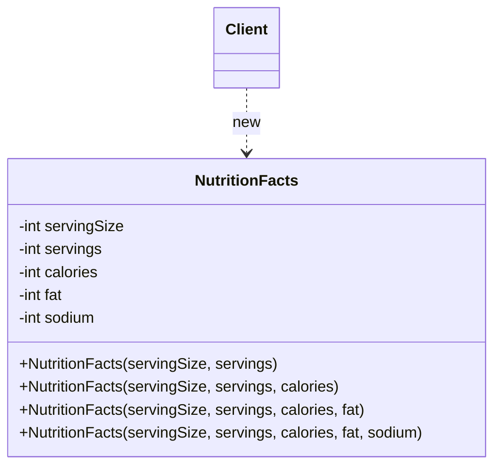

# Telescoping Constructor

## Descrição

O Telescoping Constructor é uma técnica de criação de objetos em que uma classe oferece uma sequência de construtores sobrecarregados, cada um aceitando um parâmetro a mais que o anterior. Os construtores menores delegam para os maiores, preenchendo os parâmetros ausentes com valores padrão, até chegar a um construtor "completo" que efetivamente inicializa o objeto. O nome vem da imagem de um telescópio que se estende segmento por segmento.

Não faz parte dos 23 padrões do catálogo GoF. Na literatura (com destaque para *Effective Java*, de Joshua Bloch) ele costuma ser apresentado como um **antipadrão**: funciona bem com poucos parâmetros, mas escala mal quando o número de campos opcionais cresce — as chamadas ficam difíceis de ler, a ordem dos argumentos vira armadilha e o número de construtores explode. O [Builder](/coding/gof/creational/builder) é a solução usualmente recomendada nesse cenário.

Ainda assim, a técnica tem méritos reais: produz objetos imutáveis e completamente inicializados em uma única chamada, não exige classes auxiliares e é idiomática em linguagens sem parâmetros nomeados. Para objetos com dois ou três parâmetros opcionais, ela é muitas vezes a opção mais simples e direta. Em linguagens com parâmetros nomeados e valores padrão (Kotlin, C#, Python), o problema praticamente desaparece, pois um único construtor substitui toda a cadeia.

## Problemas que resolve

- Permitir criar um objeto informando apenas os parâmetros obrigatórios, usando valores padrão para os opcionais
- Centralizar a lógica de inicialização e validação em um único construtor "completo", evitando duplicação
- Garantir que o objeto nasça em estado válido e possa ser imutável (campos `final`/`readonly`), sem setters
- Oferecer valores padrão em linguagens que não suportam parâmetros opcionais ou nomeados

## Quando usar

- A classe tem poucos parâmetros opcionais (tipicamente até três ou quatro)
- Os parâmetros opcionais têm uma ordem natural de "importância", de modo que faz sentido adicioná-los progressivamente
- Imutabilidade e inicialização atômica são desejáveis e não se quer o custo de uma classe Builder
- A linguagem não oferece parâmetros nomeados nem valores padrão

### Quando evitar

- Há muitos parâmetros opcionais, ou eles crescem com frequência — prefira o [Builder](/coding/gof/creational/builder)
- Vários parâmetros consecutivos têm o mesmo tipo (ex.: vários `int` ou `boolean`), o que facilita trocar argumentos sem erro de compilação
- O cliente precisa combinar opcionais de forma arbitrária (pular o segundo e informar o terceiro), o que a cadeia linear não permite
- A linguagem já oferece parâmetros nomeados e valores padrão, tornando a cadeia de sobrecargas desnecessária

## Trade-offs

| Ganho | Custo / Risco |
| --- | --- |
| Simples, sem classes auxiliares | Número de construtores cresce linearmente (e combinações não cobertas ficam inacessíveis) |
| Objeto imutável e válido após uma única chamada | Chamadas com muitos argumentos posicionais são difíceis de ler (`new Pizza(30, true, false, true)`) |
| Valores padrão e validação centralizados no construtor completo | Argumentos do mesmo tipo podem ser trocados silenciosamente |
| Seguro para uso concorrente (sem estado intermediário) | Adicionar um novo campo opcional exige novo construtor e altera a API pública |

- **Legibilidade:** o ponto mais criticado; IDEs com dicas de parâmetros atenuam, mas não resolvem o problema na revisão de código.
- **Manutenção:** cada novo opcional estende a cadeia; inserir um parâmetro "no meio" quebra a ordem e os clientes existentes.
- **Alternativas:** Builder (legibilidade e combinações arbitrárias), JavaBeans/setters (legível, mas perde imutabilidade e permite estados inconsistentes), static factory methods com nomes descritivos, ou parâmetros nomeados quando a linguagem permite.

## Diagrama



O `Client` instancia `NutritionFacts` escolhendo o construtor com a quantidade de argumentos de que precisa. Cada construtor menor delega (via `this(...)`) para o próximo, passando um valor padrão, até chegar ao construtor completo, que atribui todos os campos.

## Exemplo

Uma classe de informações nutricionais exige porção e número de porções, enquanto calorias, gordura e sódio são opcionais com padrão zero.

```java
public final class NutritionFacts {
    private final int servingSize; // obrigatório
    private final int servings;    // obrigatório
    private final int calories;    // opcional
    private final int fat;         // opcional
    private final int sodium;      // opcional

    public NutritionFacts(int servingSize, int servings) {
        this(servingSize, servings, 0);
    }
    public NutritionFacts(int servingSize, int servings, int calories) {
        this(servingSize, servings, calories, 0);
    }
    public NutritionFacts(int servingSize, int servings, int calories, int fat) {
        this(servingSize, servings, calories, fat, 0);
    }
    public NutritionFacts(int servingSize, int servings, int calories, int fat, int sodium) {
        if (servingSize <= 0 || servings <= 0) throw new IllegalArgumentException();
        this.servingSize = servingSize;
        this.servings = servings;
        this.calories = calories;
        this.fat = fat;
        this.sodium = sodium;
    }
}

// Uso: o que significa cada número? Trocar fat e sodium compila sem erro.
NutritionFacts cola = new NutritionFacts(240, 8, 100, 0, 35);
```

## Padrões relacionados

- [Builder](/coding/gof/creational/builder) — alternativa recomendada quando há muitos parâmetros opcionais; oferece chamadas legíveis e combinações arbitrárias mantendo a imutabilidade
- [Factory Method](/coding/gof/creational/factory-method) — métodos de criação com nomes descritivos podem substituir sobrecargas ambíguas de construtores
- [Factory](/coding/gof/creational/factory) — encapsula a escolha de valores padrão e a criação, escondendo a cadeia de construtores do cliente
- [Prototype](/coding/gof/creational/prototype) — outra forma de evitar longas listas de parâmetros: clonar um objeto pré-configurado e ajustar apenas o necessário

## Referência

- [Design Patterns Cheat Sheet](https://iretha.github.io/design-patterns/cheat-sheet)
