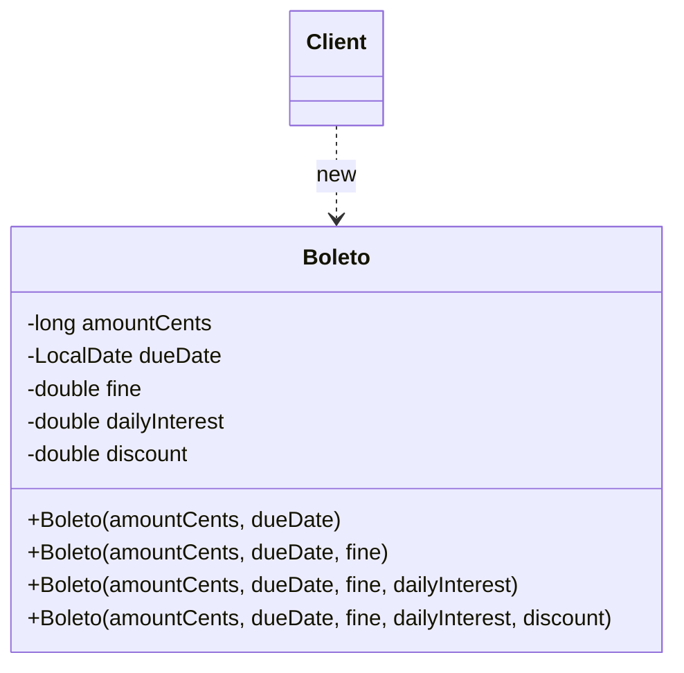

# Telescoping Constructor

## Descrição

O Telescoping Constructor é uma técnica de criação de objetos em que uma classe oferece uma sequência de construtores sobrecarregados, cada um aceitando um parâmetro a mais que o anterior. Os construtores menores delegam para os maiores, preenchendo os parâmetros ausentes com valores padrão, até chegar a um construtor "completo" que efetivamente inicializa o objeto. O nome vem da imagem de um telescópio que se estende segmento por segmento.

Não faz parte dos 23 padrões do catálogo GoF. Na literatura (com destaque para *Effective Java*, de Joshua Bloch) ele costuma ser apresentado como um **antipadrão**: funciona bem com poucos parâmetros, mas escala mal quando o número de campos opcionais cresce — as chamadas ficam difíceis de ler, a ordem dos argumentos vira armadilha e o número de construtores explode. O [Builder](/coding/gof/creational/builder) é a solução usualmente recomendada nesse cenário.

Ainda assim, a técnica tem méritos reais: produz objetos imutáveis e completamente inicializados em uma única chamada, não exige classes auxiliares e é idiomática em linguagens sem parâmetros nomeados. Para objetos com dois ou três parâmetros opcionais, ela é muitas vezes a opção mais simples e direta. Em linguagens com parâmetros nomeados e valores padrão (Kotlin, C#, Python), o problema praticamente desaparece, pois um único construtor substitui toda a cadeia.

## Problemas que resolve

- Permitir criar um objeto informando apenas os parâmetros obrigatórios, usando valores padrão para os opcionais
- Centralizar a lógica de inicialização e validação em um único construtor "completo", evitando duplicação
- Garantir que o objeto nasça em estado válido e possa ser imutável (campos `final`/`readonly`), sem setters
- Oferecer valores padrão em linguagens que não suportam parâmetros opcionais ou nomeados

## Quando usar

- A classe tem poucos parâmetros opcionais (tipicamente até três ou quatro)
- Os parâmetros opcionais têm uma ordem natural de "importância", de modo que faz sentido adicioná-los progressivamente
- Imutabilidade e inicialização atômica são desejáveis e não se quer o custo de uma classe Builder
- A linguagem não oferece parâmetros nomeados nem valores padrão

## Quando evitar

- Há muitos parâmetros opcionais, ou eles crescem com frequência — prefira o [Builder](/coding/gof/creational/builder)
- Vários parâmetros consecutivos têm o mesmo tipo (ex.: vários `int` ou `boolean`), o que facilita trocar argumentos sem erro de compilação
- O cliente precisa combinar opcionais de forma arbitrária (pular o segundo e informar o terceiro), o que a cadeia linear não permite
- A linguagem já oferece parâmetros nomeados e valores padrão, tornando a cadeia de sobrecargas desnecessária

## Trade-offs

| Ganho | Custo / Risco |
| --- | --- |
| Simples, sem classes auxiliares | Número de construtores cresce linearmente (e combinações não cobertas ficam inacessíveis) |
| Objeto imutável e válido após uma única chamada | Chamadas com muitos argumentos posicionais são difíceis de ler (`new Pizza(30, true, false, true)`) |
| Valores padrão e validação centralizados no construtor completo | Argumentos do mesmo tipo podem ser trocados silenciosamente |
| Seguro para uso concorrente (sem estado intermediário) | Adicionar um novo campo opcional exige novo construtor e altera a API pública |

- **Legibilidade:** o ponto mais criticado; IDEs com dicas de parâmetros atenuam, mas não resolvem o problema na revisão de código.
- **Manutenção:** cada novo opcional estende a cadeia; inserir um parâmetro "no meio" quebra a ordem e os clientes existentes.
- **Alternativas:** Builder (legibilidade e combinações arbitrárias), JavaBeans/setters (legível, mas perde imutabilidade e permite estados inconsistentes), static factory methods com nomes descritivos, ou parâmetros nomeados quando a linguagem permite.

## Diagrama



O `Client` instancia `Boleto` escolhendo o construtor com a quantidade de argumentos de que precisa. Cada construtor menor delega (via `this(...)`) para o próximo, passando um valor padrão, até chegar ao construtor completo, que atribui todos os campos.

## Exemplo

Um `Boleto` exige valor e vencimento, enquanto multa, juros ao dia e desconto por antecipação são opcionais, com padrão zero.

<Tabs groupId="lang" queryString>
<TabItem value="java" label="Java">

```java
public final class Boleto {
    private final long amountCents;   // obrigatório
    private final LocalDate dueDate;  // obrigatório
    private final double fine;        // opcional (taxa)
    private final double dailyInterest; // opcional (taxa ao dia)
    private final double discount;    // opcional (taxa)

    public Boleto(long amountCents, LocalDate dueDate) {
        this(amountCents, dueDate, 0);
    }
    public Boleto(long amountCents, LocalDate dueDate, double fine) {
        this(amountCents, dueDate, fine, 0);
    }
    public Boleto(long amountCents, LocalDate dueDate, double fine, double dailyInterest) {
        this(amountCents, dueDate, fine, dailyInterest, 0);
    }
    public Boleto(long amountCents, LocalDate dueDate, double fine,
                  double dailyInterest, double discount) {
        if (amountCents <= 0 || dueDate == null) throw new IllegalArgumentException();
        this.amountCents = amountCents;
        this.dueDate = dueDate;
        this.fine = fine;
        this.dailyInterest = dailyInterest;
        this.discount = discount;
    }
}

// Uso: o que significa cada número? Trocar fine e discount compila sem erro.
Boleto boleto = new Boleto(150_000, LocalDate.of(2026, 12, 10), 0.02, 0.00033, 0.05);
```

</TabItem>
<TabItem value="python" label="Python">

```python
from datetime import date

# Python não tem sobrecarga: os parâmetros com default, passados por posição, formam o mesmo telescópio.
class Boleto:
    def __init__(self, amount_cents: int, due_date: date, fine: float = 0,
                 daily_interest: float = 0, discount: float = 0) -> None:
        if amount_cents <= 0 or due_date is None:
            raise ValueError
        self.amount_cents = amount_cents      # obrigatório
        self.due_date = due_date              # obrigatório
        self.fine = fine                      # opcional (taxa)
        self.daily_interest = daily_interest  # opcional (taxa ao dia)
        self.discount = discount              # opcional (taxa)

# Uso: o que significa cada número? Trocar fine e discount não gera erro algum.
boleto = Boleto(150_000, date(2026, 12, 10), 0.02, 0.00033, 0.05)
```

</TabItem>
<TabItem value="go" label="Go">

```go
type Boleto struct {
	amountCents   int64     // obrigatório
	dueDate       time.Time // obrigatório
	fine          float64   // opcional (taxa)
	dailyInterest float64   // opcional (taxa ao dia)
	discount      float64   // opcional (taxa)
}

// Go não tem sobrecarga: o telescópio aparece como uma família de construtores.
func NewBoleto(amountCents int64, dueDate time.Time) (*Boleto, error) {
	return NewBoletoWithFine(amountCents, dueDate, 0)
}

func NewBoletoWithFine(amountCents int64, dueDate time.Time, fine float64) (*Boleto, error) {
	return NewBoletoWithInterest(amountCents, dueDate, fine, 0)
}

func NewBoletoWithInterest(amountCents int64, dueDate time.Time, fine, dailyInterest float64) (*Boleto, error) {
	return NewBoletoWithDiscount(amountCents, dueDate, fine, dailyInterest, 0)
}

func NewBoletoWithDiscount(amountCents int64, dueDate time.Time, fine, dailyInterest, discount float64) (*Boleto, error) {
	if amountCents <= 0 || dueDate.IsZero() {
		return nil, errors.New("boleto inválido")
	}
	return &Boleto{amountCents, dueDate, fine, dailyInterest, discount}, nil
}

func main() {
	// Uso: o que significa cada número? Trocar fine e discount compila sem erro.
	dueDate := time.Date(2026, 12, 10, 0, 0, 0, 0, time.UTC)
	boleto, err := NewBoletoWithDiscount(150_000, dueDate, 0.02, 0.00033, 0.05)
}
```

</TabItem>
</Tabs>

## Padrões relacionados

- [Builder](/coding/gof/creational/builder) — alternativa recomendada quando há muitos parâmetros opcionais; o `PixCharge` do exemplo do Builder resolve o mesmo problema com chamadas legíveis e combinações arbitrárias, mantendo a imutabilidade
- [Factory Method](/coding/gof/creational/factory-method) — métodos de criação com nomes descritivos podem substituir sobrecargas ambíguas de construtores
- [Factory](/coding/gof/creational/factory) — encapsula a escolha de valores padrão e a criação, escondendo a cadeia de construtores do cliente
- [Prototype](/coding/gof/creational/prototype) — outra forma de evitar longas listas de parâmetros: clonar um objeto pré-configurado e ajustar apenas o necessário

## Referência

- [Design Patterns Cheat Sheet](https://iretha.github.io/design-patterns/cheat-sheet)
