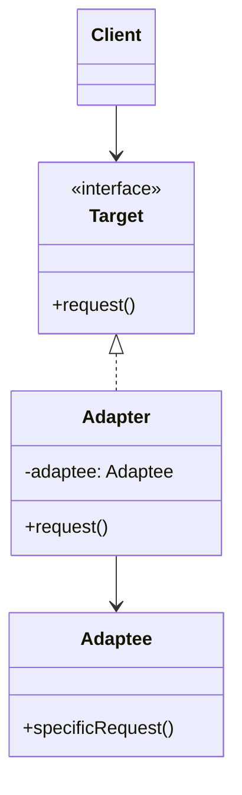

# Adapter

## Descrição

O Adapter (também conhecido como Wrapper) converte a interface de uma classe em outra interface que o cliente espera. Ele permite que classes com interfaces incompatíveis trabalhem juntas sem que nenhuma delas precise ser alterada.

O cliente conversa apenas com a interface alvo (`Target`). O adaptador implementa essa interface e, internamente, traduz cada chamada para a API do objeto adaptado (`Adaptee`), convertendo parâmetros, formatos de dados e valores de retorno quando necessário.

Existem duas variantes: o *object adapter*, que usa composição e guarda uma referência ao objeto adaptado (a forma mais comum e flexível), e o *class adapter*, que usa herança múltipla (ou herança + interface) para herdar do adaptado e implementar o alvo ao mesmo tempo.

## Problemas que resolve

- Integrar uma biblioteca de terceiros ou um sistema legado cuja interface não bate com a esperada pelo código atual.
- Reaproveitar classes existentes sem modificar seu código-fonte (que pode nem estar disponível).
- Isolar o domínio de detalhes de APIs externas, evitando que tipos e convenções de fornecedores se espalhem pela base de código.
- Permitir trocar um fornecedor (gateway de pagamento, provedor de e-mail, storage) por outro mantendo a mesma interface interna.

## Quando usar

- Você quer usar uma classe existente, mas a interface dela não corresponde à que o cliente precisa.
- Você precisa criar uma camada anticorrupção entre o seu modelo e um serviço externo ou legado.
- Várias implementações heterogêneas devem ser expostas ao cliente por uma interface única.
- Em testes, para envolver dependências externas atrás de uma interface fácil de substituir por dublês.

## Quando evitar

- Quando é possível (e barato) simplesmente alterar a interface original ou o cliente.
- Quando a diferença entre as interfaces é tão grande que o "adaptador" vira uma reimplementação inteira; nesse caso, talvez seja um Facade ou um novo serviço.
- Quando o adaptador só repassa chamadas idênticas, adicionando uma camada de indireção sem ganho real.

## Trade-offs

| Ganho | Custo / Risco |
| --- | --- |
| Reuso de código existente sem modificá-lo | Mais classes e uma camada extra de indireção |
| Respeita o princípio aberto/fechado: novos adaptadores sem tocar no cliente | Conversões de dados podem custar desempenho em chamadas muito frequentes |
| Separa a lógica de conversão da lógica de negócio (responsabilidade única) | Diferenças semânticas (erros, transações, tempos) nem sempre são adaptáveis de forma transparente |
| Facilita a troca de fornecedores e o uso de mocks em testes | Muitos adaptadores encadeados dificultam o rastreamento e a depuração |

- **Acoplamento:** o cliente depende só do `Target`; o acoplamento com o `Adaptee` fica concentrado no adaptador.
- **Testabilidade:** o adaptador pode ser testado isoladamente, e o cliente pode usar implementações falsas do `Target`.
- **Object vs. class adapter:** composição permite adaptar subclasses do adaptado e trocar a instância em tempo de execução; herança permite sobrescrever comportamento do adaptado, mas acopla mais.

## Diagrama



O `Client` depende apenas da interface `Target`. O `Adapter` implementa `Target` e delega cada chamada de `request()` para `specificRequest()` do `Adaptee`, fazendo as conversões necessárias (variante *object adapter*).

## Exemplo

A fintech usa a interface interna `PixGateway`, que trabalha com `Money` e uma chave Pix. O SDK do parceiro de liquidação, `PartnerPixClient`, recebe a chave como texto e o valor em centavos, e devolve um código de status; um adaptador faz a ponte.

<Tabs groupId="lang" queryString>
<TabItem value="java" label="Java">

```java
record Money(long cents) {}

enum PixKeyType { CPF, EMAIL, PHONE, EVP }

record PixKey(PixKeyType type, String value) {}

interface PixGateway {
    boolean send(PixKey key, Money amount);
}

// SDK do parceiro (não podemos alterar)
class PartnerPixClient {
    record Result(String status) {}

    Result transfer(String destinationKey, long amountInCents) {
        return new Result("SETTLED");
    }
}

class PartnerPixAdapter implements PixGateway {
    private final PartnerPixClient client;

    PartnerPixAdapter(PartnerPixClient client) { this.client = client; }

    public boolean send(PixKey key, Money amount) {
        PartnerPixClient.Result result = client.transfer(key.value(), amount.cents());
        return result.status().equals("SETTLED");
    }
}

// O cliente conhece apenas PixGateway
PixGateway gateway = new PartnerPixAdapter(new PartnerPixClient());
gateway.send(new PixKey(PixKeyType.EMAIL, "ana@example.com"), new Money(19_990));
```

</TabItem>
<TabItem value="python" label="Python">

```python
from dataclasses import dataclass
from typing import Protocol

@dataclass(frozen=True)
class Money:
    cents: int

@dataclass(frozen=True)
class PixKey:
    type: str  # "CPF", "EMAIL", "PHONE" ou "EVP"
    value: str

class PixGateway(Protocol):
    def send(self, key: PixKey, amount: Money) -> bool: ...

# SDK do parceiro (não podemos alterar)
class PartnerPixClient:
    def transfer(self, destination_key: str, amount_in_cents: int) -> dict:
        return {"status": "SETTLED"}

class PartnerPixAdapter:
    def __init__(self, client: PartnerPixClient) -> None:
        self._client = client

    def send(self, key: PixKey, amount: Money) -> bool:
        result = self._client.transfer(key.value, amount.cents)
        return result["status"] == "SETTLED"

# O cliente conhece apenas PixGateway
gateway: PixGateway = PartnerPixAdapter(PartnerPixClient())
gateway.send(PixKey("EMAIL", "ana@example.com"), Money(19_990))
```

</TabItem>
<TabItem value="go" label="Go">

```go
type Money struct{ Cents int64 }

type PixKey struct {
	Type  string // "CPF", "EMAIL", "PHONE" ou "EVP"
	Value string
}

type PixGateway interface {
	Send(key PixKey, amount Money) bool
}

// SDK do parceiro (não podemos alterar)
type PartnerPixClient struct{}

type PartnerResult struct{ Status string }

func (PartnerPixClient) Transfer(destinationKey string, amountInCents int64) PartnerResult {
	return PartnerResult{Status: "SETTLED"}
}

type PartnerPixAdapter struct {
	client PartnerPixClient
}

func (a PartnerPixAdapter) Send(key PixKey, amount Money) bool {
	result := a.client.Transfer(key.Value, amount.Cents)
	return result.Status == "SETTLED"
}

func main() {
	// O cliente conhece apenas PixGateway
	var gateway PixGateway = PartnerPixAdapter{client: PartnerPixClient{}}
	gateway.Send(PixKey{"EMAIL", "ana@example.com"}, Money{19_990})
}
```

</TabItem>
<TabItem value="typescript" label="TypeScript">

```typescript
interface Money {
  cents: number;
}

interface PixKey {
  type: "CPF" | "EMAIL" | "PHONE" | "EVP";
  value: string;
}

interface PixGateway {
  send(key: PixKey, amount: Money): boolean;
}

// SDK do parceiro (não podemos alterar)
class PartnerPixClient {
  transfer(destinationKey: string, amountInCents: number): { status: string } {
    return { status: "SETTLED" };
  }
}

class PartnerPixAdapter implements PixGateway {
  constructor(private readonly client: PartnerPixClient) {}

  send(key: PixKey, amount: Money): boolean {
    const result = this.client.transfer(key.value, amount.cents);
    return result.status === "SETTLED";
  }
}

// O cliente conhece apenas PixGateway
const gateway: PixGateway = new PartnerPixAdapter(new PartnerPixClient());
gateway.send({ type: "EMAIL", value: "ana@example.com" }, { cents: 19_990 });
```

</TabItem>
</Tabs>

## Padrões relacionados

- [Bridge](/coding/gof/structural/bridge) — tem estrutura parecida, mas é projetado de antemão para separar abstração e implementação; o Adapter é aplicado depois, para fazer interfaces existentes conversarem.
- [Decorator](/coding/gof/structural/decorator) — também envolve um objeto, mas mantém a mesma interface e adiciona comportamento, enquanto o Adapter muda a interface.
- [Proxy](/coding/gof/structural/proxy) — envolve um objeto oferecendo a mesma interface para controlar o acesso; o Adapter oferece uma interface diferente.
- [Facade](/coding/gof/structural/facade) — define uma interface nova e simplificada para um subsistema inteiro; o Adapter reaproveita uma interface existente para um único objeto.

## Referência

- [Design Patterns Cheat Sheet](https://iretha.github.io/design-patterns/cheat-sheet)
- [Adapter no Refactoring.Guru](https://refactoring.guru/design-patterns/adapter)
