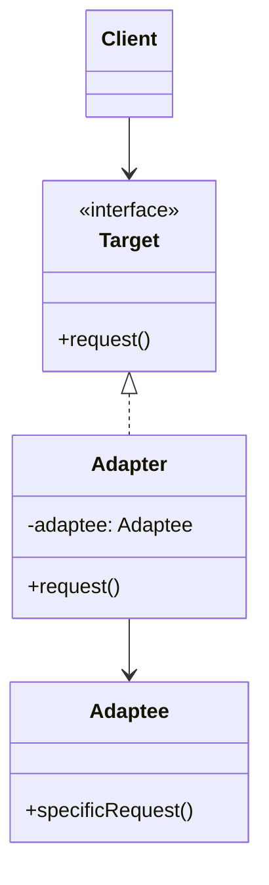

# Adapter

## Descrição

O Adapter (também conhecido como Wrapper) converte a interface de uma classe em outra interface que o cliente espera. Ele permite que classes com interfaces incompatíveis trabalhem juntas sem que nenhuma delas precise ser alterada.

O cliente conversa apenas com a interface alvo (`Target`). O adaptador implementa essa interface e, internamente, traduz cada chamada para a API do objeto adaptado (`Adaptee`), convertendo parâmetros, formatos de dados e valores de retorno quando necessário.

Existem duas variantes: o *object adapter*, que usa composição e guarda uma referência ao objeto adaptado (a forma mais comum e flexível), e o *class adapter*, que usa herança múltipla (ou herança + interface) para herdar do adaptado e implementar o alvo ao mesmo tempo.

## Problemas que resolve

- Integrar uma biblioteca de terceiros ou um sistema legado cuja interface não bate com a esperada pelo código atual.
- Reaproveitar classes existentes sem modificar seu código-fonte (que pode nem estar disponível).
- Isolar o domínio de detalhes de APIs externas, evitando que tipos e convenções de fornecedores se espalhem pela base de código.
- Permitir trocar um fornecedor (gateway de pagamento, provedor de e-mail, storage) por outro mantendo a mesma interface interna.

## Quando usar

- Você quer usar uma classe existente, mas a interface dela não corresponde à que o cliente precisa.
- Você precisa criar uma camada anticorrupção entre o seu modelo e um serviço externo ou legado.
- Várias implementações heterogêneas devem ser expostas ao cliente por uma interface única.
- Em testes, para envolver dependências externas atrás de uma interface fácil de substituir por dublês.

## Quando evitar

- Quando é possível (e barato) simplesmente alterar a interface original ou o cliente.
- Quando a diferença entre as interfaces é tão grande que o "adaptador" vira uma reimplementação inteira; nesse caso, talvez seja um Facade ou um novo serviço.
- Quando o adaptador só repassa chamadas idênticas, adicionando uma camada de indireção sem ganho real.

## Trade-offs

| Ganho | Custo / Risco |
| --- | --- |
| Reuso de código existente sem modificá-lo | Mais classes e uma camada extra de indireção |
| Respeita o princípio aberto/fechado: novos adaptadores sem tocar no cliente | Conversões de dados podem custar desempenho em chamadas muito frequentes |
| Separa a lógica de conversão da lógica de negócio (responsabilidade única) | Diferenças semânticas (erros, transações, tempos) nem sempre são adaptáveis de forma transparente |
| Facilita a troca de fornecedores e o uso de mocks em testes | Muitos adaptadores encadeados dificultam o rastreamento e a depuração |

- **Acoplamento:** o cliente depende só do `Target`; o acoplamento com o `Adaptee` fica concentrado no adaptador.
- **Testabilidade:** o adaptador pode ser testado isoladamente, e o cliente pode usar implementações falsas do `Target`.
- **Object vs. class adapter:** composição permite adaptar subclasses do adaptado e trocar a instância em tempo de execução; herança permite sobrescrever comportamento do adaptado, mas acopla mais.

## Diagrama



O `Client` depende apenas da interface `Target`. O `Adapter` implementa `Target` e delega cada chamada de `request()` para `specificRequest()` do `Adaptee`, fazendo as conversões necessárias (variante *object adapter*).

## Exemplo

Uma loja usa a interface interna `PaymentGateway`, que trabalha com valores em reais (decimal). O novo provedor `AcmePayClient` expõe um SDK que recebe centavos e retorna um código de status; um adaptador faz a ponte.

```typescript
interface PaymentGateway {
  pay(orderId: string, amount: number): boolean;
}

// SDK de terceiros (não podemos alterar)
class AcmePayClient {
  charge(reference: string, amountInCents: number): { status: string } {
    return { status: "APPROVED" };
  }
}

class AcmePayAdapter implements PaymentGateway {
  constructor(private readonly client: AcmePayClient) {}

  pay(orderId: string, amount: number): boolean {
    const cents = Math.round(amount * 100);
    const result = this.client.charge(orderId, cents);
    return result.status === "APPROVED";
  }
}

// Cliente conhece apenas PaymentGateway
const gateway: PaymentGateway = new AcmePayAdapter(new AcmePayClient());
gateway.pay("order-42", 199.9);
```

## Padrões relacionados

- [Bridge](/coding/gof/structural/bridge) — tem estrutura parecida, mas é projetado de antemão para separar abstração e implementação; o Adapter é aplicado depois, para fazer interfaces existentes conversarem.
- [Decorator](/coding/gof/structural/decorator) — também envolve um objeto, mas mantém a mesma interface e adiciona comportamento, enquanto o Adapter muda a interface.
- [Proxy](/coding/gof/structural/proxy) — envolve um objeto oferecendo a mesma interface para controlar o acesso; o Adapter oferece uma interface diferente.
- [Facade](/coding/gof/structural/facade) — define uma interface nova e simplificada para um subsistema inteiro; o Adapter reaproveita uma interface existente para um único objeto.

## Referência

- [Design Patterns Cheat Sheet](https://iretha.github.io/design-patterns/cheat-sheet)
- [Adapter no Refactoring.Guru](https://refactoring.guru/design-patterns/adapter)
